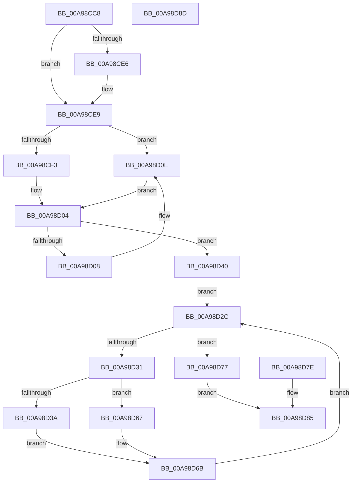

# PspGetStandardHandleList

- RVA: `0x00A98CC8`–`0x00A98D8E` (길이 `198` bytes)
- VA: `0x0000000140A98CC8`
- 실행 섹션: `PAGE`
- PDB 이름 있음: `예`; PDB Function 태그: `아니요`
- unwind 정보 RVA: `0x000BA0CC`
- 디코드: `57`개 명령, `198/198` bytes 표시
- 미해석 바이트: `0` (있으면 어셈블리에 `.byte`로 보존)

> 이 문서는 커널 이미지의 기계어와 PDB 기호를 분석해 생성했습니다. 4번과 5번은 함수 원형과 자료형을 바이너리 사용 방식에서 추정한 C 해석이며 원본 소스 복구 결과는 아닙니다.

## 1. Dependencies

- 직접 호출 지점: **1**; 고유 호출 대상: **1**
- 직접 호출자로 확인된 함수: **1**
- RIP 상대 이미지 참조: **0**

### Outgoing calls
- `0x00A98D08` → [ExRaiseDatatypeMisalignment](../89/ExRaiseDatatypeMisalignment_function_00899FD0.md) (function, `0x00899FD0`)

### Direct callers
- [PspSetupUserProcessAddressSpace](../AE/PspSetupUserProcessAddressSpace_function_00AEBDC8.md) at `0x00AEBE55`

### Static image references
- 디코드된 RIP-relative 메모리 참조가 없습니다.

## 2. Other-region calls and transfers

- 다른 실행 섹션으로 향하는 call: **0**
- 별도 외부 분기/꼬리 이동을 확인하지 못했습니다.

## 3. Assembly (complete function range)

```asm
00A98CC8  48 83 EC 48                     sub rsp, 0x48
00A98CCC  4C 8B D2                        mov r10, rdx
00A98CCF  45 33 C0                        xor r8d, r8d
00A98CD2  4C 89 44 24 30                  mov qword ptr [rsp + 0x30], r8
00A98CD7  41 8B C0                        mov eax, r8d
00A98CDA  4C 8B 89 10 03 00 00            mov r9, qword ptr [rcx + 0x310]
00A98CE1  4D 85 C9                        test r9, r9
00A98CE4  74 03                           je 0x140a98ce9
00A98CE6  49 8B 01                        mov rax, qword ptr [r9]
00A98CE9  48 89 44 24 68                  mov qword ptr [rsp + 0x68], rax
00A98CEE  48 85 C0                        test rax, rax
00A98CF1  74 1B                           je 0x140a98d0e
00A98CF3  8B 40 10                        mov eax, dword ptr [rax + 0x10]
00A98CF6  4C 89 44 24 28                  mov qword ptr [rsp + 0x28], r8
00A98CFB  48 83 C0 18                     add rax, 0x18
00A98CFF  48 89 44 24 30                  mov qword ptr [rsp + 0x30], rax
00A98D04  A8 03                           test al, 3
00A98D06  74 38                           je 0x140a98d40
00A98D08  E8 C3 12 E0 FF                  call 0x140899fd0
00A98D0D  CC                              int3
00A98D0E  48 8B 81 E0 02 00 00            mov rax, qword ptr [rcx + 0x2e0]
00A98D15  48 8B 48 20                     mov rcx, qword ptr [rax + 0x20]
00A98D19  48 89 4C 24 60                  mov qword ptr [rsp + 0x60], rcx
00A98D1E  48 8B C1                        mov rax, rcx
00A98D21  48 83 C0 20                     add rax, 0x20
00A98D25  48 89 44 24 28                  mov qword ptr [rsp + 0x28], rax
00A98D2A  EB D8                           jmp 0x140a98d04
00A98D2C  83 F9 03                        cmp ecx, 3
00A98D2F  73 46                           jae 0x140a98d77
00A98D31  8B D1                           mov edx, ecx
00A98D33  4C 39 44 24 68                  cmp qword ptr [rsp + 0x68], r8
00A98D38  74 2D                           je 0x140a98d67
00A98D3A  41 8B 04 93                     mov eax, dword ptr [r11 + rdx*4]
00A98D3E  EB 2B                           jmp 0x140a98d6b
00A98D40  48 B9 00 00 FF FF FF 7F 00 00   movabs rcx, 0x7fffffff0000
00A98D4A  48 3B C1                        cmp rax, rcx
00A98D4D  48 0F 43 C1                     cmovae rax, rcx
00A98D51  90                              nop
00A98D52  8A 00                           mov al, byte ptr [rax]
00A98D54  41 8B C8                        mov ecx, r8d
00A98D57  89 4C 24 20                     mov dword ptr [rsp + 0x20], ecx
00A98D5B  4C 8B 4C 24 28                  mov r9, qword ptr [rsp + 0x28]
00A98D60  4C 8B 5C 24 30                  mov r11, qword ptr [rsp + 0x30]
00A98D65  EB C5                           jmp 0x140a98d2c
00A98D67  49 8B 04 D1                     mov rax, qword ptr [r9 + rdx*8]
00A98D6B  49 89 04 D2                     mov qword ptr [r10 + rdx*8], rax
00A98D6F  FF C1                           inc ecx
00A98D71  89 4C 24 20                     mov dword ptr [rsp + 0x20], ecx
00A98D75  EB B5                           jmp 0x140a98d2c
00A98D77  44 89 44 24 24                  mov dword ptr [rsp + 0x24], r8d
00A98D7C  EB 07                           jmp 0x140a98d85
00A98D7E  44 8B C0                        mov r8d, eax
00A98D81  89 44 24 24                     mov dword ptr [rsp + 0x24], eax
00A98D85  41 8B C0                        mov eax, r8d
00A98D88  48 83 C4 48                     add rsp, 0x48
00A98D8C  C3                              ret
00A98D8D  CC                              int3
```

## 4. C-style interpretation (structured pseudocode)

```c
__int64 __fastcall PspGetStandardHandleList(__int64 a1, __int64 a2, int a3)
{
    __int64 result;
    __int64 v_rsp;
    unsigned __int64 v_stack_m18;
    unsigned __int64 v_stack_m20;
    unsigned int v_stack_m24;
    unsigned int v_stack_m28;
    unsigned __int64 v_stack_p18;
    unsigned __int64 v_stack_p20;

    v_rsp = (v_rsp) - (72);
    a3 = 0;
    v_stack_m18 = 0;
    result = 0;
    if (*(unsigned __int64 *)(a1 + 784) != 0) {
        result = *(unsigned __int64 *)(*(unsigned __int64 *)(a1 + 784));
    }
    v_stack_p20 = result;
    if (result == 0) goto loc_00A98D0E;
    v_stack_m20 = 0;
    result = ((unsigned int)(*(unsigned int *)(result + 16))) + (24);
    v_stack_m18 = result;
loc_00A98D04:
    if ((((unsigned __int8)(result)) & (3)) == 0) goto loc_00A98D40;
    result = ExRaiseDatatypeMisalignment(a1, a2, a3, *(unsigned __int64 *)(a1 + 784));
loc_00A98D0E:
    v_stack_p18 = *(unsigned __int64 *)(*(unsigned __int64 *)(a1 + 736) + 32);
    result = (*(unsigned __int64 *)(*(unsigned __int64 *)(a1 + 736) + 32)) + (32);
    v_stack_m20 = result;
    goto loc_00A98D04;
loc_00A98D2C:
    if (((unsigned int)(*(unsigned __int64 *)(*(unsigned __int64 *)(a1 + 736) + 32))) >= 3) goto loc_00A98D77;
    if (v_stack_p20 == 0) goto loc_00A98D67;
    goto loc_00A98D6B;
loc_00A98D40:
    result = (unsigned int)(*(unsigned int *)(v_r11 + (unsigned int)((unsigned int)(*(unsigned __int64 *)(*(unsigned __int64 *)(a1 + 736) + 32))) * 4));
    if (((unsigned int)(*(unsigned int *)(v_r11 + (unsigned int)((unsigned int)(*(unsigned __int64 *)(*(unsigned __int64 *)(a1 + 736) + 32))) * 4))) >= (*(unsigned __int64 *)(*(unsigned __int64 *)(a1 + 736) + 32))) { result = *(unsigned __int64 *)(*(unsigned __int64 *)(a1 + 736) + 32); }
    v_stack_m28 = 0;
    goto loc_00A98D2C;
loc_00A98D67:
loc_00A98D6B:
    *(unsigned __int64 *)(a2 + (unsigned int)((unsigned int)(*(unsigned __int64 *)(*(unsigned __int64 *)(a1 + 736) + 32))) * 8) = *(unsigned __int64 *)(v_stack_m20 + (unsigned int)((unsigned int)(*(unsigned __int64 *)(*(unsigned __int64 *)(a1 + 736) + 32))) * 8);
    a1 = (unsigned int)((0) + 1);
    v_stack_m28 = (unsigned int)(a1);
    goto loc_00A98D2C;
loc_00A98D77:
    v_stack_m24 = 0;
    goto loc_00A98D85;
loc_00A98D85:
    v_rsp = (v_rsp) + (72);
    return 0;
}
```

## 5. (Beta) C Style

```c
int64_t PspGetStandardHandleList(void *Arg1, int64_t Arg2, int32_t Arg3)
{
    uint8_t *arg1 = (uint8_t *)Arg1;

    int64_t result;
    int64_t local_rsp;
    uint64_t v_stack_m18;
    uint64_t v_stack_m20;
    uint32_t v_stack_m24;
    uint32_t v_stack_m28;
    uint64_t v_stack_p18;
    uint64_t v_stack_p20;

    local_rsp = (local_rsp) - (72);
    Arg3 = 0;
    v_stack_m18 = 0;
    result = 0;
    if (*(uint64_t *)(arg1 + 0x310) != 0) {
        result = *(uint64_t *)(*(uint64_t *)(arg1 + 0x310));
    }
    v_stack_p20 = result;
    if (result == 0) goto loc_00A98D0E;
    v_stack_m20 = 0;
    result = ((uint32_t)(*(uint32_t *)(result + 0x10))) + (24);
    v_stack_m18 = result;
loc_00A98D04:
    if ((((uint8_t)(result)) & (3)) == 0) goto loc_00A98D40;
    result = ExRaiseDatatypeMisalignment(Arg1, Arg2, Arg3, *(uint64_t *)(arg1 + 0x310));
loc_00A98D0E:
    v_stack_p18 = *(uint64_t *)(*(uint64_t *)(arg1 + 0x2E0) + 0x20);
    result = (*(uint64_t *)(*(uint64_t *)(arg1 + 0x2E0) + 0x20)) + (32);
    v_stack_m20 = result;
    goto loc_00A98D04;
loc_00A98D2C:
    if (((uint32_t)(*(uint64_t *)(*(uint64_t *)(arg1 + 0x2E0) + 0x20))) >= 3) goto loc_00A98D77;
    if (v_stack_p20 == 0) goto loc_00A98D67;
    goto loc_00A98D6B;
loc_00A98D40:
    result = (uint32_t)(*(uint32_t *)(local_r11 + (uint32_t)((uint32_t)(*(uint64_t *)(*(uint64_t *)(arg1 + 0x2E0) + 0x20))) * 4));
    if (((uint32_t)(*(uint32_t *)(local_r11 + (uint32_t)((uint32_t)(*(uint64_t *)(*(uint64_t *)(arg1 + 0x2E0) + 0x20))) * 4))) >= (*(uint64_t *)(*(uint64_t *)(arg1 + 0x2E0) + 0x20))) { result = *(uint64_t *)(*(uint64_t *)(arg1 + 0x2E0) + 0x20); }
    v_stack_m28 = 0;
    goto loc_00A98D2C;
loc_00A98D67:
loc_00A98D6B:
    *(uint64_t *)(Arg2 + (uint32_t)((uint32_t)(*(uint64_t *)(*(uint64_t *)(arg1 + 0x2E0) + 0x20))) * 8) = *(uint64_t *)(v_stack_m20 + (uint32_t)((uint32_t)(*(uint64_t *)(*(uint64_t *)(arg1 + 0x2E0) + 0x20))) * 8);
    Arg1 = (uint32_t)((0) + 1);
    v_stack_m28 = (uint32_t)(Arg1);
    goto loc_00A98D2C;
loc_00A98D77:
    v_stack_m24 = 0;
    goto loc_00A98D85;
loc_00A98D85:
    local_rsp = (local_rsp) + (72);
    return 0;
}
```

### 관측된 메모리 오프셋

구조체 형식이 확인되지 않은 접근은 인자 기준의 오프셋으로만 기록했습니다.

| 기준 인자 | 오프셋 표현 | 폭 (bit) | 접근 |
|---|---:|---:|---|
| `Arg1` | `+ 0x310` | `64` | `R` |

## 6. Execution-region graph

[열기: 2D/3D 그래프와 함수 탐색 컨트롤 패널](../../../control-panel.html?section=page&rva=0x00A98CC8&view=graph)

- 2D 그래프는 위에서 아래로 흐르고, 3D 그래프는 빈 공간을 드래그해 회전합니다. Shift+드래그는 이동, 휠은 확대·축소, 함수 노드 선택은 대상 보고서 이동입니다.

### Static fallback


