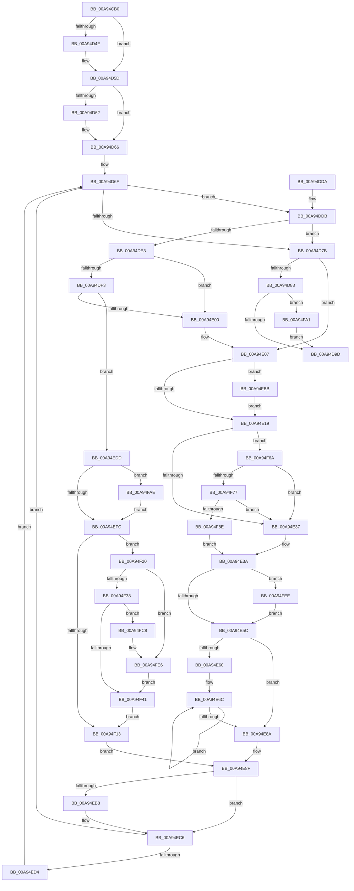

# PspPostFreezeOperationWorker

- RVA: `0x00A94CB0`–`0x00A95007` (길이 `855` bytes)
- VA: `0x0000000140A94CB0`
- 실행 섹션: `PAGE`
- PDB 이름 있음: `예`; PDB Function 태그: `아니요`
- unwind 정보 RVA: `0x000B9638`
- 디코드: `208`개 명령, `855/855` bytes 표시
- 미해석 바이트: `0` (있으면 어셈블리에 `.byte`로 보존)

> 이 문서는 커널 이미지의 기계어와 PDB 기호를 분석해 생성했습니다. 4번과 5번은 함수 원형과 자료형을 바이너리 사용 방식에서 추정한 C 해석이며 원본 소스 복구 결과는 아닙니다.

## 1. Dependencies

- 직접 호출 지점: **25**; 고유 호출 대상: **15**
- 직접 호출자로 확인된 함수: **0**
- RIP 상대 이미지 참조: **5**

### Outgoing calls
- `0x00A94CFE` → [memset](../../text/6C/memset_function_006C6C40.md) (function, `0x006C6C40`)
- `0x00A94D10` → [memset](../../text/6C/memset_function_006C6C40.md) (function, `0x006C6C40`)
- `0x00A94D3F` → [KeAbPreAcquire](../../text/21/KeAbPreAcquire_function_00210230.md) (function, `0x00210230`)
- `0x00A94D58` → [ExfAcquirePushLockExclusiveEx](../../text/20/ExfAcquirePushLockExclusiveEx_function_0020FC90.md) (function, `0x0020FC90`)
- `0x00A94DA0` → [KeAbPostRelease](../../text/2E/KeAbPostRelease_function_002E1600.md) (function, `0x002E1600`)
- `0x00A94DA5` → [KeLeaveCriticalRegion](../../text/25/KeLeaveCriticalRegion_function_0025D8B0.md) (function, `0x0025D8B0`)
- `0x00A94DB4` → [_security_check_cookie](../../text/6A/_security_check_cookie_function_006AC640.md) (function, `0x006AC640`)
- `0x00A94E1C` → [KeAbPostRelease](../../text/2E/KeAbPostRelease_function_002E1600.md) (function, `0x002E1600`)
- `0x00A94E21` → [KeLeaveCriticalRegion](../../text/25/KeLeaveCriticalRegion_function_0025D8B0.md) (function, `0x0025D8B0`)
- `0x00A94E47` → `ext-ms-win-ntos-win32k-l1-1-0.dll!Win32kProcessFreezeChangeNotify` (import, 간접 대상; import `ext-ms-win-ntos-win32k-l1-1-0.dll!Win32kProcessFreezeChangeNotify`)
- `0x00A94E6F` → [ObfDereferenceObject](../../text/2F/ObfDereferenceObject_function_002F9350.md) (function, `0x002F9350`)
- `0x00A94EA8` → [KeAbPreAcquire](../../text/21/KeAbPreAcquire_function_00210230.md) (function, `0x00210230`)
- `0x00A94EC1` → [ExfAcquirePushLockExclusiveEx](../../text/20/ExfAcquirePushLockExclusiveEx_function_0020FC90.md) (function, `0x0020FC90`)
- `0x00A94EFF` → [KeAbPostRelease](../../text/2E/KeAbPostRelease_function_002E1600.md) (function, `0x002E1600`)
- `0x00A94F04` → [KeLeaveCriticalRegion](../../text/25/KeLeaveCriticalRegion_function_0025D8B0.md) (function, `0x0025D8B0`)
- `0x00A94F16` → [ObfDereferenceObject](../../text/2F/ObfDereferenceObject_function_002F9350.md) (function, `0x002F9350`)
- `0x00A94F23` → [PsGetProcessSessionIdEx](../../text/22/PsGetProcessSessionIdEx_function_0022F8F0.md) (function, `0x0022F8F0`)
- `0x00A94F44` → [ObfReferenceObject](../../text/20/ObfReferenceObject_function_0020FA20.md) (function, `0x0020FA20`)
- `0x00A94F57` → [PsGetProcessId](../../text/43/PsGetProcessId_function_0043D910.md) (function, `0x0043D910`)
- `0x00A94F97` → [EtwTraceWin32kFreezeChangeNotifyStart](../7B/EtwTraceWin32kFreezeChangeNotifyStart_function_007B8410.md) (function, `0x007B8410`)
- `0x00A94FA4` → [ExfTryToWakePushLock](../../text/26/ExfTryToWakePushLock_function_00265DD0.md) (function, `0x00265DD0`)
- `0x00A94FB1` → [ExfTryToWakePushLock](../../text/26/ExfTryToWakePushLock_function_00265DD0.md) (function, `0x00265DD0`)
- `0x00A94FBE` → [ExfTryToWakePushLock](../../text/26/ExfTryToWakePushLock_function_00265DD0.md) (function, `0x00265DD0`)
- `0x00A94FDC` → [PspWin32kProcessFreezeNotify](../AA/PspWin32kProcessFreezeNotify_function_00AA3A88.md) (function, `0x00AA3A88`)
- `0x00A94FFD` → [EtwTraceWin32kFreezeChangeNotifyStop](../7B/EtwTraceWin32kFreezeChangeNotifyStop_function_007B84CC.md) (function, `0x007B84CC`)

### Direct callers
- 이 함수 시작 RVA로 연결되는 직접 call은 확인되지 않았습니다. 간접 호출은 완전히 역산할 수 없습니다.

### Static image references
- `0x00A94CD6` → RVA `0x00E0A740` (`.data`; read)
- `0x00A94E26` → RVA `0x00E091A0` (`.data`; read)
- `0x00A94E47` → RVA `0x00151688` (`ext-ms-win-ntos-win32k-l1-1-0.dll!Win32kProcessFreezeChangeNotify (IAT)`; read)
- `0x00A94F6A` → RVA `0x00E091B0` (`.data`; read)
- `0x00A94F77` → RVA `0x00E091B8` (`.data`; read)

## 2. Other-region calls and transfers

- 다른 실행 섹션으로 향하는 call: **21**
  - `0x00A94CFE` → [memset](../../text/6C/memset_function_006C6C40.md) (`PAGE` → `.text`)
  - `0x00A94D10` → [memset](../../text/6C/memset_function_006C6C40.md) (`PAGE` → `.text`)
  - `0x00A94D3F` → [KeAbPreAcquire](../../text/21/KeAbPreAcquire_function_00210230.md) (`PAGE` → `.text`)
  - `0x00A94D58` → [ExfAcquirePushLockExclusiveEx](../../text/20/ExfAcquirePushLockExclusiveEx_function_0020FC90.md) (`PAGE` → `.text`)
  - `0x00A94DA0` → [KeAbPostRelease](../../text/2E/KeAbPostRelease_function_002E1600.md) (`PAGE` → `.text`)
  - `0x00A94DA5` → [KeLeaveCriticalRegion](../../text/25/KeLeaveCriticalRegion_function_0025D8B0.md) (`PAGE` → `.text`)
  - `0x00A94DB4` → [_security_check_cookie](../../text/6A/_security_check_cookie_function_006AC640.md) (`PAGE` → `.text`)
  - `0x00A94E1C` → [KeAbPostRelease](../../text/2E/KeAbPostRelease_function_002E1600.md) (`PAGE` → `.text`)
  - `0x00A94E21` → [KeLeaveCriticalRegion](../../text/25/KeLeaveCriticalRegion_function_0025D8B0.md) (`PAGE` → `.text`)
  - `0x00A94E6F` → [ObfDereferenceObject](../../text/2F/ObfDereferenceObject_function_002F9350.md) (`PAGE` → `.text`)
  - `0x00A94EA8` → [KeAbPreAcquire](../../text/21/KeAbPreAcquire_function_00210230.md) (`PAGE` → `.text`)
  - `0x00A94EC1` → [ExfAcquirePushLockExclusiveEx](../../text/20/ExfAcquirePushLockExclusiveEx_function_0020FC90.md) (`PAGE` → `.text`)
  - `0x00A94EFF` → [KeAbPostRelease](../../text/2E/KeAbPostRelease_function_002E1600.md) (`PAGE` → `.text`)
  - `0x00A94F04` → [KeLeaveCriticalRegion](../../text/25/KeLeaveCriticalRegion_function_0025D8B0.md) (`PAGE` → `.text`)
  - `0x00A94F16` → [ObfDereferenceObject](../../text/2F/ObfDereferenceObject_function_002F9350.md) (`PAGE` → `.text`)
  - `0x00A94F23` → [PsGetProcessSessionIdEx](../../text/22/PsGetProcessSessionIdEx_function_0022F8F0.md) (`PAGE` → `.text`)
  - `0x00A94F44` → [ObfReferenceObject](../../text/20/ObfReferenceObject_function_0020FA20.md) (`PAGE` → `.text`)
  - `0x00A94F57` → [PsGetProcessId](../../text/43/PsGetProcessId_function_0043D910.md) (`PAGE` → `.text`)
  - `0x00A94FA4` → [ExfTryToWakePushLock](../../text/26/ExfTryToWakePushLock_function_00265DD0.md) (`PAGE` → `.text`)
  - `0x00A94FB1` → [ExfTryToWakePushLock](../../text/26/ExfTryToWakePushLock_function_00265DD0.md) (`PAGE` → `.text`)
  - `0x00A94FBE` → [ExfTryToWakePushLock](../../text/26/ExfTryToWakePushLock_function_00265DD0.md) (`PAGE` → `.text`)
- 별도 외부 분기/꼬리 이동을 확인하지 못했습니다.

## 3. Assembly (complete function range)

```asm
00A94CB0  48 8B C4                        mov rax, rsp
00A94CB3  48 89 58 10                     mov qword ptr [rax + 0x10], rbx
00A94CB7  48 89 70 18                     mov qword ptr [rax + 0x18], rsi
00A94CBB  48 89 78 20                     mov qword ptr [rax + 0x20], rdi
00A94CBF  55                              push rbp
00A94CC0  41 54                           push r12
00A94CC2  41 55                           push r13
00A94CC4  41 56                           push r14
00A94CC6  41 57                           push r15
00A94CC8  48 8D A8 88 FA FF FF            lea rbp, [rax - 0x578]
00A94CCF  48 81 EC 50 06 00 00            sub rsp, 0x650
00A94CD6  48 8B 05 63 5A 37 00            mov rax, qword ptr [rip + 0x375a63]
00A94CDD  48 33 C4                        xor rax, rsp
00A94CE0  48 89 85 40 05 00 00            mov qword ptr [rbp + 0x540], rax
00A94CE7  4C 8B F1                        mov r14, rcx
00A94CEA  48 89 4C 24 30                  mov qword ptr [rsp + 0x30], rcx
00A94CEF  48 8D 8D 40 01 00 00            lea rcx, [rbp + 0x140]
00A94CF6  33 D2                           xor edx, edx
00A94CF8  41 B8 00 04 00 00               mov r8d, 0x400
00A94CFE  E8 3D 1F C3 FF                  call 0x1406c6c40
00A94D03  33 D2                           xor edx, edx
00A94D05  48 8D 4C 24 40                  lea rcx, [rsp + 0x40]
00A94D0A  41 B8 00 02 00 00               mov r8d, 0x200
00A94D10  E8 2B 1F C3 FF                  call 0x1406c6c40
00A94D15  65 48 8B 04 25 88 01 00 00      mov rax, qword ptr gs:[0x188]
00A94D1E  49 8D 76 08                     lea rsi, [r14 + 8]
00A94D22  83 64 24 20 00                  and dword ptr [rsp + 0x20], 0
00A94D27  48 83 CB FF                     or rbx, 0xffffffffffffffff
00A94D2B  45 33 C0                        xor r8d, r8d
00A94D2E  33 D2                           xor edx, edx
00A94D30  48 8B CE                        mov rcx, rsi
00A94D33  41 83 CC FF                     or r12d, 0xffffffff
00A94D37  66 01 98 E4 01 00 00            add word ptr [rax + 0x1e4], bx
00A94D3E  90                              nop
00A94D3F  E8 EC B4 77 FF                  call 0x140210230
00A94D44  F0 48 0F BA 2E 00               lock bts qword ptr [rsi], 0
00A94D4A  48 8B F8                        mov rdi, rax
00A94D4D  73 0E                           jae 0x140a94d5d
00A94D4F  4C 8B C6                        mov r8, rsi
00A94D52  48 8B D0                        mov rdx, rax
00A94D55  48 8B CE                        mov rcx, rsi
00A94D58  E8 33 AF 77 FF                  call 0x14020fc90
00A94D5D  48 85 FF                        test rdi, rdi
00A94D60  74 04                           je 0x140a94d66
00A94D62  C6 47 0A 01                     mov byte ptr [rdi + 0xa], 1
00A94D66  49 8D 56 10                     lea rdx, [r14 + 0x10]
00A94D6A  48 89 54 24 28                  mov qword ptr [rsp + 0x28], rdx
00A94D6F  48 8B 02                        mov rax, qword ptr [rdx]
00A94D72  8B 4C 24 20                     mov ecx, dword ptr [rsp + 0x20]
00A94D76  48 3B C2                        cmp rax, rdx
00A94D79  75 60                           jne 0x140a94ddb
00A94D7B  85 C9                           test ecx, ecx
00A94D7D  0F 85 84 00 00 00               jne 0x140a94e07
00A94D83  48 8B 44 24 30                  mov rax, qword ptr [rsp + 0x30]
00A94D88  48 83 20 FE                     and qword ptr [rax], 0xfffffffffffffffe
00A94D8C  F0 48 0F C1 1E                  lock xadd qword ptr [rsi], rbx
00A94D91  80 E3 06                        and bl, 6
00A94D94  80 FB 02                        cmp bl, 2
00A94D97  0F 84 04 02 00 00               je 0x140a94fa1
00A94D9D  48 8B CE                        mov rcx, rsi
00A94DA0  E8 5B C8 84 FF                  call 0x1402e1600
00A94DA5  E8 06 8B 7C FF                  call 0x14025d8b0
00A94DAA  48 8B 8D 40 05 00 00            mov rcx, qword ptr [rbp + 0x540]
00A94DB1  48 33 CC                        xor rcx, rsp
00A94DB4  E8 87 78 C1 FF                  call 0x1406ac640
00A94DB9  4C 8D 9C 24 50 06 00 00         lea r11, [rsp + 0x650]
00A94DC1  49 8B 5B 38                     mov rbx, qword ptr [r11 + 0x38]
00A94DC5  49 8B 73 40                     mov rsi, qword ptr [r11 + 0x40]
00A94DC9  49 8B 7B 48                     mov rdi, qword ptr [r11 + 0x48]
00A94DCD  49 8B E3                        mov rsp, r11
00A94DD0  41 5F                           pop r15
00A94DD2  41 5E                           pop r14
00A94DD4  41 5D                           pop r13
00A94DD6  41 5C                           pop r12
00A94DD8  5D                              pop rbp
00A94DD9  C3                              ret
00A94DDA  CC                              int3
00A94DDB  81 F9 80 00 00 00               cmp ecx, 0x80
00A94DE1  74 98                           je 0x140a94d7b
00A94DE3  48 8B 10                        mov rdx, qword ptr [rax]
00A94DE6  4C 8D B8 F8 F7 FF FF            lea r15, [rax - 0x808]
00A94DED  48 39 42 08                     cmp qword ptr [rdx + 8], rax
00A94DF1  75 0D                           jne 0x140a94e00
00A94DF3  48 8B 48 08                     mov rcx, qword ptr [rax + 8]
00A94DF7  48 39 01                        cmp qword ptr [rcx], rax
00A94DFA  0F 84 DD 00 00 00               je 0x140a94edd
00A94E00  B9 03 00 00 00                  mov ecx, 3
00A94E05  CD 29                           int 0x29
00A94E07  48 8B C3                        mov rax, rbx
00A94E0A  F0 48 0F C1 06                  lock xadd qword ptr [rsi], rax
00A94E0F  24 06                           and al, 6
00A94E11  3C 02                           cmp al, 2
00A94E13  0F 84 A2 01 00 00               je 0x140a94fbb
00A94E19  48 8B CE                        mov rcx, rsi
00A94E1C  E8 DF C7 84 FF                  call 0x1402e1600
00A94E21  E8 8A 8A 7C FF                  call 0x14025d8b0
00A94E26  83 3D 73 43 37 00 05            cmp dword ptr [rip + 0x374373], 5
00A94E2D  8B 7C 24 20                     mov edi, dword ptr [rsp + 0x20]
00A94E31  0F 87 33 01 00 00               ja 0x140a94f6a
00A94E37  45 32 F6                        xor r14b, r14b
00A94E3A  44 8B C7                        mov r8d, edi
00A94E3D  48 8D 95 40 01 00 00            lea rdx, [rbp + 0x140]
00A94E44  41 8B CC                        mov ecx, r12d
00A94E47  48 FF 15 3A C8 6B FF            call qword ptr [rip - 0x9437c6]
00A94E4E  0F 1F 44 00 00                  nop dword ptr [rax + rax]
00A94E53  45 84 F6                        test r14b, r14b
00A94E56  0F 85 92 01 00 00               jne 0x140a94fee
00A94E5C  85 FF                           test edi, edi
00A94E5E  74 2A                           je 0x140a94e8a
00A94E60  4C 8D 7C 24 40                  lea r15, [rsp + 0x40]
00A94E65  4C 8D B5 40 01 00 00            lea r14, [rbp + 0x140]
00A94E6C  49 8B 0E                        mov rcx, qword ptr [r14]
00A94E6F  E8 DC 44 86 FF                  call 0x1402f9350
00A94E74  49 83 26 00                     and qword ptr [r14], 0
00A94E78  4D 8D 76 08                     lea r14, [r14 + 8]
00A94E7C  41 83 27 00                     and dword ptr [r15], 0
00A94E80  4D 8D 7F 04                     lea r15, [r15 + 4]
00A94E84  48 83 EF 01                     sub rdi, 1
00A94E88  75 E2                           jne 0x140a94e6c
00A94E8A  83 64 24 20 00                  and dword ptr [rsp + 0x20], 0
00A94E8F  65 48 8B 04 25 88 01 00 00      mov rax, qword ptr gs:[0x188]
00A94E98  45 33 C0                        xor r8d, r8d
00A94E9B  33 D2                           xor edx, edx
00A94E9D  48 8B CE                        mov rcx, rsi
00A94EA0  66 01 98 E4 01 00 00            add word ptr [rax + 0x1e4], bx
00A94EA7  90                              nop
00A94EA8  E8 83 B3 77 FF                  call 0x140210230
00A94EAD  F0 48 0F BA 2E 00               lock bts qword ptr [rsi], 0
00A94EB3  48 8B F8                        mov rdi, rax
00A94EB6  73 0E                           jae 0x140a94ec6
00A94EB8  4C 8B C6                        mov r8, rsi
00A94EBB  48 8B D0                        mov rdx, rax
00A94EBE  48 8B CE                        mov rcx, rsi
00A94EC1  E8 CA AD 77 FF                  call 0x14020fc90
00A94EC6  48 8B 54 24 28                  mov rdx, qword ptr [rsp + 0x28]
00A94ECB  48 85 FF                        test rdi, rdi
00A94ECE  0F 84 9B FE FF FF               je 0x140a94d6f
00A94ED4  C6 47 0A 01                     mov byte ptr [rdi + 0xa], 1
00A94ED8  E9 92 FE FF FF                  jmp 0x140a94d6f
00A94EDD  48 89 11                        mov qword ptr [rcx], rdx
00A94EE0  0F 57 C0                        xorps xmm0, xmm0
00A94EE3  48 89 4A 08                     mov qword ptr [rdx + 8], rcx
00A94EE7  0F 11 00                        movups xmmword ptr [rax], xmm0
00A94EEA  48 8B C3                        mov rax, rbx
00A94EED  F0 48 0F C1 06                  lock xadd qword ptr [rsi], rax
00A94EF2  24 06                           and al, 6
00A94EF4  3C 02                           cmp al, 2
00A94EF6  0F 84 B2 00 00 00               je 0x140a94fae
00A94EFC  48 8B CE                        mov rcx, rsi
00A94EFF  E8 FC C6 84 FF                  call 0x1402e1600
00A94F04  E8 A7 89 7C FF                  call 0x14025d8b0
00A94F09  49 83 BF 98 02 00 00 00         cmp qword ptr [r15 + 0x298], 0
00A94F11  75 0D                           jne 0x140a94f20
00A94F13  49 8B CF                        mov rcx, r15
00A94F16  E8 35 44 86 FF                  call 0x1402f9350
00A94F1B  E9 6F FF FF FF                  jmp 0x140a94e8f
00A94F20  49 8B CF                        mov rcx, r15
00A94F23  E8 C8 A9 79 FF                  call 0x14022f8f0
00A94F28  44 8B 74 24 20                  mov r14d, dword ptr [rsp + 0x20]
00A94F2D  8B F8                           mov edi, eax
00A94F2F  45 85 F6                        test r14d, r14d
00A94F32  0F 84 AE 00 00 00               je 0x140a94fe6
00A94F38  44 3B E0                        cmp r12d, eax
00A94F3B  0F 85 87 00 00 00               jne 0x140a94fc8
00A94F41  49 8B CF                        mov rcx, r15
00A94F44  E8 D7 AA 77 FF                  call 0x14020fa20
00A94F49  41 8B FE                        mov edi, r14d
00A94F4C  49 8B CF                        mov rcx, r15
00A94F4F  4C 89 BC FD 40 01 00 00         mov qword ptr [rbp + rdi*8 + 0x140], r15
00A94F57  E8 B4 89 9A FF                  call 0x14043d910
00A94F5C  41 FF C6                        inc r14d
00A94F5F  89 44 BC 40                     mov dword ptr [rsp + rdi*4 + 0x40], eax
00A94F63  44 89 74 24 20                  mov dword ptr [rsp + 0x20], r14d
00A94F68  EB A9                           jmp 0x140a94f13
00A94F6A  F6 05 3F 42 37 00 04            test byte ptr [rip + 0x37423f], 4
00A94F71  0F 84 C0 FE FF FF               je 0x140a94e37
00A94F77  48 8B 05 3A 42 37 00            mov rax, qword ptr [rip + 0x37423a]
00A94F7E  83 E0 04                        and eax, 4
00A94F81  48 3B 05 30 42 37 00            cmp rax, qword ptr [rip + 0x374230]
00A94F88  0F 85 A9 FE FF FF               jne 0x140a94e37
00A94F8E  0F B7 D7                        movzx edx, di
00A94F91  41 8B CC                        mov ecx, r12d
00A94F94  41 B6 01                        mov r14b, 1
00A94F97  E8 74 34 D2 FF                  call 0x1407b8410
00A94F9C  E9 99 FE FF FF                  jmp 0x140a94e3a
00A94FA1  48 8B CE                        mov rcx, rsi
00A94FA4  E8 27 0E 7D FF                  call 0x140265dd0
00A94FA9  E9 EF FD FF FF                  jmp 0x140a94d9d
00A94FAE  48 8B CE                        mov rcx, rsi
00A94FB1  E8 1A 0E 7D FF                  call 0x140265dd0
00A94FB6  E9 41 FF FF FF                  jmp 0x140a94efc
00A94FBB  48 8B CE                        mov rcx, rsi
00A94FBE  E8 0D 0E 7D FF                  call 0x140265dd0
00A94FC3  E9 51 FE FF FF                  jmp 0x140a94e19
00A94FC8  4C 8D 4C 24 20                  lea r9, [rsp + 0x20]
00A94FCD  41 8B CC                        mov ecx, r12d
00A94FD0  4C 8D 44 24 40                  lea r8, [rsp + 0x40]
00A94FD5  48 8D 95 40 01 00 00            lea rdx, [rbp + 0x140]
00A94FDC  E8 A7 EA 00 00                  call 0x140aa3a88
00A94FE1  44 8B 74 24 20                  mov r14d, dword ptr [rsp + 0x20]
00A94FE6  44 8B E7                        mov r12d, edi
00A94FE9  E9 53 FF FF FF                  jmp 0x140a94f41
00A94FEE  44 8B C8                        mov r9d, eax
00A94FF1  48 8D 54 24 40                  lea rdx, [rsp + 0x40]
00A94FF6  44 0F B7 C7                     movzx r8d, di
00A94FFA  41 8B CC                        mov ecx, r12d
00A94FFD  E8 CA 34 D2 FF                  call 0x1407b84cc
00A95002  E9 55 FE FF FF                  jmp 0x140a94e5c
```

## 4. C-style interpretation (structured pseudocode)

```c
__int64 __fastcall PspPostFreezeOperationWorker(__int64 a1, int a2)
{
    __int64 result;
    __int64 v_r12;
    __int64 v_r14;
    __int64 v_rbx;
    __int64 v_rdi;
    __int64 v_rsp;
    unsigned __int64 v_stack_m28;
    unsigned __int64 v_stack_m610;
    unsigned __int64 v_stack_m628;
    unsigned int v_stack_m630;
    unsigned __int64 v_stack_m638;
    unsigned __int64 v_stack_m648;
    unsigned __int64 v_stack_m650;
    unsigned int v_stack_m658;

    *(unsigned __int64 *)(v_rsp + 16) = v_rbx;
    *(unsigned __int64 *)(v_rsp + 24) = v_rsi;
    *(unsigned __int64 *)(v_rsp + 32) = v_rdi;
    v_rsp = (v_rsp) - (0x650ULL);
    result = (*(unsigned __int64 *)(v_rip + 3627619)) ^ (v_rsp);
    *(unsigned __int64 *)(v_rsp - 1400 + 1344) = result;
    v_stack_m648 = a1;
    a2 = 0;
    result = memset(v_rsp - 1400 + 320, a2, (unsigned int)(0x400ULL), a4);
    a2 = 0;
    result = memset(v_stack_m638, a2, 512, a4);
    v_rbx = (v_rbx) | (-1);
    a3 = 0;
    a2 = 0;
    v_r12 = (unsigned int)((v_r12) | (0xFFFFFFFFULL));
    result = KeAbPreAcquire(a1 + 8, a2, a3, a4);
    if (!(condition_is_above_or_equal)) {
        a3 = a1 + 8;
        a2 = result;
        a1 = a1 + 8;
        result = ExfAcquirePushLockExclusiveEx(a1, a2, a3, a4);
    }
    if (result != 0) {
        *(unsigned __int8 *)(result + 10) = 1;
    }
    v_stack_m650 = a1 + 16;
loc_00A94D6F:
    if ((*(unsigned __int64 *)(a1 + 16)) != (a1 + 16)) goto loc_00A94DDB;
loc_00A94D7B:
    if ((unsigned int)((unsigned int)(v_stack_m658)) != 0) goto loc_00A94E07;
    v_rbx = (unsigned __int8)((v_rbx) & (6));
    if (((unsigned __int8)(v_rbx)) == 2) goto loc_00A94FA1;
loc_00A94D9D:
    result = KeAbPostRelease(a1 + 8, a1 + 16, a3, a4);
    result = KeLeaveCriticalRegion(a1 + 8, a1 + 16, a3, a4);
    a1 = (*(unsigned __int64 *)(v_rsp - 1400 + 1344)) ^ (v_rsp);
    result = _security_check_cookie(a1, a1 + 16, a3, a4);
    return result;
loc_00A94DDB:
    if (((unsigned int)(a1)) == 128) goto loc_00A94D7B;
    if ((*(unsigned __int64 *)(*(unsigned __int64 *)(result) + 8)) != result) goto loc_00A94E00;
    if ((*(unsigned __int64 *)(*(unsigned __int64 *)(result + 8))) == result) goto loc_00A94EDD;
loc_00A94E00:
loc_00A94E07:
    result = (unsigned __int8)((*(unsigned __int64 *)(v_stack_m28 + 56)) & (6));
    if (((unsigned __int8)(result)) == 2) goto loc_00A94FBB;
loc_00A94E19:
    result = KeAbPostRelease(*(unsigned __int64 *)(v_stack_m28 + 64), *(unsigned __int64 *)(result), a3, a4);
    result = KeLeaveCriticalRegion(*(unsigned __int64 *)(v_stack_m28 + 64), *(unsigned __int64 *)(result), a3, a4);
    if ((*(unsigned int *)(v_rip + 3621747)) > 5) goto loc_00A94F6A;
loc_00A94E37:
    v_r14 = 0;
loc_00A94E3A:
    result = ext_ms_win_ntos_win32k_l1_1_0_dll_Win32kProcessFreezeChangeNotify((unsigned int)((unsigned int)(v_r12)), v_rsp - 1400 + 320, (unsigned int)((unsigned int)((unsigned int)(v_stack_m630))), a4);
    if (0 != 0) goto loc_00A94FEE;
loc_00A94E5C:
    if ((unsigned int)((unsigned int)(v_stack_m630)) == 0) goto loc_00A94E8A;
loc_00A94E6C:
    result = ObfDereferenceObject(*(unsigned __int64 *)(v_rsp - 1400 + 320), v_rsp - 1400 + 320, (unsigned int)((unsigned int)((unsigned int)(v_stack_m630))), a4);
    v_rdi = ((unsigned int)(v_stack_m630)) - (1);
    if (condition_is_not_equal) goto loc_00A94E6C;
loc_00A94E8A:
loc_00A94E8F:
    a3 = 0;
    a2 = 0;
    result = KeAbPreAcquire(*(unsigned __int64 *)(v_stack_m28 + 64), a2, a3, a4);
    if (!(condition_is_above_or_equal)) {
        a3 = *(unsigned __int64 *)(v_stack_m28 + 64);
        a2 = result;
        a1 = *(unsigned __int64 *)(v_stack_m28 + 64);
        result = ExfAcquirePushLockExclusiveEx(a1, a2, a3, a4);
    }
    if (result == 0) goto loc_00A94D6F;
    *(unsigned __int8 *)(result + 10) = 1;
    goto loc_00A94D6F;
loc_00A94EDD:
    *(unsigned __int64 *)(a1) = v_stack_m628;
    *(unsigned __int64 *)(v_stack_m628 + 8) = a1;
    *(unsigned __int64 *)(result) = v_xmm0;
    result = (unsigned __int8)((*(unsigned __int64 *)(v_stack_m28 + 56)) & (6));
    if (((unsigned __int8)(result)) == 2) goto loc_00A94FAE;
loc_00A94EFC:
    result = KeAbPostRelease(*(unsigned __int64 *)(v_stack_m28 + 64), v_stack_m628, a3, a4);
    result = KeLeaveCriticalRegion(*(unsigned __int64 *)(v_stack_m28 + 64), v_stack_m628, a3, a4);
    if ((*(unsigned __int64 *)(v_stack_m610 + 4 + 664)) != 0) goto loc_00A94F20;
loc_00A94F13:
    result = ObfDereferenceObject(v_stack_m610 + 4, v_stack_m628, a3, a4);
    goto loc_00A94E8F;
loc_00A94F20:
    result = PsGetProcessSessionIdEx(v_stack_m610 + 4, v_stack_m628, a3, a4);
    if ((unsigned int)((unsigned int)(v_stack_m630)) == 0) goto loc_00A94FE6;
    if (((unsigned int)(v_r12)) != ((unsigned int)(result))) goto loc_00A94FC8;
loc_00A94F41:
    result = ObfReferenceObject(v_stack_m610 + 4, v_stack_m628, a3, a4);
    *(unsigned __int64 *)(v_rsp - 1400 + (unsigned int)((unsigned int)((unsigned int)(v_stack_m630))) * 8 + 320) = v_stack_m610 + 4;
    result = PsGetProcessId(v_stack_m610 + 4, v_stack_m628, a3, a4);
    v_r14 = (unsigned int)(((unsigned int)(v_stack_m630)) + 1);
    *(unsigned int *)(v_stack_m28 + (unsigned int)((unsigned int)((unsigned int)(v_stack_m630))) * 4 + 64) = (unsigned int)(result);
    v_stack_m630 = (unsigned int)(v_r14);
    goto loc_00A94F13;
loc_00A94F6A:
    if (((*(unsigned __int8 *)(v_rip + 3621439)) & (4)) == 0) goto loc_00A94E37;
    result = (unsigned int)((*(unsigned __int64 *)(v_rip + 3621434)) & (4));
    if (result != (*(unsigned __int64 *)(v_rip + 3621424))) goto loc_00A94E37;
    result = EtwTraceWin32kFreezeChangeNotifyStart((unsigned int)((unsigned int)(v_r12)), (unsigned __int16)((unsigned int)((unsigned int)((unsigned int)(v_stack_m630)))), a3, a4);
    goto loc_00A94E3A;
loc_00A94FA1:
    result = ExfTryToWakePushLock(*(unsigned __int64 *)(v_stack_m28 + 64), (unsigned __int16)((unsigned int)((unsigned int)((unsigned int)(v_stack_m630)))), a3, a4);
    goto loc_00A94D9D;
loc_00A94FAE:
    result = ExfTryToWakePushLock(*(unsigned __int64 *)(v_stack_m28 + 64), (unsigned __int16)((unsigned int)((unsigned int)((unsigned int)(v_stack_m630)))), a3, a4);
    goto loc_00A94EFC;
loc_00A94FBB:
    result = ExfTryToWakePushLock(*(unsigned __int64 *)(v_stack_m28 + 64), (unsigned __int16)((unsigned int)((unsigned int)((unsigned int)(v_stack_m630)))), a3, a4);
    goto loc_00A94E19;
loc_00A94FC8:
    result = PspWin32kProcessFreezeNotify((unsigned int)((unsigned int)(v_r12)), v_rsp - 1400 + 320, v_stack_m610, v_stack_m630);
loc_00A94FE6:
    goto loc_00A94F41;
loc_00A94FEE:
    result = EtwTraceWin32kFreezeChangeNotifyStop((unsigned int)((unsigned int)((unsigned int)((unsigned int)((unsigned int)((unsigned int)((unsigned int)(v_stack_m630))))))), v_stack_m610, (unsigned __int16)((unsigned int)((unsigned int)((unsigned int)(v_stack_m630)))), (unsigned int)((unsigned int)(result)));
    goto loc_00A94E5C;
}
```

## 5. (Beta) C Style

```c
int64_t PspPostFreezeOperationWorker(void *Arg1, int32_t Arg2)
{
    uint8_t *arg1 = (uint8_t *)Arg1;

    int64_t result;
    int64_t local_r12;
    int64_t local_r14;
    int64_t local_rbx;
    int64_t local_rdi;
    int64_t local_rsp;
    uint64_t v_stack_m28;
    uint64_t v_stack_m610;
    uint64_t v_stack_m628;
    uint32_t v_stack_m630;
    uint64_t v_stack_m638;
    uint64_t v_stack_m648;
    uint64_t v_stack_m650;
    uint32_t v_stack_m658;

    *(uint64_t *)(local_rsp + 0x10) = local_rbx;
    *(uint64_t *)(local_rsp + 0x18) = local_rsi;
    *(uint64_t *)(local_rsp + 0x20) = local_rdi;
    local_rsp = (local_rsp) - (0x650ULL);
    result = (*(uint64_t *)(v_rip + 0x375A63)) ^ (local_rsp);
    *(uint64_t *)(local_rsp - 0x578 + 0x540) = result;
    v_stack_m648 = Arg1;
    Arg2 = 0;
    result = memset(local_rsp - 1400 + 320, Arg2, (uint32_t)(0x400ULL), a4);
    Arg2 = 0;
    result = memset(v_stack_m638, Arg2, 512, a4);
    local_rbx = (local_rbx) | (-1);
    a3 = 0;
    Arg2 = 0;
    local_r12 = (uint32_t)((local_r12) | (0xFFFFFFFFULL));
    result = KeAbPreAcquire(Arg1 + 8, Arg2, a3, a4);
    if (!(condition_is_above_or_equal)) {
        a3 = Arg1 + 8;
        Arg2 = result;
        Arg1 = Arg1 + 8;
        result = ExfAcquirePushLockExclusiveEx(Arg1, Arg2, a3, a4);
    }
    if (result != 0) {
        *(uint8_t *)(result + 0xA) = 1;
    }
    v_stack_m650 = Arg1 + 16;
loc_00A94D6F:
    if ((*(uint64_t *)(arg1 + 0x10)) != (Arg1 + 16)) goto loc_00A94DDB;
loc_00A94D7B:
    if ((uint32_t)((uint32_t)(v_stack_m658)) != 0) goto loc_00A94E07;
    local_rbx = (uint8_t)((local_rbx) & (6));
    if (((uint8_t)(local_rbx)) == 2) goto loc_00A94FA1;
loc_00A94D9D:
    result = KeAbPostRelease(Arg1 + 8, Arg1 + 16, a3, a4);
    result = KeLeaveCriticalRegion(Arg1 + 8, Arg1 + 16, a3, a4);
    Arg1 = (*(uint64_t *)(local_rsp - 0x578 + 0x540)) ^ (local_rsp);
    result = _security_check_cookie(Arg1, Arg1 + 16, a3, a4);
    return result;
loc_00A94DDB:
    if (((uint32_t)(Arg1)) == 128) goto loc_00A94D7B;
    if ((*(uint64_t *)(*(uint64_t *)(result) + 0x8)) != result) goto loc_00A94E00;
    if ((*(uint64_t *)(*(uint64_t *)(result + 0x8))) == result) goto loc_00A94EDD;
loc_00A94E00:
loc_00A94E07:
    result = (uint8_t)((*(uint64_t *)(v_stack_m28 + 0x38)) & (6));
    if (((uint8_t)(result)) == 2) goto loc_00A94FBB;
loc_00A94E19:
    result = KeAbPostRelease(*(uint64_t *)(v_stack_m28 + 0x40), *(uint64_t *)(result), a3, a4);
    result = KeLeaveCriticalRegion(*(uint64_t *)(v_stack_m28 + 0x40), *(uint64_t *)(result), a3, a4);
    if ((*(uint32_t *)(v_rip + 0x374373)) > 5) goto loc_00A94F6A;
loc_00A94E37:
    local_r14 = 0;
loc_00A94E3A:
    result = kernel_indirect_call((uint32_t)((uint32_t)(local_r12)), local_rsp - 1400 + 320, (uint32_t)((uint32_t)((uint32_t)(v_stack_m630))), a4);
    if (0 != 0) goto loc_00A94FEE;
loc_00A94E5C:
    if ((uint32_t)((uint32_t)(v_stack_m630)) == 0) goto loc_00A94E8A;
loc_00A94E6C:
    result = ObfDereferenceObject(*(uint64_t *)(local_rsp - 0x578 + 0x140), local_rsp - 1400 + 320, (uint32_t)((uint32_t)((uint32_t)(v_stack_m630))), a4);
    local_rdi = ((uint32_t)(v_stack_m630)) - (1);
    if (condition_is_not_equal) goto loc_00A94E6C;
loc_00A94E8A:
loc_00A94E8F:
    a3 = 0;
    Arg2 = 0;
    result = KeAbPreAcquire(*(uint64_t *)(v_stack_m28 + 0x40), Arg2, a3, a4);
    if (!(condition_is_above_or_equal)) {
        a3 = *(uint64_t *)(v_stack_m28 + 0x40);
        Arg2 = result;
        Arg1 = *(uint64_t *)(v_stack_m28 + 0x40);
        result = ExfAcquirePushLockExclusiveEx(Arg1, Arg2, a3, a4);
    }
    if (result == 0) goto loc_00A94D6F;
    *(uint8_t *)(result + 0xA) = 1;
    goto loc_00A94D6F;
loc_00A94EDD:
    *(uint64_t *)(arg1) = v_stack_m628;
    *(void **)(v_stack_m628 + 0x8) = Arg1;
    *(uint64_t *)(result) = v_xmm0;
    result = (uint8_t)((*(uint64_t *)(v_stack_m28 + 0x38)) & (6));
    if (((uint8_t)(result)) == 2) goto loc_00A94FAE;
loc_00A94EFC:
    result = KeAbPostRelease(*(uint64_t *)(v_stack_m28 + 0x40), v_stack_m628, a3, a4);
    result = KeLeaveCriticalRegion(*(uint64_t *)(v_stack_m28 + 0x40), v_stack_m628, a3, a4);
    if ((*(uint64_t *)(v_stack_m610 + 0x4 + 0x298)) != 0) goto loc_00A94F20;
loc_00A94F13:
    result = ObfDereferenceObject(v_stack_m610 + 4, v_stack_m628, a3, a4);
    goto loc_00A94E8F;
loc_00A94F20:
    result = PsGetProcessSessionIdEx(v_stack_m610 + 4, v_stack_m628, a3, a4);
    if ((uint32_t)((uint32_t)(v_stack_m630)) == 0) goto loc_00A94FE6;
    if (((uint32_t)(local_r12)) != ((uint32_t)(result))) goto loc_00A94FC8;
loc_00A94F41:
    result = ObfReferenceObject(v_stack_m610 + 4, v_stack_m628, a3, a4);
    *(uint64_t *)(local_rsp - 0x578 + (uint32_t)((uint32_t)((uint32_t)(v_stack_m630))) * 8 + 0x140) = v_stack_m610 + 4;
    result = PsGetProcessId(v_stack_m610 + 4, v_stack_m628, a3, a4);
    local_r14 = (uint32_t)(((uint32_t)(v_stack_m630)) + 1);
    *(uint32_t *)(v_stack_m28 + (uint32_t)((uint32_t)((uint32_t)(v_stack_m630))) * 4 + 0x40) = (uint32_t)(result);
    v_stack_m630 = (uint32_t)(local_r14);
    goto loc_00A94F13;
loc_00A94F6A:
    if (((*(uint8_t *)(v_rip + 0x37423F)) & (4)) == 0) goto loc_00A94E37;
    result = (uint32_t)((*(uint64_t *)(v_rip + 0x37423A)) & (4));
    if (result != (*(uint64_t *)(v_rip + 0x374230))) goto loc_00A94E37;
    result = EtwTraceWin32kFreezeChangeNotifyStart((uint32_t)((uint32_t)(local_r12)), (uint16_t)((uint32_t)((uint32_t)((uint32_t)(v_stack_m630)))), a3, a4);
    goto loc_00A94E3A;
loc_00A94FA1:
    result = ExfTryToWakePushLock(*(uint64_t *)(v_stack_m28 + 0x40), (uint16_t)((uint32_t)((uint32_t)((uint32_t)(v_stack_m630)))), a3, a4);
    goto loc_00A94D9D;
loc_00A94FAE:
    result = ExfTryToWakePushLock(*(uint64_t *)(v_stack_m28 + 0x40), (uint16_t)((uint32_t)((uint32_t)((uint32_t)(v_stack_m630)))), a3, a4);
    goto loc_00A94EFC;
loc_00A94FBB:
    result = ExfTryToWakePushLock(*(uint64_t *)(v_stack_m28 + 0x40), (uint16_t)((uint32_t)((uint32_t)((uint32_t)(v_stack_m630)))), a3, a4);
    goto loc_00A94E19;
loc_00A94FC8:
    result = PspWin32kProcessFreezeNotify((uint32_t)((uint32_t)(local_r12)), local_rsp - 1400 + 320, v_stack_m610, v_stack_m630);
loc_00A94FE6:
    goto loc_00A94F41;
loc_00A94FEE:
    result = EtwTraceWin32kFreezeChangeNotifyStop((uint32_t)((uint32_t)((uint32_t)((uint32_t)((uint32_t)((uint32_t)((uint32_t)(v_stack_m630))))))), v_stack_m610, (uint16_t)((uint32_t)((uint32_t)((uint32_t)(v_stack_m630)))), (uint32_t)((uint32_t)(result)));
    goto loc_00A94E5C;
}
```

### 관측된 메모리 오프셋

구조체 형식이 확인되지 않은 접근은 인자 기준의 오프셋으로만 기록했습니다.

| 기준 인자 | 오프셋 표현 | 폭 (bit) | 접근 |
|---|---:|---:|---|
| `Arg1` | `+ 0x0` | `64` | `R/W` |
| `Arg1` | `+ 0x8` | `64` | `R` |
| `Arg1` | `+ 0x10` | `64` | `R` |

## 6. Execution-region graph

[열기: 2D/3D 그래프와 함수 탐색 컨트롤 패널](../../../control-panel.html?section=page&rva=0x00A94CB0&view=graph)

- 2D 그래프는 위에서 아래로 흐르고, 3D 그래프는 빈 공간을 드래그해 회전합니다. Shift+드래그는 이동, 휠은 확대·축소, 함수 노드 선택은 대상 보고서 이동입니다.

### Static fallback


