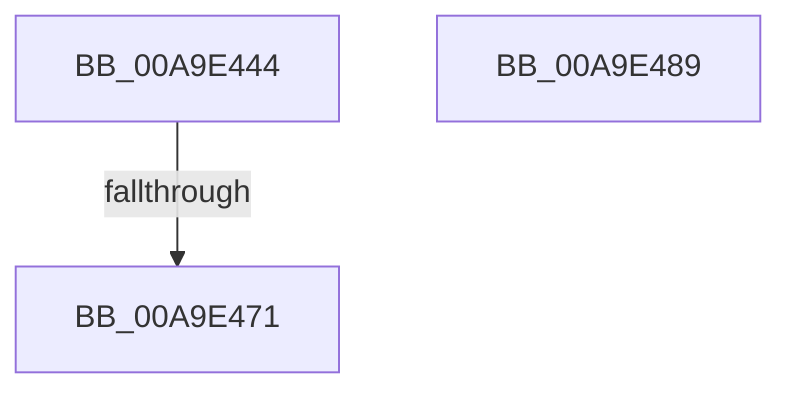

# PspReleaseReferenceToSession

- RVA: `0x00A9E444`–`0x00A9E48A` (길이 `70` bytes)
- VA: `0x0000000140A9E444`
- 실행 섹션: `PAGE`
- PDB 이름 있음: `예`; PDB Function 태그: `예`
- unwind 정보 RVA: `0x0005DD4C`
- 디코드: `19`개 명령, `70/70` bytes 표시
- 미해석 바이트: `0` (있으면 어셈블리에 `.byte`로 보존)

> 이 문서는 커널 이미지의 기계어와 PDB 기호를 분석해 생성했습니다. 4번과 5번은 함수 원형과 자료형을 바이너리 사용 방식에서 추정한 C 해석이며 원본 소스 복구 결과는 아닙니다.

## 1. Dependencies

- 직접 호출 지점: **1**; 고유 호출 대상: **1**
- 직접 호출자로 확인된 함수: **2**
- RIP 상대 이미지 참조: **1**

### Outgoing calls
- `0x00A9E479` → [_security_check_cookie](../../text/6A/_security_check_cookie_function_006AC640.md) (function, `0x006AC640`)

### Direct callers
- [PsSessionObjectDelete](../78/PsSessionObjectDelete_function_00788E70.md) at `0x00788E84`
- [PspProcessDelete](../90/PspProcessDelete_function_00907B90.md) at `0x00907D1F`

### Static image references
- `0x00A9E44E` → RVA `0x00E0A740` (`.data`; read)

## 2. Other-region calls and transfers

- 다른 실행 섹션으로 향하는 call: **1**
  - `0x00A9E479` → [_security_check_cookie](../../text/6A/_security_check_cookie_function_006AC640.md) (`PAGE` → `.text`)
- call이 아닌 외부 분기/꼬리 이동: **1**
  - `0x00A9E46B` → [sub_00B48FD4](../B4/Unknown_function_00B48FD4.md) (`tail-transfer`)

## 3. Assembly (complete function range)

```asm
00A9E444  48 89 5C 24 10                  mov qword ptr [rsp + 0x10], rbx
00A9E449  57                              push rdi
00A9E44A  48 83 EC 60                     sub rsp, 0x60
00A9E44E  48 8B 05 EB C2 36 00            mov rax, qword ptr [rip + 0x36c2eb]
00A9E455  48 33 C4                        xor rax, rsp
00A9E458  48 89 44 24 50                  mov qword ptr [rsp + 0x50], rax
00A9E45D  48 8B D9                        mov rbx, rcx
00A9E460  83 C8 FF                        or eax, 0xffffffff
00A9E463  F0 0F C1 41 0C                  lock xadd dword ptr [rcx + 0xc], eax
00A9E468  83 F8 01                        cmp eax, 1
00A9E46B  0F 84 63 AB 0A 00               je 0x140b48fd4
00A9E471  48 8B 4C 24 50                  mov rcx, qword ptr [rsp + 0x50]
00A9E476  48 33 CC                        xor rcx, rsp
00A9E479  E8 C2 E1 C0 FF                  call 0x1406ac640
00A9E47E  48 8B 5C 24 78                  mov rbx, qword ptr [rsp + 0x78]
00A9E483  48 83 C4 60                     add rsp, 0x60
00A9E487  5F                              pop rdi
00A9E488  C3                              ret
00A9E489  CC                              int3
```

## 4. C-style interpretation (structured pseudocode)

```c
__int64 __fastcall PspReleaseReferenceToSession(__int64 a1)
{
    __int64 result;
    __int64 v_rsp;
    unsigned __int64 v_stack_m18;
    unsigned __int64 v_stack_p10;

    v_stack_p10 = v_rbx;
    v_rsp = (v_rsp) - (96);
    result = (*(unsigned __int64 *)(v_rip + 3588843)) ^ (v_rsp);
    v_stack_m18 = result;
    result = (unsigned int)((result) | (0xFFFFFFFFULL));
    a1 = (v_stack_m18) ^ (v_rsp);
    result = _security_check_cookie(a1, a2, a3, a4);
    v_rsp = (v_rsp) + (96);
    return result;
}
```

## 5. (Beta) C Style

```c
int64_t PspReleaseReferenceToSession(void *Arg1)
{
    uint8_t *arg1 = (uint8_t *)Arg1;

    int64_t result;
    int64_t local_rsp;
    uint64_t v_stack_m18;
    uint64_t v_stack_p10;

    v_stack_p10 = local_rbx;
    local_rsp = (local_rsp) - (96);
    result = (*(uint64_t *)(v_rip + 0x36C2EB)) ^ (local_rsp);
    v_stack_m18 = result;
    result = (uint32_t)((result) | (0xFFFFFFFFULL));
    Arg1 = (v_stack_m18) ^ (local_rsp);
    result = _security_check_cookie(Arg1, a2, a3, a4);
    local_rsp = (local_rsp) + (96);
    return result;
}
```

### 관측된 메모리 오프셋

구조체 형식이 확인되지 않은 접근은 인자 기준의 오프셋으로만 기록했습니다.

| 기준 인자 | 오프셋 표현 | 폭 (bit) | 접근 |
|---|---:|---:|---|
| `Arg1` | `+ 0xC` | `32` | `R/W` |

## 6. Execution-region graph

[열기: 2D/3D 그래프와 함수 탐색 컨트롤 패널](../../../control-panel.html?section=page&rva=0x00A9E444&view=graph)

- 2D 그래프는 위에서 아래로 흐르고, 3D 그래프는 빈 공간을 드래그해 회전합니다. Shift+드래그는 이동, 휠은 확대·축소, 함수 노드 선택은 대상 보고서 이동입니다.

### Static fallback


