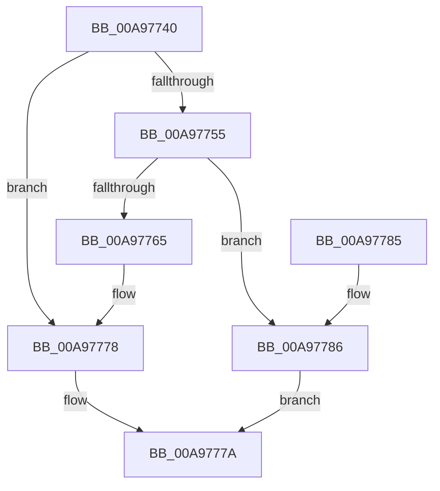

# RtlAppendStringToString

- RVA: `0x00A97740`–`0x00A9778D` (길이 `77` bytes)
- VA: `0x0000000140A97740`
- 실행 섹션: `PAGE`
- PDB 이름 있음: `예`; PDB Function 태그: `아니요`
- unwind 정보 RVA: `0x0006CF28`
- 디코드: `25`개 명령, `77/77` bytes 표시
- 미해석 바이트: `0` (있으면 어셈블리에 `.byte`로 보존)

> 이 문서는 커널 이미지의 기계어와 PDB 기호를 분석해 생성했습니다. 4번과 5번은 함수 원형과 자료형을 바이너리 사용 방식에서 추정한 C 해석이며 원본 소스 복구 결과는 아닙니다.

## 1. Dependencies

- 직접 호출 지점: **1**; 고유 호출 대상: **1**
- 직접 호출자로 확인된 함수: **5**
- RIP 상대 이미지 참조: **0**

### Outgoing calls
- `0x00A97770` → [memcpy](../../text/6C/memcpy_function_006C6840.md) (function, `0x006C6840`)

### Direct callers
- [CmpLoadHiveThread](../7D/CmpLoadHiveThread_function_007DB040.md) at `0x007DBA48`
- [CmpLoadHiveThread](../7D/CmpLoadHiveThread_function_007DB040.md) at `0x007DBAE4`
- [CmpFlushBackupHive](../7E/CmpFlushBackupHive_function_007EC1A8.md) at `0x007EC276`
- [CmpFlushBackupHive](../7E/CmpFlushBackupHive_function_007EC1A8.md) at `0x007EC291`
- [CmpInitBackupHive](../7E/CmpInitBackupHive_function_007EC594.md) at `0x007EC60E`
- [CmpInitBackupHive](../7E/CmpInitBackupHive_function_007EC594.md) at `0x007EC62A`
- [MiFormFullImageName](../7F/MiFormFullImageName_function_007F7FC4.md) at `0x007F8034`
- [EmInitSystem](../../init/C7/EmInitSystem_function_00C71150.md) at `0x00C714D6`
- [EmInitSystem](../../init/C7/EmInitSystem_function_00C71150.md) at `0x00C714F9`

### Static image references
- 디코드된 RIP-relative 메모리 참조가 없습니다.

## 2. Other-region calls and transfers

- 다른 실행 섹션으로 향하는 call: **1**
  - `0x00A97770` → [memcpy](../../text/6C/memcpy_function_006C6840.md) (`PAGE` → `.text`)
- 별도 외부 분기/꼬리 이동을 확인하지 못했습니다.

## 3. Assembly (complete function range)

```asm
00A97740  48 89 5C 24 08                  mov qword ptr [rsp + 8], rbx
00A97745  57                              push rdi
00A97746  48 83 EC 20                     sub rsp, 0x20
00A9774A  0F B7 3A                        movzx edi, word ptr [rdx]
00A9774D  48 8B D9                        mov rbx, rcx
00A97750  66 85 FF                        test di, di
00A97753  74 23                           je 0x140a97778
00A97755  0F B7 09                        movzx ecx, word ptr [rcx]
00A97758  0F B7 43 02                     movzx eax, word ptr [rbx + 2]
00A9775C  44 8D 04 39                     lea r8d, [rcx + rdi]
00A97760  44 3B C0                        cmp r8d, eax
00A97763  77 21                           ja 0x140a97786
00A97765  48 03 4B 08                     add rcx, qword ptr [rbx + 8]
00A97769  44 8B C7                        mov r8d, edi
00A9776C  48 8B 52 08                     mov rdx, qword ptr [rdx + 8]
00A97770  E8 CB F0 C2 FF                  call 0x1406c6840
00A97775  66 01 3B                        add word ptr [rbx], di
00A97778  33 C0                           xor eax, eax
00A9777A  48 8B 5C 24 30                  mov rbx, qword ptr [rsp + 0x30]
00A9777F  48 83 C4 20                     add rsp, 0x20
00A97783  5F                              pop rdi
00A97784  C3                              ret
00A97785  CC                              int3
00A97786  B8 23 00 00 C0                  mov eax, 0xc0000023
00A9778B  EB ED                           jmp 0x140a9777a
```

## 4. C-style interpretation (structured pseudocode)

```c
__int64 __fastcall RtlAppendStringToString(__int64 a1, __int64 a2)
{
    __int64 result;
    __int64 v_rsp;
    unsigned __int64 v_stack_p8;

    v_stack_p8 = v_rbx;
    v_rsp = (v_rsp) - (32);
    if ((unsigned __int16)(*(unsigned __int16 *)(a2)) == 0) goto loc_00A97778;
    if (((unsigned int)(*(unsigned __int16 *)(a1) + *(unsigned __int16 *)(a2) * 1)) > ((unsigned int)(*(unsigned __int16 *)(a1 + 2)))) goto loc_00A97786;
    a1 = (*(unsigned __int16 *)(a1)) + (*(unsigned __int64 *)(a1 + 8));
    result = memcpy(a1, *(unsigned __int64 *)(a2 + 8), (unsigned int)((unsigned int)(*(unsigned __int16 *)(a2))), a4);
loc_00A97778:
    result = 0;
loc_00A9777A:
    v_rsp = (v_rsp) + (32);
    return result;
loc_00A97786:
    goto loc_00A9777A;
}
```

## 5. (Beta) C Style

```c
int64_t RtlAppendStringToString(void *Arg1, void *Arg2)
{
    uint8_t *arg1 = (uint8_t *)Arg1;
    uint8_t *arg2 = (uint8_t *)Arg2;

    int64_t result;
    int64_t local_rsp;
    uint64_t v_stack_p8;

    v_stack_p8 = local_rbx;
    local_rsp = (local_rsp) - (32);
    if ((uint16_t)(*(uint16_t *)(arg2)) == 0) goto loc_00A97778;
    if (((uint32_t)(*(uint16_t *)(arg1) + *(uint16_t *)(arg2) * 1)) > ((uint32_t)(*(uint16_t *)(arg1 + 0x2)))) goto loc_00A97786;
    Arg1 = (*(uint16_t *)(arg1)) + (*(uint64_t *)(arg1 + 0x8));
    result = memcpy(Arg1, *(uint64_t *)(arg2 + 0x8), (uint32_t)((uint32_t)(*(uint16_t *)(arg2))), a4);
loc_00A97778:
    result = 0;
loc_00A9777A:
    local_rsp = (local_rsp) + (32);
    return result;
loc_00A97786:
    goto loc_00A9777A;
}
```

### 관측된 메모리 오프셋

구조체 형식이 확인되지 않은 접근은 인자 기준의 오프셋으로만 기록했습니다.

| 기준 인자 | 오프셋 표현 | 폭 (bit) | 접근 |
|---|---:|---:|---|
| `Arg1` | `+ 0x0` | `16` | `R` |
| `Arg1` | `+ 0x0` | `16` | `R/W` |
| `Arg1` | `+ 0x2` | `16` | `R` |
| `Arg1` | `+ 0x8` | `64` | `R` |
| `Arg2` | `+ 0x0` | `16` | `R` |
| `Arg2` | `+ 0x8` | `64` | `R` |

## 6. Execution-region graph

[열기: 2D/3D 그래프와 함수 탐색 컨트롤 패널](../../../control-panel.html?section=page&rva=0x00A97740&view=graph)

- 2D 그래프는 위에서 아래로 흐르고, 3D 그래프는 빈 공간을 드래그해 회전합니다. Shift+드래그는 이동, 휠은 확대·축소, 함수 노드 선택은 대상 보고서 이동입니다.

### Static fallback


