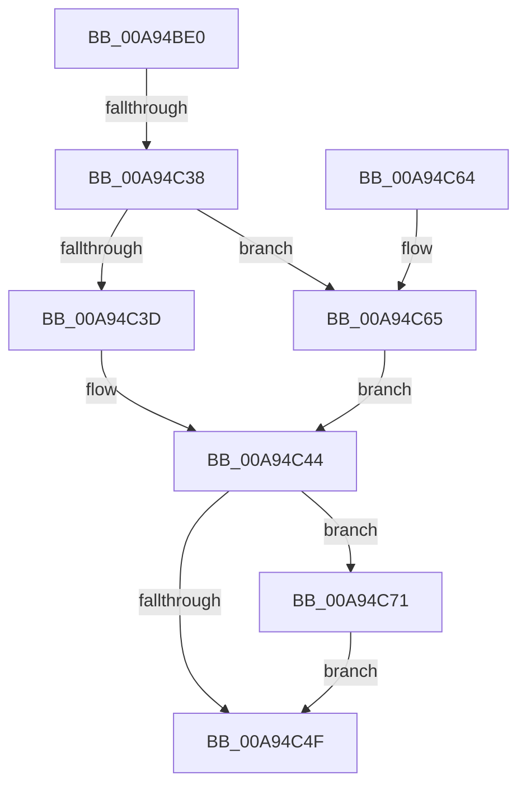

# RtlLockBootStatusData

- RVA: `0x00A94BE0`–`0x00A94C7D` (길이 `157` bytes)
- VA: `0x0000000140A94BE0`
- 실행 섹션: `PAGE`
- PDB 이름 있음: `예`; PDB Function 태그: `예`
- unwind 정보 RVA: `0x000B9614`
- 디코드: `45`개 명령, `157/157` bytes 표시
- 미해석 바이트: `0` (있으면 어셈블리에 `.byte`로 보존)

> 이 문서는 커널 이미지의 기계어와 PDB 기호를 분석해 생성했습니다. 4번과 5번은 함수 원형과 자료형을 바이너리 사용 방식에서 추정한 C 해석이며 원본 소스 복구 결과는 아닙니다.

## 1. Dependencies

- 직접 호출 지점: **3**; 고유 호출 대상: **3**
- 직접 호출자로 확인된 함수: **3**
- RIP 상대 이미지 참조: **4**

### Outgoing calls
- `0x00A94C20` → [RtlpAcquireBootStatusLock](../../text/4B/RtlpAcquireBootStatusLock_function_004B26AC.md) (function, `0x004B26AC`)
- `0x00A94C44` → [RtlpReleaseBootStatusLock](../../text/4C/RtlpReleaseBootStatusLock_function_004C05D4.md) (function, `0x004C05D4`)
- `0x00A94C76` → [ExFreePoolWithTag](../../poolcode/B8/ExFreePoolWithTag_function_00B82870.md) (function, `0x00B82870`)

### Direct callers
- [PoClearTransitionMarker](../75/PoClearTransitionMarker_function_00753C88.md) at `0x00753CBA`
- [CmCompleteRegistryInitialization](../7D/CmCompleteRegistryInitialization_function_007DF1EC.md) at `0x007DF332`
- [PopBootStatCheckIntegrity](../AC/PopBootStatCheckIntegrity_function_00ACDF4C.md) at `0x00ACE0DF`

### Static image references
- `0x00A94C25` → RVA `0x00F05C44` (`.data`; read/write)
- `0x00A94C2B` → RVA `0x00F05C20` (`.data`; read)
- `0x00A94C3D` → RVA `0x00F05C40` (`.data`; write)
- `0x00A94C65` → RVA `0x00F05C28` (`.data`; read)

## 2. Other-region calls and transfers

- 다른 실행 섹션으로 향하는 call: **3**
  - `0x00A94C20` → [RtlpAcquireBootStatusLock](../../text/4B/RtlpAcquireBootStatusLock_function_004B26AC.md) (`PAGE` → `.text`)
  - `0x00A94C44` → [RtlpReleaseBootStatusLock](../../text/4C/RtlpReleaseBootStatusLock_function_004C05D4.md) (`PAGE` → `.text`)
  - `0x00A94C76` → [ExFreePoolWithTag](../../poolcode/B8/ExFreePoolWithTag_function_00B82870.md) (`PAGE` → `POOLCODE`)
- call이 아닌 외부 분기/꼬리 이동: **1**
  - `0x00A94C32` → [sub_00B47492](../B4/Unknown_function_00B47492.md) (`tail-transfer`)

## 3. Assembly (complete function range)

```asm
00A94BE0  48 89 5C 24 08                  mov qword ptr [rsp + 8], rbx
00A94BE5  55                              push rbp
00A94BE6  56                              push rsi
00A94BE7  57                              push rdi
00A94BE8  48 8B EC                        mov rbp, rsp
00A94BEB  48 81 EC 80 00 00 00            sub rsp, 0x80
00A94BF2  33 C0                           xor eax, eax
00A94BF4  0F 57 C0                        xorps xmm0, xmm0
00A94BF7  48 21 45 30                     and qword ptr [rbp + 0x30], rax
00A94BFB  33 FF                           xor edi, edi
00A94BFD  0F 11 45 D0                     movups xmmword ptr [rbp - 0x30], xmm0
00A94C01  48 89 45 F0                     mov qword ptr [rbp - 0x10], rax
00A94C05  48 8B D9                        mov rbx, rcx
00A94C08  0F 11 45 E0                     movups xmmword ptr [rbp - 0x20], xmm0
00A94C0C  89 45 F8                        mov dword ptr [rbp - 8], eax
00A94C0F  33 F6                           xor esi, esi
00A94C11  0F 11 45 B0                     movups xmmword ptr [rbp - 0x50], xmm0
00A94C15  48 89 7D 38                     mov qword ptr [rbp + 0x38], rdi
00A94C19  0F 11 45 C0                     movups xmmword ptr [rbp - 0x40], xmm0
00A94C1D  88 45 28                        mov byte ptr [rbp + 0x28], al
00A94C20  E8 87 DA A1 FF                  call 0x1404b26ac
00A94C25  FF 05 19 10 47 00               inc dword ptr [rip + 0x471019]
00A94C2B  40 38 35 EE 0F 47 00            cmp byte ptr [rip + 0x470fee], sil
00A94C32  0F 84 5A 28 0B 00               je 0x140b47492
00A94C38  48 85 DB                        test rbx, rbx
00A94C3B  75 28                           jne 0x140a94c65
00A94C3D  C6 05 FC 0F 47 00 01            mov byte ptr [rip + 0x470ffc], 1
00A94C44  E8 8B B9 A2 FF                  call 0x1404c05d4
00A94C49  80 7D 28 00                     cmp byte ptr [rbp + 0x28], 0
00A94C4D  75 22                           jne 0x140a94c71
00A94C4F  48 8B 9C 24 A0 00 00 00         mov rbx, qword ptr [rsp + 0xa0]
00A94C57  8B C6                           mov eax, esi
00A94C59  48 81 C4 80 00 00 00            add rsp, 0x80
00A94C60  5F                              pop rdi
00A94C61  5E                              pop rsi
00A94C62  5D                              pop rbp
00A94C63  C3                              ret
00A94C64  CC                              int3
00A94C65  48 8B 05 BC 0F 47 00            mov rax, qword ptr [rip + 0x470fbc]
00A94C6C  48 89 03                        mov qword ptr [rbx], rax
00A94C6F  EB D3                           jmp 0x140a94c44
00A94C71  33 D2                           xor edx, edx
00A94C73  48 8B CF                        mov rcx, rdi
00A94C76  E8 F5 DB 0E 00                  call 0x140b82870
00A94C7B  EB D2                           jmp 0x140a94c4f
```

## 4. C-style interpretation (structured pseudocode)

```c
__int64 __fastcall RtlLockBootStatusData(__int64 a1, int a2)
{
    __int64 result;
    __int64 v_rdi;
    __int64 v_rsi;
    __int64 v_rsp;
    unsigned int v_stack_m20;
    unsigned __int64 v_stack_m28;
    unsigned __int64 v_stack_m38;
    unsigned __int64 v_stack_m48;
    unsigned __int64 v_stack_m58;
    unsigned __int64 v_stack_m68;
    unsigned __int8 v_stack_p10;
    unsigned __int64 v_stack_p18;
    unsigned __int64 v_stack_p20;
    unsigned __int64 v_stack_p8;

    v_stack_p8 = v_rbx;
    v_rsp = (v_rsp) - (128);
    result = 0;
    v_rdi = 0;
    v_stack_m48 = v_xmm0;
    v_stack_m28 = 0;
    v_stack_m38 = v_xmm0;
    v_stack_m20 = 0;
    v_rsi = 0;
    v_stack_m68 = v_xmm0;
    v_stack_p20 = 0;
    v_stack_m58 = v_xmm0;
    v_stack_p10 = 0;
    result = RtlpAcquireBootStatusLock(a1, a2, a3, a4);
    if (a1 != 0) goto loc_00A94C65;
    *(unsigned __int8 *)(v_rip + 4657148) = 1;
loc_00A94C44:
    result = RtlpReleaseBootStatusLock(a1, a2, a3, a4);
    if (v_stack_p10 != 0) goto loc_00A94C71;
loc_00A94C4F:
    v_rsp = (v_rsp) + (128);
    return 0;
loc_00A94C65:
    *(unsigned __int64 *)(v_stack_p8) = *(unsigned __int64 *)(v_rip + 4657084);
    goto loc_00A94C44;
loc_00A94C71:
    a2 = 0;
    result = ExFreePoolWithTag(0, a2, a3, a4);
    goto loc_00A94C4F;
}
```

## 5. (Beta) C Style

```c
int64_t RtlLockBootStatusData(int64_t Arg1, int32_t Arg2)
{
    int64_t result;
    int64_t local_rdi;
    int64_t local_rsi;
    int64_t local_rsp;
    uint32_t v_stack_m20;
    uint64_t v_stack_m28;
    uint64_t v_stack_m38;
    uint64_t v_stack_m48;
    uint64_t v_stack_m58;
    uint64_t v_stack_m68;
    uint8_t v_stack_p10;
    uint64_t v_stack_p18;
    uint64_t v_stack_p20;
    uint64_t v_stack_p8;

    v_stack_p8 = local_rbx;
    local_rsp = (local_rsp) - (128);
    result = 0;
    local_rdi = 0;
    v_stack_m48 = v_xmm0;
    v_stack_m28 = 0;
    v_stack_m38 = v_xmm0;
    v_stack_m20 = 0;
    local_rsi = 0;
    v_stack_m68 = v_xmm0;
    v_stack_p20 = 0;
    v_stack_m58 = v_xmm0;
    v_stack_p10 = 0;
    result = RtlpAcquireBootStatusLock(Arg1, Arg2, a3, a4);
    if (Arg1 != 0) goto loc_00A94C65;
    *(uint8_t *)(v_rip + 0x470FFC) = 1;
loc_00A94C44:
    result = RtlpReleaseBootStatusLock(Arg1, Arg2, a3, a4);
    if (v_stack_p10 != 0) goto loc_00A94C71;
loc_00A94C4F:
    local_rsp = (local_rsp) + (128);
    return 0;
loc_00A94C65:
    *(uint64_t *)(v_stack_p8) = *(uint64_t *)(v_rip + 0x470FBC);
    goto loc_00A94C44;
loc_00A94C71:
    Arg2 = 0;
    result = ExFreePoolWithTag(0, Arg2, a3, a4);
    goto loc_00A94C4F;
}
```

## 6. Execution-region graph

[열기: 2D/3D 그래프와 함수 탐색 컨트롤 패널](../../../control-panel.html?section=page&rva=0x00A94BE0&view=graph)

- 2D 그래프는 위에서 아래로 흐르고, 3D 그래프는 빈 공간을 드래그해 회전합니다. Shift+드래그는 이동, 휠은 확대·축소, 함수 노드 선택은 대상 보고서 이동입니다.

### Static fallback


