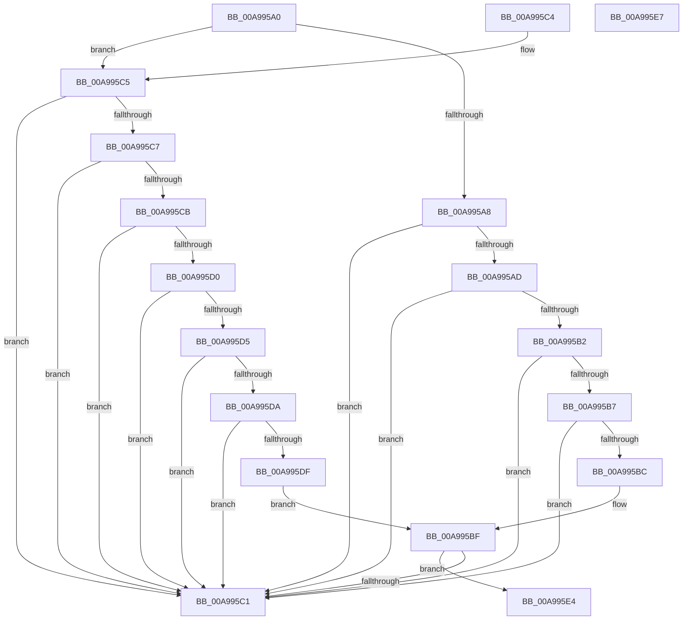

# RtlValidProcessProtection

- RVA: `0x00A995A0`–`0x00A995E8` (길이 `72` bytes)
- VA: `0x0000000140A995A0`
- 실행 섹션: `PAGE`
- PDB 이름 있음: `예`; PDB Function 태그: `아니요`
- unwind 정보 RVA: `0x000DB714`
- 디코드: `32`개 명령, `72/72` bytes 표시
- 미해석 바이트: `0` (있으면 어셈블리에 `.byte`로 보존)

> 이 문서는 커널 이미지의 기계어와 PDB 기호를 분석해 생성했습니다. 4번과 5번은 함수 원형과 자료형을 바이너리 사용 방식에서 추정한 C 해석이며 원본 소스 복구 결과는 아닙니다.

## 1. Dependencies

- 직접 호출 지점: **0**; 고유 호출 대상: **0**
- 직접 호출자로 확인된 함수: **1**
- RIP 상대 이미지 참조: **0**

### Outgoing calls
- 직접 디코드된 call 명령이 없습니다.

### Direct callers
- [PspBuildCreateProcessContext](../9E/PspBuildCreateProcessContext_function_009ED6E0.md) at `0x009EEE5D`

### Static image references
- 디코드된 RIP-relative 메모리 참조가 없습니다.

## 2. Other-region calls and transfers

- 다른 실행 섹션으로 향하는 call: **0**
- 별도 외부 분기/꼬리 이동을 확인하지 못했습니다.

## 3. Assembly (complete function range)

```asm
00A995A0  0F B6 D1                        movzx edx, cl
00A995A3  83 FA 51                        cmp edx, 0x51
00A995A6  76 1D                           jbe 0x140a995c5
00A995A8  83 EA 52                        sub edx, 0x52
00A995AB  74 14                           je 0x140a995c1
00A995AD  83 EA 0F                        sub edx, 0xf
00A995B0  74 0F                           je 0x140a995c1
00A995B2  83 EA 01                        sub edx, 1
00A995B5  74 0A                           je 0x140a995c1
00A995B7  83 EA 10                        sub edx, 0x10
00A995BA  74 05                           je 0x140a995c1
00A995BC  83 FA 0F                        cmp edx, 0xf
00A995BF  75 23                           jne 0x140a995e4
00A995C1  B0 01                           mov al, 1
00A995C3  C3                              ret
00A995C4  CC                              int3
00A995C5  74 FA                           je 0x140a995c1
00A995C7  84 C9                           test cl, cl
00A995C9  74 F6                           je 0x140a995c1
00A995CB  83 FA 08                        cmp edx, 8
00A995CE  74 F1                           je 0x140a995c1
00A995D0  83 FA 12                        cmp edx, 0x12
00A995D3  74 EC                           je 0x140a995c1
00A995D5  83 FA 21                        cmp edx, 0x21
00A995D8  74 E7                           je 0x140a995c1
00A995DA  83 FA 31                        cmp edx, 0x31
00A995DD  74 E2                           je 0x140a995c1
00A995DF  83 FA 41                        cmp edx, 0x41
00A995E2  EB DB                           jmp 0x140a995bf
00A995E4  32 C0                           xor al, al
00A995E6  C3                              ret
00A995E7  CC                              int3
```

## 4. C-style interpretation (structured pseudocode)

```c
__int64 __fastcall RtlValidProcessProtection(unsigned __int8 a1)
{
    __int64 result;

    if (a1 <= 81) goto loc_00A995C5;
    a2 = (unsigned int)((a1) - (82));
    if (condition_is_equal) goto loc_00A995C1;
    a2 = (unsigned int)((a2) - (15));
    if (condition_is_equal) goto loc_00A995C1;
    a2 = (unsigned int)((a2) - (1));
    if (condition_is_equal) goto loc_00A995C1;
    a2 = (unsigned int)((a2) - (16));
    if (condition_is_equal) goto loc_00A995C1;
loc_00A995BF:
    if (((unsigned int)(a2)) != 15) goto loc_00A995E4;
loc_00A995C1:
    return 1;
loc_00A995C5:
    if (((unsigned int)(a2)) == 15) goto loc_00A995C1;
    if (a1 == 0) goto loc_00A995C1;
    if (((unsigned int)(a2)) == 8) goto loc_00A995C1;
    if (((unsigned int)(a2)) == 18) goto loc_00A995C1;
    if (((unsigned int)(a2)) == 33) goto loc_00A995C1;
    if (((unsigned int)(a2)) == 49) goto loc_00A995C1;
    goto loc_00A995BF;
loc_00A995E4:
    result = 0;
    return result;
}
```

## 5. (Beta) C Style

```c
int64_t RtlValidProcessProtection(uint8_t Arg1)
{
    int64_t result;

    if (Arg1 <= 81) goto loc_00A995C5;
    a2 = (uint32_t)((Arg1) - (82));
    if (condition_is_equal) goto loc_00A995C1;
    a2 = (uint32_t)((a2) - (15));
    if (condition_is_equal) goto loc_00A995C1;
    a2 = (uint32_t)((a2) - (1));
    if (condition_is_equal) goto loc_00A995C1;
    a2 = (uint32_t)((a2) - (16));
    if (condition_is_equal) goto loc_00A995C1;
loc_00A995BF:
    if (((uint32_t)(a2)) != 15) goto loc_00A995E4;
loc_00A995C1:
    return 1;
loc_00A995C5:
    if (((uint32_t)(a2)) == 15) goto loc_00A995C1;
    if (Arg1 == 0) goto loc_00A995C1;
    if (((uint32_t)(a2)) == 8) goto loc_00A995C1;
    if (((uint32_t)(a2)) == 18) goto loc_00A995C1;
    if (((uint32_t)(a2)) == 33) goto loc_00A995C1;
    if (((uint32_t)(a2)) == 49) goto loc_00A995C1;
    goto loc_00A995BF;
loc_00A995E4:
    result = 0;
    return result;
}
```

## 6. Execution-region graph

[열기: 2D/3D 그래프와 함수 탐색 컨트롤 패널](../../../control-panel.html?section=page&rva=0x00A995A0&view=graph)

- 2D 그래프는 위에서 아래로 흐르고, 3D 그래프는 빈 공간을 드래그해 회전합니다. Shift+드래그는 이동, 휠은 확대·축소, 함수 노드 선택은 대상 보고서 이동입니다.

### Static fallback


