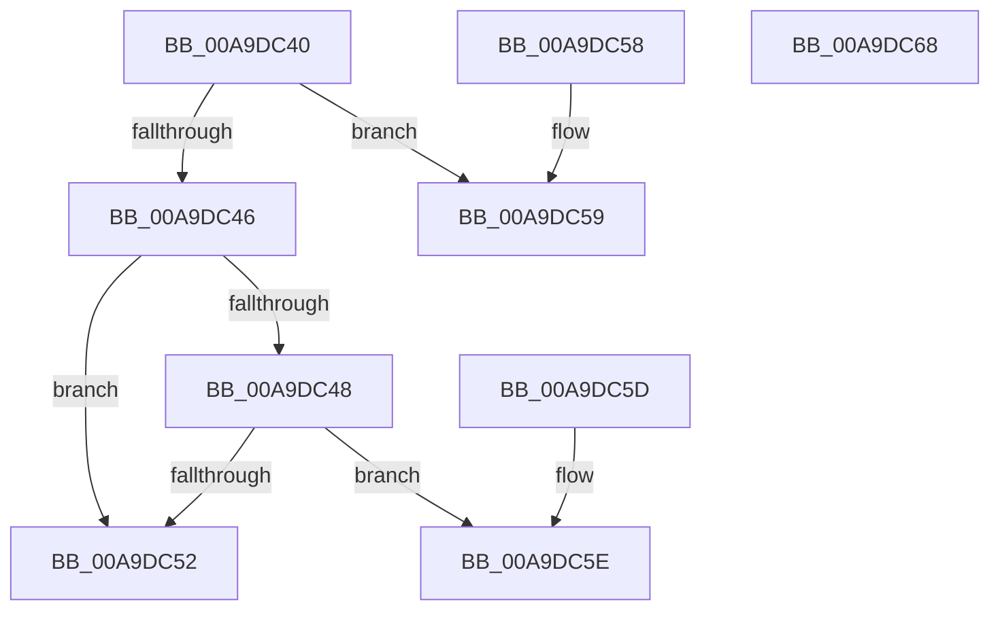

# RtlpFcCompareUpdates

- RVA: `0x00A9DC40`–`0x00A9DC69` (길이 `41` bytes)
- VA: `0x0000000140A9DC40`
- 실행 섹션: `PAGE`
- PDB 이름 있음: `예`; PDB Function 태그: `아니요`
- unwind 정보 RVA: `0x000DB714`
- 디코드: `20`개 명령, `41/41` bytes 표시
- 미해석 바이트: `0` (있으면 어셈블리에 `.byte`로 보존)

> 이 문서는 커널 이미지의 기계어와 PDB 기호를 분석해 생성했습니다. 4번과 5번은 함수 원형과 자료형을 바이너리 사용 방식에서 추정한 C 해석이며 원본 소스 복구 결과는 아닙니다.

## 1. Dependencies

- 직접 호출 지점: **0**; 고유 호출 대상: **0**
- 직접 호출자로 확인된 함수: **0**
- RIP 상대 이미지 참조: **0**

### Outgoing calls
- 직접 디코드된 call 명령이 없습니다.

### Direct callers
- 이 함수 시작 RVA로 연결되는 직접 call은 확인되지 않았습니다. 간접 호출은 완전히 역산할 수 없습니다.

### Static image references
- 디코드된 RIP-relative 메모리 참조가 없습니다.

## 2. Other-region calls and transfers

- 다른 실행 섹션으로 향하는 call: **0**
- 별도 외부 분기/꼬리 이동을 확인하지 못했습니다.

## 3. Assembly (complete function range)

```asm
00A9DC40  8B 01                           mov eax, dword ptr [rcx]
00A9DC42  3B 02                           cmp eax, dword ptr [rdx]
00A9DC44  72 13                           jb 0x140a9dc59
00A9DC46  77 0A                           ja 0x140a9dc52
00A9DC48  8B 49 04                        mov ecx, dword ptr [rcx + 4]
00A9DC4B  8B 52 04                        mov edx, dword ptr [rdx + 4]
00A9DC4E  3B CA                           cmp ecx, edx
00A9DC50  7D 0C                           jge 0x140a9dc5e
00A9DC52  B8 01 00 00 00                  mov eax, 1
00A9DC57  C3                              ret
00A9DC58  CC                              int3
00A9DC59  83 C8 FF                        or eax, 0xffffffff
00A9DC5C  C3                              ret
00A9DC5D  CC                              int3
00A9DC5E  33 C0                           xor eax, eax
00A9DC60  3B CA                           cmp ecx, edx
00A9DC62  0F 9E C0                        setle al
00A9DC65  FF C8                           dec eax
00A9DC67  C3                              ret
00A9DC68  CC                              int3
```

## 4. C-style interpretation (structured pseudocode)

```c
__int64 __fastcall RtlpFcCompareUpdates(__int64 a1, __int64 a2)
{
    __int64 result;

    if (((unsigned int)((unsigned int)(*(unsigned int *)(a1)))) < (*(unsigned int *)(a2))) goto loc_00A9DC59;
    if (((unsigned int)((unsigned int)(*(unsigned int *)(a1)))) > (*(unsigned int *)(a2))) goto loc_00A9DC52;
    if (((unsigned int)((unsigned int)(*(unsigned int *)(a1 + 4)))) >= ((unsigned int)((unsigned int)(*(unsigned int *)(a2 + 4))))) goto loc_00A9DC5E;
loc_00A9DC52:
    return 1;
loc_00A9DC59:
    result = (unsigned int)((1) | (0xFFFFFFFFULL));
    return result;
loc_00A9DC5E:
    result = 0;
    result = (((unsigned int)((unsigned int)(*(unsigned int *)(a1 + 4)))) <= ((unsigned int)((unsigned int)(*(unsigned int *)(a2 + 4))))) ? 1 : 0;
    result = (unsigned int)((result) - 1);
    return result;
}
```

## 5. (Beta) C Style

```c
int64_t RtlpFcCompareUpdates(void *Arg1, void *Arg2)
{
    uint8_t *arg1 = (uint8_t *)Arg1;
    uint8_t *arg2 = (uint8_t *)Arg2;

    int64_t result;

    if (((uint32_t)((uint32_t)(*(uint32_t *)(arg1)))) < (*(uint32_t *)(arg2))) goto loc_00A9DC59;
    if (((uint32_t)((uint32_t)(*(uint32_t *)(arg1)))) > (*(uint32_t *)(arg2))) goto loc_00A9DC52;
    if (((uint32_t)((uint32_t)(*(uint32_t *)(arg1 + 0x4)))) >= ((uint32_t)((uint32_t)(*(uint32_t *)(arg2 + 0x4))))) goto loc_00A9DC5E;
loc_00A9DC52:
    return 1;
loc_00A9DC59:
    result = (uint32_t)((1) | (0xFFFFFFFFULL));
    return result;
loc_00A9DC5E:
    result = 0;
    result = (((uint32_t)((uint32_t)(*(uint32_t *)(arg1 + 0x4)))) <= ((uint32_t)((uint32_t)(*(uint32_t *)(arg2 + 0x4))))) ? 1 : 0;
    result = (uint32_t)((result) - 1);
    return result;
}
```

### 관측된 메모리 오프셋

구조체 형식이 확인되지 않은 접근은 인자 기준의 오프셋으로만 기록했습니다.

| 기준 인자 | 오프셋 표현 | 폭 (bit) | 접근 |
|---|---:|---:|---|
| `Arg1` | `+ 0x0` | `32` | `R` |
| `Arg1` | `+ 0x4` | `32` | `R` |
| `Arg2` | `+ 0x0` | `32` | `R` |
| `Arg2` | `+ 0x4` | `32` | `R` |

## 6. Execution-region graph

[열기: 2D/3D 그래프와 함수 탐색 컨트롤 패널](../../../control-panel.html?section=page&rva=0x00A9DC40&view=graph)

- 2D 그래프는 위에서 아래로 흐르고, 3D 그래프는 빈 공간을 드래그해 회전합니다. Shift+드래그는 이동, 휠은 확대·축소, 함수 노드 선택은 대상 보고서 이동입니다.

### Static fallback


