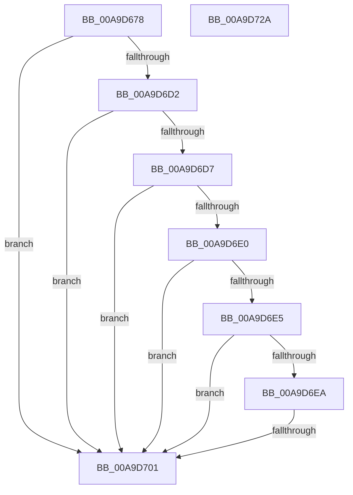

# RtlpLogCapabilityCheckLatency

- RVA: `0x00A9D678`–`0x00A9D72B` (길이 `179` bytes)
- VA: `0x0000000140A9D678`
- 실행 섹션: `PAGE`
- PDB 이름 있음: `예`; PDB Function 태그: `예`
- unwind 정보 RVA: `0x000BA728`
- 디코드: `48`개 명령, `179/179` bytes 표시
- 미해석 바이트: `0` (있으면 어셈블리에 `.byte`로 보존)

> 이 문서는 커널 이미지의 기계어와 PDB 기호를 분석해 생성했습니다. 4번과 5번은 함수 원형과 자료형을 바이너리 사용 방식에서 추정한 C 해석이며 원본 소스 복구 결과는 아닙니다.

## 1. Dependencies

- 직접 호출 지점: **2**; 고유 호출 대상: **2**
- 직접 호출자로 확인된 함수: **1**
- RIP 상대 이미지 참조: **5**

### Outgoing calls
- `0x00A9D6C5` → [RtlRunOnceExecuteOnce](../95/RtlRunOnceExecuteOnce_function_0095DC00.md) (function, `0x0095DC00`)
- `0x00A9D708` → [_security_check_cookie](../../text/6A/_security_check_cookie_function_006AC640.md) (function, `0x006AC640`)

### Direct callers
- [RtlCapabilityCheck](../A2/RtlCapabilityCheck_function_00A20340.md) at `0x00A2065A`

### Static image references
- `0x00A9D697` → RVA `0x00E0A740` (`.data`; read)
- `0x00A9D6B4` → RVA `0x0079A5E0` (`RtlpCapChkTelemetryRunOnce`; read)
- `0x00A9D6BE` → RVA `0x00E67B58` (`.data`; read)
- `0x00A9D6D7` → RVA `0x00E67B50` (`.data`; read)
- `0x00A9D6EF` → RVA `0x00E0CCA0` (`.data`; read/write)

## 2. Other-region calls and transfers

- 다른 실행 섹션으로 향하는 call: **1**
  - `0x00A9D708` → [_security_check_cookie](../../text/6A/_security_check_cookie_function_006AC640.md) (`PAGE` → `.text`)
- call이 아닌 외부 분기/꼬리 이동: **1**
  - `0x00A9D6FB` → [sub_00B48A28](../B4/Unknown_function_00B48A28.md) (`tail-transfer`)

## 3. Assembly (complete function range)

```asm
00A9D678  48 8B C4                        mov rax, rsp
00A9D67B  48 89 58 08                     mov qword ptr [rax + 8], rbx
00A9D67F  48 89 70 10                     mov qword ptr [rax + 0x10], rsi
00A9D683  48 89 78 18                     mov qword ptr [rax + 0x18], rdi
00A9D687  4C 89 70 20                     mov qword ptr [rax + 0x20], r14
00A9D68B  55                              push rbp
00A9D68C  48 8D 68 B1                     lea rbp, [rax - 0x4f]
00A9D690  48 81 EC C0 00 00 00            sub rsp, 0xc0
00A9D697  48 8B 05 A2 D0 36 00            mov rax, qword ptr [rip + 0x36d0a2]
00A9D69E  48 33 C4                        xor rax, rsp
00A9D6A1  48 89 45 37                     mov qword ptr [rbp + 0x37], rax
00A9D6A5  41 8A F1                        mov sil, r9b
00A9D6A8  45 8A F0                        mov r14b, r8b
00A9D6AB  48 8B DA                        mov rbx, rdx
00A9D6AE  48 8B F9                        mov rdi, rcx
00A9D6B1  45 33 C9                        xor r9d, r9d
00A9D6B4  48 8D 15 25 CF CF FF            lea rdx, [rip - 0x3030db]
00A9D6BB  45 33 C0                        xor r8d, r8d
00A9D6BE  48 8D 0D 93 A4 3C 00            lea rcx, [rip + 0x3ca493]
00A9D6C5  E8 36 05 EC FF                  call 0x14095dc00
00A9D6CA  45 33 C0                        xor r8d, r8d
00A9D6CD  48 85 FF                        test rdi, rdi
00A9D6D0  74 2F                           je 0x140a9d701
00A9D6D2  48 85 DB                        test rbx, rbx
00A9D6D5  74 2A                           je 0x140a9d701
00A9D6D7  4C 39 05 72 A4 3C 00            cmp qword ptr [rip + 0x3ca472], r8
00A9D6DE  74 21                           je 0x140a9d701
00A9D6E0  4C 39 07                        cmp qword ptr [rdi], r8
00A9D6E3  74 1C                           je 0x140a9d701
00A9D6E5  4C 39 03                        cmp qword ptr [rbx], r8
00A9D6E8  74 17                           je 0x140a9d701
00A9D6EA  83 C9 FF                        or ecx, 0xffffffff
00A9D6ED  8B C1                           mov eax, ecx
00A9D6EF  66 F0 0F C1 05 A8 F5 36 00      lock xadd word ptr [rip + 0x36f5a8], ax
00A9D6F8  66 03 C1                        add ax, cx
00A9D6FB  0F 84 27 B3 0A 00               je 0x140b48a28
00A9D701  48 8B 4D 37                     mov rcx, qword ptr [rbp + 0x37]
00A9D705  48 33 CC                        xor rcx, rsp
00A9D708  E8 33 EF C0 FF                  call 0x1406ac640
00A9D70D  4C 8D 9C 24 C0 00 00 00         lea r11, [rsp + 0xc0]
00A9D715  49 8B 5B 10                     mov rbx, qword ptr [r11 + 0x10]
00A9D719  49 8B 73 18                     mov rsi, qword ptr [r11 + 0x18]
00A9D71D  49 8B 7B 20                     mov rdi, qword ptr [r11 + 0x20]
00A9D721  4D 8B 73 28                     mov r14, qword ptr [r11 + 0x28]
00A9D725  49 8B E3                        mov rsp, r11
00A9D728  5D                              pop rbp
00A9D729  C3                              ret
00A9D72A  CC                              int3
```

## 4. C-style interpretation (structured pseudocode)

```c
__int64 __fastcall RtlpLogCapabilityCheckLatency(__int64 a1, __int64 a2, int a3, int a4)
{
    __int64 result;
    __int64 v_rsp;
    unsigned __int64 v_stack_m8;

    *(unsigned __int64 *)(v_rsp + 8) = v_rbx;
    *(unsigned __int64 *)(v_rsp + 16) = v_rsi;
    *(unsigned __int64 *)(v_rsp + 24) = v_rdi;
    *(unsigned __int64 *)(v_rsp + 32) = v_r14;
    v_rsp = (v_rsp) - (192);
    result = (*(unsigned __int64 *)(v_rip + 3592354)) ^ (v_rsp);
    *(unsigned __int64 *)(v_rsp - 79 + 55) = result;
    a4 = 0;
    a3 = 0;
    result = RtlRunOnceExecuteOnce(v_rip + 3974291, v_rip - 3158235, a3, a4);
    a3 = 0;
    if (a1 == 0) goto loc_00A9D701;
    if (a2 == 0) goto loc_00A9D701;
    if ((*(unsigned __int64 *)(v_rip + 3974258)) == 0) goto loc_00A9D701;
    if ((*(unsigned __int64 *)(a1)) == 0) goto loc_00A9D701;
    if ((*(unsigned __int64 *)(a2)) == 0) goto loc_00A9D701;
    a1 = (unsigned int)((v_rip + 3974291) | (0xFFFFFFFFULL));
    result = (unsigned __int16)(((unsigned int)((unsigned int)(a1))) + ((unsigned __int16)(a1)));
loc_00A9D701:
    a1 = (*(unsigned __int64 *)(v_rsp - 79 + 55)) ^ (v_rsp);
    result = _security_check_cookie(a1, v_rip - 3158235, a3, a4);
    return result;
}
```

## 5. (Beta) C Style

```c
int64_t RtlpLogCapabilityCheckLatency(int64_t Arg1, int64_t Arg2, int32_t Arg3, int32_t Arg4)
{
    int64_t result;
    int64_t local_rsp;
    uint64_t v_stack_m8;

    *(uint64_t *)(local_rsp + 0x8) = local_rbx;
    *(uint64_t *)(local_rsp + 0x10) = local_rsi;
    *(uint64_t *)(local_rsp + 0x18) = local_rdi;
    *(uint64_t *)(local_rsp + 0x20) = local_r14;
    local_rsp = (local_rsp) - (192);
    result = (*(uint64_t *)(v_rip + 0x36D0A2)) ^ (local_rsp);
    *(uint64_t *)(local_rsp - 0x4F + 0x37) = result;
    Arg4 = 0;
    Arg3 = 0;
    result = RtlRunOnceExecuteOnce(v_rip + 3974291, v_rip - 3158235, Arg3, Arg4);
    Arg3 = 0;
    if (Arg1 == 0) goto loc_00A9D701;
    if (Arg2 == 0) goto loc_00A9D701;
    if ((*(uint64_t *)(v_rip + 0x3CA472)) == 0) goto loc_00A9D701;
    if ((*(uint64_t *)(Arg1)) == 0) goto loc_00A9D701;
    if ((*(uint64_t *)(Arg2)) == 0) goto loc_00A9D701;
    Arg1 = (uint32_t)((v_rip + 3974291) | (0xFFFFFFFFULL));
    result = (uint16_t)(((uint32_t)((uint32_t)(Arg1))) + ((uint16_t)(Arg1)));
loc_00A9D701:
    Arg1 = (*(uint64_t *)(local_rsp - 0x4F + 0x37)) ^ (local_rsp);
    result = _security_check_cookie(Arg1, v_rip - 3158235, Arg3, Arg4);
    return result;
}
```

## 6. Execution-region graph

[열기: 2D/3D 그래프와 함수 탐색 컨트롤 패널](../../../control-panel.html?section=page&rva=0x00A9D678&view=graph)

- 2D 그래프는 위에서 아래로 흐르고, 3D 그래프는 빈 공간을 드래그해 회전합니다. Shift+드래그는 이동, 휠은 확대·축소, 함수 노드 선택은 대상 보고서 이동입니다.

### Static fallback


