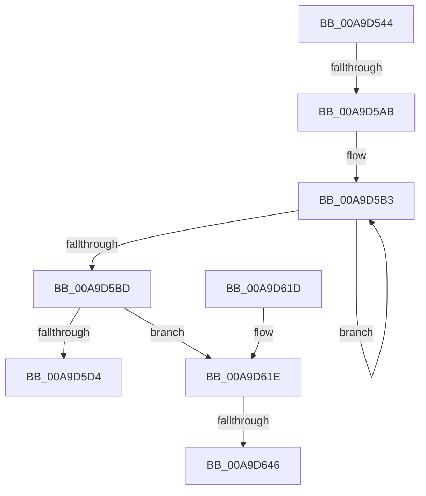

# SdbpCreateSearchDBContext

- RVA: `0x00A9D544`–`0x00A9D66F` (길이 `299` bytes)
- VA: `0x0000000140A9D544`
- 실행 섹션: `PAGE`
- PDB 이름 있음: `예`; PDB Function 태그: `예`
- unwind 정보 RVA: `0x000BA6F0`
- 디코드: `77`개 명령, `299/299` bytes 표시
- 미해석 바이트: `0` (있으면 어셈블리에 `.byte`로 보존)

> 이 문서는 커널 이미지의 기계어와 PDB 기호를 분석해 생성했습니다. 4번과 5번은 함수 원형과 자료형을 바이너리 사용 방식에서 추정한 C 해석이며 원본 소스 복구 결과는 아닙니다.

## 1. Dependencies

- 직접 호출 지점: **7**; 고유 호출 대상: **5**
- 직접 호출자로 확인된 함수: **2**
- RIP 상대 이미지 참조: **4**

### Outgoing calls
- `0x00A9D58B` → [memset](../../text/6C/memset_function_006C6C40.md) (function, `0x006C6C40`)
- `0x00A9D59D` → [memset](../../text/6C/memset_function_006C6C40.md) (function, `0x006C6C40`)
- `0x00A9D5C7` → [AslAlloc](../95/AslAlloc_function_0095BD34.md) (function, `0x0095BD34`)
- `0x00A9D5EB` → [AslLogCallPrintf](../95/AslLogCallPrintf_function_0095E4EC.md) (function, `0x0095E4EC`)
- `0x00A9D5FD` → [_security_check_cookie](../../text/6A/_security_check_cookie_function_006AC640.md) (function, `0x006AC640`)
- `0x00A9D639` → [AslPathSplit](../AB/AslPathSplit_function_00ABE87C.md) (function, `0x00ABE87C`)
- `0x00A9D664` → [AslLogCallPrintf](../95/AslLogCallPrintf_function_0095E4EC.md) (function, `0x0095E4EC`)

### Direct callers
- [SdbGetDatabaseMatch](../95/SdbGetDatabaseMatch_function_00958240.md) at `0x00958328`
- [SdbpCheckKObject](../95/SdbpCheckKObject_function_00959F04.md) at `0x00959F8C`

### Static image references
- `0x00A9D55B` → RVA `0x00E0A740` (`.data`; read)
- `0x00A9D5D4` → RVA `0x0001C680` (`.rdata`; read)
- `0x00A9D5E1` → RVA `0x0001C660` (`.rdata`; read)
- `0x00A9D646` → RVA `0x0003C200` (`.rdata`; read)

## 2. Other-region calls and transfers

- 다른 실행 섹션으로 향하는 call: **3**
  - `0x00A9D58B` → [memset](../../text/6C/memset_function_006C6C40.md) (`PAGE` → `.text`)
  - `0x00A9D59D` → [memset](../../text/6C/memset_function_006C6C40.md) (`PAGE` → `.text`)
  - `0x00A9D5FD` → [_security_check_cookie](../../text/6A/_security_check_cookie_function_006AC640.md) (`PAGE` → `.text`)
- call이 아닌 외부 분기/꼬리 이동: **3**
  - `0x00A9D5A5` → [sub_00B488F0 + 0x6E](../B4/Unknown_function_00B488F0.md) (`tail-transfer`)
  - `0x00A9D640` → [sub_00B488F0](../B4/Unknown_function_00B488F0.md) (`tail-transfer`)
  - `0x00A9D66A` → [sub_00B488F0 + 0x118](../B4/Unknown_function_00B488F0.md) (`tail-transfer`)

## 3. Assembly (complete function range)

```asm
00A9D544  48 89 5C 24 18                  mov qword ptr [rsp + 0x18], rbx
00A9D549  55                              push rbp
00A9D54A  56                              push rsi
00A9D54B  57                              push rdi
00A9D54C  41 54                           push r12
00A9D54E  41 55                           push r13
00A9D550  41 56                           push r14
00A9D552  41 57                           push r15
00A9D554  48 81 EC 80 04 00 00            sub rsp, 0x480
00A9D55B  48 8B 05 DE D1 36 00            mov rax, qword ptr [rip + 0x36d1de]
00A9D562  48 33 C4                        xor rax, rsp
00A9D565  48 89 84 24 70 04 00 00         mov qword ptr [rsp + 0x470], rax
00A9D56D  4C 8B E2                        mov r12, rdx
00A9D570  48 8B F9                        mov rdi, rcx
00A9D573  BE 08 02 00 00                  mov esi, 0x208
00A9D578  48 8D 8C 24 60 02 00 00         lea rcx, [rsp + 0x260]
00A9D580  45 33 ED                        xor r13d, r13d
00A9D583  44 8B C6                        mov r8d, esi
00A9D586  33 D2                           xor edx, edx
00A9D588  41 8B ED                        mov ebp, r13d
00A9D58B  E8 B0 96 C2 FF                  call 0x1406c6c40
00A9D590  44 8B C6                        mov r8d, esi
00A9D593  48 8D 4C 24 50                  lea rcx, [rsp + 0x50]
00A9D598  33 D2                           xor edx, edx
00A9D59A  41 8B DD                        mov ebx, r13d
00A9D59D  E8 9E 96 C2 FF                  call 0x1406c6c40
00A9D5A2  4D 85 E4                        test r12, r12
00A9D5A5  0F 84 B3 B3 0A 00               je 0x140b4895e
00A9D5AB  4D 8B 34 24                     mov r14, qword ptr [r12]
00A9D5AF  48 83 C8 FF                     or rax, 0xffffffffffffffff
00A9D5B3  48 FF C0                        inc rax
00A9D5B6  66 45 39 2C 46                  cmp word ptr [r14 + rax*2], r13w
00A9D5BB  75 F6                           jne 0x140a9d5b3
00A9D5BD  44 8D 78 01                     lea r15d, [rax + 1]
00A9D5C1  41 8B D7                        mov edx, r15d
00A9D5C4  48 03 D2                        add rdx, rdx
00A9D5C7  E8 68 E7 EB FF                  call 0x14095bd34
00A9D5CC  48 8B F0                        mov rsi, rax
00A9D5CF  48 85 C0                        test rax, rax
00A9D5D2  75 4A                           jne 0x140a9d61e
00A9D5D4  4C 8D 0D A5 F0 57 FF            lea r9, [rip - 0xa80f5b]
00A9D5DB  41 B8 B6 01 00 00               mov r8d, 0x1b6
00A9D5E1  48 8D 15 78 F0 57 FF            lea rdx, [rip - 0xa80f88]
00A9D5E8  8D 48 01                        lea ecx, [rax + 1]
00A9D5EB  E8 FC 0E EC FF                  call 0x14095e4ec
00A9D5F0  8B C5                           mov eax, ebp
00A9D5F2  48 8B 8C 24 70 04 00 00         mov rcx, qword ptr [rsp + 0x470]
00A9D5FA  48 33 CC                        xor rcx, rsp
00A9D5FD  E8 3E F0 C0 FF                  call 0x1406ac640
00A9D602  48 8B 9C 24 D0 04 00 00         mov rbx, qword ptr [rsp + 0x4d0]
00A9D60A  48 81 C4 80 04 00 00            add rsp, 0x480
00A9D611  41 5F                           pop r15
00A9D613  41 5E                           pop r14
00A9D615  41 5D                           pop r13
00A9D617  41 5C                           pop r12
00A9D619  5F                              pop rdi
00A9D61A  5E                              pop rsi
00A9D61B  5D                              pop rbp
00A9D61C  C3                              ret
00A9D61D  CC                              int3
00A9D61E  48 8D 84 24 60 02 00 00         lea rax, [rsp + 0x260]
00A9D626  45 8B C7                        mov r8d, r15d
00A9D629  4C 8D 4C 24 50                  lea r9, [rsp + 0x50]
00A9D62E  48 89 44 24 28                  mov qword ptr [rsp + 0x28], rax
00A9D633  48 8B D6                        mov rdx, rsi
00A9D636  49 8B CE                        mov rcx, r14
00A9D639  E8 3E 12 02 00                  call 0x140abe87c
00A9D63E  85 C0                           test eax, eax
00A9D640  0F 89 AA B2 0A 00               jns 0x140b488f0
00A9D646  4C 8D 0D B3 EB 59 FF            lea r9, [rip - 0xa6144d]
00A9D64D  4C 89 74 24 20                  mov qword ptr [rsp + 0x20], r14
00A9D652  41 B8 C1 01 00 00               mov r8d, 0x1c1
00A9D658  48 8D 15 01 F0 57 FF            lea rdx, [rip - 0xa80fff]
00A9D65F  B9 01 00 00 00                  mov ecx, 1
00A9D664  E8 83 0E EC FF                  call 0x14095e4ec
00A9D669  90                              nop
00A9D66A  E9 99 B3 0A 00                  jmp 0x140b48a08
```

## 4. C-style interpretation (structured pseudocode)

```c
__int64 __fastcall SdbpCreateSearchDBContext(__int64 a1, __int64 a2)
{
    __int64 result;
    __int64 v_r13;
    __int64 v_rsp;
    unsigned __int64 v_stack_m258;
    unsigned __int64 v_stack_m468;
    unsigned __int64 v_stack_m48;
    unsigned __int64 v_stack_p18;
    unsigned __int64 v_stack_p20;
    unsigned __int64 v_stack_p260;
    unsigned __int64 v_stack_p28;
    unsigned __int64 v_stack_p50;

    v_stack_p18 = v_rbx;
    v_rsp = (v_rsp) - (0x480ULL);
    result = (*(unsigned __int64 *)(v_rip + 3592670)) ^ (v_rsp);
    v_stack_m48 = result;
    v_r13 = 0;
    a2 = 0;
    result = memset(v_stack_m258, a2, 520, a4);
    a2 = 0;
    result = memset(v_stack_m468, a2, 520, a4);
    result = (result) | (-1);
loc_00A9D5B3:
    result = (result) + 1;
    if ((*(unsigned __int16 *)(*(unsigned __int64 *)(a2) + result * 2)) != 0) goto loc_00A9D5B3;
    a2 = ((unsigned int)((unsigned int)(result + 1))) + ((unsigned int)((unsigned int)(result + 1)));
    result = AslAlloc(v_stack_m468, a2, 520, a4);
    if (result != 0) goto loc_00A9D61E;
    result = AslLogCallPrintf(result + 1, v_rip - 11014024, 438, v_rip - 11013979);
    a1 = (v_stack_m48) ^ (v_rsp);
    result = _security_check_cookie(a1, v_rip - 11014024, 438, v_rip - 11013979);
    v_rsp = (v_rsp) + (0x480ULL);
    return result;
loc_00A9D61E:
    v_stack_p28 = v_stack_p260;
    result = AslPathSplit(*(unsigned __int64 *)(a2), result, (unsigned int)((unsigned int)(result + 1)), v_stack_p50);
    v_stack_p20 = *(unsigned __int64 *)(a2);
    result = AslLogCallPrintf(1, v_rip - 11014143, 449, v_rip - 10884173);
}
```

## 5. (Beta) C Style

```c
int64_t SdbpCreateSearchDBContext(int64_t Arg1, int64_t Arg2)
{
    int64_t result;
    int64_t local_r13;
    int64_t local_rsp;
    uint64_t v_stack_m258;
    uint64_t v_stack_m468;
    uint64_t v_stack_m48;
    uint64_t v_stack_p18;
    uint64_t v_stack_p20;
    uint64_t v_stack_p260;
    uint64_t v_stack_p28;
    uint64_t v_stack_p50;

    v_stack_p18 = local_rbx;
    local_rsp = (local_rsp) - (0x480ULL);
    result = (*(uint64_t *)(v_rip + 0x36D1DE)) ^ (local_rsp);
    v_stack_m48 = result;
    local_r13 = 0;
    Arg2 = 0;
    result = memset(v_stack_m258, Arg2, 520, a4);
    Arg2 = 0;
    result = memset(v_stack_m468, Arg2, 520, a4);
    result = (result) | (-1);
loc_00A9D5B3:
    result = (result) + 1;
    if ((*(uint16_t *)(*(uint64_t *)(Arg2) + result * 2)) != 0) goto loc_00A9D5B3;
    Arg2 = ((uint32_t)((uint32_t)(result + 1))) + ((uint32_t)((uint32_t)(result + 1)));
    result = AslAlloc(v_stack_m468, Arg2, 520, a4);
    if (result != 0) goto loc_00A9D61E;
    result = AslLogCallPrintf(result + 1, v_rip - 11014024, 438, v_rip - 11013979);
    Arg1 = (v_stack_m48) ^ (local_rsp);
    result = _security_check_cookie(Arg1, v_rip - 11014024, 438, v_rip - 11013979);
    local_rsp = (local_rsp) + (0x480ULL);
    return result;
loc_00A9D61E:
    v_stack_p28 = v_stack_p260;
    result = AslPathSplit(*(uint64_t *)(Arg2), result, (uint32_t)((uint32_t)(result + 1)), v_stack_p50);
    v_stack_p20 = *(uint64_t *)(Arg2);
    result = AslLogCallPrintf(1, v_rip - 11014143, 449, v_rip - 10884173);
}
```

## 6. Execution-region graph

[열기: 2D/3D 그래프와 함수 탐색 컨트롤 패널](../../../control-panel.html?section=page&rva=0x00A9D544&view=graph)

- 2D 그래프는 위에서 아래로 흐르고, 3D 그래프는 빈 공간을 드래그해 회전합니다. Shift+드래그는 이동, 휠은 확대·축소, 함수 노드 선택은 대상 보고서 이동입니다.

### Static fallback


