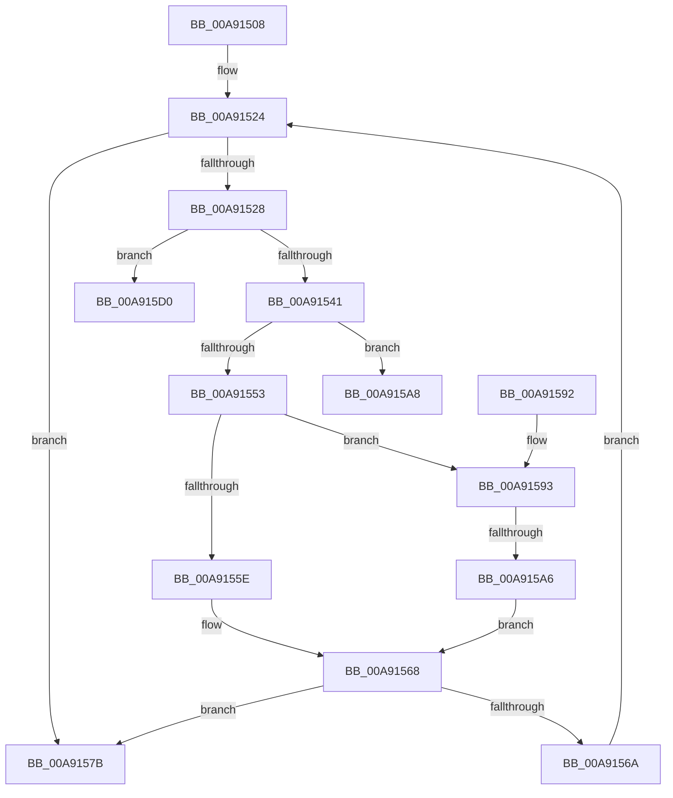

# SdbpFindMatchingName

- RVA: `0x00A91508`–`0x00A91600` (길이 `248` bytes)
- VA: `0x0000000140A91508`
- 실행 섹션: `PAGE`
- PDB 이름 있음: `예`; PDB Function 태그: `예`
- unwind 정보 RVA: `0x000B911C`
- 디코드: `69`개 명령, `248/248` bytes 표시
- 미해석 바이트: `0` (있으면 어셈블리에 `.byte`로 보존)

> 이 문서는 커널 이미지의 기계어와 PDB 기호를 분석해 생성했습니다. 4번과 5번은 함수 원형과 자료형을 바이너리 사용 방식에서 추정한 C 해석이며 원본 소스 복구 결과는 아닙니다.

## 1. Dependencies

- 직접 호출 지점: **7**; 고유 호출 대상: **5**
- 직접 호출자로 확인된 함수: **3**
- RIP 상대 이미지 참조: **3**

### Outgoing calls
- `0x00A91532` → [SdbFindFirstTag](../95/SdbFindFirstTag_function_0095E34C.md) (function, `0x0095E34C`)
- `0x00A91546` → [SdbGetStringTagPtr](../95/SdbGetStringTagPtr_function_0095DDA8.md) (function, `0x0095DDA8`)
- `0x00A91561` → [wcsicmp](../../text/50/wcsicmp_function_00500080.md) (function, `0x00500080`)
- `0x00A91572` → [SdbpGetNextIndexedRecord](SdbpGetNextIndexedRecord_function_00A91608.md) (function, `0x00A91608`)
- `0x00A91599` → [wcsicmp](../../text/50/wcsicmp_function_00500080.md) (function, `0x00500080`)
- `0x00A915C5` → [AslLogCallPrintf](../95/AslLogCallPrintf_function_0095E4EC.md) (function, `0x0095E4EC`)
- `0x00A915F5` → [AslLogCallPrintf](../95/AslLogCallPrintf_function_0095E4EC.md) (function, `0x0095E4EC`)

### Direct callers
- [SdbGetDatabaseMatchEx](../95/SdbGetDatabaseMatchEx_function_0095BD7C.md) at `0x0095BF38`
- [SdbFindFirstStringIndexedTag](../95/SdbFindFirstStringIndexedTag_function_0095C1D8.md) at `0x0095C272`
- [SdbFindNextStringIndexedTag](SdbFindNextStringIndexedTag_function_00A914C8.md) at `0x00A914EE`

### Static image references
- `0x00A915A8` → RVA `0x0003D150` (`.rdata`; read)
- `0x00A915B9` → RVA `0x0003D180` (`.rdata`; read)
- `0x00A915D4` → RVA `0x0003D198` (`.rdata`; read)

## 2. Other-region calls and transfers

- 다른 실행 섹션으로 향하는 call: **2**
  - `0x00A91561` → [wcsicmp](../../text/50/wcsicmp_function_00500080.md) (`PAGE` → `.text`)
  - `0x00A91599` → [wcsicmp](../../text/50/wcsicmp_function_00500080.md) (`PAGE` → `.text`)
- call이 아닌 외부 분기/꼬리 이동: **3**
  - `0x00A915A0` → [sub_00B46D42](../B4/Unknown_function_00B46D42.md) (`tail-transfer`)
  - `0x00A915CB` → [sub_00B46D42](../B4/Unknown_function_00B46D42.md) (`tail-transfer`)
  - `0x00A915FB` → [sub_00B46D42](../B4/Unknown_function_00B46D42.md) (`tail-transfer`)

## 3. Assembly (complete function range)

```asm
00A91508  48 89 5C 24 08                  mov qword ptr [rsp + 8], rbx
00A9150D  48 89 6C 24 10                  mov qword ptr [rsp + 0x10], rbp
00A91512  48 89 74 24 18                  mov qword ptr [rsp + 0x18], rsi
00A91517  57                              push rdi
00A91518  48 83 EC 30                     sub rsp, 0x30
00A9151C  49 8B F8                        mov rdi, r8
00A9151F  8B DA                           mov ebx, edx
00A91521  48 8B E9                        mov rbp, rcx
00A91524  85 DB                           test ebx, ebx
00A91526  74 53                           je 0x140a9157b
00A91528  44 0F B7 47 0C                  movzx r8d, word ptr [rdi + 0xc]
00A9152D  8B D3                           mov edx, ebx
00A9152F  48 8B CD                        mov rcx, rbp
00A91532  E8 15 CE EC FF                  call 0x14095e34c
00A91537  8B F0                           mov esi, eax
00A91539  85 C0                           test eax, eax
00A9153B  0F 84 8F 00 00 00               je 0x140a915d0
00A91541  8B D0                           mov edx, eax
00A91543  48 8B CD                        mov rcx, rbp
00A91546  E8 5D C8 EC FF                  call 0x14095dda8
00A9154B  48 8B C8                        mov rcx, rax
00A9154E  48 85 C0                        test rax, rax
00A91551  74 55                           je 0x140a915a8
00A91553  8B 47 14                        mov eax, dword ptr [rdi + 0x14]
00A91556  4C 8B 47 20                     mov r8, qword ptr [rdi + 0x20]
00A9155A  A8 01                           test al, 1
00A9155C  75 35                           jne 0x140a91593
00A9155E  49 8B D0                        mov rdx, r8
00A91561  E8 1A EB A6 FF                  call 0x140500080
00A91566  85 C0                           test eax, eax
00A91568  74 11                           je 0x140a9157b
00A9156A  8B 17                           mov edx, dword ptr [rdi]
00A9156C  4C 8B C7                        mov r8, rdi
00A9156F  48 8B CD                        mov rcx, rbp
00A91572  E8 91 00 00 00                  call 0x140a91608
00A91577  8B D8                           mov ebx, eax
00A91579  EB A9                           jmp 0x140a91524
00A9157B  8B C3                           mov eax, ebx
00A9157D  48 8B 5C 24 40                  mov rbx, qword ptr [rsp + 0x40]
00A91582  48 8B 6C 24 48                  mov rbp, qword ptr [rsp + 0x48]
00A91587  48 8B 74 24 50                  mov rsi, qword ptr [rsp + 0x50]
00A9158C  48 83 C4 30                     add rsp, 0x30
00A91590  5F                              pop rdi
00A91591  C3                              ret
00A91592  CC                              int3
00A91593  48 8B D1                        mov rdx, rcx
00A91596  49 8B C8                        mov rcx, r8
00A91599  E8 E2 EA A6 FF                  call 0x140500080
00A9159E  85 C0                           test eax, eax
00A915A0  0F 88 9C 57 0B 00               js 0x140b46d42
00A915A6  EB C0                           jmp 0x140a91568
00A915A8  4C 8D 0D A1 BB 5A FF            lea r9, [rip - 0xa5445f]
00A915AF  89 74 24 20                     mov dword ptr [rsp + 0x20], esi
00A915B3  41 B8 78 02 00 00               mov r8d, 0x278
00A915B9  48 8D 15 C0 BB 5A FF            lea rdx, [rip - 0xa54440]
00A915C0  B9 01 00 00 00                  mov ecx, 1
00A915C5  E8 22 CF EC FF                  call 0x14095e4ec
00A915CA  90                              nop
00A915CB  E9 72 57 0B 00                  jmp 0x140b46d42
00A915D0  0F B7 47 0C                     movzx eax, word ptr [rdi + 0xc]
00A915D4  4C 8D 0D BD BB 5A FF            lea r9, [rip - 0xa54443]
00A915DB  89 44 24 28                     mov dword ptr [rsp + 0x28], eax
00A915DF  48 8D 15 9A BB 5A FF            lea rdx, [rip - 0xa54466]
00A915E6  41 B8 6E 02 00 00               mov r8d, 0x26e
00A915EC  89 5C 24 20                     mov dword ptr [rsp + 0x20], ebx
00A915F0  B9 01 00 00 00                  mov ecx, 1
00A915F5  E8 F2 CE EC FF                  call 0x14095e4ec
00A915FA  90                              nop
00A915FB  E9 42 57 0B 00                  jmp 0x140b46d42
```

## 4. C-style interpretation (structured pseudocode)

```c
__int64 __fastcall SdbpFindMatchingName(__int64 a1, int a2, __int64 a3)
{
    __int64 result;
    __int64 v_rsp;
    unsigned __int64 v_stack_p10;
    unsigned __int64 v_stack_p18;
    unsigned int v_stack_p20;
    unsigned int v_stack_p28;
    unsigned __int64 v_stack_p8;

    v_stack_p8 = v_rbx;
    v_stack_p10 = v_rbp;
    v_stack_p18 = v_rsi;
    v_rsp = (v_rsp) - (48);
loc_00A91524:
    if ((unsigned int)((unsigned int)(a2)) == 0) goto loc_00A9157B;
    result = SdbFindFirstTag(a1, (unsigned int)((unsigned int)((unsigned int)(a2))), *(unsigned __int16 *)(a3 + 12), a4);
    if ((unsigned int)(result) == 0) goto loc_00A915D0;
    result = SdbGetStringTagPtr(a1, (unsigned int)((unsigned int)(result)), *(unsigned __int16 *)(a3 + 12), a4);
    if (result == 0) goto loc_00A915A8;
    if ((((unsigned __int8)((unsigned int)(*(unsigned int *)(a3 + 20)))) & (1)) != 0) goto loc_00A91593;
    result = wcsicmp(result, *(unsigned __int64 *)(a3 + 32), *(unsigned __int64 *)(a3 + 32), a4);
loc_00A91568:
    if ((unsigned int)(result) == 0) goto loc_00A9157B;
    result = SdbpGetNextIndexedRecord(a1, (unsigned int)(*(unsigned int *)(a3)), a3, a4);
    goto loc_00A91524;
loc_00A9157B:
    v_rsp = (v_rsp) + (48);
    return (unsigned int)((unsigned int)((unsigned int)((unsigned int)(result))));
loc_00A91593:
    result = wcsicmp(a3, a1, a3, a4);
    goto loc_00A91568;
loc_00A915A8:
    v_stack_p20 = (unsigned int)(v_stack_p18);
    result = AslLogCallPrintf(1, v_rip - 10830912, 632, v_rip - 10830943);
loc_00A915D0:
    v_stack_p28 = (unsigned int)(*(unsigned __int16 *)(a3 + 12));
    v_stack_p20 = (unsigned int)(v_stack_p8);
    result = AslLogCallPrintf(1, v_rip - 10830950, 622, v_rip - 10830915);
}
```

## 5. (Beta) C Style

```c
int64_t SdbpFindMatchingName(int64_t Arg1, int32_t Arg2, void *Arg3)
{
    uint8_t *arg3 = (uint8_t *)Arg3;

    int64_t result;
    int64_t local_rsp;
    uint64_t v_stack_p10;
    uint64_t v_stack_p18;
    uint32_t v_stack_p20;
    uint32_t v_stack_p28;
    uint64_t v_stack_p8;

    v_stack_p8 = local_rbx;
    v_stack_p10 = local_rbp;
    v_stack_p18 = local_rsi;
    local_rsp = (local_rsp) - (48);
loc_00A91524:
    if ((uint32_t)((uint32_t)(Arg2)) == 0) goto loc_00A9157B;
    result = SdbFindFirstTag(Arg1, (uint32_t)((uint32_t)((uint32_t)(Arg2))), *(uint16_t *)(arg3 + 0xC), a4);
    if ((uint32_t)(result) == 0) goto loc_00A915D0;
    result = SdbGetStringTagPtr(Arg1, (uint32_t)((uint32_t)(result)), *(uint16_t *)(arg3 + 0xC), a4);
    if (result == 0) goto loc_00A915A8;
    if ((((uint8_t)((uint32_t)(*(uint32_t *)(arg3 + 0x14)))) & (1)) != 0) goto loc_00A91593;
    result = wcsicmp(result, *(uint64_t *)(arg3 + 0x20), *(uint64_t *)(arg3 + 0x20), a4);
loc_00A91568:
    if ((uint32_t)(result) == 0) goto loc_00A9157B;
    result = SdbpGetNextIndexedRecord(Arg1, (uint32_t)(*(uint32_t *)(arg3)), Arg3, a4);
    goto loc_00A91524;
loc_00A9157B:
    local_rsp = (local_rsp) + (48);
    return (uint32_t)((uint32_t)((uint32_t)((uint32_t)(result))));
loc_00A91593:
    result = wcsicmp(Arg3, Arg1, Arg3, a4);
    goto loc_00A91568;
loc_00A915A8:
    v_stack_p20 = (uint32_t)(v_stack_p18);
    result = AslLogCallPrintf(1, v_rip - 10830912, 632, v_rip - 10830943);
loc_00A915D0:
    v_stack_p28 = (uint32_t)(*(uint16_t *)(arg3 + 0xC));
    v_stack_p20 = (uint32_t)(v_stack_p8);
    result = AslLogCallPrintf(1, v_rip - 10830950, 622, v_rip - 10830915);
}
```

### 관측된 메모리 오프셋

구조체 형식이 확인되지 않은 접근은 인자 기준의 오프셋으로만 기록했습니다.

| 기준 인자 | 오프셋 표현 | 폭 (bit) | 접근 |
|---|---:|---:|---|
| `Arg3` | `+ 0x0` | `32` | `R` |
| `Arg3` | `+ 0xC` | `16` | `R` |
| `Arg3` | `+ 0x14` | `32` | `R` |
| `Arg3` | `+ 0x20` | `64` | `R` |

## 6. Execution-region graph

[열기: 2D/3D 그래프와 함수 탐색 컨트롤 패널](../../../control-panel.html?section=page&rva=0x00A91508&view=graph)

- 2D 그래프는 위에서 아래로 흐르고, 3D 그래프는 빈 공간을 드래그해 회전합니다. Shift+드래그는 이동, 휠은 확대·축소, 함수 노드 선택은 대상 보고서 이동입니다.

### Static fallback


