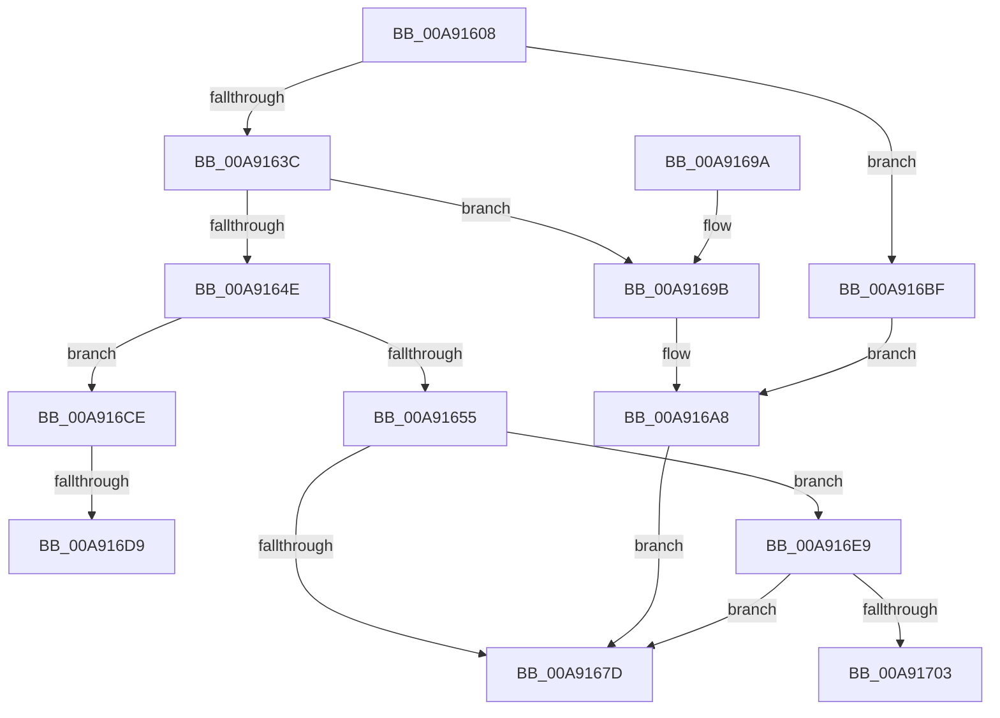

# SdbpGetNextIndexedRecord

- RVA: `0x00A91608`–`0x00A91710` (길이 `264` bytes)
- VA: `0x0000000140A91608`
- 실행 섹션: `PAGE`
- PDB 이름 있음: `예`; PDB Function 태그: `예`
- unwind 정보 RVA: `0x000B9144`
- 디코드: `69`개 명령, `264/264` bytes 표시
- 미해석 바이트: `0` (있으면 어셈블리에 `.byte`로 보존)

> 이 문서는 커널 이미지의 기계어와 PDB 기호를 분석해 생성했습니다. 4번과 5번은 함수 원형과 자료형을 바이너리 사용 방식에서 추정한 C 해석이며 원본 소스 복구 결과는 아닙니다.

## 1. Dependencies

- 직접 호출 지점: **4**; 고유 호출 대상: **4**
- 직접 호출자로 확인된 함수: **4**
- RIP 상대 이미지 참조: **3**

### Outgoing calls
- `0x00A91629` → [SdbGetTagFromTagID](../95/SdbGetTagFromTagID_function_0095E3C0.md) (function, `0x0095E3C0`)
- `0x00A91641` → [SdbpGetMappedTagData](../95/SdbpGetMappedTagData_function_0095DD24.md) (function, `0x0095DD24`)
- `0x00A9165A` → [SdbGetTagDataSize](../95/SdbGetTagDataSize_function_0095E230.md) (function, `0x0095E230`)
- `0x00A916B8` → [AslLogCallPrintf](../95/AslLogCallPrintf_function_0095E4EC.md) (function, `0x0095E4EC`)

### Direct callers
- [SdbMergeIsEntryUpdated](../81/SdbMergeIsEntryUpdated_function_00819158.md) at `0x008194E6`
- [SdbGetDatabaseMatchEx](../95/SdbGetDatabaseMatchEx_function_0095BD7C.md) at `0x0095BECF`
- [SdbFindNextStringIndexedTag](SdbFindNextStringIndexedTag_function_00A914C8.md) at `0x00A914DD`
- [SdbpFindMatchingName](SdbpFindMatchingName_function_00A91508.md) at `0x00A91572`

### Static image references
- `0x00A9169B` → RVA `0x0001C158` (`.rdata`; read)
- `0x00A916A8` → RVA `0x0001C190` (`.rdata`; read)
- `0x00A916BF` → RVA `0x00012858` (`.rdata`; read)

## 2. Other-region calls and transfers

- 다른 실행 섹션으로 향하는 call: **0**
- call이 아닌 외부 분기/꼬리 이동: **3**
  - `0x00A916D3` → [sub_00B46D4A](../B4/Unknown_function_00B46D4A.md) (`tail-transfer`)
  - `0x00A916E4` → [sub_00B46D4A](../B4/Unknown_function_00B46D4A.md) (`tail-transfer`)
  - `0x00A9170B` → [sub_00B46D4A + 0x5A](../B4/Unknown_function_00B46D4A.md) (`tail-transfer`)

## 3. Assembly (complete function range)

```asm
00A91608  48 8B C4                        mov rax, rsp
00A9160B  48 89 58 08                     mov qword ptr [rax + 8], rbx
00A9160F  48 89 68 10                     mov qword ptr [rax + 0x10], rbp
00A91613  48 89 70 18                     mov qword ptr [rax + 0x18], rsi
00A91617  48 89 78 20                     mov qword ptr [rax + 0x20], rdi
00A9161B  41 56                           push r14
00A9161D  48 83 EC 30                     sub rsp, 0x30
00A91621  49 8B D8                        mov rbx, r8
00A91624  8B F2                           mov esi, edx
00A91626  48 8B E9                        mov rbp, rcx
00A91629  E8 92 CD EC FF                  call 0x14095e3c0
00A9162E  B9 01 98 00 00                  mov ecx, 0x9801
00A91633  66 3B C1                        cmp ax, cx
00A91636  0F 85 83 00 00 00               jne 0x140a916bf
00A9163C  8B D6                           mov edx, esi
00A9163E  48 8B CD                        mov rcx, rbp
00A91641  E8 DE C6 EC FF                  call 0x14095dd24
00A91646  48 8B F8                        mov rdi, rax
00A91649  48 85 C0                        test rax, rax
00A9164C  74 4D                           je 0x140a9169b
00A9164E  8B 43 14                        mov eax, dword ptr [rbx + 0x14]
00A91651  A8 01                           test al, 1
00A91653  75 79                           jne 0x140a916ce
00A91655  8B D6                           mov edx, esi
00A91657  48 8B CD                        mov rcx, rbp
00A9165A  E8 D1 CB EC FF                  call 0x14095e230
00A9165F  44 8B 43 10                     mov r8d, dword ptr [rbx + 0x10]
00A91663  8B C8                           mov ecx, eax
00A91665  48 B8 AB AA AA AA AA AA AA AA   movabs rax, 0xaaaaaaaaaaaaaaab
00A9166F  48 F7 E1                        mul rcx
00A91672  48 C1 EA 03                     shr rdx, 3
00A91676  FF CA                           dec edx
00A91678  44 3B C2                        cmp r8d, edx
00A9167B  75 6C                           jne 0x140a916e9
00A9167D  33 C0                           xor eax, eax
00A9167F  48 8B 5C 24 40                  mov rbx, qword ptr [rsp + 0x40]
00A91684  48 8B 6C 24 48                  mov rbp, qword ptr [rsp + 0x48]
00A91689  48 8B 74 24 50                  mov rsi, qword ptr [rsp + 0x50]
00A9168E  48 8B 7C 24 58                  mov rdi, qword ptr [rsp + 0x58]
00A91693  48 83 C4 30                     add rsp, 0x30
00A91697  41 5E                           pop r14
00A91699  C3                              ret
00A9169A  CC                              int3
00A9169B  4C 8D 0D B6 AA 58 FF            lea r9, [rip - 0xa7554a]
00A916A2  41 B8 FD 02 00 00               mov r8d, 0x2fd
00A916A8  48 8D 15 E1 AA 58 FF            lea rdx, [rip - 0xa7551f]
00A916AF  89 74 24 20                     mov dword ptr [rsp + 0x20], esi
00A916B3  B9 01 00 00 00                  mov ecx, 1
00A916B8  E8 2F CE EC FF                  call 0x14095e4ec
00A916BD  EB BE                           jmp 0x140a9167d
00A916BF  4C 8D 0D 92 11 58 FF            lea r9, [rip - 0xa7ee6e]
00A916C6  41 B8 F6 02 00 00               mov r8d, 0x2f6
00A916CC  EB DA                           jmp 0x140a916a8
00A916CE  8B 73 04                        mov esi, dword ptr [rbx + 4]
00A916D1  85 F6                           test esi, esi
00A916D3  0F 85 71 56 0B 00               jne 0x140b46d4a
00A916D9  8B 43 10                        mov eax, dword ptr [rbx + 0x10]
00A916DC  48 8D 0C 40                     lea rcx, [rax + rax*2]
00A916E0  8B 74 8F 08                     mov esi, dword ptr [rdi + rcx*4 + 8]
00A916E4  E9 61 56 0B 00                  jmp 0x140b46d4a
00A916E9  4B 8D 0C 40                     lea rcx, [r8 + r8*2]
00A916ED  48 8B 14 8F                     mov rdx, qword ptr [rdi + rcx*4]
00A916F1  41 8D 48 01                     lea ecx, [r8 + 1]
00A916F5  4C 8D 04 49                     lea r8, [rcx + rcx*2]
00A916F9  4A 3B 14 87                     cmp rdx, qword ptr [rdi + r8*4]
00A916FD  0F 85 7A FF FF FF               jne 0x140a9167d
00A91703  89 4B 10                        mov dword ptr [rbx + 0x10], ecx
00A91706  42 8B 7C 87 08                  mov edi, dword ptr [rdi + r8*4 + 8]
00A9170B  E9 94 56 0B 00                  jmp 0x140b46da4
```

## 4. C-style interpretation (structured pseudocode)

```c
__int64 __fastcall SdbpGetNextIndexedRecord(__int64 a1, int a2, __int64 a3)
{
    __int64 result;
    __int64 v_rsp;
    unsigned __int64 v_stack_p10;
    unsigned __int64 v_stack_p18;
    unsigned __int64 v_stack_p20;
    unsigned __int64 v_stack_p8;

    *(unsigned __int64 *)(v_rsp + 8) = v_rbx;
    *(unsigned __int64 *)(v_rsp + 16) = v_rbp;
    *(unsigned __int64 *)(v_rsp + 24) = v_rsi;
    *(unsigned __int64 *)(v_rsp + 32) = v_rdi;
    v_rsp = (v_rsp) - (48);
    result = SdbGetTagFromTagID(a1, a2, a3, a4);
    if (((unsigned __int16)(result)) != ((unsigned __int16)((unsigned int)(0x9801ULL)))) goto loc_00A916BF;
    result = SdbpGetMappedTagData(a1, (unsigned int)((unsigned int)((unsigned int)(a2))), a3, a4);
    if (result == 0) goto loc_00A9169B;
    if ((((unsigned __int8)((unsigned int)(*(unsigned int *)(a3 + 20)))) & (1)) != 0) goto loc_00A916CE;
    result = SdbGetTagDataSize(a1, (unsigned int)((unsigned int)((unsigned int)(a2))), a3, a4);
    a2 = ((unsigned int)((unsigned int)((unsigned int)(a2)))) >> (3);
    a2 = (unsigned int)((a2) - 1);
    if (((unsigned int)((unsigned int)(*(unsigned int *)(a3 + 16)))) != a2) goto loc_00A916E9;
loc_00A9167D:
    result = 0;
    v_rsp = (v_rsp) + (48);
    return result;
loc_00A9169B:
loc_00A916A8:
    v_stack_p20 = (unsigned int)(v_stack_p18);
    result = AslLogCallPrintf(1, v_rip - 10966303, 765, v_rip - 10966346);
    goto loc_00A9167D;
loc_00A916BF:
    goto loc_00A916A8;
loc_00A916CE:
loc_00A916E9:
    if ((*(unsigned __int64 *)(v_stack_p20 + 758 + 758 * 2 * 4)) != (*(unsigned __int64 *)(v_stack_p20 + 758 + 1 + 758 + 1 * 2 * 4))) goto loc_00A9167D;
    *(unsigned int *)(v_stack_p8 + 16) = (unsigned int)(758 + 1);
}
```

## 5. (Beta) C Style

```c
int64_t SdbpGetNextIndexedRecord(int64_t Arg1, int32_t Arg2, void *Arg3)
{
    uint8_t *arg3 = (uint8_t *)Arg3;

    int64_t result;
    int64_t local_rsp;
    uint64_t v_stack_p10;
    uint64_t v_stack_p18;
    uint64_t v_stack_p20;
    uint64_t v_stack_p8;

    *(uint64_t *)(local_rsp + 0x8) = local_rbx;
    *(uint64_t *)(local_rsp + 0x10) = local_rbp;
    *(uint64_t *)(local_rsp + 0x18) = local_rsi;
    *(uint64_t *)(local_rsp + 0x20) = local_rdi;
    local_rsp = (local_rsp) - (48);
    result = SdbGetTagFromTagID(Arg1, Arg2, Arg3, a4);
    if (((uint16_t)(result)) != ((uint16_t)((uint32_t)(0x9801ULL)))) goto loc_00A916BF;
    result = SdbpGetMappedTagData(Arg1, (uint32_t)((uint32_t)((uint32_t)(Arg2))), Arg3, a4);
    if (result == 0) goto loc_00A9169B;
    if ((((uint8_t)((uint32_t)(*(uint32_t *)(arg3 + 0x14)))) & (1)) != 0) goto loc_00A916CE;
    result = SdbGetTagDataSize(Arg1, (uint32_t)((uint32_t)((uint32_t)(Arg2))), Arg3, a4);
    Arg2 = ((uint32_t)((uint32_t)((uint32_t)(Arg2)))) >> (3);
    Arg2 = (uint32_t)((Arg2) - 1);
    if (((uint32_t)((uint32_t)(*(uint32_t *)(arg3 + 0x10)))) != Arg2) goto loc_00A916E9;
loc_00A9167D:
    result = 0;
    local_rsp = (local_rsp) + (48);
    return result;
loc_00A9169B:
loc_00A916A8:
    v_stack_p20 = (uint32_t)(v_stack_p18);
    result = AslLogCallPrintf(1, v_rip - 10966303, 765, v_rip - 10966346);
    goto loc_00A9167D;
loc_00A916BF:
    goto loc_00A916A8;
loc_00A916CE:
loc_00A916E9:
    if ((*(uint64_t *)(v_stack_p20 + 0x2F6 + 0x2F6 * 2 * 4)) != (*(uint64_t *)(v_stack_p20 + 0x2F6 + 0x1 + 0x2F6 + 0x1 * 2 * 4))) goto loc_00A9167D;
    *(uint32_t *)(v_stack_p8 + 0x10) = (uint32_t)(758 + 1);
}
```

### 관측된 메모리 오프셋

구조체 형식이 확인되지 않은 접근은 인자 기준의 오프셋으로만 기록했습니다.

| 기준 인자 | 오프셋 표현 | 폭 (bit) | 접근 |
|---|---:|---:|---|
| `Arg3` | `+ 0x4` | `32` | `R` |
| `Arg3` | `+ 0x10` | `32` | `R` |
| `Arg3` | `+ 0x10` | `32` | `W` |
| `Arg3` | `+ 0x14` | `32` | `R` |

## 6. Execution-region graph

[열기: 2D/3D 그래프와 함수 탐색 컨트롤 패널](../../../control-panel.html?section=page&rva=0x00A91608&view=graph)

- 2D 그래프는 위에서 아래로 흐르고, 3D 그래프는 빈 공간을 드래그해 회전합니다. Shift+드래그는 이동, 휠은 확대·축소, 함수 노드 선택은 대상 보고서 이동입니다.

### Static fallback


