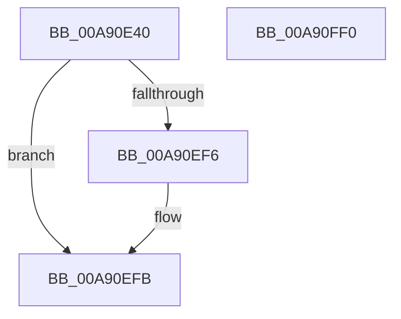

# SeAuditHardLinkCreationWithTransaction

- RVA: `0x00A90E40`–`0x00A90FF1` (길이 `433` bytes)
- VA: `0x0000000140A90E40`
- 실행 섹션: `PAGE`
- PDB 이름 있음: `예`; PDB Function 태그: `아니요`
- unwind 정보 RVA: `0x000B8FF4`
- 디코드: `98`개 명령, `433/433` bytes 표시
- 미해석 바이트: `0` (있으면 어셈블리에 `.byte`로 보존)

> 이 문서는 커널 이미지의 기계어와 PDB 기호를 분석해 생성했습니다. 4번과 5번은 함수 원형과 자료형을 바이너리 사용 방식에서 추정한 C 해석이며 원본 소스 복구 결과는 아닙니다.

## 1. Dependencies

- 직접 호출 지점: **5**; 고유 호출 대상: **5**
- 직접 호출자로 확인된 함수: **1**
- RIP 상대 이미지 참조: **2**

### Outgoing calls
- `0x00A90EAD` → [memset](../../text/6C/memset_function_006C6C40.md) (function, `0x006C6C40`)
- `0x00A90F00` → [SeCaptureSubjectContext](../86/SeCaptureSubjectContext_function_0086B820.md) (function, `0x0086B820`)
- `0x00A90FB1` → [SepAdtLogAuditRecord](../../text/22/SepAdtLogAuditRecord_function_00224B6C.md) (function, `0x00224B6C`)
- `0x00A90FBB` → [SeReleaseSubjectContext](../86/SeReleaseSubjectContext_function_0086B710.md) (function, `0x0086B710`)
- `0x00A90FCA` → [_security_check_cookie](../../text/6A/_security_check_cookie_function_006AC640.md) (function, `0x006AC640`)

### Direct callers
- [SeAuditHardLinkCreation](../79/SeAuditHardLinkCreation_function_0079E9F0.md) at `0x0079E9F7`

### Static image references
- `0x00A90E66` → RVA `0x00E0A740` (`.data`; read)
- `0x00A90F8C` → RVA `0x000013A8` (`.rdata`; read)

## 2. Other-region calls and transfers

- 다른 실행 섹션으로 향하는 call: **3**
  - `0x00A90EAD` → [memset](../../text/6C/memset_function_006C6C40.md) (`PAGE` → `.text`)
  - `0x00A90FB1` → [SepAdtLogAuditRecord](../../text/22/SepAdtLogAuditRecord_function_00224B6C.md) (`PAGE` → `.text`)
  - `0x00A90FCA` → [_security_check_cookie](../../text/6A/_security_check_cookie_function_006AC640.md) (`PAGE` → `.text`)
- 별도 외부 분기/꼬리 이동을 확인하지 못했습니다.

## 3. Assembly (complete function range)

```asm
00A90E40  48 8B C4                        mov rax, rsp
00A90E43  48 89 58 08                     mov qword ptr [rax + 8], rbx
00A90E47  48 89 70 10                     mov qword ptr [rax + 0x10], rsi
00A90E4B  48 89 78 18                     mov qword ptr [rax + 0x18], rdi
00A90E4F  4C 89 60 20                     mov qword ptr [rax + 0x20], r12
00A90E53  55                              push rbp
00A90E54  41 56                           push r14
00A90E56  41 57                           push r15
00A90E58  48 8D A8 68 FC FF FF            lea rbp, [rax - 0x398]
00A90E5F  48 81 EC 80 04 00 00            sub rsp, 0x480
00A90E66  48 8B 05 D3 98 37 00            mov rax, qword ptr [rip + 0x3798d3]
00A90E6D  48 33 C4                        xor rax, rsp
00A90E70  48 89 85 70 03 00 00            mov qword ptr [rbp + 0x370], rax
00A90E77  48 83 64 24 20 00               and qword ptr [rsp + 0x20], 0
00A90E7D  41 8A F8                        mov dil, r8b
00A90E80  4C 8B F2                        mov r14, rdx
00A90E83  C7 44 24 28 00 00 00 80         mov dword ptr [rsp + 0x28], 0x80000000
00A90E8B  4C 8B F9                        mov r15, rcx
00A90E8E  33 C0                           xor eax, eax
00A90E90  0F 57 C0                        xorps xmm0, xmm0
00A90E93  89 44 24 2C                     mov dword ptr [rsp + 0x2c], eax
00A90E97  33 D2                           xor edx, edx
00A90E99  48 8D 4C 24 40                  lea rcx, [rsp + 0x40]
00A90E9E  41 B8 18 04 00 00               mov r8d, 0x418
00A90EA4  49 8B D9                        mov rbx, r9
00A90EA7  F3 0F 7F 44 24 30               movdqu xmmword ptr [rsp + 0x30], xmm0
00A90EAD  E8 8E 5D C3 FF                  call 0x1406c6c40
00A90EB2  B8 75 00 00 00                  mov eax, 0x75
00A90EB7  C7 44 24 40 03 00 00 00         mov dword ptr [rsp + 0x40], 3
00A90EBF  48 85 DB                        test rbx, rbx
00A90EC2  66 89 44 24 50                  mov word ptr [rsp + 0x50], ax
00A90EC7  48 8D B5 60 03 00 00            lea rsi, [rbp + 0x360]
00A90ECE  C7 44 24 44 38 12 00 00         mov dword ptr [rsp + 0x44], 0x1238
00A90ED6  48 0F 45 F3                     cmovne rsi, rbx
00A90EDA  0F 57 C0                        xorps xmm0, xmm0
00A90EDD  44 8D 60 93                     lea r12d, [rax - 0x6d]
00A90EE1  66 44 89 64 24 52               mov word ptr [rsp + 0x52], r12w
00A90EE7  8D 58 9B                        lea ebx, [rax - 0x65]
00A90EEA  0F 11 85 60 03 00 00            movups xmmword ptr [rbp + 0x360], xmm0
00A90EF1  40 84 FF                        test dil, dil
00A90EF4  75 05                           jne 0x140a90efb
00A90EF6  66 89 5C 24 52                  mov word ptr [rsp + 0x52], bx
00A90EFB  48 8D 4C 24 20                  lea rcx, [rsp + 0x20]
00A90F00  E8 1B A9 DD FF                  call 0x14086b820
00A90F05  48 8B 4C 24 20                  mov rcx, qword ptr [rsp + 0x20]
00A90F0A  4C 8B 44 24 30                  mov r8, qword ptr [rsp + 0x30]
00A90F0F  48 85 C9                        test rcx, rcx
00A90F12  49 8B C0                        mov rax, r8
00A90F15  C7 44 24 58 04 00 00 00         mov dword ptr [rsp + 0x58], 4
00A90F1D  48 0F 45 C1                     cmovne rax, rcx
00A90F21  C7 44 24 78 01 00 00 00         mov dword ptr [rsp + 0x78], 1
00A90F29  4C 0F 45 C1                     cmovne r8, rcx
00A90F2D  C7 44 24 7C 20 00 00 00         mov dword ptr [rsp + 0x7c], 0x20
00A90F35  B9 02 00 00 00                  mov ecx, 2
00A90F3A  C7 45 98 05 00 00 00            mov dword ptr [rbp - 0x68], 5
00A90F41  89 4D B8                        mov dword ptr [rbp - 0x48], ecx
00A90F44  48 8B 80 98 00 00 00            mov rax, qword ptr [rax + 0x98]
00A90F4B  89 4D D8                        mov dword ptr [rbp - 0x28], ecx
00A90F4E  48 8D 4C 24 40                  lea rcx, [rsp + 0x40]
00A90F53  44 89 65 9C                     mov dword ptr [rbp - 0x64], r12d
00A90F57  4C 89 7D D0                     mov qword ptr [rbp - 0x30], r15
00A90F5B  48 8B 10                        mov rdx, qword ptr [rax]
00A90F5E  48 89 54 24 70                  mov qword ptr [rsp + 0x70], rdx
00A90F63  4C 89 75 F0                     mov qword ptr [rbp - 0x10], r14
00A90F67  C7 45 F8 0D 00 00 00            mov dword ptr [rbp - 8], 0xd
00A90F6E  0F B6 42 01                     movzx eax, byte ptr [rdx + 1]
00A90F72  89 5D FC                        mov dword ptr [rbp - 4], ebx
00A90F75  48 89 75 10                     mov qword ptr [rbp + 0x10], rsi
00A90F79  C7 44 24 48 06 00 00 00         mov dword ptr [rsp + 0x48], 6
00A90F81  8D 04 85 08 00 00 00            lea eax, [rax*4 + 8]
00A90F88  89 44 24 5C                     mov dword ptr [rsp + 0x5c], eax
00A90F8C  48 8D 05 15 04 57 FF            lea rax, [rip - 0xa8fbeb]
00A90F93  48 89 45 90                     mov qword ptr [rbp - 0x70], rax
00A90F97  49 8B 40 18                     mov rax, qword ptr [r8 + 0x18]
00A90F9B  48 89 45 A0                     mov qword ptr [rbp - 0x60], rax
00A90F9F  41 0F B7 07                     movzx eax, word ptr [r15]
00A90FA3  03 C3                           add eax, ebx
00A90FA5  89 45 BC                        mov dword ptr [rbp - 0x44], eax
00A90FA8  41 0F B7 06                     movzx eax, word ptr [r14]
00A90FAC  03 C3                           add eax, ebx
00A90FAE  89 45 DC                        mov dword ptr [rbp - 0x24], eax
00A90FB1  E8 B6 3B 79 FF                  call 0x140224b6c
00A90FB6  48 8D 4C 24 20                  lea rcx, [rsp + 0x20]
00A90FBB  E8 50 A7 DD FF                  call 0x14086b710
00A90FC0  48 8B 8D 70 03 00 00            mov rcx, qword ptr [rbp + 0x370]
00A90FC7  48 33 CC                        xor rcx, rsp
00A90FCA  E8 71 B6 C1 FF                  call 0x1406ac640
00A90FCF  4C 8D 9C 24 80 04 00 00         lea r11, [rsp + 0x480]
00A90FD7  49 8B 5B 20                     mov rbx, qword ptr [r11 + 0x20]
00A90FDB  49 8B 73 28                     mov rsi, qword ptr [r11 + 0x28]
00A90FDF  49 8B 7B 30                     mov rdi, qword ptr [r11 + 0x30]
00A90FE3  4D 8B 63 38                     mov r12, qword ptr [r11 + 0x38]
00A90FE7  49 8B E3                        mov rsp, r11
00A90FEA  41 5F                           pop r15
00A90FEC  41 5E                           pop r14
00A90FEE  5D                              pop rbp
00A90FEF  C3                              ret
00A90FF0  CC                              int3
```

## 4. C-style interpretation (structured pseudocode)

```c
__int64 __fastcall SeAuditHardLinkCreationWithTransaction(__int64 a1, __int64 a2, unsigned __int8 a3, __int64 a4)
{
    __int64 result;
    __int64 v_rsi;
    __int64 v_rsp;
    unsigned __int64 v_stack_m18;
    unsigned int v_stack_m41C;
    unsigned int v_stack_m420;
    unsigned __int64 v_stack_m428;
    unsigned int v_stack_m43C;
    unsigned int v_stack_m440;
    unsigned __int16 v_stack_m446;
    unsigned __int16 v_stack_m448;
    unsigned int v_stack_m450;
    unsigned int v_stack_m454;
    unsigned __int64 v_stack_m458;
    unsigned __int64 v_stack_m468;
    unsigned int v_stack_m46C;
    unsigned int v_stack_m470;
    unsigned __int64 v_stack_m478;

    *(unsigned __int64 *)(v_rsp + 8) = v_rbx;
    *(unsigned __int64 *)(v_rsp + 16) = v_rsi;
    *(unsigned __int64 *)(v_rsp + 24) = v_rdi;
    *(unsigned __int64 *)(v_rsp + 32) = v_r12;
    v_rsp = (v_rsp) - (0x480ULL);
    result = (*(unsigned __int64 *)(v_rip + 3643603)) ^ (v_rsp);
    *(unsigned __int64 *)(v_rsp - 920 + 880) = result;
    v_stack_m470 = 0x80000000ULL;
    result = 0;
    v_stack_m46C = 0;
    a2 = 0;
    v_stack_m468 = v_xmm0;
    result = memset(v_stack_m458, a2, (unsigned int)(0x418ULL), a4);
    v_stack_m458 = 3;
    v_stack_m448 = 117;
    v_stack_m454 = 0x1238ULL;
    v_rsi = v_rsp - 920 + 864;
    if (a4 != 0) { v_rsi = a4; }
    v_stack_m446 = (unsigned __int16)(117 - 109);
    *(unsigned __int64 *)(v_rsp - 920 + 864) = v_xmm0;
    if (a3 == 0) {
        v_stack_m446 = (unsigned __int16)(117 - 101);
    }
    result = SeCaptureSubjectContext(v_stack_m478, a2, (unsigned int)(0x418ULL), a4);
    v_stack_m440 = 4;
    result = v_stack_m468;
    if (v_stack_m478 != 0) { result = v_stack_m478; }
    v_stack_m420 = 1;
    a3 = v_stack_m468;
    if (v_stack_m478 != 0) { a3 = v_stack_m478; }
    v_stack_m41C = 32;
    *(unsigned int *)(v_rsp - 920 - 104) = 5;
    *(unsigned int *)(v_rsp - 920 - 72) = 2;
    *(unsigned int *)(v_rsp - 920 - 40) = 2;
    *(unsigned int *)(v_rsp - 920 - 100) = (unsigned int)(117 - 109);
    *(unsigned __int64 *)(v_rsp - 920 - 48) = a1;
    v_stack_m428 = *(unsigned __int64 *)(*(unsigned __int64 *)(result + 152));
    *(unsigned __int64 *)(v_rsp - 920 - 16) = 0;
    *(unsigned int *)(v_rsp - 920 - 8) = 13;
    *(unsigned int *)(v_rsp - 920 - 4) = (unsigned int)(117 - 101);
    *(unsigned __int64 *)(v_rsp - 920 + 16) = v_rsi;
    v_stack_m450 = 6;
    v_stack_m43C = (unsigned int)(*(unsigned __int8 *)(*(unsigned __int64 *)(*(unsigned __int64 *)(result + 152)) + 1) * 4 + 8);
    *(unsigned __int64 *)(v_rsp - 920 - 112) = v_rip - 11074539;
    *(unsigned __int64 *)(v_rsp - 920 - 96) = *(unsigned __int64 *)(a3 + 24);
    result = (unsigned int)((*(unsigned __int16 *)(a1)) + ((unsigned int)(117 - 101)));
    *(unsigned int *)(v_rsp - 920 - 68) = (unsigned int)(result);
    result = (unsigned int)((*(unsigned __int16 *)(a2)) + ((unsigned int)(117 - 101)));
    *(unsigned int *)(v_rsp - 920 - 36) = (unsigned int)(result);
    result = SepAdtLogAuditRecord(v_stack_m458, *(unsigned __int64 *)(*(unsigned __int64 *)(result + 152)), a3, a4);
    result = SeReleaseSubjectContext(v_stack_m478, *(unsigned __int64 *)(*(unsigned __int64 *)(result + 152)), a3, a4);
    a1 = (*(unsigned __int64 *)(v_rsp - 920 + 880)) ^ (v_rsp);
    result = _security_check_cookie(a1, *(unsigned __int64 *)(*(unsigned __int64 *)(result + 152)), a3, a4);
    return result;
}
```

## 5. (Beta) C Style

```c
int64_t SeAuditHardLinkCreationWithTransaction(void *Arg1, void *Arg2, uint8_t Arg3, int64_t Arg4)
{
    uint8_t *arg1 = (uint8_t *)Arg1;
    uint8_t *arg2 = (uint8_t *)Arg2;

    int64_t result;
    int64_t local_rsi;
    int64_t local_rsp;
    uint64_t v_stack_m18;
    uint32_t v_stack_m41C;
    uint32_t v_stack_m420;
    uint64_t v_stack_m428;
    uint32_t v_stack_m43C;
    uint32_t v_stack_m440;
    uint16_t v_stack_m446;
    uint16_t v_stack_m448;
    uint32_t v_stack_m450;
    uint32_t v_stack_m454;
    uint64_t v_stack_m458;
    uint64_t v_stack_m468;
    uint32_t v_stack_m46C;
    uint32_t v_stack_m470;
    uint64_t v_stack_m478;

    *(uint64_t *)(local_rsp + 0x8) = local_rbx;
    *(uint64_t *)(local_rsp + 0x10) = local_rsi;
    *(uint64_t *)(local_rsp + 0x18) = local_rdi;
    *(uint64_t *)(local_rsp + 0x20) = local_r12;
    local_rsp = (local_rsp) - (0x480ULL);
    result = (*(uint64_t *)(v_rip + 0x3798D3)) ^ (local_rsp);
    *(uint64_t *)(local_rsp - 0x398 + 0x370) = result;
    v_stack_m470 = 0x80000000ULL;
    result = 0;
    v_stack_m46C = 0;
    Arg2 = 0;
    v_stack_m468 = v_xmm0;
    result = memset(v_stack_m458, Arg2, (uint32_t)(0x418ULL), Arg4);
    v_stack_m458 = 3;
    v_stack_m448 = 117;
    v_stack_m454 = 0x1238ULL;
    local_rsi = local_rsp - 920 + 864;
    if (Arg4 != 0) { local_rsi = Arg4; }
    v_stack_m446 = (uint16_t)(117 - 109);
    *(uint64_t *)(local_rsp - 0x398 + 0x360) = v_xmm0;
    if (Arg3 == 0) {
        v_stack_m446 = (uint16_t)(117 - 101);
    }
    result = SeCaptureSubjectContext(v_stack_m478, Arg2, (uint32_t)(0x418ULL), Arg4);
    v_stack_m440 = 4;
    result = v_stack_m468;
    if (v_stack_m478 != 0) { result = v_stack_m478; }
    v_stack_m420 = 1;
    Arg3 = v_stack_m468;
    if (v_stack_m478 != 0) { Arg3 = v_stack_m478; }
    v_stack_m41C = 32;
    *(uint32_t *)(local_rsp - 0x398 - 0x68) = 5;
    *(uint32_t *)(local_rsp - 0x398 - 0x48) = 2;
    *(uint32_t *)(local_rsp - 0x398 - 0x28) = 2;
    *(uint32_t *)(local_rsp - 0x398 - 0x64) = (uint32_t)(117 - 109);
    *(void **)(local_rsp - 0x398 - 0x30) = Arg1;
    v_stack_m428 = *(uint64_t *)(*(uint64_t *)(result + 0x98));
    *(uint64_t *)(local_rsp - 0x398 - 0x10) = 0;
    *(uint32_t *)(local_rsp - 0x398 - 0x8) = 13;
    *(uint32_t *)(local_rsp - 0x398 - 0x4) = (uint32_t)(117 - 101);
    *(uint64_t *)(local_rsp - 0x398 + 0x10) = local_rsi;
    v_stack_m450 = 6;
    v_stack_m43C = (uint32_t)(*(uint8_t *)(*(uint64_t *)(*(uint64_t *)(result + 0x98)) + 0x1) * 4 + 8);
    *(uint64_t *)(local_rsp - 0x398 - 0x70) = v_rip - 11074539;
    *(uint64_t *)(local_rsp - 0x398 - 0x60) = *(uint64_t *)(Arg3 + 0x18);
    result = (uint32_t)((*(uint16_t *)(arg1)) + ((uint32_t)(117 - 101)));
    *(uint32_t *)(local_rsp - 0x398 - 0x44) = (uint32_t)(result);
    result = (uint32_t)((*(uint16_t *)(arg2)) + ((uint32_t)(117 - 101)));
    *(uint32_t *)(local_rsp - 0x398 - 0x24) = (uint32_t)(result);
    result = SepAdtLogAuditRecord(v_stack_m458, *(uint64_t *)(*(uint64_t *)(result + 0x98)), Arg3, Arg4);
    result = SeReleaseSubjectContext(v_stack_m478, *(uint64_t *)(*(uint64_t *)(result + 0x98)), Arg3, Arg4);
    Arg1 = (*(uint64_t *)(local_rsp - 0x398 + 0x370)) ^ (local_rsp);
    result = _security_check_cookie(Arg1, *(uint64_t *)(*(uint64_t *)(result + 0x98)), Arg3, Arg4);
    return result;
}
```

### 관측된 메모리 오프셋

구조체 형식이 확인되지 않은 접근은 인자 기준의 오프셋으로만 기록했습니다.

| 기준 인자 | 오프셋 표현 | 폭 (bit) | 접근 |
|---|---:|---:|---|
| `Arg1` | `+ 0x0` | `16` | `R` |
| `Arg2` | `+ 0x0` | `16` | `R` |

## 6. Execution-region graph

[열기: 2D/3D 그래프와 함수 탐색 컨트롤 패널](../../../control-panel.html?section=page&rva=0x00A90E40&view=graph)

- 2D 그래프는 위에서 아래로 흐르고, 3D 그래프는 빈 공간을 드래그해 회전합니다. Shift+드래그는 이동, 휠은 확대·축소, 함수 노드 선택은 대상 보고서 이동입니다.

### Static fallback


