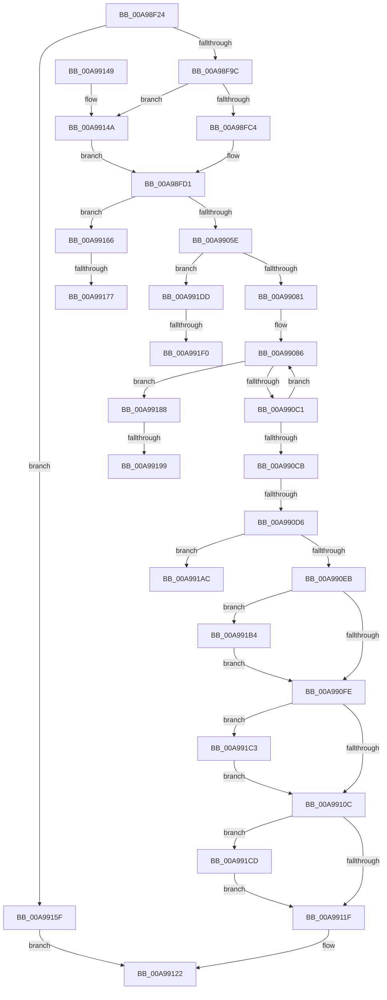

# SepCleanupLUIDDeviceMapDirectory

- RVA: `0x00A98F24`–`0x00A99200` (길이 `732` bytes)
- VA: `0x0000000140A98F24`
- 실행 섹션: `PAGE`
- PDB 이름 있음: `예`; PDB Function 태그: `예`
- unwind 정보 RVA: `0x000BA118`
- 디코드: `181`개 명령, `732/732` bytes 표시
- 미해석 바이트: `0` (있으면 어셈블리에 `.byte`로 보존)

> 이 문서는 커널 이미지의 기계어와 PDB 기호를 분석해 생성했습니다. 4번과 5번은 함수 원형과 자료형을 바이너리 사용 방식에서 추정한 C 해석이며 원본 소스 복구 결과는 아닙니다.

## 1. Dependencies

- 직접 호출 지점: **21**; 고유 호출 대상: **15**
- 직접 호출자로 확인된 함수: **2**
- RIP 상대 이미지 참조: **3**

### Outgoing calls
- `0x00A98FB4` → [ObReferenceObjectSafeWithTag](../../text/21/ObReferenceObjectSafeWithTag_function_00210EE0.md) (function, `0x00210EE0`)
- `0x00A98FCC` → [ObfDereferenceObjectWithTag](../../text/2F/ObfDereferenceObjectWithTag_function_002F78E0.md) (function, `0x002F78E0`)
- `0x00A98FD4` → [PsGetServerSiloServiceSessionId](../../text/45/PsGetServerSiloServiceSessionId_function_0045ED00.md) (function, `0x0045ED00`)
- `0x00A98FF9` → [swprintf_s](../../text/50/swprintf_s_function_00504B20.md) (function, `0x00504B20`)
- `0x00A99006` → [RtlInitUnicodeString](../../text/42/RtlInitUnicodeString_function_0042A780.md) (function, `0x0042A780`)
- `0x00A99033` → [PsAttachSiloToCurrentThread](../../text/44/PsAttachSiloToCurrentThread_function_004428C0.md) (function, `0x004428C0`)
- `0x00A9904F` → [ZwOpenDirectoryObject](../../text/6A/ZwOpenDirectoryObject_function_006ADBD0.md) (function, `0x006ADBD0`)
- `0x00A99070` → [ExAllocatePool2](../../poolcode/B8/ExAllocatePool2_function_00B820F0.md) (function, `0x00B820F0`)
- `0x00A990AF` → [ZwQueryDirectoryObject](../../text/6A/ZwQueryDirectoryObject_function_006AFAB0.md) (function, `0x006AFAB0`)
- `0x00A990F0` → [ExFreePoolWithTag](../../poolcode/B8/ExFreePoolWithTag_function_00B82870.md) (function, `0x00B82870`)
- `0x00A99111` → [PsDetachSiloFromCurrentThread](../../text/44/PsDetachSiloFromCurrentThread_function_00449AC0.md) (function, `0x00449AC0`)
- `0x00A99129` → [_security_check_cookie](../../text/6A/_security_check_cookie_function_006AC640.md) (function, `0x006AC640`)
- `0x00A99155` → [KeStackAttachProcess](../../text/21/KeStackAttachProcess_function_00216800.md) (function, `0x00216800`)
- `0x00A99169` → [PsDetachSiloFromCurrentThread](../../text/44/PsDetachSiloFromCurrentThread_function_00449AC0.md) (function, `0x00449AC0`)
- `0x00A9917D` → [KiUnstackDetachProcess](../../text/21/KiUnstackDetachProcess_function_00217D30.md) (function, `0x00217D30`)
- `0x00A9919E` → [ExFreePoolWithTag](../../poolcode/B8/ExFreePoolWithTag_function_00B82870.md) (function, `0x00B82870`)
- `0x00A991B9` → [ExFreePoolWithTag](../../poolcode/B8/ExFreePoolWithTag_function_00B82870.md) (function, `0x00B82870`)
- `0x00A991C3` → [ZwClose](../../text/6A/ZwClose_function_006AD2B0.md) (function, `0x006AD2B0`)
- `0x00A991D3` → [KiUnstackDetachProcess](../../text/21/KiUnstackDetachProcess_function_00217D30.md) (function, `0x00217D30`)
- `0x00A991E2` → [ZwClose](../../text/6A/ZwClose_function_006AD2B0.md) (function, `0x006AD2B0`)
- `0x00A991F5` → [ExFreePoolWithTag](../../poolcode/B8/ExFreePoolWithTag_function_00B82870.md) (function, `0x00B82870`)

### Direct callers
- [SepDeleteLogonSessionTrack](../AA/SepDeleteLogonSessionTrack_function_00AA04E0.md) at `0x00AA0614`
- [SepDeReferenceLogonSession](../AF/SepDeReferenceLogonSession_function_00AF25EC.md) at `0x00AF27B0`

### Static image references
- `0x00A98F40` → RVA `0x00E0A740` (`.data`; read)
- `0x00A98FDC` → RVA `0x00B060B0` (` ?? ::NNGAKEGL::`string'`; read)
- `0x00A9914A` → RVA `0x00FC6AB0` (`ALMOSTRO`; read)

## 2. Other-region calls and transfers

- 다른 실행 섹션으로 향하는 call: **21**
  - `0x00A98FB4` → [ObReferenceObjectSafeWithTag](../../text/21/ObReferenceObjectSafeWithTag_function_00210EE0.md) (`PAGE` → `.text`)
  - `0x00A98FCC` → [ObfDereferenceObjectWithTag](../../text/2F/ObfDereferenceObjectWithTag_function_002F78E0.md) (`PAGE` → `.text`)
  - `0x00A98FD4` → [PsGetServerSiloServiceSessionId](../../text/45/PsGetServerSiloServiceSessionId_function_0045ED00.md) (`PAGE` → `.text`)
  - `0x00A98FF9` → [swprintf_s](../../text/50/swprintf_s_function_00504B20.md) (`PAGE` → `.text`)
  - `0x00A99006` → [RtlInitUnicodeString](../../text/42/RtlInitUnicodeString_function_0042A780.md) (`PAGE` → `.text`)
  - `0x00A99033` → [PsAttachSiloToCurrentThread](../../text/44/PsAttachSiloToCurrentThread_function_004428C0.md) (`PAGE` → `.text`)
  - `0x00A9904F` → [ZwOpenDirectoryObject](../../text/6A/ZwOpenDirectoryObject_function_006ADBD0.md) (`PAGE` → `.text`)
  - `0x00A99070` → [ExAllocatePool2](../../poolcode/B8/ExAllocatePool2_function_00B820F0.md) (`PAGE` → `POOLCODE`)
  - `0x00A990AF` → [ZwQueryDirectoryObject](../../text/6A/ZwQueryDirectoryObject_function_006AFAB0.md) (`PAGE` → `.text`)
  - `0x00A990F0` → [ExFreePoolWithTag](../../poolcode/B8/ExFreePoolWithTag_function_00B82870.md) (`PAGE` → `POOLCODE`)
  - `0x00A99111` → [PsDetachSiloFromCurrentThread](../../text/44/PsDetachSiloFromCurrentThread_function_00449AC0.md) (`PAGE` → `.text`)
  - `0x00A99129` → [_security_check_cookie](../../text/6A/_security_check_cookie_function_006AC640.md) (`PAGE` → `.text`)
  - `0x00A99155` → [KeStackAttachProcess](../../text/21/KeStackAttachProcess_function_00216800.md) (`PAGE` → `.text`)
  - `0x00A99169` → [PsDetachSiloFromCurrentThread](../../text/44/PsDetachSiloFromCurrentThread_function_00449AC0.md) (`PAGE` → `.text`)
  - `0x00A9917D` → [KiUnstackDetachProcess](../../text/21/KiUnstackDetachProcess_function_00217D30.md) (`PAGE` → `.text`)
  - `0x00A9919E` → [ExFreePoolWithTag](../../poolcode/B8/ExFreePoolWithTag_function_00B82870.md) (`PAGE` → `POOLCODE`)
  - `0x00A991B9` → [ExFreePoolWithTag](../../poolcode/B8/ExFreePoolWithTag_function_00B82870.md) (`PAGE` → `POOLCODE`)
  - `0x00A991C3` → [ZwClose](../../text/6A/ZwClose_function_006AD2B0.md) (`PAGE` → `.text`)
  - `0x00A991D3` → [KiUnstackDetachProcess](../../text/21/KiUnstackDetachProcess_function_00217D30.md) (`PAGE` → `.text`)
  - `0x00A991E2` → [ZwClose](../../text/6A/ZwClose_function_006AD2B0.md) (`PAGE` → `.text`)
  - `0x00A991F5` → [ExFreePoolWithTag](../../poolcode/B8/ExFreePoolWithTag_function_00B82870.md) (`PAGE` → `POOLCODE`)
- call이 아닌 외부 분기/꼬리 이동: **8**
  - `0x00A990D0` → [sub_00B47F58 + 0x31](../B4/Unknown_function_00B47F58.md) (`tail-transfer`)
  - `0x00A99171` → [sub_00B47F58](../B4/Unknown_function_00B47F58.md) (`tail-transfer`)
  - `0x00A99183` → [sub_00B47F58](../B4/Unknown_function_00B47F58.md) (`tail-transfer`)
  - `0x00A99193` → [sub_00B47F58 + 0x7](../B4/Unknown_function_00B47F58.md) (`tail-transfer`)
  - `0x00A991A7` → [sub_00B47F58 + 0x7](../B4/Unknown_function_00B47F58.md) (`tail-transfer`)
  - `0x00A991AF` → [sub_00B47F58 + 0xEB](../B4/Unknown_function_00B47F58.md) (`tail-transfer`)
  - `0x00A991EA` → [sub_00B47F58 + 0x102](../B4/Unknown_function_00B47F58.md) (`tail-transfer`)
  - `0x00A991FB` → [sub_00B47F58 + 0x102](../B4/Unknown_function_00B47F58.md) (`tail-transfer`)

## 3. Assembly (complete function range)

```asm
00A98F24  48 89 5C 24 18                  mov qword ptr [rsp + 0x18], rbx
00A98F29  55                              push rbp
00A98F2A  56                              push rsi
00A98F2B  57                              push rdi
00A98F2C  41 54                           push r12
00A98F2E  41 55                           push r13
00A98F30  41 56                           push r14
00A98F32  41 57                           push r15
00A98F34  48 8D 6C 24 90                  lea rbp, [rsp - 0x70]
00A98F39  48 81 EC 70 01 00 00            sub rsp, 0x170
00A98F40  48 8B 05 F9 17 37 00            mov rax, qword ptr [rip + 0x3717f9]
00A98F47  48 33 C4                        xor rax, rsp
00A98F4A  48 89 45 60                     mov qword ptr [rbp + 0x60], rax
00A98F4E  45 33 ED                        xor r13d, r13d
00A98F51  0F 57 C0                        xorps xmm0, xmm0
00A98F54  44 89 6C 24 6C                  mov dword ptr [rsp + 0x6c], r13d
00A98F59  4C 8B FA                        mov r15, rdx
00A98F5C  44 89 6D 84                     mov dword ptr [rbp - 0x7c], r13d
00A98F60  48 8B F1                        mov rsi, rcx
00A98F63  4C 89 6C 24 50                  mov qword ptr [rsp + 0x50], r13
00A98F68  41 8B DD                        mov ebx, r13d
00A98F6B  44 89 6C 24 58                  mov dword ptr [rsp + 0x58], r13d
00A98F70  45 8D 75 64                     lea r14d, [r13 + 0x64]
00A98F74  44 89 6C 24 44                  mov dword ptr [rsp + 0x44], r13d
00A98F79  4C 89 6C 24 48                  mov qword ptr [rsp + 0x48], r13
00A98F7E  44 89 6C 24 40                  mov dword ptr [rsp + 0x40], r13d
00A98F83  0F 11 45 98                     movups xmmword ptr [rbp - 0x68], xmm0
00A98F87  0F 11 45 A8                     movups xmmword ptr [rbp - 0x58], xmm0
00A98F8B  0F 11 45 B8                     movups xmmword ptr [rbp - 0x48], xmm0
00A98F8F  0F 11 45 C8                     movups xmmword ptr [rbp - 0x38], xmm0
00A98F93  48 85 C9                        test rcx, rcx
00A98F96  0F 84 C3 01 00 00               je 0x140a9915f
00A98F9C  65 48 8B 04 25 88 01 00 00      mov rax, qword ptr gs:[0x188]
00A98FA5  BA 53 65 52 4D                  mov edx, 0x4d526553
00A98FAA  48 8B B8 B8 00 00 00            mov rdi, qword ptr [rax + 0xb8]
00A98FB1  48 8B CF                        mov rcx, rdi
00A98FB4  E8 27 7F 77 FF                  call 0x140210ee0
00A98FB9  44 8A E0                        mov r12b, al
00A98FBC  84 C0                           test al, al
00A98FBE  0F 84 86 01 00 00               je 0x140a9914a
00A98FC4  BA 53 65 52 4D                  mov edx, 0x4d526553
00A98FC9  48 8B CF                        mov rcx, rdi
00A98FCC  E8 0F E9 85 FF                  call 0x1402f78e0
00A98FD1  49 8B CF                        mov rcx, r15
00A98FD4  E8 27 5D 9C FF                  call 0x14045ed00
00A98FD9  44 8B C8                        mov r9d, eax
00A98FDC  4C 8D 05 CD D0 06 00            lea r8, [rip + 0x6d0cd]
00A98FE3  8B 06                           mov eax, dword ptr [rsi]
00A98FE5  48 8D 4D E0                     lea rcx, [rbp - 0x20]
00A98FE9  89 44 24 28                     mov dword ptr [rsp + 0x28], eax
00A98FED  BA 40 00 00 00                  mov edx, 0x40
00A98FF2  8B 46 04                        mov eax, dword ptr [rsi + 4]
00A98FF5  89 44 24 20                     mov dword ptr [rsp + 0x20], eax
00A98FF9  E8 22 BB A6 FF                  call 0x140504b20
00A98FFE  48 8D 55 E0                     lea rdx, [rbp - 0x20]
00A99002  48 8D 4D 98                     lea rcx, [rbp - 0x68]
00A99006  E8 75 17 99 FF                  call 0x14042a780
00A9900B  48 8D 45 98                     lea rax, [rbp - 0x68]
00A9900F  C7 44 24 68 30 00 00 00         mov dword ptr [rsp + 0x68], 0x30
00A99017  0F 57 C0                        xorps xmm0, xmm0
00A9901A  48 89 44 24 78                  mov qword ptr [rsp + 0x78], rax
00A9901F  49 8B CF                        mov rcx, r15
00A99022  4C 89 6C 24 70                  mov qword ptr [rsp + 0x70], r13
00A99027  F3 0F 7F 45 88                  movdqu xmmword ptr [rbp - 0x78], xmm0
00A9902C  C7 45 80 40 02 00 00            mov dword ptr [rbp - 0x80], 0x240
00A99033  E8 88 98 9A FF                  call 0x1404428c0
00A99038  4C 8D 44 24 68                  lea r8, [rsp + 0x68]
00A9903D  48 89 44 24 60                  mov qword ptr [rsp + 0x60], rax
00A99042  BA 01 00 00 00                  mov edx, 1
00A99047  48 8D 4C 24 48                  lea rcx, [rsp + 0x48]
00A9904C  48 8B F0                        mov rsi, rax
00A9904F  E8 7C 4B C1 FF                  call 0x1406adbd0
00A99054  8B F8                           mov edi, eax
00A99056  85 C0                           test eax, eax
00A99058  0F 88 08 01 00 00               js 0x140a99166
00A9905E  41 8B D6                        mov edx, r14d
00A99061  B9 00 01 00 00                  mov ecx, 0x100
00A99066  48 C1 E2 03                     shl rdx, 3
00A9906A  41 B8 53 65 48 61               mov r8d, 0x61486553
00A99070  E8 7B 90 0E 00                  call 0x140b820f0
00A99075  4C 8B F8                        mov r15, rax
00A99078  48 85 C0                        test rax, rax
00A9907B  0F 84 5C 01 00 00               je 0x140a991dd
00A99081  41 B5 01                        mov r13b, 1
00A99084  33 FF                           xor edi, edi
00A99086  44 8B 44 24 40                  mov r8d, dword ptr [rsp + 0x40]
00A9908B  48 8D 44 24 44                  lea rax, [rsp + 0x44]
00A99090  48 8B 4C 24 48                  mov rcx, qword ptr [rsp + 0x48]
00A99095  41 B1 01                        mov r9b, 1
00A99098  48 89 44 24 30                  mov qword ptr [rsp + 0x30], rax
00A9909D  48 8B D3                        mov rdx, rbx
00A990A0  48 8D 44 24 58                  lea rax, [rsp + 0x58]
00A990A5  48 89 44 24 28                  mov qword ptr [rsp + 0x28], rax
00A990AA  44 88 6C 24 20                  mov byte ptr [rsp + 0x20], r13b
00A990AF  E8 FC 69 C1 FF                  call 0x1406afab0
00A990B4  8B F0                           mov esi, eax
00A990B6  3D 23 00 00 C0                  cmp eax, 0xc0000023
00A990BB  0F 84 C7 00 00 00               je 0x140a99188
00A990C1  8B C6                           mov eax, esi
00A990C3  81 FE 23 00 00 C0               cmp esi, 0xc0000023
00A990C9  74 BB                           je 0x140a99086
00A990CB  45 33 ED                        xor r13d, r13d
00A990CE  85 F6                           test esi, esi
00A990D0  0F 89 B3 EE 0A 00               jns 0x140b47f89
00A990D6  81 FE 1A 00 00 80               cmp esi, 0x8000001a
00A990DC  45 8B F5                        mov r14d, r13d
00A990DF  44 0F 45 F0                     cmovne r14d, eax
00A990E3  85 FF                           test edi, edi
00A990E5  0F 85 C1 00 00 00               jne 0x140a991ac
00A990EB  33 D2                           xor edx, edx
00A990ED  49 8B CF                        mov rcx, r15
00A990F0  E8 7B 97 0E 00                  call 0x140b82870
00A990F5  48 85 DB                        test rbx, rbx
00A990F8  0F 85 B6 00 00 00               jne 0x140a991b4
00A990FE  48 8B 4C 24 48                  mov rcx, qword ptr [rsp + 0x48]
00A99103  48 85 C9                        test rcx, rcx
00A99106  0F 85 B7 00 00 00               jne 0x140a991c3
00A9910C  48 8B 4C 24 60                  mov rcx, qword ptr [rsp + 0x60]
00A99111  E8 AA 09 9B FF                  call 0x140449ac0
00A99116  45 84 E4                        test r12b, r12b
00A99119  0F 84 AE 00 00 00               je 0x140a991cd
00A9911F  41 8B C6                        mov eax, r14d
00A99122  48 8B 4D 60                     mov rcx, qword ptr [rbp + 0x60]
00A99126  48 33 CC                        xor rcx, rsp
00A99129  E8 12 35 C1 FF                  call 0x1406ac640
00A9912E  48 8B 9C 24 C0 01 00 00         mov rbx, qword ptr [rsp + 0x1c0]
00A99136  48 81 C4 70 01 00 00            add rsp, 0x170
00A9913D  41 5F                           pop r15
00A9913F  41 5E                           pop r14
00A99141  41 5D                           pop r13
00A99143  41 5C                           pop r12
00A99145  5F                              pop rdi
00A99146  5E                              pop rsi
00A99147  5D                              pop rbp
00A99148  C3                              ret
00A99149  CC                              int3
00A9914A  48 8B 0D 5F D9 52 00            mov rcx, qword ptr [rip + 0x52d95f]
00A99151  48 8D 55 A8                     lea rdx, [rbp - 0x58]
00A99155  E8 A6 D6 77 FF                  call 0x140216800
00A9915A  E9 72 FE FF FF                  jmp 0x140a98fd1
00A9915F  B8 0D 00 00 C0                  mov eax, 0xc000000d
00A99164  EB BC                           jmp 0x140a99122
00A99166  48 8B CE                        mov rcx, rsi
00A99169  E8 52 09 9B FF                  call 0x140449ac0
00A9916E  45 84 E4                        test r12b, r12b
00A99171  0F 85 E1 ED 0A 00               jne 0x140b47f58
00A99177  33 D2                           xor edx, edx
00A99179  48 8D 4D A8                     lea rcx, [rbp - 0x58]
00A9917D  E8 AE EB 77 FF                  call 0x140217d30
00A99182  90                              nop
00A99183  E9 D0 ED 0A 00                  jmp 0x140b47f58
00A99188  8B 44 24 44                     mov eax, dword ptr [rsp + 0x44]
00A9918C  89 44 24 40                     mov dword ptr [rsp + 0x40], eax
00A99190  48 85 DB                        test rbx, rbx
00A99193  0F 84 C6 ED 0A 00               je 0x140b47f5f
00A99199  33 D2                           xor edx, edx
00A9919B  48 8B CB                        mov rcx, rbx
00A9919E  E8 CD 96 0E 00                  call 0x140b82870
00A991A3  8B 44 24 40                     mov eax, dword ptr [rsp + 0x40]
00A991A7  E9 B3 ED 0A 00                  jmp 0x140b47f5f
00A991AC  49 8B F7                        mov rsi, r15
00A991AF  E9 8F EE 0A 00                  jmp 0x140b48043
00A991B4  33 D2                           xor edx, edx
00A991B6  48 8B CB                        mov rcx, rbx
00A991B9  E8 B2 96 0E 00                  call 0x140b82870
00A991BE  E9 3B FF FF FF                  jmp 0x140a990fe
00A991C3  E8 E8 40 C1 FF                  call 0x1406ad2b0
00A991C8  E9 3F FF FF FF                  jmp 0x140a9910c
00A991CD  33 D2                           xor edx, edx
00A991CF  48 8D 4D A8                     lea rcx, [rbp - 0x58]
00A991D3  E8 58 EB 77 FF                  call 0x140217d30
00A991D8  E9 42 FF FF FF                  jmp 0x140a9911f
00A991DD  48 8B 4C 24 48                  mov rcx, qword ptr [rsp + 0x48]
00A991E2  E8 C9 40 C1 FF                  call 0x1406ad2b0
00A991E7  48 85 DB                        test rbx, rbx
00A991EA  0F 84 6A EE 0A 00               je 0x140b4805a
00A991F0  33 D2                           xor edx, edx
00A991F2  48 8B CB                        mov rcx, rbx
00A991F5  E8 76 96 0E 00                  call 0x140b82870
00A991FA  90                              nop
00A991FB  E9 5A EE 0A 00                  jmp 0x140b4805a
```

## 4. C-style interpretation (structured pseudocode)

```c
__int64 __fastcall SepCleanupLUIDDeviceMapDirectory(__int64 a1, __int64 a2)
{
    __int64 result;
    __int64 v_r13;
    __int64 v_r14;
    __int64 v_rdi;
    __int64 v_rsp;
    unsigned __int64 v_stack_m100;
    unsigned __int64 v_stack_m110;
    unsigned __int64 v_stack_m120;
    unsigned int v_stack_m124;
    unsigned int v_stack_m128;
    unsigned __int64 v_stack_m130;
    unsigned __int64 v_stack_m138;
    unsigned int v_stack_m13C;
    unsigned int v_stack_m140;
    unsigned __int64 v_stack_m148;
    unsigned int v_stack_m150;
    unsigned __int64 v_stack_m158;
    unsigned __int64 v_stack_m160;
    unsigned int v_stack_m164;
    unsigned int v_stack_m168;
    unsigned __int64 v_stack_m178;
    unsigned int v_stack_m180;
    unsigned int v_stack_m188;
    unsigned __int64 v_stack_m48;
    unsigned __int64 v_stack_mA8;
    unsigned __int64 v_stack_mC8;
    unsigned __int64 v_stack_mE0;
    unsigned __int64 v_stack_mF0;
    unsigned __int64 v_stack_p18;
    unsigned int v_stack_p40;
    unsigned int v_stack_p44;
    unsigned __int64 v_stack_p48;

    v_stack_p18 = v_rbx;
    v_rsp = (v_rsp) - (368);
    result = (*(unsigned __int64 *)(v_rip + 3610617)) ^ (v_rsp);
    v_stack_m48 = result;
    v_r13 = 0;
    v_stack_m13C = 0;
    v_stack_m124 = 0;
    v_stack_m158 = 0;
    v_stack_m150 = 0;
    v_stack_m164 = 0;
    v_stack_m160 = 0;
    v_stack_m168 = 0;
    v_stack_m110 = v_xmm0;
    v_stack_m100 = v_xmm0;
    v_stack_mF0 = v_xmm0;
    v_stack_mE0 = v_xmm0;
    if (a1 == 0) goto loc_00A9915F;
    result = ObReferenceObjectSafeWithTag(*(unsigned __int64 *)(*(unsigned __int64 *)(gs_base + (0 + 392)) + 184), (unsigned int)(0x4D526553ULL), a3, a4);
    if ((unsigned __int8)(result) == 0) goto loc_00A9914A;
    result = ObfDereferenceObjectWithTag(*(unsigned __int64 *)(*(unsigned __int64 *)(gs_base + (0 + 392)) + 184), (unsigned int)(0x4D526553ULL), a3, a4);
loc_00A98FD1:
    result = PsGetServerSiloServiceSessionId(a2, (unsigned int)(0x4D526553ULL), a3, a4);
    v_stack_m180 = (unsigned int)((unsigned int)(*(unsigned int *)(a1)));
    v_stack_m188 = (unsigned int)((unsigned int)(*(unsigned int *)(a1 + 4)));
    result = swprintf_s(v_stack_mC8, 64, v_rip + 446669, (unsigned int)((unsigned int)(result)));
    result = RtlInitUnicodeString(v_stack_m110, v_stack_mC8, v_rip + 446669, (unsigned int)((unsigned int)(result)));
    v_stack_m140 = 48;
    v_stack_m130 = v_stack_m110;
    v_stack_m138 = 0;
    v_stack_m120 = v_xmm0;
    v_stack_m128 = 576;
    result = PsAttachSiloToCurrentThread(a2, v_stack_mC8, v_rip + 446669, (unsigned int)((unsigned int)(result)));
    v_stack_m148 = result;
    result = ZwOpenDirectoryObject(v_stack_m160, 1, v_stack_m140, (unsigned int)((unsigned int)(result)));
    if (sign_flag) goto loc_00A99166;
    a2 = ((unsigned int)((unsigned int)(v_r13 + 100))) << (3);
    result = ExAllocatePool2(256, a2, (unsigned int)(0x61486553ULL), (unsigned int)((unsigned int)(result)));
    if (result == 0) goto loc_00A991DD;
    v_rdi = 0;
loc_00A99086:
    v_stack_m178 = v_stack_m164;
    v_stack_m180 = v_stack_m150;
    v_stack_m188 = 1;
    result = ZwQueryDirectoryObject(v_stack_m160, 0, (unsigned int)(v_stack_m168), 1);
    if (((unsigned int)(result)) == 0xC0000023ULL) goto loc_00A99188;
    if (((unsigned int)((unsigned int)((unsigned int)(result)))) == 0xC0000023ULL) goto loc_00A99086;
    v_r13 = 0;
    v_r14 = 0;
    if (((unsigned int)((unsigned int)((unsigned int)(result)))) != 0x8000001AULL) { v_r14 = (unsigned int)((unsigned int)((unsigned int)((unsigned int)((unsigned int)(result))))); }
    if (0 != 0) goto loc_00A991AC;
    a2 = 0;
    result = ExFreePoolWithTag(result, a2, (unsigned int)(v_stack_m168), 1);
    if (0 != 0) goto loc_00A991B4;
loc_00A990FE:
    if (v_stack_m160 != 0) goto loc_00A991C3;
loc_00A9910C:
    result = PsDetachSiloFromCurrentThread(v_stack_m148, a2, (unsigned int)(v_stack_m168), 1);
    if ((unsigned __int8)((unsigned __int8)(result)) == 0) goto loc_00A991CD;
loc_00A9911F:
loc_00A99122:
    a1 = (v_stack_m48) ^ (v_rsp);
    result = _security_check_cookie(a1, a2, (unsigned int)(v_stack_m168), 1);
    v_rsp = (v_rsp) + (368);
    return result;
loc_00A9914A:
    result = KeStackAttachProcess(*(unsigned __int64 *)(v_rip + 5429599), v_stack_m100, (unsigned int)(v_stack_m168), 1);
    goto loc_00A98FD1;
loc_00A9915F:
    goto loc_00A99122;
loc_00A99166:
    result = PsDetachSiloFromCurrentThread((unsigned int)((unsigned int)(result)), v_stack_m100, (unsigned int)(v_stack_m168), 1);
    a2 = 0;
    result = KiUnstackDetachProcess(v_stack_m100, a2, (unsigned int)(v_stack_m168), 1);
loc_00A99188:
    v_stack_p40 = (unsigned int)((unsigned int)(v_stack_p44));
    a2 = 0;
    result = ExFreePoolWithTag(v_stack_p18, a2, (unsigned int)(v_stack_m168), 1);
loc_00A991AC:
loc_00A991B4:
    a2 = 0;
    result = ExFreePoolWithTag(v_stack_p18, a2, (unsigned int)(v_stack_m168), 1);
    goto loc_00A990FE;
loc_00A991C3:
    result = ZwClose(v_stack_p18, a2, (unsigned int)(v_stack_m168), 1);
    goto loc_00A9910C;
loc_00A991CD:
    a2 = 0;
    result = KiUnstackDetachProcess(v_stack_m100, a2, (unsigned int)(v_stack_m168), 1);
    goto loc_00A9911F;
loc_00A991DD:
    result = ZwClose(v_stack_p48, a2, (unsigned int)(v_stack_m168), 1);
    a2 = 0;
    result = ExFreePoolWithTag(v_stack_p18, a2, (unsigned int)(v_stack_m168), 1);
}
```

## 5. (Beta) C Style

```c
int64_t SepCleanupLUIDDeviceMapDirectory(void *Arg1, int64_t Arg2)
{
    uint8_t *arg1 = (uint8_t *)Arg1;

    int64_t result;
    int64_t local_r13;
    int64_t local_r14;
    int64_t local_rdi;
    int64_t local_rsp;
    uint64_t v_stack_m100;
    uint64_t v_stack_m110;
    uint64_t v_stack_m120;
    uint32_t v_stack_m124;
    uint32_t v_stack_m128;
    uint64_t v_stack_m130;
    uint64_t v_stack_m138;
    uint32_t v_stack_m13C;
    uint32_t v_stack_m140;
    uint64_t v_stack_m148;
    uint32_t v_stack_m150;
    uint64_t v_stack_m158;
    uint64_t v_stack_m160;
    uint32_t v_stack_m164;
    uint32_t v_stack_m168;
    uint64_t v_stack_m178;
    uint32_t v_stack_m180;
    uint32_t v_stack_m188;
    uint64_t v_stack_m48;
    uint64_t v_stack_mA8;
    uint64_t v_stack_mC8;
    uint64_t v_stack_mE0;
    uint64_t v_stack_mF0;
    uint64_t v_stack_p18;
    uint32_t v_stack_p40;
    uint32_t v_stack_p44;
    uint64_t v_stack_p48;

    v_stack_p18 = local_rbx;
    local_rsp = (local_rsp) - (368);
    result = (*(uint64_t *)(v_rip + 0x3717F9)) ^ (local_rsp);
    v_stack_m48 = result;
    local_r13 = 0;
    v_stack_m13C = 0;
    v_stack_m124 = 0;
    v_stack_m158 = 0;
    v_stack_m150 = 0;
    v_stack_m164 = 0;
    v_stack_m160 = 0;
    v_stack_m168 = 0;
    v_stack_m110 = v_xmm0;
    v_stack_m100 = v_xmm0;
    v_stack_mF0 = v_xmm0;
    v_stack_mE0 = v_xmm0;
    if (Arg1 == NULL) goto loc_00A9915F;
    result = ObReferenceObjectSafeWithTag(*(uint64_t *)(*(uint64_t *)(gs_base + (0 + 0x188)) + 0xB8), (uint32_t)(0x4D526553ULL), a3, a4);
    if ((uint8_t)(result) == 0) goto loc_00A9914A;
    result = ObfDereferenceObjectWithTag(*(uint64_t *)(*(uint64_t *)(gs_base + (0 + 0x188)) + 0xB8), (uint32_t)(0x4D526553ULL), a3, a4);
loc_00A98FD1:
    result = PsGetServerSiloServiceSessionId(Arg2, (uint32_t)(0x4D526553ULL), a3, a4);
    v_stack_m180 = (uint32_t)((uint32_t)(*(uint32_t *)(arg1)));
    v_stack_m188 = (uint32_t)((uint32_t)(*(uint32_t *)(arg1 + 0x4)));
    result = swprintf_s(v_stack_mC8, 64, v_rip + 446669, (uint32_t)((uint32_t)(result)));
    result = RtlInitUnicodeString(v_stack_m110, v_stack_mC8, v_rip + 446669, (uint32_t)((uint32_t)(result)));
    v_stack_m140 = 48;
    v_stack_m130 = v_stack_m110;
    v_stack_m138 = 0;
    v_stack_m120 = v_xmm0;
    v_stack_m128 = 576;
    result = PsAttachSiloToCurrentThread(Arg2, v_stack_mC8, v_rip + 446669, (uint32_t)((uint32_t)(result)));
    v_stack_m148 = result;
    result = ZwOpenDirectoryObject(v_stack_m160, 1, v_stack_m140, (uint32_t)((uint32_t)(result)));
    if (sign_flag) goto loc_00A99166;
    Arg2 = ((uint32_t)((uint32_t)(local_r13 + 100))) << (3);
    result = ExAllocatePool2(256, Arg2, (uint32_t)(0x61486553ULL), (uint32_t)((uint32_t)(result)));
    if (result == 0) goto loc_00A991DD;
    local_rdi = 0;
loc_00A99086:
    v_stack_m178 = v_stack_m164;
    v_stack_m180 = v_stack_m150;
    v_stack_m188 = 1;
    result = ZwQueryDirectoryObject(v_stack_m160, 0, (uint32_t)(v_stack_m168), 1);
    if (((uint32_t)(result)) == 0xC0000023ULL) goto loc_00A99188;
    if (((uint32_t)((uint32_t)((uint32_t)(result)))) == 0xC0000023ULL) goto loc_00A99086;
    local_r13 = 0;
    local_r14 = 0;
    if (((uint32_t)((uint32_t)((uint32_t)(result)))) != 0x8000001AULL) { local_r14 = (uint32_t)((uint32_t)((uint32_t)((uint32_t)((uint32_t)(result))))); }
    if (0 != 0) goto loc_00A991AC;
    Arg2 = 0;
    result = ExFreePoolWithTag(result, Arg2, (uint32_t)(v_stack_m168), 1);
    if (0 != 0) goto loc_00A991B4;
loc_00A990FE:
    if (v_stack_m160 != 0) goto loc_00A991C3;
loc_00A9910C:
    result = PsDetachSiloFromCurrentThread(v_stack_m148, Arg2, (uint32_t)(v_stack_m168), 1);
    if ((uint8_t)((uint8_t)(result)) == 0) goto loc_00A991CD;
loc_00A9911F:
loc_00A99122:
    Arg1 = (v_stack_m48) ^ (local_rsp);
    result = _security_check_cookie(Arg1, Arg2, (uint32_t)(v_stack_m168), 1);
    local_rsp = (local_rsp) + (368);
    return result;
loc_00A9914A:
    result = KeStackAttachProcess(*(uint64_t *)(v_rip + 0x52D95F), v_stack_m100, (uint32_t)(v_stack_m168), 1);
    goto loc_00A98FD1;
loc_00A9915F:
    goto loc_00A99122;
loc_00A99166:
    result = PsDetachSiloFromCurrentThread((uint32_t)((uint32_t)(result)), v_stack_m100, (uint32_t)(v_stack_m168), 1);
    Arg2 = 0;
    result = KiUnstackDetachProcess(v_stack_m100, Arg2, (uint32_t)(v_stack_m168), 1);
loc_00A99188:
    v_stack_p40 = (uint32_t)((uint32_t)(v_stack_p44));
    Arg2 = 0;
    result = ExFreePoolWithTag(v_stack_p18, Arg2, (uint32_t)(v_stack_m168), 1);
loc_00A991AC:
loc_00A991B4:
    Arg2 = 0;
    result = ExFreePoolWithTag(v_stack_p18, Arg2, (uint32_t)(v_stack_m168), 1);
    goto loc_00A990FE;
loc_00A991C3:
    result = ZwClose(v_stack_p18, Arg2, (uint32_t)(v_stack_m168), 1);
    goto loc_00A9910C;
loc_00A991CD:
    Arg2 = 0;
    result = KiUnstackDetachProcess(v_stack_m100, Arg2, (uint32_t)(v_stack_m168), 1);
    goto loc_00A9911F;
loc_00A991DD:
    result = ZwClose(v_stack_p48, Arg2, (uint32_t)(v_stack_m168), 1);
    Arg2 = 0;
    result = ExFreePoolWithTag(v_stack_p18, Arg2, (uint32_t)(v_stack_m168), 1);
}
```

### 관측된 메모리 오프셋

구조체 형식이 확인되지 않은 접근은 인자 기준의 오프셋으로만 기록했습니다.

| 기준 인자 | 오프셋 표현 | 폭 (bit) | 접근 |
|---|---:|---:|---|
| `Arg1` | `+ 0x0` | `32` | `R` |
| `Arg1` | `+ 0x4` | `32` | `R` |

## 6. Execution-region graph

[열기: 2D/3D 그래프와 함수 탐색 컨트롤 패널](../../../control-panel.html?section=page&rva=0x00A98F24&view=graph)

- 2D 그래프는 위에서 아래로 흐르고, 3D 그래프는 빈 공간을 드래그해 회전합니다. Shift+드래그는 이동, 휠은 확대·축소, 함수 노드 선택은 대상 보고서 이동입니다.

### Static fallback


