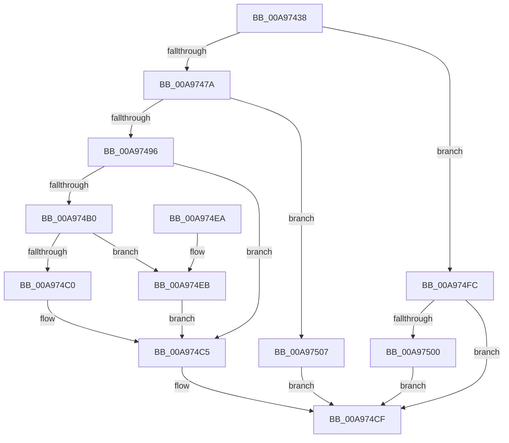

# SiQuerySystemInformationString

- RVA: `0x00A97438`–`0x00A9750E` (길이 `214` bytes)
- VA: `0x0000000140A97438`
- 실행 섹션: `PAGE`
- PDB 이름 있음: `예`; PDB Function 태그: `아니요`
- unwind 정보 RVA: `0x0005C988`
- 디코드: `66`개 명령, `214/214` bytes 표시
- 미해석 바이트: `0` (있으면 어셈블리에 `.byte`로 보존)

> 이 문서는 커널 이미지의 기계어와 PDB 기호를 분석해 생성했습니다. 4번과 5번은 함수 원형과 자료형을 바이너리 사용 방식에서 추정한 C 해석이며 원본 소스 복구 결과는 아닙니다.

## 1. Dependencies

- 직접 호출 지점: **5**; 고유 호출 대상: **4**
- 직접 호출자로 확인된 함수: **2**
- RIP 상대 이미지 참조: **0**

### Outgoing calls
- `0x00A97468` → [ZwQuerySystemInformation](../../text/6A/ZwQuerySystemInformation_function_006AD790.md) (function, `0x006AD790`)
- `0x00A97489` → [ExAllocatePool2](../../poolcode/B8/ExAllocatePool2_function_00B820F0.md) (function, `0x00B820F0`)
- `0x00A974A5` → [ZwQuerySystemInformation](../../text/6A/ZwQuerySystemInformation_function_006AD790.md) (function, `0x006AD790`)
- `0x00A974CA` → [ExFreePoolWithTag](../../poolcode/B8/ExFreePoolWithTag_function_00B82870.md) (function, `0x00B82870`)
- `0x00A974F5` → [memcpy](../../text/6C/memcpy_function_006C6840.md) (function, `0x006C6840`)

### Direct callers
- [SyspartGetFirmwarePartition](../6F/SyspartGetFirmwarePartition_function_006FF7C4.md) at `0x006FF7E9`
- [SyspartGetSystemPartition](SyspartGetSystemPartition_function_00A973CC.md) at `0x00A973F1`

### Static image references
- 디코드된 RIP-relative 메모리 참조가 없습니다.

## 2. Other-region calls and transfers

- 다른 실행 섹션으로 향하는 call: **5**
  - `0x00A97468` → [ZwQuerySystemInformation](../../text/6A/ZwQuerySystemInformation_function_006AD790.md) (`PAGE` → `.text`)
  - `0x00A97489` → [ExAllocatePool2](../../poolcode/B8/ExAllocatePool2_function_00B820F0.md) (`PAGE` → `POOLCODE`)
  - `0x00A974A5` → [ZwQuerySystemInformation](../../text/6A/ZwQuerySystemInformation_function_006AD790.md) (`PAGE` → `.text`)
  - `0x00A974CA` → [ExFreePoolWithTag](../../poolcode/B8/ExFreePoolWithTag_function_00B82870.md) (`PAGE` → `POOLCODE`)
  - `0x00A974F5` → [memcpy](../../text/6C/memcpy_function_006C6840.md) (`PAGE` → `.text`)
- 별도 외부 분기/꼬리 이동을 확인하지 못했습니다.

## 3. Assembly (complete function range)

```asm
00A97438  48 8B C4                        mov rax, rsp
00A9743B  48 89 58 08                     mov qword ptr [rax + 8], rbx
00A9743F  48 89 68 10                     mov qword ptr [rax + 0x10], rbp
00A97443  48 89 70 18                     mov qword ptr [rax + 0x18], rsi
00A97447  57                              push rdi
00A97448  41 56                           push r14
00A9744A  41 57                           push r15
00A9744C  48 83 EC 30                     sub rsp, 0x30
00A97450  83 60 D8 00                     and dword ptr [rax - 0x28], 0
00A97454  4D 8B F1                        mov r14, r9
00A97457  45 8B F8                        mov r15d, r8d
00A9745A  4C 8D 48 D8                     lea r9, [rax - 0x28]
00A9745E  48 8B EA                        mov rbp, rdx
00A97461  45 33 C0                        xor r8d, r8d
00A97464  33 D2                           xor edx, edx
00A97466  8B F1                           mov esi, ecx
00A97468  E8 23 63 C1 FF                  call 0x1406ad790
00A9746D  8B D8                           mov ebx, eax
00A9746F  3D 23 00 00 C0                  cmp eax, 0xc0000023
00A97474  0F 85 82 00 00 00               jne 0x140a974fc
00A9747A  8B 54 24 20                     mov edx, dword ptr [rsp + 0x20]
00A9747E  B9 00 01 00 00                  mov ecx, 0x100
00A97483  41 B8 53 59 50 4B               mov r8d, 0x4b505953
00A97489  E8 62 AC 0E 00                  call 0x140b820f0
00A9748E  48 8B F8                        mov rdi, rax
00A97491  48 85 C0                        test rax, rax
00A97494  74 71                           je 0x140a97507
00A97496  44 8B 44 24 20                  mov r8d, dword ptr [rsp + 0x20]
00A9749B  4C 8D 4C 24 20                  lea r9, [rsp + 0x20]
00A974A0  48 8B D0                        mov rdx, rax
00A974A3  8B CE                           mov ecx, esi
00A974A5  E8 E6 62 C1 FF                  call 0x1406ad790
00A974AA  8B D8                           mov ebx, eax
00A974AC  85 C0                           test eax, eax
00A974AE  78 15                           js 0x140a974c5
00A974B0  0F B7 07                        movzx eax, word ptr [rdi]
00A974B3  83 C0 02                        add eax, 2
00A974B6  8B C8                           mov ecx, eax
00A974B8  41 89 06                        mov dword ptr [r14], eax
00A974BB  41 3B C7                        cmp eax, r15d
00A974BE  76 2B                           jbe 0x140a974eb
00A974C0  BB 23 00 00 C0                  mov ebx, 0xc0000023
00A974C5  33 D2                           xor edx, edx
00A974C7  48 8B CF                        mov rcx, rdi
00A974CA  E8 A1 B3 0E 00                  call 0x140b82870
00A974CF  48 8B 6C 24 58                  mov rbp, qword ptr [rsp + 0x58]
00A974D4  8B C3                           mov eax, ebx
00A974D6  48 8B 5C 24 50                  mov rbx, qword ptr [rsp + 0x50]
00A974DB  48 8B 74 24 60                  mov rsi, qword ptr [rsp + 0x60]
00A974E0  48 83 C4 30                     add rsp, 0x30
00A974E4  41 5F                           pop r15
00A974E6  41 5E                           pop r14
00A974E8  5F                              pop rdi
00A974E9  C3                              ret
00A974EA  CC                              int3
00A974EB  48 8B 57 08                     mov rdx, qword ptr [rdi + 8]
00A974EF  4C 8B C1                        mov r8, rcx
00A974F2  48 8B CD                        mov rcx, rbp
00A974F5  E8 46 F3 C2 FF                  call 0x1406c6840
00A974FA  EB C9                           jmp 0x140a974c5
00A974FC  85 C0                           test eax, eax
00A974FE  78 CF                           js 0x140a974cf
00A97500  BB 01 00 00 C0                  mov ebx, 0xc0000001
00A97505  EB C8                           jmp 0x140a974cf
00A97507  BB 9A 00 00 C0                  mov ebx, 0xc000009a
00A9750C  EB C1                           jmp 0x140a974cf
```

## 4. C-style interpretation (structured pseudocode)

```c
__int64 __fastcall SiQuerySystemInformationString(int a1, __int64 a2, int a3, __int64 a4)
{
    __int64 result;
    __int64 v_rsp;
    unsigned int v_stack_m28;
    unsigned __int64 v_stack_p10;
    unsigned __int64 v_stack_p18;
    unsigned __int64 v_stack_p8;

    *(unsigned __int64 *)(v_rsp + 8) = v_rbx;
    *(unsigned __int64 *)(v_rsp + 16) = v_rbp;
    *(unsigned __int64 *)(v_rsp + 24) = v_rsi;
    v_rsp = (v_rsp) - (48);
    a3 = 0;
    a2 = 0;
    result = ZwQuerySystemInformation(a1, a2, a3, v_rsp - 40);
    if (((unsigned int)(result)) != 0xC0000023ULL) goto loc_00A974FC;
    result = ExAllocatePool2(256, (unsigned int)(v_stack_m28), (unsigned int)(0x4B505953ULL), v_rsp - 40);
    if (result == 0) goto loc_00A97507;
    result = ZwQuerySystemInformation((unsigned int)((unsigned int)((unsigned int)(a1))), result, (unsigned int)(v_stack_m28), v_stack_m28);
    if (sign_flag) goto loc_00A974C5;
    result = (unsigned int)((*(unsigned __int16 *)(result)) + (2));
    *(unsigned int *)(a4) = (unsigned int)(result);
    if (((unsigned int)(result)) <= ((unsigned int)((unsigned int)(a3)))) goto loc_00A974EB;
loc_00A974C5:
    a2 = 0;
    result = ExFreePoolWithTag(result, a2, (unsigned int)(v_stack_m28), v_stack_m28);
loc_00A974CF:
    v_rsp = (v_rsp) + (48);
    return (unsigned int)((unsigned int)((unsigned int)(0xC0000023ULL)));
loc_00A974EB:
    result = memcpy(v_stack_p10, *(unsigned __int64 *)(result + 8), result, v_stack_m28);
    goto loc_00A974C5;
loc_00A974FC:
    if (sign_flag) goto loc_00A974CF;
    goto loc_00A974CF;
loc_00A97507:
    goto loc_00A974CF;
}
```

## 5. (Beta) C Style

```c
int64_t SiQuerySystemInformationString(int32_t Arg1, int64_t Arg2, int32_t Arg3, void *Arg4)
{
    uint8_t *arg4 = (uint8_t *)Arg4;

    int64_t result;
    int64_t local_rsp;
    uint32_t v_stack_m28;
    uint64_t v_stack_p10;
    uint64_t v_stack_p18;
    uint64_t v_stack_p8;

    *(uint64_t *)(local_rsp + 0x8) = local_rbx;
    *(uint64_t *)(local_rsp + 0x10) = local_rbp;
    *(uint64_t *)(local_rsp + 0x18) = local_rsi;
    local_rsp = (local_rsp) - (48);
    Arg3 = 0;
    Arg2 = 0;
    result = ZwQuerySystemInformation(Arg1, Arg2, Arg3, local_rsp - 40);
    if (((uint32_t)(result)) != 0xC0000023ULL) goto loc_00A974FC;
    result = ExAllocatePool2(256, (uint32_t)(v_stack_m28), (uint32_t)(0x4B505953ULL), local_rsp - 40);
    if (result == 0) goto loc_00A97507;
    result = ZwQuerySystemInformation((uint32_t)((uint32_t)((uint32_t)(Arg1))), result, (uint32_t)(v_stack_m28), v_stack_m28);
    if (sign_flag) goto loc_00A974C5;
    result = (uint32_t)((*(uint16_t *)(result)) + (2));
    *(uint32_t *)(arg4) = (uint32_t)(result);
    if (((uint32_t)(result)) <= ((uint32_t)((uint32_t)(Arg3)))) goto loc_00A974EB;
loc_00A974C5:
    Arg2 = 0;
    result = ExFreePoolWithTag(result, Arg2, (uint32_t)(v_stack_m28), v_stack_m28);
loc_00A974CF:
    local_rsp = (local_rsp) + (48);
    return (uint32_t)((uint32_t)((uint32_t)(0xC0000023ULL)));
loc_00A974EB:
    result = memcpy(v_stack_p10, *(uint64_t *)(result + 0x8), result, v_stack_m28);
    goto loc_00A974C5;
loc_00A974FC:
    if (sign_flag) goto loc_00A974CF;
    goto loc_00A974CF;
loc_00A97507:
    goto loc_00A974CF;
}
```

### 관측된 메모리 오프셋

구조체 형식이 확인되지 않은 접근은 인자 기준의 오프셋으로만 기록했습니다.

| 기준 인자 | 오프셋 표현 | 폭 (bit) | 접근 |
|---|---:|---:|---|
| `Arg4` | `+ 0x0` | `32` | `W` |

## 6. Execution-region graph

[열기: 2D/3D 그래프와 함수 탐색 컨트롤 패널](../../../control-panel.html?section=page&rva=0x00A97438&view=graph)

- 2D 그래프는 위에서 아래로 흐르고, 3D 그래프는 빈 공간을 드래그해 회전합니다. Shift+드래그는 이동, 휠은 확대·축소, 함수 노드 선택은 대상 보고서 이동입니다.

### Static fallback


