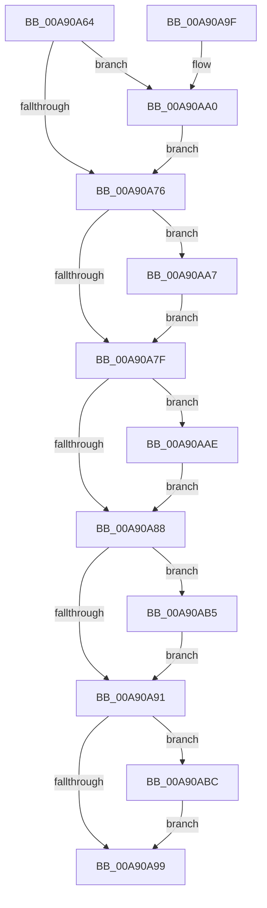

# SmCrEncCleanup

- RVA: `0x00A90A64`–`0x00A90AC3` (길이 `95` bytes)
- VA: `0x0000000140A90A64`
- 실행 섹션: `PAGE`
- PDB 이름 있음: `예`; PDB Function 태그: `아니요`
- unwind 정보 RVA: `0x000795DC`
- 디코드: `32`개 명령, `95/95` bytes 표시
- 미해석 바이트: `0` (있으면 어셈블리에 `.byte`로 보존)

> 이 문서는 커널 이미지의 기계어와 PDB 기호를 분석해 생성했습니다. 4번과 5번은 함수 원형과 자료형을 바이너리 사용 방식에서 추정한 C 해석이며 원본 소스 복구 결과는 아닙니다.

## 1. Dependencies

- 직접 호출 지점: **5**; 고유 호출 대상: **3**
- 직접 호출자로 확인된 함수: **1**
- RIP 상대 이미지 참조: **0**

### Outgoing calls
- `0x00A90AA0` → [CmSiFreeMemory](../../text/47/CmSiFreeMemory_function_00475D80.md) (function, `0x00475D80`)
- `0x00A90AA7` → [BCryptDestroyKey](../../text/60/BCryptDestroyKey_function_00606530.md) (function, `0x00606530`)
- `0x00A90AAE` → [CmSiFreeMemory](../../text/47/CmSiFreeMemory_function_00475D80.md) (function, `0x00475D80`)
- `0x00A90AB5` → [CmSiFreeMemory](../../text/47/CmSiFreeMemory_function_00475D80.md) (function, `0x00475D80`)
- `0x00A90ABC` → [BCryptCloseAlgorithmProvider](../../text/60/BCryptCloseAlgorithmProvider_function_006064D8.md) (function, `0x006064D8`)

### Direct callers
- [ST_STORE&lt;SM_TRAITS&gt;::StCleanup](../../text/3B/ST_STORE_SM_TRAITS_StCleanup_function_003B03B4.md) at `0x003B0438`

### Static image references
- 디코드된 RIP-relative 메모리 참조가 없습니다.

## 2. Other-region calls and transfers

- 다른 실행 섹션으로 향하는 call: **5**
  - `0x00A90AA0` → [CmSiFreeMemory](../../text/47/CmSiFreeMemory_function_00475D80.md) (`PAGE` → `.text`)
  - `0x00A90AA7` → [BCryptDestroyKey](../../text/60/BCryptDestroyKey_function_00606530.md) (`PAGE` → `.text`)
  - `0x00A90AAE` → [CmSiFreeMemory](../../text/47/CmSiFreeMemory_function_00475D80.md) (`PAGE` → `.text`)
  - `0x00A90AB5` → [CmSiFreeMemory](../../text/47/CmSiFreeMemory_function_00475D80.md) (`PAGE` → `.text`)
  - `0x00A90ABC` → [BCryptCloseAlgorithmProvider](../../text/60/BCryptCloseAlgorithmProvider_function_006064D8.md) (`PAGE` → `.text`)
- 별도 외부 분기/꼬리 이동을 확인하지 못했습니다.

## 3. Assembly (complete function range)

```asm
00A90A64  40 53                           push rbx
00A90A66  48 83 EC 20                     sub rsp, 0x20
00A90A6A  48 8B D9                        mov rbx, rcx
00A90A6D  48 8B 49 10                     mov rcx, qword ptr [rcx + 0x10]
00A90A71  48 85 C9                        test rcx, rcx
00A90A74  75 2A                           jne 0x140a90aa0
00A90A76  48 8B 4B 20                     mov rcx, qword ptr [rbx + 0x20]
00A90A7A  48 85 C9                        test rcx, rcx
00A90A7D  75 28                           jne 0x140a90aa7
00A90A7F  48 8B 4B 28                     mov rcx, qword ptr [rbx + 0x28]
00A90A83  48 85 C9                        test rcx, rcx
00A90A86  75 26                           jne 0x140a90aae
00A90A88  48 8B 4B 30                     mov rcx, qword ptr [rbx + 0x30]
00A90A8C  48 85 C9                        test rcx, rcx
00A90A8F  75 24                           jne 0x140a90ab5
00A90A91  48 8B 0B                        mov rcx, qword ptr [rbx]
00A90A94  48 85 C9                        test rcx, rcx
00A90A97  75 23                           jne 0x140a90abc
00A90A99  48 83 C4 20                     add rsp, 0x20
00A90A9D  5B                              pop rbx
00A90A9E  C3                              ret
00A90A9F  CC                              int3
00A90AA0  E8 DB 52 9E FF                  call 0x140475d80
00A90AA5  EB CF                           jmp 0x140a90a76
00A90AA7  E8 84 5A B7 FF                  call 0x140606530
00A90AAC  EB D1                           jmp 0x140a90a7f
00A90AAE  E8 CD 52 9E FF                  call 0x140475d80
00A90AB3  EB D3                           jmp 0x140a90a88
00A90AB5  E8 C6 52 9E FF                  call 0x140475d80
00A90ABA  EB D5                           jmp 0x140a90a91
00A90ABC  E8 17 5A B7 FF                  call 0x1406064d8
00A90AC1  EB D6                           jmp 0x140a90a99
```

## 4. C-style interpretation (structured pseudocode)

```c
__int64 __fastcall SmCrEncCleanup(__int64 a1)
{
    __int64 result;
    __int64 v_rsp;

    v_rsp = (v_rsp) - (32);
    if (*(unsigned __int64 *)(a1 + 16) != 0) goto loc_00A90AA0;
loc_00A90A76:
    if (*(unsigned __int64 *)(a1 + 32) != 0) goto loc_00A90AA7;
loc_00A90A7F:
    if (*(unsigned __int64 *)(a1 + 40) != 0) goto loc_00A90AAE;
loc_00A90A88:
    if (*(unsigned __int64 *)(a1 + 48) != 0) goto loc_00A90AB5;
loc_00A90A91:
    if (*(unsigned __int64 *)(a1) != 0) goto loc_00A90ABC;
loc_00A90A99:
    v_rsp = (v_rsp) + (32);
    return result;
loc_00A90AA0:
    result = CmSiFreeMemory(*(unsigned __int64 *)(a1), a2, a3, a4);
    goto loc_00A90A76;
loc_00A90AA7:
    result = BCryptDestroyKey(*(unsigned __int64 *)(a1), a2, a3, a4);
    goto loc_00A90A7F;
loc_00A90AAE:
    result = CmSiFreeMemory(*(unsigned __int64 *)(a1), a2, a3, a4);
    goto loc_00A90A88;
loc_00A90AB5:
    result = CmSiFreeMemory(*(unsigned __int64 *)(a1), a2, a3, a4);
    goto loc_00A90A91;
loc_00A90ABC:
    result = BCryptCloseAlgorithmProvider(*(unsigned __int64 *)(a1), a2, a3, a4);
    goto loc_00A90A99;
}
```

## 5. (Beta) C Style

```c
int64_t SmCrEncCleanup(void *Arg1)
{
    uint8_t *arg1 = (uint8_t *)Arg1;

    int64_t result;
    int64_t local_rsp;

    local_rsp = (local_rsp) - (32);
    if (*(uint64_t *)(arg1 + 0x10) != 0) goto loc_00A90AA0;
loc_00A90A76:
    if (*(uint64_t *)(arg1 + 0x20) != 0) goto loc_00A90AA7;
loc_00A90A7F:
    if (*(uint64_t *)(arg1 + 0x28) != 0) goto loc_00A90AAE;
loc_00A90A88:
    if (*(uint64_t *)(arg1 + 0x30) != 0) goto loc_00A90AB5;
loc_00A90A91:
    if (*(uint64_t *)(arg1) != 0) goto loc_00A90ABC;
loc_00A90A99:
    local_rsp = (local_rsp) + (32);
    return result;
loc_00A90AA0:
    result = CmSiFreeMemory(*(uint64_t *)(arg1), a2, a3, a4);
    goto loc_00A90A76;
loc_00A90AA7:
    result = BCryptDestroyKey(*(uint64_t *)(arg1), a2, a3, a4);
    goto loc_00A90A7F;
loc_00A90AAE:
    result = CmSiFreeMemory(*(uint64_t *)(arg1), a2, a3, a4);
    goto loc_00A90A88;
loc_00A90AB5:
    result = CmSiFreeMemory(*(uint64_t *)(arg1), a2, a3, a4);
    goto loc_00A90A91;
loc_00A90ABC:
    result = BCryptCloseAlgorithmProvider(*(uint64_t *)(arg1), a2, a3, a4);
    goto loc_00A90A99;
}
```

### 관측된 메모리 오프셋

구조체 형식이 확인되지 않은 접근은 인자 기준의 오프셋으로만 기록했습니다.

| 기준 인자 | 오프셋 표현 | 폭 (bit) | 접근 |
|---|---:|---:|---|
| `Arg1` | `+ 0x0` | `64` | `R` |
| `Arg1` | `+ 0x10` | `64` | `R` |
| `Arg1` | `+ 0x20` | `64` | `R` |
| `Arg1` | `+ 0x28` | `64` | `R` |
| `Arg1` | `+ 0x30` | `64` | `R` |

## 6. Execution-region graph

[열기: 2D/3D 그래프와 함수 탐색 컨트롤 패널](../../../control-panel.html?section=page&rva=0x00A90A64&view=graph)

- 2D 그래프는 위에서 아래로 흐르고, 3D 그래프는 빈 공간을 드래그해 회전합니다. Shift+드래그는 이동, 휠은 확대·축소, 함수 노드 선택은 대상 보고서 이동입니다.

### Static fallback


