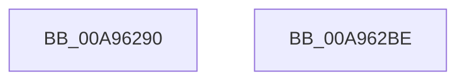

# SmCrEncInitialize

- RVA: `0x00A96290`–`0x00A962BF` (길이 `47` bytes)
- VA: `0x0000000140A96290`
- 실행 섹션: `PAGE`
- PDB 이름 있음: `예`; PDB Function 태그: `아니요`
- unwind 정보 RVA: `0x0005CF00`
- 디코드: `14`개 명령, `47/47` bytes 표시
- 미해석 바이트: `0` (있으면 어셈블리에 `.byte`로 보존)

> 이 문서는 커널 이미지의 기계어와 PDB 기호를 분석해 생성했습니다. 4번과 5번은 함수 원형과 자료형을 바이너리 사용 방식에서 추정한 C 해석이며 원본 소스 복구 결과는 아닙니다.

## 1. Dependencies

- 직접 호출 지점: **1**; 고유 호출 대상: **1**
- 직접 호출자로 확인된 함수: **1**
- RIP 상대 이미지 참조: **0**

### Outgoing calls
- `0x00A962A1` → [memset](../../text/6C/memset_function_006C6C40.md) (function, `0x006C6C40`)

### Direct callers
- [ST_STORE&lt;SM_TRAITS&gt;::StInitialize](../../text/46/ST_STORE_SM_TRAITS_StInitialize_function_00468158.md) at `0x004681BD`

### Static image references
- 디코드된 RIP-relative 메모리 참조가 없습니다.

## 2. Other-region calls and transfers

- 다른 실행 섹션으로 향하는 call: **1**
  - `0x00A962A1` → [memset](../../text/6C/memset_function_006C6C40.md) (`PAGE` → `.text`)
- 별도 외부 분기/꼬리 이동을 확인하지 못했습니다.

## 3. Assembly (complete function range)

```asm
00A96290  40 53                           push rbx
00A96292  48 83 EC 20                     sub rsp, 0x20
00A96296  33 D2                           xor edx, edx
00A96298  41 B8 90 00 00 00               mov r8d, 0x90
00A9629E  48 8B D9                        mov rbx, rcx
00A962A1  E8 9A 09 C3 FF                  call 0x1406c6c40
00A962A6  B8 01 00 00 00                  mov eax, 1
00A962AB  C7 43 38 58 00 00 00            mov dword ptr [rbx + 0x38], 0x58
00A962B2  89 43 08                        mov dword ptr [rbx + 8], eax
00A962B5  89 43 3C                        mov dword ptr [rbx + 0x3c], eax
00A962B8  48 83 C4 20                     add rsp, 0x20
00A962BC  5B                              pop rbx
00A962BD  C3                              ret
00A962BE  CC                              int3
```

## 4. C-style interpretation (structured pseudocode)

```c
__int64 __fastcall SmCrEncInitialize(__int64 a1, int a2)
{
    __int64 result;
    __int64 v_rsp;

    v_rsp = (v_rsp) - (32);
    a2 = 0;
    result = memset(a1, a2, 144, a4);
    *(unsigned int *)(a1 + 56) = 88;
    *(unsigned int *)(a1 + 8) = 1;
    *(unsigned int *)(a1 + 60) = 1;
    v_rsp = (v_rsp) + (32);
    return 1;
}
```

## 5. (Beta) C Style

```c
int64_t SmCrEncInitialize(void *Arg1, int32_t Arg2)
{
    uint8_t *arg1 = (uint8_t *)Arg1;

    int64_t result;
    int64_t local_rsp;

    local_rsp = (local_rsp) - (32);
    Arg2 = 0;
    result = memset(Arg1, Arg2, 144, a4);
    *(uint32_t *)(arg1 + 0x38) = 88;
    *(uint32_t *)(arg1 + 0x8) = 1;
    *(uint32_t *)(arg1 + 0x3C) = 1;
    local_rsp = (local_rsp) + (32);
    return 1;
}
```

### 관측된 메모리 오프셋

구조체 형식이 확인되지 않은 접근은 인자 기준의 오프셋으로만 기록했습니다.

| 기준 인자 | 오프셋 표현 | 폭 (bit) | 접근 |
|---|---:|---:|---|
| `Arg1` | `+ 0x8` | `32` | `W` |
| `Arg1` | `+ 0x38` | `32` | `W` |
| `Arg1` | `+ 0x3C` | `32` | `W` |

## 6. Execution-region graph

[열기: 2D/3D 그래프와 함수 탐색 컨트롤 패널](../../../control-panel.html?section=page&rva=0x00A96290&view=graph)

- 2D 그래프는 위에서 아래로 흐르고, 3D 그래프는 빈 공간을 드래그해 회전합니다. Shift+드래그는 이동, 휠은 확대·축소, 함수 노드 선택은 대상 보고서 이동입니다.

### Static fallback


