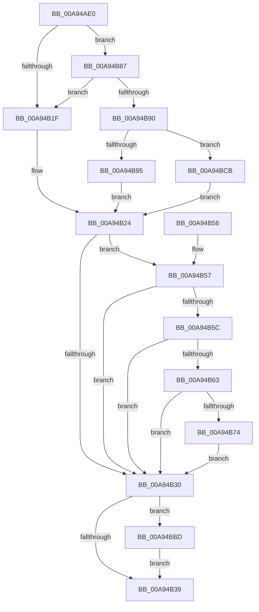

# VmMergeMemoryRanges

- RVA: `0x00A94AE0`–`0x00A94BD5` (길이 `245` bytes)
- VA: `0x0000000140A94AE0`
- 실행 섹션: `PAGE`
- PDB 이름 있음: `예`; PDB Function 태그: `아니요`
- unwind 정보 RVA: `0x000B27C4`
- 디코드: `65`개 명령, `245/245` bytes 표시
- 미해석 바이트: `0` (있으면 어셈블리에 `.byte`로 보존)

> 이 문서는 커널 이미지의 기계어와 PDB 기호를 분석해 생성했습니다. 4번과 5번은 함수 원형과 자료형을 바이너리 사용 방식에서 추정한 C 해석이며 원본 소스 복구 결과는 아닙니다.

## 1. Dependencies

- 직접 호출 지점: **4**; 고유 호출 대상: **4**
- 직접 호출자로 확인된 함수: **0**
- RIP 상대 이미지 참조: **1**

### Outgoing calls
- `0x00A94B80` → [VmpLogSplitMergeMemoryRange](../7A/VmpLogSplitMergeMemoryRange_function_007AEAE0.md) (function, `0x007AEAE0`)
- `0x00A94B9F` → [FsRtlAcquirePushLockExclusive](../../text/4A/FsRtlAcquirePushLockExclusive_function_004A05F4.md) (function, `0x004A05F4`)
- `0x00A94BB1` → [VmpMergeMemoryRanges](../../text/4D/VmpMergeMemoryRanges_function_004D9EDC.md) (function, `0x004D9EDC`)
- `0x00A94BC1` → [PfLockExclusiveRelease](../../text/49/PfLockExclusiveRelease_function_00491D88.md) (function, `0x00491D88`)

### Direct callers
- 이 함수 시작 RVA로 연결되는 직접 call은 확인되지 않았습니다. 간접 호출은 완전히 역산할 수 없습니다.

### Static image references
- `0x00A94B24` → RVA `0x00F02458` (`.data`; read)

## 2. Other-region calls and transfers

- 다른 실행 섹션으로 향하는 call: **3**
  - `0x00A94B9F` → [FsRtlAcquirePushLockExclusive](../../text/4A/FsRtlAcquirePushLockExclusive_function_004A05F4.md) (`PAGE` → `.text`)
  - `0x00A94BB1` → [VmpMergeMemoryRanges](../../text/4D/VmpMergeMemoryRanges_function_004D9EDC.md) (`PAGE` → `.text`)
  - `0x00A94BC1` → [PfLockExclusiveRelease](../../text/49/PfLockExclusiveRelease_function_00491D88.md) (`PAGE` → `.text`)
- 별도 외부 분기/꼬리 이동을 확인하지 못했습니다.

## 3. Assembly (complete function range)

```asm
00A94AE0  48 8B C4                        mov rax, rsp
00A94AE3  48 89 58 08                     mov qword ptr [rax + 8], rbx
00A94AE7  48 89 68 10                     mov qword ptr [rax + 0x10], rbp
00A94AEB  48 89 70 18                     mov qword ptr [rax + 0x18], rsi
00A94AEF  48 89 78 20                     mov qword ptr [rax + 0x20], rdi
00A94AF3  41 56                           push r14
00A94AF5  48 83 EC 30                     sub rsp, 0x30
00A94AF9  65 48 8B 04 25 88 01 00 00      mov rax, qword ptr gs:[0x188]
00A94B02  45 33 F6                        xor r14d, r14d
00A94B05  48 8B EA                        mov rbp, rdx
00A94B08  48 8B F1                        mov rsi, rcx
00A94B0B  4C 8B 80 B8 00 00 00            mov r8, qword ptr [rax + 0xb8]
00A94B12  49 8B B8 70 06 00 00            mov rdi, qword ptr [r8 + 0x670]
00A94B19  48 83 FA FF                     cmp rdx, -1
00A94B1D  75 68                           jne 0x140a94b87
00A94B1F  BB 0D 00 00 C0                  mov ebx, 0xc000000d
00A94B24  48 8B 05 2D D9 46 00            mov rax, qword ptr [rip + 0x46d92d]
00A94B2B  48 85 C0                        test rax, rax
00A94B2E  75 27                           jne 0x140a94b57
00A94B30  45 85 F6                        test r14d, r14d
00A94B33  0F 85 84 00 00 00               jne 0x140a94bbd
00A94B39  48 8B 6C 24 48                  mov rbp, qword ptr [rsp + 0x48]
00A94B3E  8B C3                           mov eax, ebx
00A94B40  48 8B 5C 24 40                  mov rbx, qword ptr [rsp + 0x40]
00A94B45  48 8B 74 24 50                  mov rsi, qword ptr [rsp + 0x50]
00A94B4A  48 8B 7C 24 58                  mov rdi, qword ptr [rsp + 0x58]
00A94B4F  48 83 C4 30                     add rsp, 0x30
00A94B53  41 5E                           pop r14
00A94B55  C3                              ret
00A94B56  CC                              int3
00A94B57  83 38 00                        cmp dword ptr [rax], 0
00A94B5A  76 D4                           jbe 0x140a94b30
00A94B5C  8A 48 10                        mov cl, byte ptr [rax + 0x10]
00A94B5F  84 C9                           test cl, cl
00A94B61  79 CD                           jns 0x140a94b30
00A94B63  48 8B 48 18                     mov rcx, qword ptr [rax + 0x18]
00A94B67  48 8B C1                        mov rax, rcx
00A94B6A  25 80 00 00 00                  and eax, 0x80
00A94B6F  48 3B C1                        cmp rax, rcx
00A94B72  75 BC                           jne 0x140a94b30
00A94B74  4C 8B CD                        mov r9, rbp
00A94B77  89 5C 24 20                     mov dword ptr [rsp + 0x20], ebx
00A94B7B  4C 8B C6                        mov r8, rsi
00A94B7E  33 D2                           xor edx, edx
00A94B80  E8 5B 9F D1 FF                  call 0x1407aeae0
00A94B85  EB A9                           jmp 0x140a94b30
00A94B87  48 F7 C6 FF 0F 00 00            test rsi, 0xfff
00A94B8E  75 8F                           jne 0x140a94b1f
00A94B90  48 85 FF                        test rdi, rdi
00A94B93  74 36                           je 0x140a94bcb
00A94B95  48 8D 4F 78                     lea rcx, [rdi + 0x78]
00A94B99  41 BE 01 00 00 00               mov r14d, 1
00A94B9F  E8 50 BA A0 FF                  call 0x1404a05f4
00A94BA4  48 8B D6                        mov rdx, rsi
00A94BA7  4C 8B C5                        mov r8, rbp
00A94BAA  48 C1 EA 0C                     shr rdx, 0xc
00A94BAE  48 8B CF                        mov rcx, rdi
00A94BB1  E8 26 53 A4 FF                  call 0x1404d9edc
00A94BB6  8B D8                           mov ebx, eax
00A94BB8  E9 67 FF FF FF                  jmp 0x140a94b24
00A94BBD  48 8D 4F 78                     lea rcx, [rdi + 0x78]
00A94BC1  E8 C2 D1 9F FF                  call 0x140491d88
00A94BC6  E9 6E FF FF FF                  jmp 0x140a94b39
00A94BCB  BB 88 00 00 C0                  mov ebx, 0xc0000088
00A94BD0  E9 4F FF FF FF                  jmp 0x140a94b24
```

## 4. C-style interpretation (structured pseudocode)

```c
__int64 __fastcall VmMergeMemoryRanges(__int64 a1, __int64 a2)
{
    __int64 result;
    __int64 v_r14;
    __int64 v_rsp;
    unsigned __int64 v_stack_p10;
    unsigned __int64 v_stack_p18;
    unsigned __int64 v_stack_p20;
    unsigned __int64 v_stack_p8;

    *(unsigned __int64 *)(v_rsp + 8) = v_rbx;
    *(unsigned __int64 *)(v_rsp + 16) = v_rbp;
    *(unsigned __int64 *)(v_rsp + 24) = v_rsi;
    *(unsigned __int64 *)(v_rsp + 32) = v_rdi;
    v_rsp = (v_rsp) - (48);
    v_r14 = 0;
    if (a2 != -1) goto loc_00A94B87;
loc_00A94B1F:
loc_00A94B24:
    if (*(unsigned __int64 *)(v_rip + 4643117) != 0) goto loc_00A94B57;
loc_00A94B30:
    if (0 != 0) goto loc_00A94BBD;
loc_00A94B39:
    v_rsp = (v_rsp) + (48);
    return (unsigned int)((unsigned int)((unsigned int)(0xC000000DULL)));
loc_00A94B57:
    if ((*(unsigned int *)((unsigned int)((unsigned int)((unsigned int)(0xC000000DULL))))) <= 0) goto loc_00A94B30;
    if (!sign_flag) goto loc_00A94B30;
    result = (unsigned int)((*(unsigned __int64 *)((unsigned int)((unsigned int)((unsigned int)(0xC000000DULL))) + 24)) & (128));
    if (result != (*(unsigned __int64 *)((unsigned int)((unsigned int)((unsigned int)(0xC000000DULL))) + 24))) goto loc_00A94B30;
    v_stack_p20 = (unsigned int)(v_stack_p8);
    a2 = 0;
    result = VmpLogSplitMergeMemoryRange(*(unsigned __int64 *)((unsigned int)((unsigned int)((unsigned int)(0xC000000DULL))) + 24), a2, v_stack_p18, v_stack_p10);
    goto loc_00A94B30;
loc_00A94B87:
    if (((v_stack_p18) & (0xFFFULL)) != 0) goto loc_00A94B1F;
    if (v_stack_p20 == 0) goto loc_00A94BCB;
    result = FsRtlAcquirePushLockExclusive(v_stack_p20 + 120, a2, v_stack_p18, v_stack_p10);
    a2 = (v_stack_p18) >> (12);
    result = VmpMergeMemoryRanges(v_stack_p20, a2, v_stack_p10, v_stack_p10);
    goto loc_00A94B24;
loc_00A94BBD:
    result = PfLockExclusiveRelease(v_stack_p20 + 120, a2, v_stack_p10, v_stack_p10);
    goto loc_00A94B39;
loc_00A94BCB:
    goto loc_00A94B24;
}
```

## 5. (Beta) C Style

```c
int64_t VmMergeMemoryRanges(int64_t Arg1, int64_t Arg2)
{
    int64_t result;
    int64_t local_r14;
    int64_t local_rsp;
    uint64_t v_stack_p10;
    uint64_t v_stack_p18;
    uint64_t v_stack_p20;
    uint64_t v_stack_p8;

    *(uint64_t *)(local_rsp + 0x8) = local_rbx;
    *(uint64_t *)(local_rsp + 0x10) = local_rbp;
    *(uint64_t *)(local_rsp + 0x18) = local_rsi;
    *(uint64_t *)(local_rsp + 0x20) = local_rdi;
    local_rsp = (local_rsp) - (48);
    local_r14 = 0;
    if (Arg2 != -1) goto loc_00A94B87;
loc_00A94B1F:
loc_00A94B24:
    if (*(uint64_t *)(v_rip + 0x46D92D) != 0) goto loc_00A94B57;
loc_00A94B30:
    if (0 != 0) goto loc_00A94BBD;
loc_00A94B39:
    local_rsp = (local_rsp) + (48);
    return (uint32_t)((uint32_t)((uint32_t)(0xC000000DULL)));
loc_00A94B57:
    if ((*(uint32_t *)((uint32_t)((uint32_t)((uint32_t)(0xC000000DULL))))) <= 0) goto loc_00A94B30;
    if (!sign_flag) goto loc_00A94B30;
    result = (uint32_t)((*(uint64_t *)((uint32_t)((uint32_t)((uint32_t)(0xC000000DULL))) + 0x18)) & (128));
    if (result != (*(uint64_t *)((uint32_t)((uint32_t)((uint32_t)(0xC000000DULL))) + 0x18))) goto loc_00A94B30;
    v_stack_p20 = (uint32_t)(v_stack_p8);
    Arg2 = 0;
    result = VmpLogSplitMergeMemoryRange(*(uint64_t *)((uint32_t)((uint32_t)((uint32_t)(0xC000000DULL))) + 0x18), Arg2, v_stack_p18, v_stack_p10);
    goto loc_00A94B30;
loc_00A94B87:
    if (((v_stack_p18) & (0xFFFULL)) != 0) goto loc_00A94B1F;
    if (v_stack_p20 == 0) goto loc_00A94BCB;
    result = FsRtlAcquirePushLockExclusive(v_stack_p20 + 120, Arg2, v_stack_p18, v_stack_p10);
    Arg2 = (v_stack_p18) >> (12);
    result = VmpMergeMemoryRanges(v_stack_p20, Arg2, v_stack_p10, v_stack_p10);
    goto loc_00A94B24;
loc_00A94BBD:
    result = PfLockExclusiveRelease(v_stack_p20 + 120, Arg2, v_stack_p10, v_stack_p10);
    goto loc_00A94B39;
loc_00A94BCB:
    goto loc_00A94B24;
}
```

## 6. Execution-region graph

[열기: 2D/3D 그래프와 함수 탐색 컨트롤 패널](../../../control-panel.html?section=page&rva=0x00A94AE0&view=graph)

- 2D 그래프는 위에서 아래로 흐르고, 3D 그래프는 빈 공간을 드래그해 회전합니다. Shift+드래그는 이동, 휠은 확대·축소, 함수 노드 선택은 대상 보고서 이동입니다.

### Static fallback


