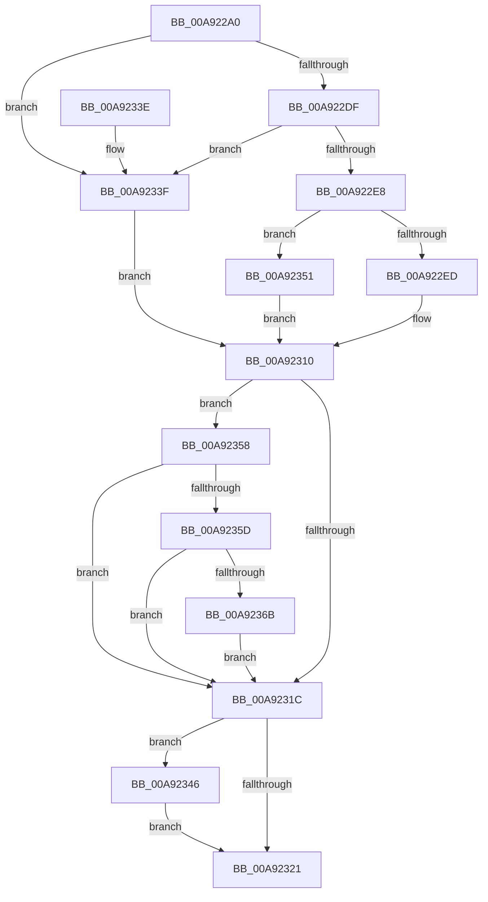

# VmSplitMemoryRange

- RVA: `0x00A922A0`–`0x00A92381` (길이 `225` bytes)
- VA: `0x0000000140A922A0`
- 실행 섹션: `PAGE`
- PDB 이름 있음: `예`; PDB Function 태그: `아니요`
- unwind 정보 RVA: `0x0008783C`
- 디코드: `61`개 명령, `225/225` bytes 표시
- 미해석 바이트: `0` (있으면 어셈블리에 `.byte`로 보존)

> 이 문서는 커널 이미지의 기계어와 PDB 기호를 분석해 생성했습니다. 4번과 5번은 함수 원형과 자료형을 바이너리 사용 방식에서 추정한 C 해석이며 원본 소스 복구 결과는 아닙니다.

## 1. Dependencies

- 직접 호출 지점: **5**; 고유 호출 대상: **5**
- 직접 호출자로 확인된 함수: **0**
- RIP 상대 이미지 참조: **1**

### Outgoing calls
- `0x00A922F7` → [FsRtlAcquirePushLockExclusive](../../text/4A/FsRtlAcquirePushLockExclusive_function_004A05F4.md) (function, `0x004A05F4`)
- `0x00A92309` → [VmpSplitMemoryRange](../../text/42/VmpSplitMemoryRange_function_00429754.md) (function, `0x00429754`)
- `0x00A9234A` → [PfLockExclusiveRelease](../../text/49/PfLockExclusiveRelease_function_00491D88.md) (function, `0x00491D88`)
- `0x00A92362` → [tlgKeywordOn](../../text/42/tlgKeywordOn_function_0042EAA0.md) (function, `0x0042EAA0`)
- `0x00A9237A` → [VmpLogSplitMergeMemoryRange](../7A/VmpLogSplitMergeMemoryRange_function_007AEAE0.md) (function, `0x007AEAE0`)

### Direct callers
- 이 함수 시작 RVA로 연결되는 직접 call은 확인되지 않았습니다. 간접 호출은 완전히 역산할 수 없습니다.

### Static image references
- `0x00A92310` → RVA `0x00F02458` (`.data`; read)

## 2. Other-region calls and transfers

- 다른 실행 섹션으로 향하는 call: **4**
  - `0x00A922F7` → [FsRtlAcquirePushLockExclusive](../../text/4A/FsRtlAcquirePushLockExclusive_function_004A05F4.md) (`PAGE` → `.text`)
  - `0x00A92309` → [VmpSplitMemoryRange](../../text/42/VmpSplitMemoryRange_function_00429754.md) (`PAGE` → `.text`)
  - `0x00A9234A` → [PfLockExclusiveRelease](../../text/49/PfLockExclusiveRelease_function_00491D88.md) (`PAGE` → `.text`)
  - `0x00A92362` → [tlgKeywordOn](../../text/42/tlgKeywordOn_function_0042EAA0.md) (`PAGE` → `.text`)
- 별도 외부 분기/꼬리 이동을 확인하지 못했습니다.

## 3. Assembly (complete function range)

```asm
00A922A0  48 8B C4                        mov rax, rsp
00A922A3  48 89 58 08                     mov qword ptr [rax + 8], rbx
00A922A7  48 89 68 10                     mov qword ptr [rax + 0x10], rbp
00A922AB  48 89 70 18                     mov qword ptr [rax + 0x18], rsi
00A922AF  48 89 78 20                     mov qword ptr [rax + 0x20], rdi
00A922B3  41 56                           push r14
00A922B5  48 83 EC 30                     sub rsp, 0x30
00A922B9  65 48 8B 04 25 88 01 00 00      mov rax, qword ptr gs:[0x188]
00A922C2  45 33 F6                        xor r14d, r14d
00A922C5  48 8B EA                        mov rbp, rdx
00A922C8  48 8B F1                        mov rsi, rcx
00A922CB  4C 8B 80 B8 00 00 00            mov r8, qword ptr [rax + 0xb8]
00A922D2  49 8B B8 70 06 00 00            mov rdi, qword ptr [r8 + 0x670]
00A922D9  48 83 FA FF                     cmp rdx, -1
00A922DD  74 60                           je 0x140a9233f
00A922DF  48 F7 C1 FF 0F 00 00            test rcx, 0xfff
00A922E6  75 57                           jne 0x140a9233f
00A922E8  48 85 FF                        test rdi, rdi
00A922EB  74 64                           je 0x140a92351
00A922ED  48 8D 4F 78                     lea rcx, [rdi + 0x78]
00A922F1  41 BE 01 00 00 00               mov r14d, 1
00A922F7  E8 F8 E2 A0 FF                  call 0x1404a05f4
00A922FC  48 8B D6                        mov rdx, rsi
00A922FF  4C 8B C5                        mov r8, rbp
00A92302  48 C1 EA 0C                     shr rdx, 0xc
00A92306  48 8B CF                        mov rcx, rdi
00A92309  E8 46 74 99 FF                  call 0x140429754
00A9230E  8B D8                           mov ebx, eax
00A92310  48 8B 0D 41 01 47 00            mov rcx, qword ptr [rip + 0x470141]
00A92317  48 85 C9                        test rcx, rcx
00A9231A  75 3C                           jne 0x140a92358
00A9231C  45 85 F6                        test r14d, r14d
00A9231F  75 25                           jne 0x140a92346
00A92321  48 8B 6C 24 48                  mov rbp, qword ptr [rsp + 0x48]
00A92326  8B C3                           mov eax, ebx
00A92328  48 8B 5C 24 40                  mov rbx, qword ptr [rsp + 0x40]
00A9232D  48 8B 74 24 50                  mov rsi, qword ptr [rsp + 0x50]
00A92332  48 8B 7C 24 58                  mov rdi, qword ptr [rsp + 0x58]
00A92337  48 83 C4 30                     add rsp, 0x30
00A9233B  41 5E                           pop r14
00A9233D  C3                              ret
00A9233E  CC                              int3
00A9233F  BB 0D 00 00 C0                  mov ebx, 0xc000000d
00A92344  EB CA                           jmp 0x140a92310
00A92346  48 8D 4F 78                     lea rcx, [rdi + 0x78]
00A9234A  E8 39 FA 9F FF                  call 0x140491d88
00A9234F  EB D0                           jmp 0x140a92321
00A92351  BB 88 00 00 C0                  mov ebx, 0xc0000088
00A92356  EB B8                           jmp 0x140a92310
00A92358  83 39 00                        cmp dword ptr [rcx], 0
00A9235B  76 BF                           jbe 0x140a9231c
00A9235D  BA 80 00 00 00                  mov edx, 0x80
00A92362  E8 39 C7 99 FF                  call 0x14042eaa0
00A92367  84 C0                           test al, al
00A92369  74 B1                           je 0x140a9231c
00A9236B  4C 8B CD                        mov r9, rbp
00A9236E  89 5C 24 20                     mov dword ptr [rsp + 0x20], ebx
00A92372  4C 8B C6                        mov r8, rsi
00A92375  BA 01 00 00 00                  mov edx, 1
00A9237A  E8 61 C7 D1 FF                  call 0x1407aeae0
00A9237F  EB 9B                           jmp 0x140a9231c
```

## 4. C-style interpretation (structured pseudocode)

```c
__int64 __fastcall VmSplitMemoryRange(__int64 a1, __int64 a2)
{
    __int64 result;
    __int64 v_r14;
    __int64 v_rsp;
    unsigned __int64 v_stack_p10;
    unsigned __int64 v_stack_p18;
    unsigned __int64 v_stack_p20;
    unsigned __int64 v_stack_p8;

    *(unsigned __int64 *)(v_rsp + 8) = v_rbx;
    *(unsigned __int64 *)(v_rsp + 16) = v_rbp;
    *(unsigned __int64 *)(v_rsp + 24) = v_rsi;
    *(unsigned __int64 *)(v_rsp + 32) = v_rdi;
    v_rsp = (v_rsp) - (48);
    v_r14 = 0;
    if (a2 == -1) goto loc_00A9233F;
    if (((a1) & (0xFFFULL)) != 0) goto loc_00A9233F;
    if (*(unsigned __int64 *)(*(unsigned __int64 *)(*(unsigned __int64 *)(gs_base + (0 + 392)) + 184) + 1648) == 0) goto loc_00A92351;
    result = FsRtlAcquirePushLockExclusive(*(unsigned __int64 *)(*(unsigned __int64 *)(*(unsigned __int64 *)(gs_base + (0 + 392)) + 184) + 1648) + 120, a2, *(unsigned __int64 *)(*(unsigned __int64 *)(gs_base + (0 + 392)) + 184), a4);
    a2 = (a1) >> (12);
    result = VmpSplitMemoryRange(*(unsigned __int64 *)(*(unsigned __int64 *)(*(unsigned __int64 *)(gs_base + (0 + 392)) + 184) + 1648), a2, a2, a4);
loc_00A92310:
    if (*(unsigned __int64 *)(v_rip + 4653377) != 0) goto loc_00A92358;
loc_00A9231C:
    if (1 != 0) goto loc_00A92346;
loc_00A92321:
    v_rsp = (v_rsp) + (48);
    return (unsigned int)((unsigned int)((unsigned int)((unsigned int)(result))));
loc_00A9233F:
    goto loc_00A92310;
loc_00A92346:
    result = PfLockExclusiveRelease(v_stack_p20 + 120, a2, a2, a4);
    goto loc_00A92321;
loc_00A92351:
    goto loc_00A92310;
loc_00A92358:
    if ((*(unsigned int *)(v_stack_p20 + 120)) <= 0) goto loc_00A9231C;
    result = tlgKeywordOn(v_stack_p20 + 120, 128, a2, a4);
    if ((unsigned __int8)(result) == 0) goto loc_00A9231C;
    v_stack_p20 = (unsigned int)((unsigned int)(0xC0000088ULL));
    result = VmpLogSplitMergeMemoryRange(v_stack_p20 + 120, 1, v_stack_p18, v_stack_p10);
    goto loc_00A9231C;
}
```

## 5. (Beta) C Style

```c
int64_t VmSplitMemoryRange(int64_t Arg1, int64_t Arg2)
{
    int64_t result;
    int64_t local_r14;
    int64_t local_rsp;
    uint64_t v_stack_p10;
    uint64_t v_stack_p18;
    uint64_t v_stack_p20;
    uint64_t v_stack_p8;

    *(uint64_t *)(local_rsp + 0x8) = local_rbx;
    *(uint64_t *)(local_rsp + 0x10) = local_rbp;
    *(uint64_t *)(local_rsp + 0x18) = local_rsi;
    *(uint64_t *)(local_rsp + 0x20) = local_rdi;
    local_rsp = (local_rsp) - (48);
    local_r14 = 0;
    if (Arg2 == -1) goto loc_00A9233F;
    if (((Arg1) & (0xFFFULL)) != 0) goto loc_00A9233F;
    if (*(uint64_t *)(*(uint64_t *)(*(uint64_t *)(gs_base + (0 + 0x188)) + 0xB8) + 0x670) == 0) goto loc_00A92351;
    result = FsRtlAcquirePushLockExclusive(*(uint64_t *)(*(uint64_t *)(*(uint64_t *)(gs_base + (0 + 0x188)) + 0xB8) + 0x670) + 120, Arg2, *(uint64_t *)(*(uint64_t *)(gs_base + (0 + 0x188)) + 0xB8), a4);
    Arg2 = (Arg1) >> (12);
    result = VmpSplitMemoryRange(*(uint64_t *)(*(uint64_t *)(*(uint64_t *)(gs_base + (0 + 0x188)) + 0xB8) + 0x670), Arg2, Arg2, a4);
loc_00A92310:
    if (*(uint64_t *)(v_rip + 0x470141) != 0) goto loc_00A92358;
loc_00A9231C:
    if (1 != 0) goto loc_00A92346;
loc_00A92321:
    local_rsp = (local_rsp) + (48);
    return (uint32_t)((uint32_t)((uint32_t)((uint32_t)(result))));
loc_00A9233F:
    goto loc_00A92310;
loc_00A92346:
    result = PfLockExclusiveRelease(v_stack_p20 + 120, Arg2, Arg2, a4);
    goto loc_00A92321;
loc_00A92351:
    goto loc_00A92310;
loc_00A92358:
    if ((*(uint32_t *)(v_stack_p20 + 0x78)) <= 0) goto loc_00A9231C;
    result = tlgKeywordOn(v_stack_p20 + 120, 128, Arg2, a4);
    if ((uint8_t)(result) == 0) goto loc_00A9231C;
    v_stack_p20 = (uint32_t)((uint32_t)(0xC0000088ULL));
    result = VmpLogSplitMergeMemoryRange(v_stack_p20 + 120, 1, v_stack_p18, v_stack_p10);
    goto loc_00A9231C;
}
```

## 6. Execution-region graph

[열기: 2D/3D 그래프와 함수 탐색 컨트롤 패널](../../../control-panel.html?section=page&rva=0x00A922A0&view=graph)

- 2D 그래프는 위에서 아래로 흐르고, 3D 그래프는 빈 공간을 드래그해 회전합니다. Shift+드래그는 이동, 휠은 확대·축소, 함수 노드 선택은 대상 보고서 이동입니다.

### Static fallback


