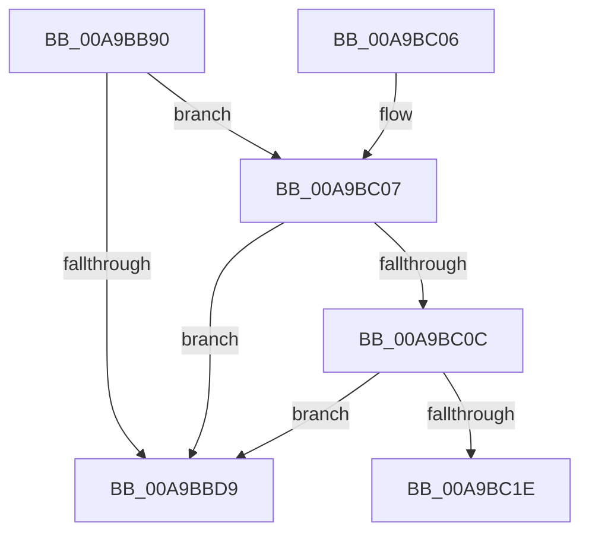

# VmpTracingEnabledCallback

- RVA: `0x00A9BB90`–`0x00A9BC27` (길이 `151` bytes)
- VA: `0x0000000140A9BB90`
- 실행 섹션: `PAGE`
- PDB 이름 있음: `예`; PDB Function 태그: `예`
- unwind 정보 RVA: `0x000BA4BC`
- 디코드: `45`개 명령, `151/151` bytes 표시
- 미해석 바이트: `0` (있으면 어셈블리에 `.byte`로 보존)

> 이 문서는 커널 이미지의 기계어와 PDB 기호를 분석해 생성했습니다. 4번과 5번은 함수 원형과 자료형을 바이너리 사용 방식에서 추정한 C 해석이며 원본 소스 복구 결과는 아닙니다.

## 1. Dependencies

- 직접 호출 지점: **2**; 고유 호출 대상: **2**
- 직접 호출자로 확인된 함수: **0**
- RIP 상대 이미지 참조: **1**

### Outgoing calls
- `0x00A9BBE0` → [_security_check_cookie](../../text/6A/_security_check_cookie_function_006AC640.md) (function, `0x006AC640`)
- `0x00A9BC0E` → [PsGetNextProcess](../91/PsGetNextProcess_function_0091C900.md) (function, `0x0091C900`)

### Direct callers
- 이 함수 시작 RVA로 연결되는 직접 call은 확인되지 않았습니다. 간접 호출은 완전히 역산할 수 없습니다.

### Static image references
- `0x00A9BBB4` → RVA `0x00E0A740` (`.data`; read)

## 2. Other-region calls and transfers

- 다른 실행 섹션으로 향하는 call: **1**
  - `0x00A9BBE0` → [_security_check_cookie](../../text/6A/_security_check_cookie_function_006AC640.md) (`PAGE` → `.text`)
- call이 아닌 외부 분기/꼬리 이동: **1**
  - `0x00A9BC22` → [sub_00B484E6](../B4/Unknown_function_00B484E6.md) (`tail-transfer`)

## 3. Assembly (complete function range)

```asm
00A9BB90  48 89 5C 24 08                  mov qword ptr [rsp + 8], rbx
00A9BB95  48 89 74 24 10                  mov qword ptr [rsp + 0x10], rsi
00A9BB9A  48 89 7C 24 18                  mov qword ptr [rsp + 0x18], rdi
00A9BB9F  55                              push rbp
00A9BBA0  41 54                           push r12
00A9BBA2  41 55                           push r13
00A9BBA4  41 56                           push r14
00A9BBA6  41 57                           push r15
00A9BBA8  48 8D 6C 24 A0                  lea rbp, [rsp - 0x60]
00A9BBAD  48 81 EC 60 01 00 00            sub rsp, 0x160
00A9BBB4  48 8B 05 85 EB 36 00            mov rax, qword ptr [rip + 0x36eb85]
00A9BBBB  48 33 C4                        xor rax, rsp
00A9BBBE  48 89 45 50                     mov qword ptr [rbp + 0x50], rax
00A9BBC2  0F 57 C0                        xorps xmm0, xmm0
00A9BBC5  8D 42 FF                        lea eax, [rdx - 1]
00A9BBC8  0F 11 45 80                     movups xmmword ptr [rbp - 0x80], xmm0
00A9BBCC  0F 11 45 90                     movups xmmword ptr [rbp - 0x70], xmm0
00A9BBD0  0F 11 45 A0                     movups xmmword ptr [rbp - 0x60], xmm0
00A9BBD4  83 F8 01                        cmp eax, 1
00A9BBD7  76 2E                           jbe 0x140a9bc07
00A9BBD9  48 8B 4D 50                     mov rcx, qword ptr [rbp + 0x50]
00A9BBDD  48 33 CC                        xor rcx, rsp
00A9BBE0  E8 5B 0A C1 FF                  call 0x1406ac640
00A9BBE5  4C 8D 9C 24 60 01 00 00         lea r11, [rsp + 0x160]
00A9BBED  49 8B 5B 30                     mov rbx, qword ptr [r11 + 0x30]
00A9BBF1  49 8B 73 38                     mov rsi, qword ptr [r11 + 0x38]
00A9BBF5  49 8B 7B 40                     mov rdi, qword ptr [r11 + 0x40]
00A9BBF9  49 8B E3                        mov rsp, r11
00A9BBFC  41 5F                           pop r15
00A9BBFE  41 5E                           pop r14
00A9BC00  41 5D                           pop r13
00A9BC02  41 5C                           pop r12
00A9BC04  5D                              pop rbp
00A9BC05  C3                              ret
00A9BC06  CC                              int3
00A9BC07  45 84 C9                        test r9b, r9b
00A9BC0A  79 CD                           jns 0x140a9bbd9
00A9BC0C  33 C9                           xor ecx, ecx
00A9BC0E  E8 ED 0C E8 FF                  call 0x14091c900
00A9BC13  45 33 F6                        xor r14d, r14d
00A9BC16  48 8B F8                        mov rdi, rax
00A9BC19  48 85 C0                        test rax, rax
00A9BC1C  74 BB                           je 0x140a9bbd9
00A9BC1E  45 8D 66 08                     lea r12d, [r14 + 8]
00A9BC22  E9 BF C8 0A 00                  jmp 0x140b484e6
```

## 4. C-style interpretation (structured pseudocode)

```c
__int64 __fastcall VmpTracingEnabledCallback(__int64 a1, __int64 a2, __int64 a3, unsigned __int8 a4)
{
    __int64 result;
    __int64 v_r14;
    __int64 v_rsp;
    unsigned __int64 v_stack_m108;
    unsigned __int64 v_stack_m28;
    unsigned __int64 v_stack_m38;
    unsigned __int64 v_stack_m88;
    unsigned __int64 v_stack_mE8;
    unsigned __int64 v_stack_mF8;
    unsigned __int64 v_stack_p10;
    unsigned __int64 v_stack_p18;
    unsigned __int64 v_stack_p8;

    v_stack_p8 = v_rbx;
    v_stack_p10 = v_rsi;
    v_stack_p18 = v_rdi;
    v_rsp = (v_rsp) - (352);
    result = (*(unsigned __int64 *)(v_rip + 3599237)) ^ (v_rsp);
    v_stack_m38 = result;
    v_stack_m108 = v_xmm0;
    v_stack_mF8 = v_xmm0;
    v_stack_mE8 = v_xmm0;
    if (((unsigned int)(a2 - 1)) <= 1) goto loc_00A9BC07;
loc_00A9BBD9:
    a1 = (v_stack_m38) ^ (v_rsp);
    result = _security_check_cookie(a1, a2, a3, a4);
    return result;
loc_00A9BC07:
    if (!sign_flag) goto loc_00A9BBD9;
    a1 = 0;
    result = PsGetNextProcess(a1, a2, a3, a4);
    v_r14 = 0;
    if (result == 0) goto loc_00A9BBD9;
}
```

## 5. (Beta) C Style

```c
int64_t VmpTracingEnabledCallback(int64_t Arg1, void *Arg2, int64_t Arg3, uint8_t Arg4)
{
    uint8_t *arg2 = (uint8_t *)Arg2;

    int64_t result;
    int64_t local_r14;
    int64_t local_rsp;
    uint64_t v_stack_m108;
    uint64_t v_stack_m28;
    uint64_t v_stack_m38;
    uint64_t v_stack_m88;
    uint64_t v_stack_mE8;
    uint64_t v_stack_mF8;
    uint64_t v_stack_p10;
    uint64_t v_stack_p18;
    uint64_t v_stack_p8;

    v_stack_p8 = local_rbx;
    v_stack_p10 = local_rsi;
    v_stack_p18 = local_rdi;
    local_rsp = (local_rsp) - (352);
    result = (*(uint64_t *)(v_rip + 0x36EB85)) ^ (local_rsp);
    v_stack_m38 = result;
    v_stack_m108 = v_xmm0;
    v_stack_mF8 = v_xmm0;
    v_stack_mE8 = v_xmm0;
    if (((uint32_t)(Arg2 - 1)) <= 1) goto loc_00A9BC07;
loc_00A9BBD9:
    Arg1 = (v_stack_m38) ^ (local_rsp);
    result = _security_check_cookie(Arg1, Arg2, Arg3, Arg4);
    return result;
loc_00A9BC07:
    if (!sign_flag) goto loc_00A9BBD9;
    Arg1 = 0;
    result = PsGetNextProcess(Arg1, Arg2, Arg3, Arg4);
    local_r14 = 0;
    if (result == 0) goto loc_00A9BBD9;
}
```

### 관측된 메모리 오프셋

구조체 형식이 확인되지 않은 접근은 인자 기준의 오프셋으로만 기록했습니다.

| 기준 인자 | 오프셋 표현 | 폭 (bit) | 접근 |
|---|---:|---:|---|
| `Arg2` | `- 0x1` | `32` | `R` |

## 6. Execution-region graph

[열기: 2D/3D 그래프와 함수 탐색 컨트롤 패널](../../../control-panel.html?section=page&rva=0x00A9BB90&view=graph)

- 2D 그래프는 위에서 아래로 흐르고, 3D 그래프는 빈 공간을 드래그해 회전합니다. Shift+드래그는 이동, 휠은 확대·축소, 함수 노드 선택은 대상 보고서 이동입니다.

### Static fallback


