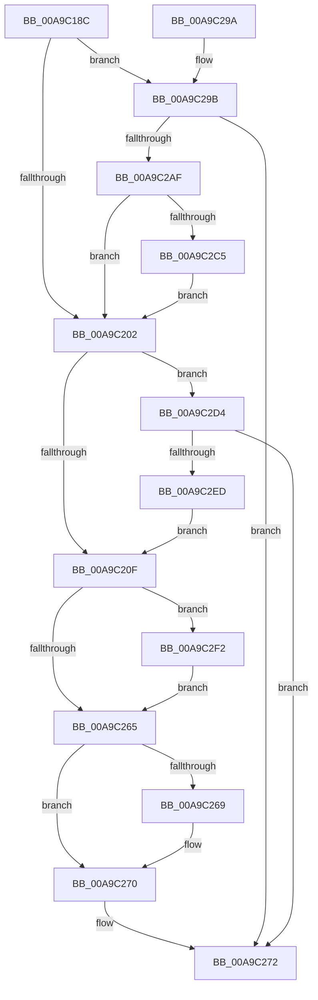

# VslCreateEnclave

- RVA: `0x00A9C18C`–`0x00A9C301` (길이 `373` bytes)
- VA: `0x0000000140A9C18C`
- 실행 섹션: `PAGE`
- PDB 이름 있음: `예`; PDB Function 태그: `아니요`
- unwind 정보 RVA: `0x000BA57C`
- 디코드: `95`개 명령, `373/373` bytes 표시
- 미해석 바이트: `0` (있으면 어셈블리에 `.byte`로 보존)

> 이 문서는 커널 이미지의 기계어와 PDB 기호를 분석해 생성했습니다. 4번과 5번은 함수 원형과 자료형을 바이너리 사용 방식에서 추정한 C 해석이며 원본 소스 복구 결과는 아닙니다.

## 1. Dependencies

- 직접 호출 지점: **8**; 고유 호출 대상: **7**
- 직접 호출자로 확인된 함수: **1**
- RIP 상대 이미지 참조: **1**

### Outgoing calls
- `0x00A9C1DF` → [memset](../../text/6C/memset_function_006C6C40.md) (function, `0x006C6C40`)
- `0x00A9C1EF` → [memset](../../text/6C/memset_function_006C6C40.md) (function, `0x006C6C40`)
- `0x00A9C252` → [VslpEnterIumSecureMode](../../text/23/VslpEnterIumSecureMode_function_00235E50.md) (function, `0x00235E50`)
- `0x00A9C279` → [_security_check_cookie](../../text/6A/_security_check_cookie_function_006AC640.md) (function, `0x006AC640`)
- `0x00A9C2A6` → [VslCreateSecureProcess](VslCreateSecureProcess_function_00A9C308.md) (function, `0x00A9C308`)
- `0x00A9C2CA` → [VslCloseSecureHandle](../../text/4B/VslCloseSecureHandle_function_004BBF40.md) (function, `0x004BBF40`)
- `0x00A9C2E4` → [VslpLockPagesForTransfer](../../text/29/VslpLockPagesForTransfer_function_0029E0FC.md) (function, `0x0029E0FC`)
- `0x00A9C2F7` → [VslpUnlockPagesForTransfer](../../text/29/VslpUnlockPagesForTransfer_function_0029EE4C.md) (function, `0x0029EE4C`)

### Direct callers
- [PsCreateVsmEnclave](PsCreateVsmEnclave_function_00A9BCCC.md) at `0x00A9BE6E`

### Static image references
- `0x00A9C1AA` → RVA `0x00E0A740` (`.data`; read)

## 2. Other-region calls and transfers

- 다른 실행 섹션으로 향하는 call: **7**
  - `0x00A9C1DF` → [memset](../../text/6C/memset_function_006C6C40.md) (`PAGE` → `.text`)
  - `0x00A9C1EF` → [memset](../../text/6C/memset_function_006C6C40.md) (`PAGE` → `.text`)
  - `0x00A9C252` → [VslpEnterIumSecureMode](../../text/23/VslpEnterIumSecureMode_function_00235E50.md) (`PAGE` → `.text`)
  - `0x00A9C279` → [_security_check_cookie](../../text/6A/_security_check_cookie_function_006AC640.md) (`PAGE` → `.text`)
  - `0x00A9C2CA` → [VslCloseSecureHandle](../../text/4B/VslCloseSecureHandle_function_004BBF40.md) (`PAGE` → `.text`)
  - `0x00A9C2E4` → [VslpLockPagesForTransfer](../../text/29/VslpLockPagesForTransfer_function_0029E0FC.md) (`PAGE` → `.text`)
  - `0x00A9C2F7` → [VslpUnlockPagesForTransfer](../../text/29/VslpUnlockPagesForTransfer_function_0029EE4C.md) (`PAGE` → `.text`)
- 별도 외부 분기/꼬리 이동을 확인하지 못했습니다.

## 3. Assembly (complete function range)

```asm
00A9C18C  48 89 5C 24 08                  mov qword ptr [rsp + 8], rbx
00A9C191  48 89 74 24 20                  mov qword ptr [rsp + 0x20], rsi
00A9C196  55                              push rbp
00A9C197  57                              push rdi
00A9C198  41 54                           push r12
00A9C19A  41 56                           push r14
00A9C19C  41 57                           push r15
00A9C19E  48 8D 6C 24 F0                  lea rbp, [rsp - 0x10]
00A9C1A3  48 81 EC 10 01 00 00            sub rsp, 0x110
00A9C1AA  48 8B 05 8F E5 36 00            mov rax, qword ptr [rip + 0x36e58f]
00A9C1B1  48 33 C4                        xor rax, rsp
00A9C1B4  48 89 45 00                     mov qword ptr [rbp], rax
00A9C1B8  4C 8B 75 68                     mov r14, qword ptr [rbp + 0x68]
00A9C1BC  48 8B DA                        mov rbx, rdx
00A9C1BF  48 8B BD 80 00 00 00            mov rdi, qword ptr [rbp + 0x80]
00A9C1C6  33 D2                           xor edx, edx
00A9C1C8  48 83 64 24 30 00               and qword ptr [rsp + 0x30], 0
00A9C1CE  49 8B F0                        mov rsi, r8
00A9C1D1  4C 8B E1                        mov r12, rcx
00A9C1D4  4D 8B F9                        mov r15, r9
00A9C1D7  48 8D 4D 90                     lea rcx, [rbp - 0x70]
00A9C1DB  44 8D 42 68                     lea r8d, [rdx + 0x68]
00A9C1DF  E8 5C AA C2 FF                  call 0x1406c6c40
00A9C1E4  33 D2                           xor edx, edx
00A9C1E6  48 8D 4C 24 40                  lea rcx, [rsp + 0x40]
00A9C1EB  44 8D 42 48                     lea r8d, [rdx + 0x48]
00A9C1EF  E8 4C AA C2 FF                  call 0x1406c6c40
00A9C1F4  48 83 BB 70 01 00 00 00         cmp qword ptr [rbx + 0x170], 0
00A9C1FC  0F 84 99 00 00 00               je 0x140a9c29b
00A9C202  44 8B 45 70                     mov r8d, dword ptr [rbp + 0x70]
00A9C206  45 85 C0                        test r8d, r8d
00A9C209  0F 85 C5 00 00 00               jne 0x140a9c2d4
00A9C20F  48 8B 83 70 01 00 00            mov rax, qword ptr [rbx + 0x170]
00A9C216  4C 8D 4D 90                     lea r9, [rbp - 0x70]
00A9C21A  48 89 45 98                     mov qword ptr [rbp - 0x68], rax
00A9C21E  BA 2F 00 00 00                  mov edx, 0x2f
00A9C223  48 8B 45 60                     mov rax, qword ptr [rbp + 0x60]
00A9C227  45 33 C0                        xor r8d, r8d
00A9C22A  48 89 45 A8                     mov qword ptr [rbp - 0x58], rax
00A9C22E  B1 02                           mov cl, 2
00A9C230  48 8B 44 24 40                  mov rax, qword ptr [rsp + 0x40]
00A9C235  48 89 45 B8                     mov qword ptr [rbp - 0x48], rax
00A9C239  48 8B 44 24 78                  mov rax, qword ptr [rsp + 0x78]
00A9C23E  48 89 45 C0                     mov qword ptr [rbp - 0x40], rax
00A9C242  0F B6 45 78                     movzx eax, byte ptr [rbp + 0x78]
00A9C246  48 89 45 C8                     mov qword ptr [rbp - 0x38], rax
00A9C24A  4C 89 7D A0                     mov qword ptr [rbp - 0x60], r15
00A9C24E  4C 89 65 B0                     mov qword ptr [rbp - 0x50], r12
00A9C252  E8 F9 9B 79 FF                  call 0x140235e50
00A9C257  48 83 7C 24 40 00               cmp qword ptr [rsp + 0x40], 0
00A9C25D  8B D8                           mov ebx, eax
00A9C25F  0F 85 8D 00 00 00               jne 0x140a9c2f2
00A9C265  85 DB                           test ebx, ebx
00A9C267  78 07                           js 0x140a9c270
00A9C269  48 8B 4D A0                     mov rcx, qword ptr [rbp - 0x60]
00A9C26D  48 89 0F                        mov qword ptr [rdi], rcx
00A9C270  8B C3                           mov eax, ebx
00A9C272  48 8B 4D 00                     mov rcx, qword ptr [rbp]
00A9C276  48 33 CC                        xor rcx, rsp
00A9C279  E8 C2 03 C1 FF                  call 0x1406ac640
00A9C27E  4C 8D 9C 24 10 01 00 00         lea r11, [rsp + 0x110]
00A9C286  49 8B 5B 30                     mov rbx, qword ptr [r11 + 0x30]
00A9C28A  49 8B 73 48                     mov rsi, qword ptr [r11 + 0x48]
00A9C28E  49 8B E3                        mov rsp, r11
00A9C291  41 5F                           pop r15
00A9C293  41 5E                           pop r14
00A9C295  41 5C                           pop r12
00A9C297  5F                              pop rdi
00A9C298  5D                              pop rbp
00A9C299  C3                              ret
00A9C29A  CC                              int3
00A9C29B  4C 8D 44 24 30                  lea r8, [rsp + 0x30]
00A9C2A0  48 8B D6                        mov rdx, rsi
00A9C2A3  48 8B CB                        mov rcx, rbx
00A9C2A6  E8 5D 00 00 00                  call 0x140a9c308
00A9C2AB  85 C0                           test eax, eax
00A9C2AD  78 C3                           js 0x140a9c272
00A9C2AF  48 8B 4C 24 30                  mov rcx, qword ptr [rsp + 0x30]
00A9C2B4  33 C0                           xor eax, eax
00A9C2B6  F0 48 0F B1 8B 70 01 00 00      lock cmpxchg qword ptr [rbx + 0x170], rcx
00A9C2BF  0F 84 3D FF FF FF               je 0x140a9c202
00A9C2C5  48 8B 4C 24 30                  mov rcx, qword ptr [rsp + 0x30]
00A9C2CA  E8 71 FC A1 FF                  call 0x1404bbf40
00A9C2CF  E9 2E FF FF FF                  jmp 0x140a9c202
00A9C2D4  83 64 24 20 00                  and dword ptr [rsp + 0x20], 0
00A9C2D9  48 8D 4C 24 40                  lea rcx, [rsp + 0x40]
00A9C2DE  45 33 C9                        xor r9d, r9d
00A9C2E1  49 8B D6                        mov rdx, r14
00A9C2E4  E8 13 1E 80 FF                  call 0x14029e0fc
00A9C2E9  85 C0                           test eax, eax
00A9C2EB  78 85                           js 0x140a9c272
00A9C2ED  E9 1D FF FF FF                  jmp 0x140a9c20f
00A9C2F2  48 8D 4C 24 40                  lea rcx, [rsp + 0x40]
00A9C2F7  E8 50 2B 80 FF                  call 0x14029ee4c
00A9C2FC  E9 64 FF FF FF                  jmp 0x140a9c265
```

## 4. C-style interpretation (structured pseudocode)

```c
__int64 __fastcall VslCreateEnclave(__int64 a1, __int64 a2, __int64 a3, __int64 a4, __int64 a5, __int64 a6, unsigned int a7, unsigned __int8 a8, __int64 a9)
{
    __int64 result;
    __int64 v_rsp;
    unsigned __int64 v_stack_m108;
    unsigned __int64 v_stack_m28;
    unsigned __int64 v_stack_m38;
    unsigned __int64 v_stack_m70;
    unsigned __int64 v_stack_m78;
    unsigned __int64 v_stack_m80;
    unsigned __int64 v_stack_m88;
    unsigned __int64 v_stack_m90;
    unsigned __int64 v_stack_m98;
    unsigned __int64 v_stack_mA0;
    unsigned __int64 v_stack_mA8;
    unsigned __int64 v_stack_mC0;
    unsigned __int64 v_stack_mD0;
    unsigned __int64 v_stack_mE0;
    unsigned int v_stack_mF0;
    unsigned __int64 v_stack_mF8;
    unsigned __int64 v_stack_p20;
    unsigned __int64 v_stack_p8;

    v_stack_p8 = v_rbx;
    v_stack_p20 = v_rsi;
    v_rsp = (v_rsp) - (272);
    result = (*(unsigned __int64 *)(v_rip + 3597711)) ^ (v_rsp);
    v_stack_m38 = result;
    a2 = 0;
    result = memset(v_stack_mA8, a2, a2 + 104, a4);
    a2 = 0;
    result = memset(v_stack_mF8, a2, a2 + 72, a4);
    if ((*(unsigned __int64 *)(a2 + 368)) == 0) goto loc_00A9C29B;
loc_00A9C202:
    if ((unsigned int)((unsigned int)(a7)) != 0) goto loc_00A9C2D4;
loc_00A9C20F:
    v_stack_mA0 = *(unsigned __int64 *)(a2 + 368);
    a3 = 0;
    v_stack_m90 = a5;
    v_stack_m80 = v_stack_mF8;
    v_stack_m78 = v_stack_mC0;
    v_stack_m70 = a8;
    v_stack_m98 = a4;
    v_stack_m88 = a1;
    result = VslpEnterIumSecureMode(2, 47, a3, v_stack_mA8);
    if (v_stack_mF8 != 0) goto loc_00A9C2F2;
loc_00A9C265:
    if (!(sign_flag)) {
        a1 = v_stack_m98;
        *(unsigned __int64 *)(a9) = a1;
    }
loc_00A9C272:
    a1 = (v_stack_m38) ^ (v_rsp);
    result = _security_check_cookie(a1, 47, a3, v_stack_mA8);
    return result;
loc_00A9C29B:
    result = VslCreateSecureProcess(*(unsigned __int64 *)(v_stack_m28 + 48), *(unsigned __int64 *)(v_stack_m28 + 72), v_stack_mE0, v_stack_mA8);
    if (sign_flag) goto loc_00A9C272;
    result = 0;
    if (condition_is_equal) goto loc_00A9C202;
    result = VslCloseSecureHandle(v_stack_mE0, *(unsigned __int64 *)(v_stack_m28 + 72), v_stack_mE0, v_stack_mA8);
    goto loc_00A9C202;
loc_00A9C2D4:
    a4 = 0;
    result = VslpLockPagesForTransfer(v_stack_mD0, a6, v_stack_mE0, a4);
    if (sign_flag) goto loc_00A9C272;
    goto loc_00A9C20F;
loc_00A9C2F2:
    result = VslpUnlockPagesForTransfer(v_stack_mD0, a6, v_stack_mE0, a4);
    goto loc_00A9C265;
}
```

## 5. (Beta) C Style

```c
int64_t VslCreateEnclave(int64_t Arg1, void *Arg2, int64_t Arg3, int64_t Arg4, int64_t Arg5, int64_t Arg6, uint32_t Arg7, uint8_t Arg8, void *Arg9)
{
    uint8_t *arg2 = (uint8_t *)Arg2;
    uint8_t *arg9 = (uint8_t *)Arg9;

    int64_t result;
    int64_t local_rsp;
    uint64_t v_stack_m108;
    uint64_t v_stack_m28;
    uint64_t v_stack_m38;
    uint64_t v_stack_m70;
    uint64_t v_stack_m78;
    uint64_t v_stack_m80;
    uint64_t v_stack_m88;
    uint64_t v_stack_m90;
    uint64_t v_stack_m98;
    uint64_t v_stack_mA0;
    uint64_t v_stack_mA8;
    uint64_t v_stack_mC0;
    uint64_t v_stack_mD0;
    uint64_t v_stack_mE0;
    uint32_t v_stack_mF0;
    uint64_t v_stack_mF8;
    uint64_t v_stack_p20;
    uint64_t v_stack_p8;

    v_stack_p8 = local_rbx;
    v_stack_p20 = local_rsi;
    local_rsp = (local_rsp) - (272);
    result = (*(uint64_t *)(v_rip + 0x36E58F)) ^ (local_rsp);
    v_stack_m38 = result;
    Arg2 = 0;
    result = memset(v_stack_mA8, Arg2, Arg2 + 104, Arg4);
    Arg2 = 0;
    result = memset(v_stack_mF8, Arg2, Arg2 + 72, Arg4);
    if ((*(uint64_t *)(arg2 + 0x170)) == 0) goto loc_00A9C29B;
loc_00A9C202:
    if ((uint32_t)((uint32_t)(Arg7)) != 0) goto loc_00A9C2D4;
loc_00A9C20F:
    v_stack_mA0 = *(uint64_t *)(arg2 + 0x170);
    Arg3 = 0;
    v_stack_m90 = Arg5;
    v_stack_m80 = v_stack_mF8;
    v_stack_m78 = v_stack_mC0;
    v_stack_m70 = Arg8;
    v_stack_m98 = Arg4;
    v_stack_m88 = Arg1;
    result = VslpEnterIumSecureMode(2, 47, Arg3, v_stack_mA8);
    if (v_stack_mF8 != 0) goto loc_00A9C2F2;
loc_00A9C265:
    if (!(sign_flag)) {
        Arg1 = v_stack_m98;
        *(uint64_t *)(arg9) = Arg1;
    }
loc_00A9C272:
    Arg1 = (v_stack_m38) ^ (local_rsp);
    result = _security_check_cookie(Arg1, 47, Arg3, v_stack_mA8);
    return result;
loc_00A9C29B:
    result = VslCreateSecureProcess(*(uint64_t *)(v_stack_m28 + 0x30), *(uint64_t *)(v_stack_m28 + 0x48), v_stack_mE0, v_stack_mA8);
    if (sign_flag) goto loc_00A9C272;
    result = 0;
    if (condition_is_equal) goto loc_00A9C202;
    result = VslCloseSecureHandle(v_stack_mE0, *(uint64_t *)(v_stack_m28 + 0x48), v_stack_mE0, v_stack_mA8);
    goto loc_00A9C202;
loc_00A9C2D4:
    Arg4 = 0;
    result = VslpLockPagesForTransfer(v_stack_mD0, Arg6, v_stack_mE0, Arg4);
    if (sign_flag) goto loc_00A9C272;
    goto loc_00A9C20F;
loc_00A9C2F2:
    result = VslpUnlockPagesForTransfer(v_stack_mD0, Arg6, v_stack_mE0, Arg4);
    goto loc_00A9C265;
}
```

### 관측된 메모리 오프셋

구조체 형식이 확인되지 않은 접근은 인자 기준의 오프셋으로만 기록했습니다.

| 기준 인자 | 오프셋 표현 | 폭 (bit) | 접근 |
|---|---:|---:|---|
| `Arg2` | `+ 0x170` | `64` | `R` |
| `Arg9` | `+ 0x0` | `64` | `W` |

## 6. Execution-region graph

[열기: 2D/3D 그래프와 함수 탐색 컨트롤 패널](../../../control-panel.html?section=page&rva=0x00A9C18C&view=graph)

- 2D 그래프는 위에서 아래로 흐르고, 3D 그래프는 빈 공간을 드래그해 회전합니다. Shift+드래그는 이동, 휠은 확대·축소, 함수 노드 선택은 대상 보고서 이동입니다.

### Static fallback


