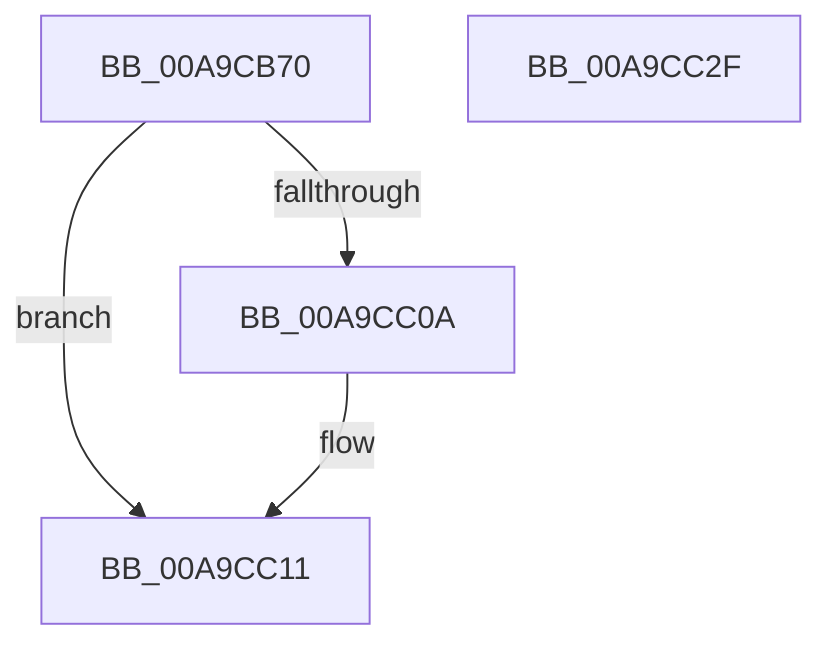

# VslCreateSecureThread

- RVA: `0x00A9CB70`–`0x00A9CC30` (길이 `192` bytes)
- VA: `0x0000000140A9CB70`
- 실행 섹션: `PAGE`
- PDB 이름 있음: `예`; PDB Function 태그: `아니요`
- unwind 정보 RVA: `0x000BA674`
- 디코드: `49`개 명령, `192/192` bytes 표시
- 미해석 바이트: `0` (있으면 어셈블리에 `.byte`로 보존)

> 이 문서는 커널 이미지의 기계어와 PDB 기호를 분석해 생성했습니다. 4번과 5번은 함수 원형과 자료형을 바이너리 사용 방식에서 추정한 C 해석이며 원본 소스 복구 결과는 아닙니다.

## 1. Dependencies

- 직접 호출 지점: **3**; 고유 호출 대상: **3**
- 직접 호출자로 확인된 함수: **1**
- RIP 상대 이미지 참조: **1**

### Outgoing calls
- `0x00A9CBAF` → [memset](../../text/6C/memset_function_006C6C40.md) (function, `0x006C6C40`)
- `0x00A9CC01` → [VslpEnterIumSecureMode](../../text/23/VslpEnterIumSecureMode_function_00235E50.md) (function, `0x00235E50`)
- `0x00A9CC1C` → [_security_check_cookie](../../text/6A/_security_check_cookie_function_006AC640.md) (function, `0x006AC640`)

### Direct callers
- [KeSecureThread](../../text/4C/KeSecureThread_function_004C5D74.md) at `0x004C5DA3`

### Static image references
- `0x00A9CB7E` → RVA `0x00E0A740` (`.data`; read)

## 2. Other-region calls and transfers

- 다른 실행 섹션으로 향하는 call: **3**
  - `0x00A9CBAF` → [memset](../../text/6C/memset_function_006C6C40.md) (`PAGE` → `.text`)
  - `0x00A9CC01` → [VslpEnterIumSecureMode](../../text/23/VslpEnterIumSecureMode_function_00235E50.md) (`PAGE` → `.text`)
  - `0x00A9CC1C` → [_security_check_cookie](../../text/6A/_security_check_cookie_function_006AC640.md) (`PAGE` → `.text`)
- 별도 외부 분기/꼬리 이동을 확인하지 못했습니다.

## 3. Assembly (complete function range)

```asm
00A9CB70  40 53                           push rbx
00A9CB72  55                              push rbp
00A9CB73  56                              push rsi
00A9CB74  57                              push rdi
00A9CB75  41 56                           push r14
00A9CB77  48 81 EC A0 00 00 00            sub rsp, 0xa0
00A9CB7E  48 8B 05 BB DB 36 00            mov rax, qword ptr [rip + 0x36dbbb]
00A9CB85  48 33 C4                        xor rax, rsp
00A9CB88  48 89 84 24 90 00 00 00         mov qword ptr [rsp + 0x90], rax
00A9CB90  4C 8B B4 24 00 01 00 00         mov r14, qword ptr [rsp + 0x100]
00A9CB98  48 8B FA                        mov rdi, rdx
00A9CB9B  33 D2                           xor edx, edx
00A9CB9D  49 8B F0                        mov rsi, r8
00A9CBA0  48 8B D9                        mov rbx, rcx
00A9CBA3  49 8B E9                        mov rbp, r9
00A9CBA6  48 8D 4C 24 20                  lea rcx, [rsp + 0x20]
00A9CBAB  44 8D 42 68                     lea r8d, [rdx + 0x68]
00A9CBAF  E8 8C A0 C2 FF                  call 0x1406c6c40
00A9CBB4  48 8B 83 70 01 00 00            mov rax, qword ptr [rbx + 0x170]
00A9CBBB  4C 8D 4C 24 20                  lea r9, [rsp + 0x20]
00A9CBC0  48 89 44 24 28                  mov qword ptr [rsp + 0x28], rax
00A9CBC5  BA 08 00 00 00                  mov edx, 8
00A9CBCA  48 8B 46 30                     mov rax, qword ptr [rsi + 0x30]
00A9CBCE  45 33 C0                        xor r8d, r8d
00A9CBD1  48 89 44 24 38                  mov qword ptr [rsp + 0x38], rax
00A9CBD6  B1 02                           mov cl, 2
00A9CBD8  48 8B 84 24 F0 00 00 00         mov rax, qword ptr [rsp + 0xf0]
00A9CBE0  48 89 44 24 50                  mov qword ptr [rsp + 0x50], rax
00A9CBE5  48 8B 84 24 F8 00 00 00         mov rax, qword ptr [rsp + 0xf8]
00A9CBED  48 89 44 24 58                  mov qword ptr [rsp + 0x58], rax
00A9CBF2  48 89 7C 24 30                  mov qword ptr [rsp + 0x30], rdi
00A9CBF7  48 89 74 24 40                  mov qword ptr [rsp + 0x40], rsi
00A9CBFC  48 89 6C 24 48                  mov qword ptr [rsp + 0x48], rbp
00A9CC01  E8 4A 92 79 FF                  call 0x140235e50
00A9CC06  85 C0                           test eax, eax
00A9CC08  78 07                           js 0x140a9cc11
00A9CC0A  8B 4C 24 30                     mov ecx, dword ptr [rsp + 0x30]
00A9CC0E  41 89 0E                        mov dword ptr [r14], ecx
00A9CC11  48 8B 8C 24 90 00 00 00         mov rcx, qword ptr [rsp + 0x90]
00A9CC19  48 33 CC                        xor rcx, rsp
00A9CC1C  E8 1F FA C0 FF                  call 0x1406ac640
00A9CC21  48 81 C4 A0 00 00 00            add rsp, 0xa0
00A9CC28  41 5E                           pop r14
00A9CC2A  5F                              pop rdi
00A9CC2B  5E                              pop rsi
00A9CC2C  5D                              pop rbp
00A9CC2D  5B                              pop rbx
00A9CC2E  C3                              ret
00A9CC2F  CC                              int3
```

## 4. C-style interpretation (structured pseudocode)

```c
__int64 __fastcall VslCreateSecureThread(__int64 a1, __int64 a2, __int64 a3, __int64 a4, __int64 a5, __int64 a6, __int64 a7)
{
    __int64 result;
    __int64 v_rsp;
    unsigned __int64 v_stack_m38;
    unsigned __int64 v_stack_m70;
    unsigned __int64 v_stack_m78;
    unsigned __int64 v_stack_m80;
    unsigned __int64 v_stack_m88;
    unsigned __int64 v_stack_m90;
    unsigned __int64 v_stack_m98;
    unsigned __int64 v_stack_mA0;
    unsigned __int64 v_stack_mA8;

    v_rsp = (v_rsp) - (160);
    result = (*(unsigned __int64 *)(v_rip + 3595195)) ^ (v_rsp);
    v_stack_m38 = result;
    a2 = 0;
    result = memset(v_stack_mA8, a2, a2 + 104, a4);
    v_stack_mA0 = *(unsigned __int64 *)(a1 + 368);
    a3 = 0;
    v_stack_m90 = *(unsigned __int64 *)(a3 + 48);
    v_stack_m78 = a5;
    v_stack_m70 = a6;
    v_stack_m98 = 0;
    v_stack_m88 = 0;
    v_stack_m80 = a4;
    result = VslpEnterIumSecureMode(2, 8, a3, v_stack_mA8);
    if (!(sign_flag)) {
        a1 = v_stack_m98;
        *(unsigned int *)(a7) = (unsigned int)(a1);
    }
    a1 = (v_stack_m38) ^ (v_rsp);
    result = _security_check_cookie(a1, 8, a3, v_stack_mA8);
    v_rsp = (v_rsp) + (160);
    return result;
}
```

## 5. (Beta) C Style

```c
int64_t VslCreateSecureThread(void *Arg1, int64_t Arg2, void *Arg3, int64_t Arg4, int64_t Arg5, int64_t Arg6, void *Arg7)
{
    uint8_t *arg1 = (uint8_t *)Arg1;
    uint8_t *arg3 = (uint8_t *)Arg3;
    uint8_t *arg7 = (uint8_t *)Arg7;

    int64_t result;
    int64_t local_rsp;
    uint64_t v_stack_m38;
    uint64_t v_stack_m70;
    uint64_t v_stack_m78;
    uint64_t v_stack_m80;
    uint64_t v_stack_m88;
    uint64_t v_stack_m90;
    uint64_t v_stack_m98;
    uint64_t v_stack_mA0;
    uint64_t v_stack_mA8;

    local_rsp = (local_rsp) - (160);
    result = (*(uint64_t *)(v_rip + 0x36DBBB)) ^ (local_rsp);
    v_stack_m38 = result;
    Arg2 = 0;
    result = memset(v_stack_mA8, Arg2, Arg2 + 104, Arg4);
    v_stack_mA0 = *(uint64_t *)(arg1 + 0x170);
    Arg3 = 0;
    v_stack_m90 = *(uint64_t *)(arg3 + 0x30);
    v_stack_m78 = Arg5;
    v_stack_m70 = Arg6;
    v_stack_m98 = 0;
    v_stack_m88 = 0;
    v_stack_m80 = Arg4;
    result = VslpEnterIumSecureMode(2, 8, Arg3, v_stack_mA8);
    if (!(sign_flag)) {
        Arg1 = v_stack_m98;
        *(uint32_t *)(arg7) = (uint32_t)(Arg1);
    }
    Arg1 = (v_stack_m38) ^ (local_rsp);
    result = _security_check_cookie(Arg1, 8, Arg3, v_stack_mA8);
    local_rsp = (local_rsp) + (160);
    return result;
}
```

### 관측된 메모리 오프셋

구조체 형식이 확인되지 않은 접근은 인자 기준의 오프셋으로만 기록했습니다.

| 기준 인자 | 오프셋 표현 | 폭 (bit) | 접근 |
|---|---:|---:|---|
| `Arg1` | `+ 0x170` | `64` | `R` |
| `Arg3` | `+ 0x30` | `64` | `R` |
| `Arg7` | `+ 0x0` | `32` | `W` |

## 6. Execution-region graph

[열기: 2D/3D 그래프와 함수 탐색 컨트롤 패널](../../../control-panel.html?section=page&rva=0x00A9CB70&view=graph)

- 2D 그래프는 위에서 아래로 흐르고, 3D 그래프는 빈 공간을 드래그해 회전합니다. Shift+드래그는 이동, 휠은 확대·축소, 함수 노드 선택은 대상 보고서 이동입니다.

### Static fallback


