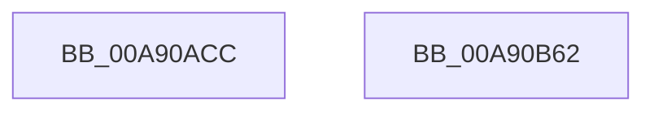

# VslReserveProtectedPages

- RVA: `0x00A90ACC`–`0x00A90B63` (길이 `151` bytes)
- VA: `0x0000000140A90ACC`
- 실행 섹션: `PAGE`
- PDB 이름 있음: `예`; PDB Function 태그: `아니요`
- unwind 정보 RVA: `0x00068468`
- 디코드: `36`개 명령, `151/151` bytes 표시
- 미해석 바이트: `0` (있으면 어셈블리에 `.byte`로 보존)

> 이 문서는 커널 이미지의 기계어와 PDB 기호를 분석해 생성했습니다. 4번과 5번은 함수 원형과 자료형을 바이너리 사용 방식에서 추정한 C 해석이며 원본 소스 복구 결과는 아닙니다.

## 1. Dependencies

- 직접 호출 지점: **3**; 고유 호출 대상: **3**
- 직접 호출자로 확인된 함수: **3**
- RIP 상대 이미지 참조: **1**

### Outgoing calls
- `0x00A90B0C` → [memset](../../text/6C/memset_function_006C6C40.md) (function, `0x006C6C40`)
- `0x00A90B34` → [VslpEnterIumSecureMode](../../text/23/VslpEnterIumSecureMode_function_00235E50.md) (function, `0x00235E50`)
- `0x00A90B44` → [_security_check_cookie](../../text/6A/_security_check_cookie_function_006AC640.md) (function, `0x006AC640`)

### Direct callers
- [KeReservePrivilegedPages](../../text/4B/KeReservePrivilegedPages_function_004BEAE8.md) at `0x004BEAEC`
- [MiFreeKernelPadSections](../../init/C6/MiFreeKernelPadSections_function_00C6B5CC.md) at `0x00C6B6A8`
- [MiInitializeLoadedModuleList](../../init/C6/MiInitializeLoadedModuleList_function_00C6BCDC.md) at `0x00C6C00E`

### Static image references
- `0x00A90AE3` → RVA `0x00E0A740` (`.data`; read)

## 2. Other-region calls and transfers

- 다른 실행 섹션으로 향하는 call: **3**
  - `0x00A90B0C` → [memset](../../text/6C/memset_function_006C6C40.md) (`PAGE` → `.text`)
  - `0x00A90B34` → [VslpEnterIumSecureMode](../../text/23/VslpEnterIumSecureMode_function_00235E50.md) (`PAGE` → `.text`)
  - `0x00A90B44` → [_security_check_cookie](../../text/6A/_security_check_cookie_function_006AC640.md) (`PAGE` → `.text`)
- 별도 외부 분기/꼬리 이동을 확인하지 못했습니다.

## 3. Assembly (complete function range)

```asm
00A90ACC  48 89 5C 24 08                  mov qword ptr [rsp + 8], rbx
00A90AD1  48 89 6C 24 10                  mov qword ptr [rsp + 0x10], rbp
00A90AD6  48 89 74 24 18                  mov qword ptr [rsp + 0x18], rsi
00A90ADB  57                              push rdi
00A90ADC  48 81 EC A0 00 00 00            sub rsp, 0xa0
00A90AE3  48 8B 05 56 9C 37 00            mov rax, qword ptr [rip + 0x379c56]
00A90AEA  48 33 C4                        xor rax, rsp
00A90AED  48 89 84 24 90 00 00 00         mov qword ptr [rsp + 0x90], rax
00A90AF5  48 8B FA                        mov rdi, rdx
00A90AF8  41 8B F0                        mov esi, r8d
00A90AFB  33 D2                           xor edx, edx
00A90AFD  41 8B E9                        mov ebp, r9d
00A90B00  48 8B D9                        mov rbx, rcx
00A90B03  48 8D 4C 24 20                  lea rcx, [rsp + 0x20]
00A90B08  44 8D 42 68                     lea r8d, [rdx + 0x68]
00A90B0C  E8 2F 61 C3 FF                  call 0x1406c6c40
00A90B11  BA D3 00 00 00                  mov edx, 0xd3
00A90B16  48 89 5C 24 28                  mov qword ptr [rsp + 0x28], rbx
00A90B1B  4C 8D 4C 24 20                  lea r9, [rsp + 0x20]
00A90B20  48 89 7C 24 30                  mov qword ptr [rsp + 0x30], rdi
00A90B25  45 33 C0                        xor r8d, r8d
00A90B28  48 89 74 24 38                  mov qword ptr [rsp + 0x38], rsi
00A90B2D  B1 02                           mov cl, 2
00A90B2F  48 89 6C 24 40                  mov qword ptr [rsp + 0x40], rbp
00A90B34  E8 17 53 7A FF                  call 0x140235e50
00A90B39  48 8B 8C 24 90 00 00 00         mov rcx, qword ptr [rsp + 0x90]
00A90B41  48 33 CC                        xor rcx, rsp
00A90B44  E8 F7 BA C1 FF                  call 0x1406ac640
00A90B49  4C 8D 9C 24 A0 00 00 00         lea r11, [rsp + 0xa0]
00A90B51  49 8B 5B 10                     mov rbx, qword ptr [r11 + 0x10]
00A90B55  49 8B 6B 18                     mov rbp, qword ptr [r11 + 0x18]
00A90B59  49 8B 73 20                     mov rsi, qword ptr [r11 + 0x20]
00A90B5D  49 8B E3                        mov rsp, r11
00A90B60  5F                              pop rdi
00A90B61  C3                              ret
00A90B62  CC                              int3
```

## 4. C-style interpretation (structured pseudocode)

```c
__int64 __fastcall VslReserveProtectedPages(__int64 a1, __int64 a2, int a3, int a4)
{
    __int64 result;
    __int64 v_rsp;
    unsigned __int64 v_stack_m18;
    unsigned __int64 v_stack_m68;
    unsigned __int64 v_stack_m70;
    unsigned __int64 v_stack_m78;
    unsigned __int64 v_stack_m8;
    unsigned __int64 v_stack_m80;
    unsigned __int64 v_stack_m88;
    unsigned __int64 v_stack_p10;
    unsigned __int64 v_stack_p18;
    unsigned __int64 v_stack_p8;

    v_stack_p8 = v_rbx;
    v_stack_p10 = v_rbp;
    v_stack_p18 = v_rsi;
    v_rsp = (v_rsp) - (160);
    result = (*(unsigned __int64 *)(v_rip + 3644502)) ^ (v_rsp);
    v_stack_m18 = result;
    a2 = 0;
    result = memset(v_stack_m88, a2, a2 + 104, a4);
    v_stack_m80 = a1;
    v_stack_m78 = 0;
    a3 = 0;
    v_stack_m70 = (unsigned int)(a3);
    v_stack_m68 = (unsigned int)(a4);
    result = VslpEnterIumSecureMode(2, 211, a3, v_stack_m88);
    a1 = (v_stack_m18) ^ (v_rsp);
    result = _security_check_cookie(a1, 211, a3, v_stack_m88);
    return result;
}
```

## 5. (Beta) C Style

```c
int64_t VslReserveProtectedPages(int64_t Arg1, int64_t Arg2, int32_t Arg3, int32_t Arg4)
{
    int64_t result;
    int64_t local_rsp;
    uint64_t v_stack_m18;
    uint64_t v_stack_m68;
    uint64_t v_stack_m70;
    uint64_t v_stack_m78;
    uint64_t v_stack_m8;
    uint64_t v_stack_m80;
    uint64_t v_stack_m88;
    uint64_t v_stack_p10;
    uint64_t v_stack_p18;
    uint64_t v_stack_p8;

    v_stack_p8 = local_rbx;
    v_stack_p10 = local_rbp;
    v_stack_p18 = local_rsi;
    local_rsp = (local_rsp) - (160);
    result = (*(uint64_t *)(v_rip + 0x379C56)) ^ (local_rsp);
    v_stack_m18 = result;
    Arg2 = 0;
    result = memset(v_stack_m88, Arg2, Arg2 + 104, Arg4);
    v_stack_m80 = Arg1;
    v_stack_m78 = 0;
    Arg3 = 0;
    v_stack_m70 = (uint32_t)(Arg3);
    v_stack_m68 = (uint32_t)(Arg4);
    result = VslpEnterIumSecureMode(2, 211, Arg3, v_stack_m88);
    Arg1 = (v_stack_m18) ^ (local_rsp);
    result = _security_check_cookie(Arg1, 211, Arg3, v_stack_m88);
    return result;
}
```

## 6. Execution-region graph

[열기: 2D/3D 그래프와 함수 탐색 컨트롤 패널](../../../control-panel.html?section=page&rva=0x00A90ACC&view=graph)

- 2D 그래프는 위에서 아래로 흐르고, 3D 그래프는 빈 공간을 드래그해 회전합니다. Shift+드래그는 이동, 휠은 확대·축소, 함수 노드 선택은 대상 보고서 이동입니다.

### Static fallback


