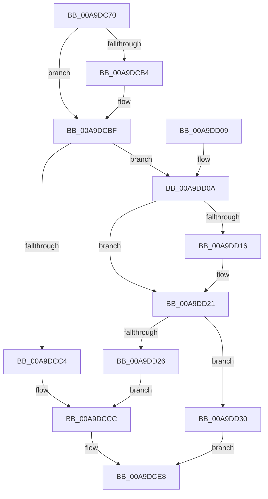

# VslpConnectedStandbyPoCallback

- RVA: `0x00A9DC70`–`0x00A9DD37` (길이 `199` bytes)
- VA: `0x0000000140A9DC70`
- 실행 섹션: `PAGE`
- PDB 이름 있음: `예`; PDB Function 태그: `아니요`
- unwind 정보 RVA: `0x000BA800`
- 디코드: `47`개 명령, `199/199` bytes 표시
- 미해석 바이트: `0` (있으면 어셈블리에 `.byte`로 보존)

> 이 문서는 커널 이미지의 기계어와 PDB 기호를 분석해 생성했습니다. 4번과 5번은 함수 원형과 자료형을 바이너리 사용 방식에서 추정한 C 해석이며 원본 소스 복구 결과는 아닙니다.

## 1. Dependencies

- 직접 호출 지점: **3**; 고유 호출 대상: **3**
- 직접 호출자로 확인된 함수: **0**
- RIP 상대 이미지 참조: **5**

### Outgoing calls
- `0x00A9DCA0` → [memset](../../text/6C/memset_function_006C6C40.md) (function, `0x006C6C40`)
- `0x00A9DCE3` → [VslpEnterIumSecureMode](../../text/23/VslpEnterIumSecureMode_function_00235E50.md) (function, `0x00235E50`)
- `0x00A9DCF3` → [_security_check_cookie](../../text/6A/_security_check_cookie_function_006AC640.md) (function, `0x006AC640`)

### Direct callers
- 이 함수 시작 RVA로 연결되는 직접 call은 확인되지 않았습니다. 간접 호출은 완전히 역산할 수 없습니다.

### Static image references
- `0x00A9DC7D` → RVA `0x00E0A740` (`.data`; read)
- `0x00A9DCA5` → RVA `0x0001C740` (`.rdata`; read)
- `0x00A9DCB4` → RVA `0x0001C748` (`.rdata`; read)
- `0x00A9DD0A` → RVA `0x0001A268` (`.rdata`; read)
- `0x00A9DD16` → RVA `0x0001A270` (`.rdata`; read)

## 2. Other-region calls and transfers

- 다른 실행 섹션으로 향하는 call: **3**
  - `0x00A9DCA0` → [memset](../../text/6C/memset_function_006C6C40.md) (`PAGE` → `.text`)
  - `0x00A9DCE3` → [VslpEnterIumSecureMode](../../text/23/VslpEnterIumSecureMode_function_00235E50.md) (`PAGE` → `.text`)
  - `0x00A9DCF3` → [_security_check_cookie](../../text/6A/_security_check_cookie_function_006AC640.md) (`PAGE` → `.text`)
- 별도 외부 분기/꼬리 이동을 확인하지 못했습니다.

## 3. Assembly (complete function range)

```asm
00A9DC70  48 89 5C 24 08                  mov qword ptr [rsp + 8], rbx
00A9DC75  57                              push rdi
00A9DC76  48 81 EC A0 00 00 00            sub rsp, 0xa0
00A9DC7D  48 8B 05 BC CA 36 00            mov rax, qword ptr [rip + 0x36cabc]
00A9DC84  48 33 C4                        xor rax, rsp
00A9DC87  48 89 84 24 90 00 00 00         mov qword ptr [rsp + 0x90], rax
00A9DC8F  48 8B FA                        mov rdi, rdx
00A9DC92  48 8B D9                        mov rbx, rcx
00A9DC95  33 D2                           xor edx, edx
00A9DC97  48 8D 4C 24 20                  lea rcx, [rsp + 0x20]
00A9DC9C  44 8D 42 68                     lea r8d, [rdx + 0x68]
00A9DCA0  E8 9B 8F C2 FF                  call 0x1406c6c40
00A9DCA5  4C 8B 05 94 EA 57 FF            mov r8, qword ptr [rip - 0xa8156c]
00A9DCAC  48 8B 03                        mov rax, qword ptr [rbx]
00A9DCAF  4C 2B C0                        sub r8, rax
00A9DCB2  75 0B                           jne 0x140a9dcbf
00A9DCB4  4C 8B 05 8D EA 57 FF            mov r8, qword ptr [rip - 0xa81573]
00A9DCBB  4C 2B 43 08                     sub r8, qword ptr [rbx + 8]
00A9DCBF  4D 85 C0                        test r8, r8
00A9DCC2  75 46                           jne 0x140a9dd0a
00A9DCC4  C7 44 24 38 01 00 00 00         mov dword ptr [rsp + 0x38], 1
00A9DCCC  83 3F 00                        cmp dword ptr [rdi], 0
00A9DCCF  4C 8D 4C 24 20                  lea r9, [rsp + 0x20]
00A9DCD4  BA 41 00 00 00                  mov edx, 0x41
00A9DCD9  B1 02                           mov cl, 2
00A9DCDB  0F 95 44 24 28                  setne byte ptr [rsp + 0x28]
00A9DCE0  45 33 C0                        xor r8d, r8d
00A9DCE3  E8 68 81 79 FF                  call 0x140235e50
00A9DCE8  48 8B 8C 24 90 00 00 00         mov rcx, qword ptr [rsp + 0x90]
00A9DCF0  48 33 CC                        xor rcx, rsp
00A9DCF3  E8 48 E9 C0 FF                  call 0x1406ac640
00A9DCF8  48 8B 9C 24 B0 00 00 00         mov rbx, qword ptr [rsp + 0xb0]
00A9DD00  48 81 C4 A0 00 00 00            add rsp, 0xa0
00A9DD07  5F                              pop rdi
00A9DD08  C3                              ret
00A9DD09  CC                              int3
00A9DD0A  48 8B 0D 57 C5 57 FF            mov rcx, qword ptr [rip - 0xa83aa9]
00A9DD11  48 2B C8                        sub rcx, rax
00A9DD14  75 0B                           jne 0x140a9dd21
00A9DD16  48 8B 0D 53 C5 57 FF            mov rcx, qword ptr [rip - 0xa83aad]
00A9DD1D  48 2B 4B 08                     sub rcx, qword ptr [rbx + 8]
00A9DD21  48 85 C9                        test rcx, rcx
00A9DD24  75 0A                           jne 0x140a9dd30
00A9DD26  C7 44 24 38 02 00 00 00         mov dword ptr [rsp + 0x38], 2
00A9DD2E  EB 9C                           jmp 0x140a9dccc
00A9DD30  B8 BB 00 00 C0                  mov eax, 0xc00000bb
00A9DD35  EB B1                           jmp 0x140a9dce8
```

## 4. C-style interpretation (structured pseudocode)

```c
__int64 __fastcall VslpConnectedStandbyPoCallback(__int64 a1, __int64 a2)
{
    __int64 result;
    __int64 v_rsp;
    unsigned __int64 v_stack_m18;
    unsigned int v_stack_m70;
    unsigned __int8 v_stack_m80;
    unsigned __int64 v_stack_m88;
    unsigned int v_stack_p38;
    unsigned __int64 v_stack_p8;

    v_stack_p8 = v_rbx;
    v_rsp = (v_rsp) - (160);
    result = (*(unsigned __int64 *)(v_rip + 3590844)) ^ (v_rsp);
    v_stack_m18 = result;
    a2 = 0;
    result = memset(v_stack_m88, a2, a2 + 104, a4);
    a3 = (*(unsigned __int64 *)(v_rip - 11015532)) - (*(unsigned __int64 *)(a1));
    if (!(condition_is_not_equal)) {
        a3 = *(unsigned __int64 *)(v_rip - 11015539);
        a3 = (a3) - (*(unsigned __int64 *)(a1 + 8));
    }
    if (a3 != 0) goto loc_00A9DD0A;
    v_stack_m70 = 1;
loc_00A9DCCC:
    a3 = 0;
    result = VslpEnterIumSecureMode(2, 65, a3, v_stack_m88);
loc_00A9DCE8:
    a1 = (v_stack_m18) ^ (v_rsp);
    result = _security_check_cookie(a1, 65, a3, v_stack_m88);
    v_rsp = (v_rsp) + (160);
    return result;
loc_00A9DD0A:
    a1 = (*(unsigned __int64 *)(v_rip - 11025065)) - (result);
    if (!(condition_is_not_equal)) {
        a1 = *(unsigned __int64 *)(v_rip - 11025069);
        a1 = (a1) - (*(unsigned __int64 *)(v_stack_p8 + 8));
    }
    if (a1 != 0) goto loc_00A9DD30;
    v_stack_p38 = 2;
    goto loc_00A9DCCC;
loc_00A9DD30:
    goto loc_00A9DCE8;
}
```

## 5. (Beta) C Style

```c
int64_t VslpConnectedStandbyPoCallback(void *Arg1, void *Arg2)
{
    uint8_t *arg1 = (uint8_t *)Arg1;
    uint8_t *arg2 = (uint8_t *)Arg2;

    int64_t result;
    int64_t local_rsp;
    uint64_t v_stack_m18;
    uint32_t v_stack_m70;
    uint8_t v_stack_m80;
    uint64_t v_stack_m88;
    uint32_t v_stack_p38;
    uint64_t v_stack_p8;

    v_stack_p8 = local_rbx;
    local_rsp = (local_rsp) - (160);
    result = (*(uint64_t *)(v_rip + 0x36CABC)) ^ (local_rsp);
    v_stack_m18 = result;
    Arg2 = 0;
    result = memset(v_stack_m88, Arg2, Arg2 + 104, a4);
    a3 = (*(uint64_t *)(v_rip - 0xA8156C)) - (*(uint64_t *)(arg1));
    if (!(condition_is_not_equal)) {
        a3 = *(uint64_t *)(v_rip - 0xA81573);
        a3 = (a3) - (*(uint64_t *)(arg1 + 0x8));
    }
    if (a3 != 0) goto loc_00A9DD0A;
    v_stack_m70 = 1;
loc_00A9DCCC:
    a3 = 0;
    result = VslpEnterIumSecureMode(2, 65, a3, v_stack_m88);
loc_00A9DCE8:
    Arg1 = (v_stack_m18) ^ (local_rsp);
    result = _security_check_cookie(Arg1, 65, a3, v_stack_m88);
    local_rsp = (local_rsp) + (160);
    return result;
loc_00A9DD0A:
    Arg1 = (*(uint64_t *)(v_rip - 0xA83AA9)) - (result);
    if (!(condition_is_not_equal)) {
        Arg1 = *(uint64_t *)(v_rip - 0xA83AAD);
        Arg1 = (Arg1) - (*(uint64_t *)(v_stack_p8 + 0x8));
    }
    if (Arg1 != NULL) goto loc_00A9DD30;
    v_stack_p38 = 2;
    goto loc_00A9DCCC;
loc_00A9DD30:
    goto loc_00A9DCE8;
}
```

### 관측된 메모리 오프셋

구조체 형식이 확인되지 않은 접근은 인자 기준의 오프셋으로만 기록했습니다.

| 기준 인자 | 오프셋 표현 | 폭 (bit) | 접근 |
|---|---:|---:|---|
| `Arg1` | `+ 0x0` | `64` | `R` |
| `Arg1` | `+ 0x8` | `64` | `R` |
| `Arg2` | `+ 0x0` | `32` | `R` |

## 6. Execution-region graph

[열기: 2D/3D 그래프와 함수 탐색 컨트롤 패널](../../../control-panel.html?section=page&rva=0x00A9DC70&view=graph)

- 2D 그래프는 위에서 아래로 흐르고, 3D 그래프는 빈 공간을 드래그해 회전합니다. Shift+드래그는 이동, 휠은 확대·축소, 함수 노드 선택은 대상 보고서 이동입니다.

### Static fallback


