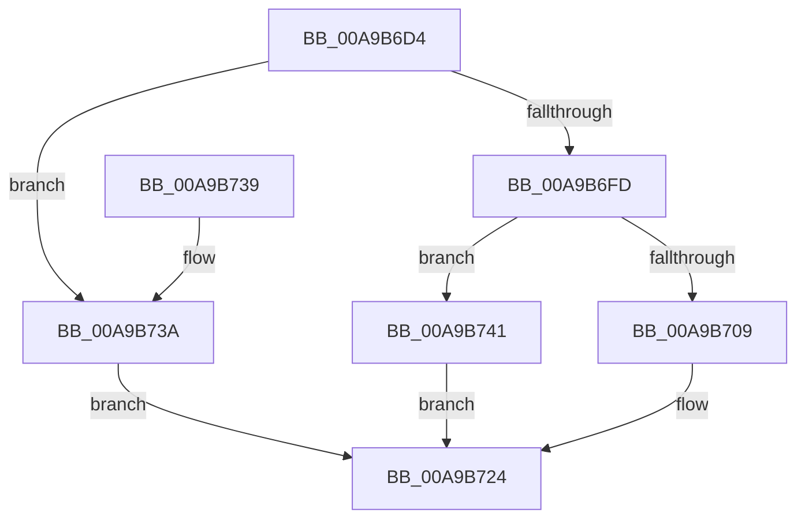

# WdipSemWriteEvent

- RVA: `0x00A9B6D4`–`0x00A9B748` (길이 `116` bytes)
- VA: `0x0000000140A9B6D4`
- 실행 섹션: `PAGE`
- PDB 이름 있음: `예`; PDB Function 태그: `아니요`
- unwind 정보 RVA: `0x00091EE8`
- 디코드: `33`개 명령, `116/116` bytes 표시
- 미해석 바이트: `0` (있으면 어셈블리에 `.byte`로 보존)

> 이 문서는 커널 이미지의 기계어와 PDB 기호를 분석해 생성했습니다. 4번과 5번은 함수 원형과 자료형을 바이너리 사용 방식에서 추정한 C 해석이며 원본 소스 복구 결과는 아닙니다.

## 1. Dependencies

- 직접 호출 지점: **2**; 고유 호출 대상: **2**
- 직접 호출자로 확인된 함수: **9**
- RIP 상대 이미지 참조: **1**

### Outgoing calls
- `0x00A9B700` → [EtwEventEnabled](../../text/39/EtwEventEnabled_function_00392450.md) (function, `0x00392450`)
- `0x00A9B71F` → [EtwWrite](../../text/41/EtwWrite_function_0041C720.md) (function, `0x0041C720`)

### Direct callers
- [WdipSemUpdateProviderTableWithEvent](../7B/WdipSemUpdateProviderTableWithEvent_function_007B09F8.md) at `0x007B0ABA`
- [WdipSemWriteInflightLimitExceededEvent](../7B/WdipSemWriteInflightLimitExceededEvent_function_007B1434.md) at `0x007B14F5`
- [WdipSemWriteMisconfigEvent](../7B/WdipSemWriteMisconfigEvent_function_007B151C.md) at `0x007B158D`
- [WdipSemWriteScenarioLimitExceededEvent](../7B/WdipSemWriteScenarioLimitExceededEvent_function_007B15AC.md) at `0x007B1615`
- [WdipSemWriteSemFailureEvent](../7B/WdipSemWriteSemFailureEvent_function_007B1634.md) at `0x007B16AA`
- [WdipSemSqmAddToStream](../7B/WdipSemSqmAddToStream_function_007B1C94.md) at `0x007B1DC4`
- [WdipSemSqmIncrementDword](../7B/WdipSemSqmIncrementDword_function_007B1DF8.md) at `0x007B1E75`
- [WdipSemSqmInit](../7B/WdipSemSqmInit_function_007B1E98.md) at `0x007B1EFE`
- [WdipSemWriteSemActionsEvent](../AB/WdipSemWriteSemActionsEvent_function_00ABC618.md) at `0x00ABC7A3`

### Static image references
- `0x00A9B6E8` → RVA `0x00F01DD0` (`.data`; read)

## 2. Other-region calls and transfers

- 다른 실행 섹션으로 향하는 call: **2**
  - `0x00A9B700` → [EtwEventEnabled](../../text/39/EtwEventEnabled_function_00392450.md) (`PAGE` → `.text`)
  - `0x00A9B71F` → [EtwWrite](../../text/41/EtwWrite_function_0041C720.md) (`PAGE` → `.text`)
- 별도 외부 분기/꼬리 이동을 확인하지 못했습니다.

## 3. Assembly (complete function range)

```asm
00A9B6D4  48 89 5C 24 08                  mov qword ptr [rsp + 8], rbx
00A9B6D9  48 89 6C 24 10                  mov qword ptr [rsp + 0x10], rbp
00A9B6DE  48 89 74 24 18                  mov qword ptr [rsp + 0x18], rsi
00A9B6E3  57                              push rdi
00A9B6E4  48 83 EC 30                     sub rsp, 0x30
00A9B6E8  48 8B 3D E1 66 46 00            mov rdi, qword ptr [rip + 0x4666e1]
00A9B6EF  41 8B F1                        mov esi, r9d
00A9B6F2  49 8B E8                        mov rbp, r8
00A9B6F5  48 8B DA                        mov rbx, rdx
00A9B6F8  48 85 D2                        test rdx, rdx
00A9B6FB  74 3D                           je 0x140a9b73a
00A9B6FD  48 8B CF                        mov rcx, rdi
00A9B700  E8 4B 6D 8F FF                  call 0x140392450
00A9B705  84 C0                           test al, al
00A9B707  74 38                           je 0x140a9b741
00A9B709  48 8B 44 24 60                  mov rax, qword ptr [rsp + 0x60]
00A9B70E  44 8B CE                        mov r9d, esi
00A9B711  4C 8B C5                        mov r8, rbp
00A9B714  48 89 44 24 20                  mov qword ptr [rsp + 0x20], rax
00A9B719  48 8B D3                        mov rdx, rbx
00A9B71C  48 8B CF                        mov rcx, rdi
00A9B71F  E8 FC 0F 98 FF                  call 0x14041c720
00A9B724  48 8B 5C 24 40                  mov rbx, qword ptr [rsp + 0x40]
00A9B729  48 8B 6C 24 48                  mov rbp, qword ptr [rsp + 0x48]
00A9B72E  48 8B 74 24 50                  mov rsi, qword ptr [rsp + 0x50]
00A9B733  48 83 C4 30                     add rsp, 0x30
00A9B737  5F                              pop rdi
00A9B738  C3                              ret
00A9B739  CC                              int3
00A9B73A  B8 0D 00 00 C0                  mov eax, 0xc000000d
00A9B73F  EB E3                           jmp 0x140a9b724
00A9B741  B8 08 00 00 C0                  mov eax, 0xc0000008
00A9B746  EB DC                           jmp 0x140a9b724
```

## 4. C-style interpretation (structured pseudocode)

```c
__int64 __fastcall WdipSemWriteEvent(__int64 a1, __int64 a2, __int64 a3, int a4, __int64 a5)
{
    __int64 result;
    __int64 v_rsp;
    unsigned __int64 v_stack_m18;
    unsigned __int64 v_stack_p10;
    unsigned __int64 v_stack_p18;
    unsigned __int64 v_stack_p8;

    v_stack_p8 = v_rbx;
    v_stack_p10 = v_rbp;
    v_stack_p18 = v_rsi;
    v_rsp = (v_rsp) - (48);
    if (a2 == 0) goto loc_00A9B73A;
    result = EtwEventEnabled(*(unsigned __int64 *)(v_rip + 4613857), a2, a3, a4);
    if ((unsigned __int8)(result) == 0) goto loc_00A9B741;
    v_stack_m18 = a5;
    result = EtwWrite(*(unsigned __int64 *)(v_rip + 4613857), a2, a3, (unsigned int)((unsigned int)((unsigned int)(a4))));
loc_00A9B724:
    v_rsp = (v_rsp) + (48);
    return result;
loc_00A9B73A:
    goto loc_00A9B724;
loc_00A9B741:
    goto loc_00A9B724;
}
```

## 5. (Beta) C Style

```c
int64_t WdipSemWriteEvent(int64_t Arg1, int64_t Arg2, int64_t Arg3, int32_t Arg4, int64_t Arg5)
{
    int64_t result;
    int64_t local_rsp;
    uint64_t v_stack_m18;
    uint64_t v_stack_p10;
    uint64_t v_stack_p18;
    uint64_t v_stack_p8;

    v_stack_p8 = local_rbx;
    v_stack_p10 = local_rbp;
    v_stack_p18 = local_rsi;
    local_rsp = (local_rsp) - (48);
    if (Arg2 == 0) goto loc_00A9B73A;
    result = EtwEventEnabled(*(uint64_t *)(v_rip + 0x4666E1), Arg2, Arg3, Arg4);
    if ((uint8_t)(result) == 0) goto loc_00A9B741;
    v_stack_m18 = Arg5;
    result = EtwWrite(*(uint64_t *)(v_rip + 0x4666E1), Arg2, Arg3, (uint32_t)((uint32_t)((uint32_t)(Arg4))));
loc_00A9B724:
    local_rsp = (local_rsp) + (48);
    return result;
loc_00A9B73A:
    goto loc_00A9B724;
loc_00A9B741:
    goto loc_00A9B724;
}
```

## 6. Execution-region graph

[열기: 2D/3D 그래프와 함수 탐색 컨트롤 패널](../../../control-panel.html?section=page&rva=0x00A9B6D4&view=graph)

- 2D 그래프는 위에서 아래로 흐르고, 3D 그래프는 빈 공간을 드래그해 회전합니다. Shift+드래그는 이동, 휠은 확대·축소, 함수 노드 선택은 대상 보고서 이동입니다.

### Static fallback


