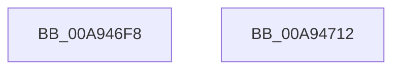

# WmiReleaseSmbiosLockExclusive

- RVA: `0x00A946F8`–`0x00A94713` (길이 `27` bytes)
- VA: `0x0000000140A946F8`
- 실행 섹션: `PAGE`
- PDB 이름 있음: `예`; PDB Function 태그: `아니요`
- unwind 정보 RVA: `0x0005C788`
- 디코드: `7`개 명령, `27/27` bytes 표시
- 미해석 바이트: `0` (있으면 어셈블리에 `.byte`로 보존)

> 이 문서는 커널 이미지의 기계어와 PDB 기호를 분석해 생성했습니다. 4번과 5번은 함수 원형과 자료형을 바이너리 사용 방식에서 추정한 C 해석이며 원본 소스 복구 결과는 아닙니다.

## 1. Dependencies

- 직접 호출 지점: **2**; 고유 호출 대상: **2**
- 직접 호출자로 확인된 함수: **2**
- RIP 상대 이미지 참조: **1**

### Outgoing calls
- `0x00A94703` → [ExReleaseResourceLite](../../text/25/ExReleaseResourceLite_function_0025FA10.md) (function, `0x0025FA10`)
- `0x00A94708` → [KeLeaveCriticalRegion](../../text/25/KeLeaveCriticalRegion_function_0025D8B0.md) (function, `0x0025D8B0`)

### Direct callers
- [WmipReadSMBiosSysInfo](../../text/64/WmipReadSMBiosSysInfo_function_0064E36C.md) at `0x0064E42B`
- [sub_00B80364](../../pagelk/B8/Unknown_function_00B80364.md) at `0x00B80489`

### Static image references
- `0x00A946FC` → RVA `0x00EFFB40` (`.data`; read)

## 2. Other-region calls and transfers

- 다른 실행 섹션으로 향하는 call: **2**
  - `0x00A94703` → [ExReleaseResourceLite](../../text/25/ExReleaseResourceLite_function_0025FA10.md) (`PAGE` → `.text`)
  - `0x00A94708` → [KeLeaveCriticalRegion](../../text/25/KeLeaveCriticalRegion_function_0025D8B0.md) (`PAGE` → `.text`)
- 별도 외부 분기/꼬리 이동을 확인하지 못했습니다.

## 3. Assembly (complete function range)

```asm
00A946F8  48 83 EC 28                     sub rsp, 0x28
00A946FC  48 8D 0D 3D B4 46 00            lea rcx, [rip + 0x46b43d]
00A94703  E8 08 B3 7C FF                  call 0x14025fa10
00A94708  E8 A3 91 7C FF                  call 0x14025d8b0
00A9470D  48 83 C4 28                     add rsp, 0x28
00A94711  C3                              ret
00A94712  CC                              int3
```

## 4. C-style interpretation (structured pseudocode)

```c
__int64 __fastcall WmiReleaseSmbiosLockExclusive(void)
{
    __int64 result;
    __int64 v_rsp;

    v_rsp = (v_rsp) - (40);
    result = ExReleaseResourceLite(v_rip + 4633661, a2, a3, a4);
    result = KeLeaveCriticalRegion(v_rip + 4633661, a2, a3, a4);
    v_rsp = (v_rsp) + (40);
    return result;
}
```

## 5. (Beta) C Style

```c
void WmiReleaseSmbiosLockExclusive(void)
{
    int64_t result;
    int64_t local_rsp;

    local_rsp = (local_rsp) - (40);
    result = ExReleaseResourceLite(v_rip + 4633661, a2, a3, a4);
    result = KeLeaveCriticalRegion(v_rip + 4633661, a2, a3, a4);
    local_rsp = (local_rsp) + (40);
    return result;
}
```

## 6. Execution-region graph

[열기: 2D/3D 그래프와 함수 탐색 컨트롤 패널](../../../control-panel.html?section=page&rva=0x00A946F8&view=graph)

- 2D 그래프는 위에서 아래로 흐르고, 3D 그래프는 빈 공간을 드래그해 회전합니다. Shift+드래그는 이동, 휠은 확대·축소, 함수 노드 선택은 대상 보고서 이동입니다.

### Static fallback


