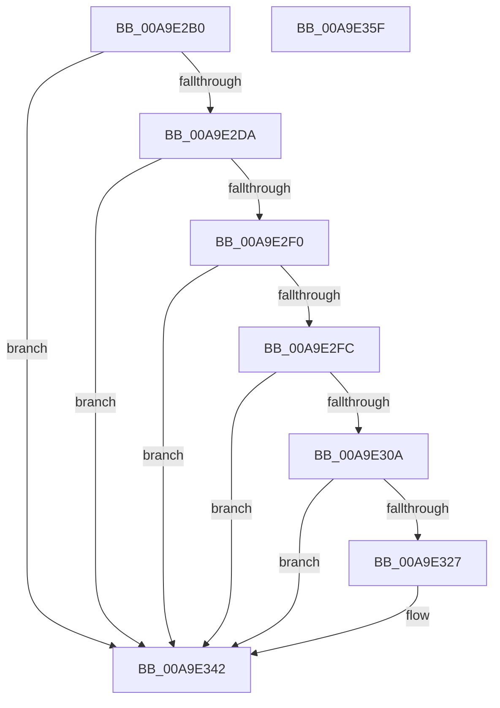

# WmipAllocateSingleInstanceWnode

- RVA: `0x00A9E2B0`–`0x00A9E360` (길이 `176` bytes)
- VA: `0x0000000140A9E2B0`
- 실행 섹션: `PAGE`
- PDB 이름 있음: `예`; PDB Function 태그: `아니요`
- unwind 정보 RVA: `0x0005E6B4`
- 디코드: `55`개 명령, `176/176` bytes 표시
- 미해석 바이트: `0` (있으면 어셈블리에 `.byte`로 보존)

> 이 문서는 커널 이미지의 기계어와 PDB 기호를 분석해 생성했습니다. 4번과 5번은 함수 원형과 자료형을 바이너리 사용 방식에서 추정한 C 해석이며 원본 소스 복구 결과는 아닙니다.

## 1. Dependencies

- 직접 호출 지점: **1**; 고유 호출 대상: **1**
- 직접 호출자로 확인된 함수: **2**
- RIP 상대 이미지 참조: **0**

### Outgoing calls
- `0x00A9E31A` → [ExAllocatePool2](../../poolcode/B8/ExAllocatePool2_function_00B820F0.md) (function, `0x00B820F0`)

### Direct callers
- [IoWMISetSingleInstance](../7B/IoWMISetSingleInstance_function_007B22C0.md) at `0x007B2320`
- [IoWMISetSingleItem](../7B/IoWMISetSingleItem_function_007B23F0.md) at `0x007B2450`

### Static image references
- 디코드된 RIP-relative 메모리 참조가 없습니다.

## 2. Other-region calls and transfers

- 다른 실행 섹션으로 향하는 call: **1**
  - `0x00A9E31A` → [ExAllocatePool2](../../poolcode/B8/ExAllocatePool2_function_00B820F0.md) (`PAGE` → `POOLCODE`)
- 별도 외부 분기/꼬리 이동을 확인하지 못했습니다.

## 3. Assembly (complete function range)

```asm
00A9E2B0  48 8B C4                        mov rax, rsp
00A9E2B3  48 89 58 08                     mov qword ptr [rax + 8], rbx
00A9E2B7  48 89 68 10                     mov qword ptr [rax + 0x10], rbp
00A9E2BB  48 89 70 18                     mov qword ptr [rax + 0x18], rsi
00A9E2BF  48 89 78 20                     mov qword ptr [rax + 0x20], rdi
00A9E2C3  41 56                           push r14
00A9E2C5  48 83 EC 20                     sub rsp, 0x20
00A9E2C9  44 8D 51 01                     lea r10d, [rcx + 1]
00A9E2CD  4D 8B F1                        mov r14, r9
00A9E2D0  BF 9A 00 00 C0                  mov edi, 0xc000009a
00A9E2D5  44 3B D1                        cmp r10d, ecx
00A9E2D8  72 68                           jb 0x140a9e342
00A9E2DA  0F B7 0A                        movzx ecx, word ptr [rdx]
00A9E2DD  41 83 E2 FE                     and r10d, 0xfffffffe
00A9E2E1  41 8B C2                        mov eax, r10d
00A9E2E4  83 C1 02                        add ecx, 2
00A9E2E7  F7 D0                           not eax
00A9E2E9  41 8B EA                        mov ebp, r10d
00A9E2EC  3B C8                           cmp ecx, eax
00A9E2EE  77 52                           ja 0x140a9e342
00A9E2F0  44 03 D1                        add r10d, ecx
00A9E2F3  41 8D 5A 07                     lea ebx, [r10 + 7]
00A9E2F7  41 3B DA                        cmp ebx, r10d
00A9E2FA  72 46                           jb 0x140a9e342
00A9E2FC  83 E3 F8                        and ebx, 0xfffffff8
00A9E2FF  8B C3                           mov eax, ebx
00A9E301  8B F3                           mov esi, ebx
00A9E303  F7 D0                           not eax
00A9E305  44 3B C0                        cmp r8d, eax
00A9E308  77 38                           ja 0x140a9e342
00A9E30A  41 03 D8                        add ebx, r8d
00A9E30D  B9 40 00 00 00                  mov ecx, 0x40
00A9E312  8B D3                           mov edx, ebx
00A9E314  41 B8 57 6D 69 70               mov r8d, 0x70696d57
00A9E31A  E8 D1 3D 0E 00                  call 0x140b820f0
00A9E31F  48 8B C8                        mov rcx, rax
00A9E322  48 85 C0                        test rax, rax
00A9E325  74 1B                           je 0x140a9e342
00A9E327  48 8B 44 24 50                  mov rax, qword ptr [rsp + 0x50]
00A9E32C  33 FF                           xor edi, edi
00A9E32E  41 89 2E                        mov dword ptr [r14], ebp
00A9E331  89 30                           mov dword ptr [rax], esi
00A9E333  48 8B 44 24 58                  mov rax, qword ptr [rsp + 0x58]
00A9E338  89 18                           mov dword ptr [rax], ebx
00A9E33A  48 8B 44 24 60                  mov rax, qword ptr [rsp + 0x60]
00A9E33F  48 89 08                        mov qword ptr [rax], rcx
00A9E342  48 8B 5C 24 30                  mov rbx, qword ptr [rsp + 0x30]
00A9E347  8B C7                           mov eax, edi
00A9E349  48 8B 7C 24 48                  mov rdi, qword ptr [rsp + 0x48]
00A9E34E  48 8B 6C 24 38                  mov rbp, qword ptr [rsp + 0x38]
00A9E353  48 8B 74 24 40                  mov rsi, qword ptr [rsp + 0x40]
00A9E358  48 83 C4 20                     add rsp, 0x20
00A9E35C  41 5E                           pop r14
00A9E35E  C3                              ret
00A9E35F  CC                              int3
```

## 4. C-style interpretation (structured pseudocode)

```c
__int64 __fastcall WmipAllocateSingleInstanceWnode(__int64 a1, __int64 a2, int a3, __int64 a4, __int64 a5, __int64 a6, __int64 a7)
{
    __int64 result;
    __int64 v_r10;
    __int64 v_rbx;
    __int64 v_rdi;
    __int64 v_rsp;
    unsigned __int64 v_stack_p10;
    unsigned __int64 v_stack_p18;
    unsigned __int64 v_stack_p20;
    unsigned __int64 v_stack_p8;

    *(unsigned __int64 *)(v_rsp + 8) = v_rbx;
    *(unsigned __int64 *)(v_rsp + 16) = v_rbp;
    *(unsigned __int64 *)(v_rsp + 24) = v_rsi;
    *(unsigned __int64 *)(v_rsp + 32) = v_rdi;
    v_rsp = (v_rsp) - (32);
    if (((unsigned int)(a1 + 1)) < ((unsigned int)(a1))) goto loc_00A9E342;
    v_r10 = (unsigned int)((a1 + 1) & (0xFFFFFFFEULL));
    a1 = (unsigned int)((*(unsigned __int16 *)(a2)) + (2));
    result = (unsigned int)(~((unsigned int)((unsigned int)(v_r10))));
    if (((unsigned int)(a1)) > ((unsigned int)(result))) goto loc_00A9E342;
    v_r10 = (unsigned int)((v_r10) + ((unsigned int)(a1)));
    if (((unsigned int)(v_r10 + 7)) < ((unsigned int)(v_r10))) goto loc_00A9E342;
    v_rbx = (unsigned int)((v_r10 + 7) & (0xFFFFFFF8ULL));
    result = (unsigned int)(~((unsigned int)((unsigned int)(v_rbx))));
    if (a3 > ((unsigned int)(result))) goto loc_00A9E342;
    v_rbx = (unsigned int)((v_rbx) + (a3));
    result = ExAllocatePool2(64, (unsigned int)((unsigned int)(v_rbx)), (unsigned int)(0x70696D57ULL), a4);
    v_rdi = (unsigned int)(0xC000009AULL);
    if (result != 0) {
        result = a5;
        v_rdi = 0;
        *(unsigned int *)(a4) = (unsigned int)((unsigned int)((unsigned int)(v_r10)));
        *(unsigned int *)(result) = (unsigned int)((unsigned int)((unsigned int)(v_rbx)));
        result = a6;
        *(unsigned int *)(result) = (unsigned int)(v_rbx);
        result = a7;
        *(unsigned __int64 *)(result) = result;
    }
    v_rsp = (v_rsp) + (32);
    return 0;
}
```

## 5. (Beta) C Style

```c
int64_t WmipAllocateSingleInstanceWnode(void *Arg1, void *Arg2, int32_t Arg3, void *Arg4, void *Arg5, void *Arg6, void *Arg7)
{
    uint8_t *arg1 = (uint8_t *)Arg1;
    uint8_t *arg2 = (uint8_t *)Arg2;
    uint8_t *arg4 = (uint8_t *)Arg4;
    uint8_t *arg5 = (uint8_t *)Arg5;
    uint8_t *arg6 = (uint8_t *)Arg6;
    uint8_t *arg7 = (uint8_t *)Arg7;

    int64_t result;
    int64_t local_r10;
    int64_t local_rbx;
    int64_t local_rdi;
    int64_t local_rsp;
    uint64_t v_stack_p10;
    uint64_t v_stack_p18;
    uint64_t v_stack_p20;
    uint64_t v_stack_p8;

    *(uint64_t *)(local_rsp + 0x8) = local_rbx;
    *(uint64_t *)(local_rsp + 0x10) = local_rbp;
    *(uint64_t *)(local_rsp + 0x18) = local_rsi;
    *(uint64_t *)(local_rsp + 0x20) = local_rdi;
    local_rsp = (local_rsp) - (32);
    if (((uint32_t)(Arg1 + 1)) < ((uint32_t)(Arg1))) goto loc_00A9E342;
    local_r10 = (uint32_t)((Arg1 + 1) & (0xFFFFFFFEULL));
    Arg1 = (uint32_t)((*(uint16_t *)(arg2)) + (2));
    result = (uint32_t)(~((uint32_t)((uint32_t)(local_r10))));
    if (((uint32_t)(Arg1)) > ((uint32_t)(result))) goto loc_00A9E342;
    local_r10 = (uint32_t)((local_r10) + ((uint32_t)(Arg1)));
    if (((uint32_t)(local_r10 + 7)) < ((uint32_t)(local_r10))) goto loc_00A9E342;
    local_rbx = (uint32_t)((local_r10 + 7) & (0xFFFFFFF8ULL));
    result = (uint32_t)(~((uint32_t)((uint32_t)(local_rbx))));
    if (Arg3 > ((uint32_t)(result))) goto loc_00A9E342;
    local_rbx = (uint32_t)((local_rbx) + (Arg3));
    result = ExAllocatePool2(64, (uint32_t)((uint32_t)(local_rbx)), (uint32_t)(0x70696D57ULL), Arg4);
    local_rdi = (uint32_t)(0xC000009AULL);
    if (result != 0) {
        result = Arg5;
        local_rdi = 0;
        *(uint32_t *)(arg4) = (uint32_t)((uint32_t)((uint32_t)(local_r10)));
        *(uint32_t *)(result) = (uint32_t)((uint32_t)((uint32_t)(local_rbx)));
        result = Arg6;
        *(uint32_t *)(result) = (uint32_t)(local_rbx);
        result = Arg7;
        *(uint64_t *)(result) = result;
    }
    local_rsp = (local_rsp) + (32);
    return 0;
}
```

### 관측된 메모리 오프셋

구조체 형식이 확인되지 않은 접근은 인자 기준의 오프셋으로만 기록했습니다.

| 기준 인자 | 오프셋 표현 | 폭 (bit) | 접근 |
|---|---:|---:|---|
| `Arg1` | `+ 0x1` | `32` | `R` |
| `Arg2` | `+ 0x0` | `16` | `R` |
| `Arg4` | `+ 0x0` | `32` | `W` |
| `Arg5` | `+ 0x0` | `32` | `W` |
| `Arg6` | `+ 0x0` | `32` | `W` |
| `Arg7` | `+ 0x0` | `64` | `W` |

## 6. Execution-region graph

[열기: 2D/3D 그래프와 함수 탐색 컨트롤 패널](../../../control-panel.html?section=page&rva=0x00A9E2B0&view=graph)

- 2D 그래프는 위에서 아래로 흐르고, 3D 그래프는 빈 공간을 드래그해 회전합니다. Shift+드래그는 이동, 휠은 확대·축소, 함수 노드 선택은 대상 보고서 이동입니다.

### Static fallback


