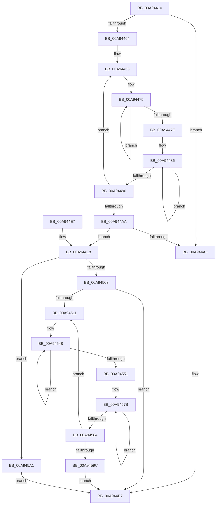

# WmipEnumerateMofResources

- RVA: `0x00A94410`–`0x00A945AD` (길이 `413` bytes)
- VA: `0x0000000140A94410`
- 실행 섹션: `PAGE`
- PDB 이름 있음: `예`; PDB Function 태그: `아니요`
- unwind 정보 RVA: `0x000B9500`
- 디코드: `118`개 명령, `413/413` bytes 표시
- 미해석 바이트: `0` (있으면 어셈블리에 `.byte`로 보존)

> 이 문서는 커널 이미지의 기계어와 PDB 기호를 분석해 생성했습니다. 4번과 5번은 함수 원형과 자료형을 바이너리 사용 방식에서 추정한 C 해석이며 원본 소스 복구 결과는 아닙니다.

## 1. Dependencies

- 직접 호출 지점: **4**; 고유 호출 대상: **3**
- 직접 호출자로 확인된 함수: **1**
- RIP 상대 이미지 참조: **2**

### Outgoing calls
- `0x00A9444A` → [KeWaitForSingleObject](../../text/20/KeWaitForSingleObject_function_0020E6B0.md) (function, `0x0020E6B0`)
- `0x00A944C3` → [KeReleaseMutex](../../text/39/KeReleaseMutex_function_00396810.md) (function, `0x00396810`)
- `0x00A94539` → [RtlStringCbCopyW](../../text/43/RtlStringCbCopyW_function_0043B910.md) (function, `0x0043B910`)
- `0x00A9456C` → [RtlStringCbCopyW](../../text/43/RtlStringCbCopyW_function_0043B910.md) (function, `0x0043B910`)

### Direct callers
- [WmipIoControl](../9D/WmipIoControl_function_009DEBD0.md) at `0x009DF0A4`

### Static image references
- `0x00A94440` → RVA `0x00EFFA60` (`.data`; read)
- `0x00A9444F` → RVA `0x00EFFAE0` (`.data`; read)

## 2. Other-region calls and transfers

- 다른 실행 섹션으로 향하는 call: **4**
  - `0x00A9444A` → [KeWaitForSingleObject](../../text/20/KeWaitForSingleObject_function_0020E6B0.md) (`PAGE` → `.text`)
  - `0x00A944C3` → [KeReleaseMutex](../../text/39/KeReleaseMutex_function_00396810.md) (`PAGE` → `.text`)
  - `0x00A94539` → [RtlStringCbCopyW](../../text/43/RtlStringCbCopyW_function_0043B910.md) (`PAGE` → `.text`)
  - `0x00A9456C` → [RtlStringCbCopyW](../../text/43/RtlStringCbCopyW_function_0043B910.md) (`PAGE` → `.text`)
- 별도 외부 분기/꼬리 이동을 확인하지 못했습니다.

## 3. Assembly (complete function range)

```asm
00A94410  48 8B C4                        mov rax, rsp
00A94413  48 89 58 08                     mov qword ptr [rax + 8], rbx
00A94417  48 89 68 10                     mov qword ptr [rax + 0x10], rbp
00A9441B  48 89 70 18                     mov qword ptr [rax + 0x18], rsi
00A9441F  57                              push rdi
00A94420  41 54                           push r12
00A94422  41 55                           push r13
00A94424  41 56                           push r14
00A94426  41 57                           push r15
00A94428  48 83 EC 30                     sub rsp, 0x30
00A9442C  4D 8B F8                        mov r15, r8
00A9442F  8B FA                           mov edi, edx
00A94431  48 8B F1                        mov rsi, rcx
00A94434  45 33 E4                        xor r12d, r12d
00A94437  45 33 C0                        xor r8d, r8d
00A9443A  4C 89 60 C8                     mov qword ptr [rax - 0x38], r12
00A9443E  33 D2                           xor edx, edx
00A94440  48 8D 0D 19 B6 46 00            lea rcx, [rip + 0x46b619]
00A94447  45 33 C9                        xor r9d, r9d
00A9444A  E8 61 A2 77 FF                  call 0x14020e6b0
00A9444F  4C 8B 05 8A B6 46 00            mov r8, qword ptr [rip + 0x46b68a]
00A94456  45 8B CC                        mov r9d, r12d
00A94459  41 8B DC                        mov ebx, r12d
00A9445C  49 8B 10                        mov rdx, qword ptr [r8]
00A9445F  49 3B D0                        cmp rdx, r8
00A94462  74 4B                           je 0x140a944af
00A94464  49 83 CB FF                     or r11, 0xffffffffffffffff
00A94468  48 8B 4A 30                     mov rcx, qword ptr [rdx + 0x30]
00A9446C  49 8B C3                        mov rax, r11
00A9446F  45 8B D1                        mov r10d, r9d
00A94472  41 FF C1                        inc r9d
00A94475  48 FF C0                        inc rax
00A94478  66 44 39 24 41                  cmp word ptr [rcx + rax*2], r12w
00A9447D  75 F6                           jne 0x140a94475
00A9447F  4C 8B 42 28                     mov r8, qword ptr [rdx + 0x28]
00A94483  49 8B CB                        mov rcx, r11
00A94486  48 FF C1                        inc rcx
00A94489  66 45 39 24 48                  cmp word ptr [r8 + rcx*2], r12w
00A9448E  75 F6                           jne 0x140a94486
00A94490  48 8B 12                        mov rdx, qword ptr [rdx]
00A94493  48 03 C1                        add rax, rcx
00A94496  4C 8B 05 43 B6 46 00            mov r8, qword ptr [rip + 0x46b643]
00A9449D  48 8D 1C 43                     lea rbx, [rbx + rax*2]
00A944A1  48 83 C3 04                     add rbx, 4
00A944A5  49 3B D0                        cmp rdx, r8
00A944A8  75 BE                           jne 0x140a94468
00A944AA  45 85 C9                        test r9d, r9d
00A944AD  75 39                           jne 0x140a944e8
00A944AF  44 89 26                        mov dword ptr [rsi], r12d
00A944B2  BB 10 00 00 00                  mov ebx, 0x10
00A944B7  33 D2                           xor edx, edx
00A944B9  41 89 1F                        mov dword ptr [r15], ebx
00A944BC  48 8D 0D 9D B5 46 00            lea rcx, [rip + 0x46b59d]
00A944C3  E8 48 23 90 FF                  call 0x140396810
00A944C8  48 8B 5C 24 60                  mov rbx, qword ptr [rsp + 0x60]
00A944CD  33 C0                           xor eax, eax
00A944CF  48 8B 6C 24 68                  mov rbp, qword ptr [rsp + 0x68]
00A944D4  48 8B 74 24 70                  mov rsi, qword ptr [rsp + 0x70]
00A944D9  48 83 C4 30                     add rsp, 0x30
00A944DD  41 5F                           pop r15
00A944DF  41 5E                           pop r14
00A944E1  41 5D                           pop r13
00A944E3  41 5C                           pop r12
00A944E5  5F                              pop rdi
00A944E6  C3                              ret
00A944E7  CC                              int3
00A944E8  4B 8D 0C 52                     lea rcx, [r10 + r10*2]
00A944EC  48 8B EF                        mov rbp, rdi
00A944EF  4C 8D 34 8D 10 00 00 00         lea r14, [rcx*4 + 0x10]
00A944F7  49 03 DE                        add rbx, r14
00A944FA  48 3B FB                        cmp rdi, rbx
00A944FD  0F 82 9E 00 00 00               jb 0x140a945a1
00A94503  44 89 0E                        mov dword ptr [rsi], r9d
00A94506  45 8B EC                        mov r13d, r12d
00A94509  49 8B 38                        mov rdi, qword ptr [r8]
00A9450C  49 3B F8                        cmp rdi, r8
00A9450F  74 A6                           je 0x140a944b7
00A94511  41 8B C5                        mov eax, r13d
00A94514  49 8D 0C 36                     lea rcx, [r14 + rsi]
00A94518  48 8B D5                        mov rdx, rbp
00A9451B  41 FF C5                        inc r13d
00A9451E  49 2B D6                        sub rdx, r14
00A94521  4C 8D 24 40                     lea r12, [rax + rax*2]
00A94525  8B 47 10                        mov eax, dword ptr [rdi + 0x10]
00A94528  83 E0 01                        and eax, 1
00A9452B  46 89 74 A6 04                  mov dword ptr [rsi + r12*4 + 4], r14d
00A94530  42 89 44 A6 0C                  mov dword ptr [rsi + r12*4 + 0xc], eax
00A94535  4C 8B 47 28                     mov r8, qword ptr [rdi + 0x28]
00A94539  E8 D2 73 9A FF                  call 0x14043b910
00A9453E  48 8B 4F 28                     mov rcx, qword ptr [rdi + 0x28]
00A94542  48 83 C8 FF                     or rax, 0xffffffffffffffff
00A94546  33 D2                           xor edx, edx
00A94548  48 FF C0                        inc rax
00A9454B  66 39 14 41                     cmp word ptr [rcx + rax*2], dx
00A9454F  75 F7                           jne 0x140a94548
00A94551  4D 8D 34 46                     lea r14, [r14 + rax*2]
00A94555  48 8B D5                        mov rdx, rbp
00A94558  49 83 C6 02                     add r14, 2
00A9455C  46 89 74 A6 08                  mov dword ptr [rsi + r12*4 + 8], r14d
00A94561  49 2B D6                        sub rdx, r14
00A94564  4C 8B 47 30                     mov r8, qword ptr [rdi + 0x30]
00A94568  49 8D 0C 36                     lea rcx, [r14 + rsi]
00A9456C  E8 9F 73 9A FF                  call 0x14043b910
00A94571  48 8B 4F 30                     mov rcx, qword ptr [rdi + 0x30]
00A94575  48 83 C8 FF                     or rax, 0xffffffffffffffff
00A94579  33 D2                           xor edx, edx
00A9457B  48 FF C0                        inc rax
00A9457E  66 39 14 41                     cmp word ptr [rcx + rax*2], dx
00A94582  75 F7                           jne 0x140a9457b
00A94584  48 8B 3F                        mov rdi, qword ptr [rdi]
00A94587  4D 8D 34 46                     lea r14, [r14 + rax*2]
00A9458B  49 83 C6 02                     add r14, 2
00A9458F  48 3B 3D 4A B5 46 00            cmp rdi, qword ptr [rip + 0x46b54a]
00A94596  0F 85 75 FF FF FF               jne 0x140a94511
00A9459C  E9 16 FF FF FF                  jmp 0x140a944b7
00A945A1  89 1E                           mov dword ptr [rsi], ebx
00A945A3  BB 04 00 00 00                  mov ebx, 4
00A945A8  E9 0A FF FF FF                  jmp 0x140a944b7
```

## 4. C-style interpretation (structured pseudocode)

```c
__int64 __fastcall WmipEnumerateMofResources(__int64 a1, int a2, __int64 a3, int a4)
{
    __int64 result;
    __int64 v_r11;
    __int64 v_r12;
    __int64 v_r13;
    __int64 v_r14;
    __int64 v_rbx;
    __int64 v_rsp;
    unsigned __int64 v_stack_p10;
    unsigned __int64 v_stack_p18;
    unsigned __int64 v_stack_p8;

    *(unsigned __int64 *)(v_rsp + 8) = v_rbx;
    *(unsigned __int64 *)(v_rsp + 16) = v_rbp;
    *(unsigned __int64 *)(v_rsp + 24) = v_rsi;
    v_rsp = (v_rsp) - (48);
    v_r12 = 0;
    a3 = 0;
    *(unsigned __int64 *)(v_rsp - 56) = 0;
    a2 = 0;
    a4 = 0;
    result = KeWaitForSingleObject(v_rip + 4634137, a2, a3, a4);
    if ((*(unsigned __int64 *)(*(unsigned __int64 *)(v_rip + 4634250))) == (*(unsigned __int64 *)(v_rip + 4634250))) goto loc_00A944AF;
    v_r11 = (v_r11) | (-1);
loc_00A94468:
    a4 = (unsigned int)((0) + 1);
loc_00A94475:
    result = (v_r11) + 1;
    if ((*(unsigned __int16 *)(*(unsigned __int64 *)(*(unsigned __int64 *)(*(unsigned __int64 *)(v_rip + 4634250)) + 48) + result * 2)) != 0) goto loc_00A94475;
loc_00A94486:
    a1 = (v_r11) + 1;
    if ((*(unsigned __int16 *)(*(unsigned __int64 *)(*(unsigned __int64 *)(*(unsigned __int64 *)(v_rip + 4634250)) + 40) + a1 * 2)) != 0) goto loc_00A94486;
    result = (result) + (a1);
    v_rbx = (0 + result * 2) + (4);
    if ((*(unsigned __int64 *)(*(unsigned __int64 *)(*(unsigned __int64 *)(v_rip + 4634250)))) != (*(unsigned __int64 *)(v_rip + 4634179))) goto loc_00A94468;
    if (a4 != 0) goto loc_00A944E8;
loc_00A944AF:
    *(unsigned int *)(a1) = 0;
loc_00A944B7:
    a2 = 0;
    *(unsigned int *)(a3) = 16;
    result = KeReleaseMutex(v_rip + 4634013, a2, *(unsigned __int64 *)(v_rip + 4634179), a4);
    result = 0;
    v_rsp = (v_rsp) + (48);
    return result;
loc_00A944E8:
    v_rbx = (v_stack_p8) + (0 + 0 * 2 * 4 + 16);
    if (((unsigned int)(a2)) < v_rbx) goto loc_00A945A1;
    *(unsigned int *)(v_stack_p18) = a4;
    if ((*(unsigned __int64 *)(*(unsigned __int64 *)(v_rip + 4634179))) == (*(unsigned __int64 *)(v_rip + 4634179))) goto loc_00A944B7;
loc_00A94511:
    v_r13 = (unsigned int)((0) + 1);
    a2 = ((unsigned int)(a2)) - (0 + 0 * 2 * 4 + 16);
    result = (unsigned int)(((unsigned int)(*(unsigned int *)(*(unsigned __int64 *)(*(unsigned __int64 *)(v_rip + 4634179)) + 16))) & (1));
    *(unsigned int *)(v_stack_p18 + 0 + 0 * 2 * 4 + 4) = (unsigned int)(0 + 0 * 2 * 4 + 16);
    *(unsigned int *)(v_stack_p18 + 0 + 0 * 2 * 4 + 12) = (unsigned int)(result);
    result = RtlStringCbCopyW(0 + 0 * 2 * 4 + 16 + v_stack_p18 * 1, a2, *(unsigned __int64 *)(*(unsigned __int64 *)(*(unsigned __int64 *)(v_rip + 4634179)) + 40), a4);
    result = (result) | (-1);
    a2 = 0;
loc_00A94548:
    result = (result) + 1;
    if ((*(unsigned __int16 *)(*(unsigned __int64 *)(*(unsigned __int64 *)(*(unsigned __int64 *)(v_rip + 4634179)) + 40) + result * 2)) != 0) goto loc_00A94548;
    v_r14 = (0 + 0 * 2 * 4 + 16 + result * 2) + (2);
    *(unsigned int *)(v_stack_p18 + 0 + 0 * 2 * 4 + 8) = (unsigned int)(v_r14);
    a2 = ((unsigned int)(a2)) - (v_r14);
    result = RtlStringCbCopyW(v_r14 + v_stack_p18 * 1, a2, *(unsigned __int64 *)(*(unsigned __int64 *)(*(unsigned __int64 *)(v_rip + 4634179)) + 48), a4);
    result = (result) | (-1);
    a2 = 0;
loc_00A9457B:
    result = (result) + 1;
    if ((*(unsigned __int16 *)(*(unsigned __int64 *)(*(unsigned __int64 *)(*(unsigned __int64 *)(v_rip + 4634179)) + 48) + result * 2)) != 0) goto loc_00A9457B;
    v_r14 = (v_r14 + result * 2) + (2);
    if ((*(unsigned __int64 *)(*(unsigned __int64 *)(*(unsigned __int64 *)(v_rip + 4634179)))) != (*(unsigned __int64 *)(v_rip + 4633930))) goto loc_00A94511;
    goto loc_00A944B7;
loc_00A945A1:
    *(unsigned int *)(v_stack_p18) = (unsigned int)(v_rbx);
    goto loc_00A944B7;
}
```

## 5. (Beta) C Style

```c
int64_t WmipEnumerateMofResources(void *Arg1, int32_t Arg2, void *Arg3, int32_t Arg4)
{
    uint8_t *arg1 = (uint8_t *)Arg1;
    uint8_t *arg3 = (uint8_t *)Arg3;

    int64_t result;
    int64_t local_r11;
    int64_t local_r12;
    int64_t local_r13;
    int64_t local_r14;
    int64_t local_rbx;
    int64_t local_rsp;
    uint64_t v_stack_p10;
    uint64_t v_stack_p18;
    uint64_t v_stack_p8;

    *(uint64_t *)(local_rsp + 0x8) = local_rbx;
    *(uint64_t *)(local_rsp + 0x10) = local_rbp;
    *(uint64_t *)(local_rsp + 0x18) = local_rsi;
    local_rsp = (local_rsp) - (48);
    local_r12 = 0;
    Arg3 = 0;
    *(uint64_t *)(local_rsp - 0x38) = 0;
    Arg2 = 0;
    Arg4 = 0;
    result = KeWaitForSingleObject(v_rip + 4634137, Arg2, Arg3, Arg4);
    if ((*(uint64_t *)(*(uint64_t *)(v_rip + 0x46B68A))) == (*(uint64_t *)(v_rip + 0x46B68A))) goto loc_00A944AF;
    local_r11 = (local_r11) | (-1);
loc_00A94468:
    Arg4 = (uint32_t)((0) + 1);
loc_00A94475:
    result = (local_r11) + 1;
    if ((*(uint16_t *)(*(uint64_t *)(*(uint64_t *)(*(uint64_t *)(v_rip + 0x46B68A)) + 0x30) + result * 2)) != 0) goto loc_00A94475;
loc_00A94486:
    Arg1 = (local_r11) + 1;
    if ((*(uint16_t *)(*(uint64_t *)(*(uint64_t *)(*(uint64_t *)(v_rip + 0x46B68A)) + 0x28) + arg1 * 2)) != 0) goto loc_00A94486;
    result = (result) + (Arg1);
    local_rbx = (0 + result * 2) + (4);
    if ((*(uint64_t *)(*(uint64_t *)(*(uint64_t *)(v_rip + 0x46B68A)))) != (*(uint64_t *)(v_rip + 0x46B643))) goto loc_00A94468;
    if (Arg4 != 0) goto loc_00A944E8;
loc_00A944AF:
    *(uint32_t *)(arg1) = 0;
loc_00A944B7:
    Arg2 = 0;
    *(uint32_t *)(arg3) = 16;
    result = KeReleaseMutex(v_rip + 4634013, Arg2, *(uint64_t *)(v_rip + 0x46B643), Arg4);
    result = 0;
    local_rsp = (local_rsp) + (48);
    return result;
loc_00A944E8:
    local_rbx = (v_stack_p8) + (0 + 0 * 2 * 4 + 16);
    if (((uint32_t)(Arg2)) < local_rbx) goto loc_00A945A1;
    *(uint32_t *)(v_stack_p18) = Arg4;
    if ((*(uint64_t *)(*(uint64_t *)(v_rip + 0x46B643))) == (*(uint64_t *)(v_rip + 0x46B643))) goto loc_00A944B7;
loc_00A94511:
    local_r13 = (uint32_t)((0) + 1);
    Arg2 = ((uint32_t)(Arg2)) - (0 + 0 * 2 * 4 + 16);
    result = (uint32_t)(((uint32_t)(*(uint32_t *)(*(uint64_t *)(*(uint64_t *)(v_rip + 0x46B643)) + 0x10))) & (1));
    *(uint32_t *)(v_stack_p18 + 0x0 + 0x0 * 2 * 4 + 0x4) = (uint32_t)(0 + 0 * 2 * 4 + 16);
    *(uint32_t *)(v_stack_p18 + 0x0 + 0x0 * 2 * 4 + 0xC) = (uint32_t)(result);
    result = RtlStringCbCopyW(0 + 0 * 2 * 4 + 16 + v_stack_p18 * 1, Arg2, *(uint64_t *)(*(uint64_t *)(*(uint64_t *)(v_rip + 0x46B643)) + 0x28), Arg4);
    result = (result) | (-1);
    Arg2 = 0;
loc_00A94548:
    result = (result) + 1;
    if ((*(uint16_t *)(*(uint64_t *)(*(uint64_t *)(*(uint64_t *)(v_rip + 0x46B643)) + 0x28) + result * 2)) != 0) goto loc_00A94548;
    local_r14 = (0 + 0 * 2 * 4 + 16 + result * 2) + (2);
    *(uint32_t *)(v_stack_p18 + 0x0 + 0x0 * 2 * 4 + 0x8) = (uint32_t)(local_r14);
    Arg2 = ((uint32_t)(Arg2)) - (local_r14);
    result = RtlStringCbCopyW(local_r14 + v_stack_p18 * 1, Arg2, *(uint64_t *)(*(uint64_t *)(*(uint64_t *)(v_rip + 0x46B643)) + 0x30), Arg4);
    result = (result) | (-1);
    Arg2 = 0;
loc_00A9457B:
    result = (result) + 1;
    if ((*(uint16_t *)(*(uint64_t *)(*(uint64_t *)(*(uint64_t *)(v_rip + 0x46B643)) + 0x30) + result * 2)) != 0) goto loc_00A9457B;
    local_r14 = (local_r14 + result * 2) + (2);
    if ((*(uint64_t *)(*(uint64_t *)(*(uint64_t *)(v_rip + 0x46B643)))) != (*(uint64_t *)(v_rip + 0x46B54A))) goto loc_00A94511;
    goto loc_00A944B7;
loc_00A945A1:
    *(uint32_t *)(v_stack_p18) = (uint32_t)(local_rbx);
    goto loc_00A944B7;
}
```

### 관측된 메모리 오프셋

구조체 형식이 확인되지 않은 접근은 인자 기준의 오프셋으로만 기록했습니다.

| 기준 인자 | 오프셋 표현 | 폭 (bit) | 접근 |
|---|---:|---:|---|
| `Arg1` | `+ 0x0` | `32` | `W` |
| `Arg1` | `+ 0x4 + r12*4` | `32` | `W` |
| `Arg1` | `+ 0x8 + r12*4` | `32` | `W` |
| `Arg1` | `+ 0xC + r12*4` | `32` | `W` |
| `Arg3` | `+ 0x0` | `32` | `W` |

## 6. Execution-region graph

[열기: 2D/3D 그래프와 함수 탐색 컨트롤 패널](../../../control-panel.html?section=page&rva=0x00A94410&view=graph)

- 2D 그래프는 위에서 아래로 흐르고, 3D 그래프는 빈 공간을 드래그해 회전합니다. Shift+드래그는 이동, 휠은 확대·축소, 함수 노드 선택은 대상 보고서 이동입니다.

### Static fallback


