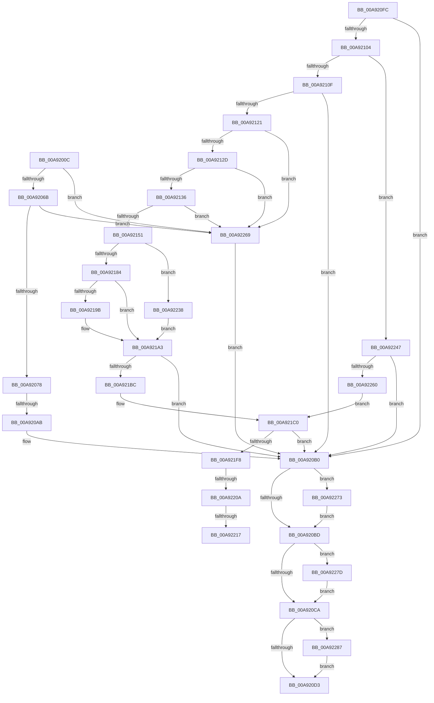

# _CmDeleteDeviceRegKeyWorker

- RVA: `0x00A9200C`–`0x00A92296` (길이 `650` bytes)
- VA: `0x0000000140A9200C`
- 실행 섹션: `PAGE`
- PDB 이름 있음: `예`; PDB Function 태그: `예`
- unwind 정보 RVA: `0x000B92D4`
- 디코드: `165`개 명령, `650/650` bytes 표시
- 미해석 바이트: `0` (있으면 어셈블리에 `.byte`로 보존)

> 이 문서는 커널 이미지의 기계어와 PDB 기호를 분석해 생성했습니다. 4번과 5번은 함수 원형과 자료형을 바이너리 사용 방식에서 추정한 C 해석이며 원본 소스 복구 결과는 아닙니다.

## 1. Dependencies

- 직접 호출 지점: **12**; 고유 호출 대상: **9**
- 직접 호출자로 확인된 함수: **1**
- RIP 상대 이미지 참조: **4**

### Outgoing calls
- `0x00A9209A` → [ExAllocatePool2](../../poolcode/B8/ExAllocatePool2_function_00B820F0.md) (function, `0x00B820F0`)
- `0x00A920DC` → [_security_check_cookie](../../text/6A/_security_check_cookie_function_006AC640.md) (function, `0x006AC640`)
- `0x00A92116` → [RtlInitUnicodeStringEx](../../text/46/RtlInitUnicodeStringEx_function_00463960.md) (function, `0x00463960`)
- `0x00A92144` → [RtlPrefixUnicodeString](../8F/RtlPrefixUnicodeString_function_008F4F70.md) (function, `0x008F4F70`)
- `0x00A92177` → [RtlPrefixUnicodeString](../8F/RtlPrefixUnicodeString_function_008F4F70.md) (function, `0x008F4F70`)
- `0x00A92192` → [RtlPrefixUnicodeString](../8F/RtlPrefixUnicodeString_function_008F4F70.md) (function, `0x008F4F70`)
- `0x00A921AD` → [_PnpCtxGetCachedContextBaseKey](../8E/_PnpCtxGetCachedContextBaseKey_function_008EFB2C.md) (function, `0x008EFB2C`)
- `0x00A921E9` → [_CmOpenDeviceRegKey](../8E/_CmOpenDeviceRegKey_function_008EE540.md) (function, `0x008EE540`)
- `0x00A92251` → [PnpCtxRegOpenCurrentUserKey](../AB/PnpCtxRegOpenCurrentUserKey_function_00AB5E40.md) (function, `0x00AB5E40`)
- `0x00A92273` → [ZwClose](../../text/6A/ZwClose_function_006AD2B0.md) (function, `0x006AD2B0`)
- `0x00A9227D` → [ZwClose](../../text/6A/ZwClose_function_006AD2B0.md) (function, `0x006AD2B0`)
- `0x00A9228C` → [ExFreePoolWithTag](../../poolcode/B8/ExFreePoolWithTag_function_00B82870.md) (function, `0x00B82870`)

### Direct callers
- [sub_00B34AC2](../B3/Unknown_function_00B34AC2.md) at `0x00B34AEB`

### Static image references
- `0x00A92026` → RVA `0x00E0A740` (`.data`; read)
- `0x00A9213D` → RVA `0x00001A08` (`.rdata`; read)
- `0x00A92170` → RVA `0x00001A18` (`.rdata`; read)
- `0x00A9218B` → RVA `0x00001B78` (`.rdata`; read)

## 2. Other-region calls and transfers

- 다른 실행 섹션으로 향하는 call: **6**
  - `0x00A9209A` → [ExAllocatePool2](../../poolcode/B8/ExAllocatePool2_function_00B820F0.md) (`PAGE` → `POOLCODE`)
  - `0x00A920DC` → [_security_check_cookie](../../text/6A/_security_check_cookie_function_006AC640.md) (`PAGE` → `.text`)
  - `0x00A92116` → [RtlInitUnicodeStringEx](../../text/46/RtlInitUnicodeStringEx_function_00463960.md) (`PAGE` → `.text`)
  - `0x00A92273` → [ZwClose](../../text/6A/ZwClose_function_006AD2B0.md) (`PAGE` → `.text`)
  - `0x00A9227D` → [ZwClose](../../text/6A/ZwClose_function_006AD2B0.md) (`PAGE` → `.text`)
  - `0x00A9228C` → [ExFreePoolWithTag](../../poolcode/B8/ExFreePoolWithTag_function_00B82870.md) (`PAGE` → `POOLCODE`)
- call이 아닌 외부 분기/꼬리 이동: **4**
  - `0x00A920A5` → [sub_00B47098](../B4/Unknown_function_00B47098.md) (`tail-transfer`)
  - `0x00A92204` → [sub_00B47098 + 0x10F](../B4/Unknown_function_00B47098.md) (`tail-transfer`)
  - `0x00A92211` → [sub_00B47098 + 0x10F](../B4/Unknown_function_00B47098.md) (`tail-transfer`)
  - `0x00A92233` → [sub_00B47098 + 0x68](../B4/Unknown_function_00B47098.md) (`tail-transfer`)

## 3. Assembly (complete function range)

```asm
00A9200C  48 89 5C 24 18                  mov qword ptr [rsp + 0x18], rbx
00A92011  55                              push rbp
00A92012  56                              push rsi
00A92013  57                              push rdi
00A92014  41 54                           push r12
00A92016  41 55                           push r13
00A92018  41 56                           push r14
00A9201A  41 57                           push r15
00A9201C  48 8B EC                        mov rbp, rsp
00A9201F  48 81 EC 80 00 00 00            sub rsp, 0x80
00A92026  48 8B 05 13 87 37 00            mov rax, qword ptr [rip + 0x378713]
00A9202D  48 33 C4                        xor rax, rsp
00A92030  48 89 45 F8                     mov qword ptr [rbp - 8], rax
00A92034  4C 8B F9                        mov r15, rcx
00A92037  48 89 55 D0                     mov qword ptr [rbp - 0x30], rdx
00A9203B  33 C9                           xor ecx, ecx
00A9203D  0F 57 C0                        xorps xmm0, xmm0
00A92040  89 4D C0                        mov dword ptr [rbp - 0x40], ecx
00A92043  45 8B E9                        mov r13d, r9d
00A92046  48 89 4D C8                     mov qword ptr [rbp - 0x38], rcx
00A9204A  45 8B F0                        mov r14d, r8d
00A9204D  48 89 4D D8                     mov qword ptr [rbp - 0x28], rcx
00A92051  48 8B DA                        mov rbx, rdx
00A92054  48 89 4D E0                     mov qword ptr [rbp - 0x20], rcx
00A92058  44 8D 61 04                     lea r12d, [rcx + 4]
00A9205C  8B F1                           mov esi, ecx
00A9205E  0F 11 45 E8                     movups xmmword ptr [rbp - 0x18], xmm0
00A92062  45 85 C0                        test r8d, r8d
00A92065  0F 84 FE 01 00 00               je 0x140a92269
00A9206B  41 F7 C0 E8 FC FF FF            test r8d, 0xfffffce8
00A92072  0F 85 F1 01 00 00               jne 0x140a92269
00A92078  41 8B C0                        mov eax, r8d
00A9207B  25 00 02 00 00                  and eax, 0x200
00A92080  F7 D8                           neg eax
00A92082  1B FF                           sbb edi, edi
00A92084  83 E7 78                        and edi, 0x78
00A92087  81 C7 F0 00 00 00               add edi, 0xf0
00A9208D  8B D7                           mov edx, edi
00A9208F  B9 00 01 00 00                  mov ecx, 0x100
00A92094  41 B8 50 4E 50 52               mov r8d, 0x52504e50
00A9209A  E8 51 00 0F 00                  call 0x140b820f0
00A9209F  48 8B F0                        mov rsi, rax
00A920A2  48 85 C0                        test rax, rax
00A920A5  0F 85 ED 4F 0B 00               jne 0x140b47098
00A920AB  BB 17 00 00 C0                  mov ebx, 0xc0000017
00A920B0  48 8B 4D E0                     mov rcx, qword ptr [rbp - 0x20]
00A920B4  48 85 C9                        test rcx, rcx
00A920B7  0F 85 B6 01 00 00               jne 0x140a92273
00A920BD  48 8B 4D D8                     mov rcx, qword ptr [rbp - 0x28]
00A920C1  48 85 C9                        test rcx, rcx
00A920C4  0F 85 B3 01 00 00               jne 0x140a9227d
00A920CA  48 85 F6                        test rsi, rsi
00A920CD  0F 85 B4 01 00 00               jne 0x140a92287
00A920D3  8B C3                           mov eax, ebx
00A920D5  48 8B 4D F8                     mov rcx, qword ptr [rbp - 8]
00A920D9  48 33 CC                        xor rcx, rsp
00A920DC  E8 5F A5 C1 FF                  call 0x1406ac640
00A920E1  48 8B 9C 24 D0 00 00 00         mov rbx, qword ptr [rsp + 0xd0]
00A920E9  48 81 C4 80 00 00 00            add rsp, 0x80
00A920F0  41 5F                           pop r15
00A920F2  41 5E                           pop r14
00A920F4  41 5D                           pop r13
00A920F6  41 5C                           pop r12
00A920F8  5F                              pop rdi
00A920F9  5E                              pop rsi
00A920FA  5D                              pop rbp
00A920FB  C3                              ret
00A920FC  CC                              int3
00A920FD  45 33 ED                        xor r13d, r13d
00A92100  85 C0                           test eax, eax
00A92102  78 AC                           js 0x140a920b0
00A92104  41 0F BA E6 08                  bt r14d, 8
00A92109  0F 82 38 01 00 00               jb 0x140a92247
00A9210F  48 8B D6                        mov rdx, rsi
00A92112  48 8D 4D E8                     lea rcx, [rbp - 0x18]
00A92116  E8 45 18 9D FF                  call 0x140463960
00A9211B  8B D8                           mov ebx, eax
00A9211D  85 C0                           test eax, eax
00A9211F  78 8F                           js 0x140a920b0
00A92121  0F B7 5D E8                     movzx ebx, word ptr [rbp - 0x18]
00A92125  3B DF                           cmp ebx, edi
00A92127  0F 83 3C 01 00 00               jae 0x140a92269
00A9212D  83 FB 32                        cmp ebx, 0x32
00A92130  0F 86 33 01 00 00               jbe 0x140a92269
00A92136  41 B0 01                        mov r8b, 1
00A92139  48 8D 55 E8                     lea rdx, [rbp - 0x18]
00A9213D  48 8D 0D C4 F8 56 FF            lea rcx, [rip - 0xa9073c]
00A92144  E8 27 2E E6 FF                  call 0x1408f4f70
00A92149  84 C0                           test al, al
00A9214B  0F 84 18 01 00 00               je 0x140a92269
00A92151  B8 CE FF 00 00                  mov eax, 0xffce
00A92156  48 8D 7E 32                     lea rdi, [rsi + 0x32]
00A9215A  66 01 45 EA                     add word ptr [rbp - 0x16], ax
00A9215E  48 8D 55 E8                     lea rdx, [rbp - 0x18]
00A92162  66 03 D8                        add bx, ax
00A92165  48 89 7D F0                     mov qword ptr [rbp - 0x10], rdi
00A92169  41 B0 01                        mov r8b, 1
00A9216C  66 89 5D E8                     mov word ptr [rbp - 0x18], bx
00A92170  48 8D 0D A1 F8 56 FF            lea rcx, [rip - 0xa9075f]
00A92177  E8 F4 2D E6 FF                  call 0x1408f4f70
00A9217C  84 C0                           test al, al
00A9217E  0F 85 B4 00 00 00               jne 0x140a92238
00A92184  41 B0 01                        mov r8b, 1
00A92187  48 8D 55 E8                     lea rdx, [rbp - 0x18]
00A9218B  48 8D 0D E6 F9 56 FF            lea rcx, [rip - 0xa9061a]
00A92192  E8 D9 2D E6 FF                  call 0x1408f4f70
00A92197  84 C0                           test al, al
00A92199  74 08                           je 0x140a921a3
00A9219B  45 8D 65 0E                     lea r12d, [r13 + 0xe]
00A9219F  48 83 C7 24                     add rdi, 0x24
00A921A3  4C 8D 45 C8                     lea r8, [rbp - 0x38]
00A921A7  41 8B D4                        mov edx, r12d
00A921AA  49 8B CF                        mov rcx, r15
00A921AD  E8 7A D9 E5 FF                  call 0x1408efb2c
00A921B2  8B D8                           mov ebx, eax
00A921B4  85 C0                           test eax, eax
00A921B6  0F 88 F4 FE FF FF               js 0x140a920b0
00A921BC  4C 8B 65 C8                     mov r12, qword ptr [rbp - 0x38]
00A921C0  48 8B 55 D0                     mov rdx, qword ptr [rbp - 0x30]
00A921C4  48 8D 45 E0                     lea rax, [rbp - 0x20]
00A921C8  4C 89 6C 24 38                  mov qword ptr [rsp + 0x38], r13
00A921CD  45 33 C9                        xor r9d, r9d
00A921D0  48 89 44 24 30                  mov qword ptr [rsp + 0x30], rax
00A921D5  49 8B CF                        mov rcx, r15
00A921D8  44 88 6C 24 28                  mov byte ptr [rsp + 0x28], r13b
00A921DD  C7 44 24 20 01 00 00 00         mov dword ptr [rsp + 0x20], 1
00A921E5  45 8D 41 10                     lea r8d, [r9 + 0x10]
00A921E9  E8 52 C3 E5 FF                  call 0x1408ee540
00A921EE  8B D8                           mov ebx, eax
00A921F0  85 C0                           test eax, eax
00A921F2  0F 88 B8 FE FF FF               js 0x140a920b0
00A921F8  45 0F B6 EE                     movzx r13d, r14b
00A921FC  44 89 6D C0                     mov dword ptr [rbp - 0x40], r13d
00A92200  41 83 FD 12                     cmp r13d, 0x12
00A92204  0F 85 9D 4F 0B 00               jne 0x140b471a7
00A9220A  41 F7 C6 00 0F 00 00            test r14d, 0xf00
00A92211  0F 85 90 4F 0B 00               jne 0x140b471a7
00A92217  C7 45 E8 12 03 00 00            mov dword ptr [rbp - 0x18], 0x312
00A9221E  48 8D 45 E8                     lea rax, [rbp - 0x18]
00A92222  C7 45 EC 12 02 00 00            mov dword ptr [rbp - 0x14], 0x212
00A92229  45 33 ED                        xor r13d, r13d
00A9222C  C7 45 F0 12 01 00 00            mov dword ptr [rbp - 0x10], 0x112
00A92233  E9 C8 4E 0B 00                  jmp 0x140b47100
00A92238  41 BC 05 00 00 00               mov r12d, 5
00A9223E  48 83 C7 0A                     add rdi, 0xa
00A92242  E9 5C FF FF FF                  jmp 0x140a921a3
00A92247  4C 8D 4D D8                     lea r9, [rbp - 0x28]
00A9224B  49 8B CF                        mov rcx, r15
00A9224E  48 8B FE                        mov rdi, rsi
00A92251  E8 EA 3B 02 00                  call 0x140ab5e40
00A92256  8B D8                           mov ebx, eax
00A92258  85 C0                           test eax, eax
00A9225A  0F 88 50 FE FF FF               js 0x140a920b0
00A92260  4C 8B 65 D8                     mov r12, qword ptr [rbp - 0x28]
00A92264  E9 57 FF FF FF                  jmp 0x140a921c0
00A92269  BB 0D 00 00 C0                  mov ebx, 0xc000000d
00A9226E  E9 3D FE FF FF                  jmp 0x140a920b0
00A92273  E8 38 B0 C1 FF                  call 0x1406ad2b0
00A92278  E9 40 FE FF FF                  jmp 0x140a920bd
00A9227D  E8 2E B0 C1 FF                  call 0x1406ad2b0
00A92282  E9 43 FE FF FF                  jmp 0x140a920ca
00A92287  33 D2                           xor edx, edx
00A92289  48 8B CE                        mov rcx, rsi
00A9228C  E8 DF 05 0F 00                  call 0x140b82870
00A92291  E9 3D FE FF FF                  jmp 0x140a920d3
```

## 4. C-style interpretation (structured pseudocode)

```c
__int64 __fastcall _CmDeleteDeviceRegKeyWorker(__int64 a1, __int64 a2, int a3, int a4)
{
    __int64 result;
    __int64 v_rdi;
    __int64 v_rsp;
    unsigned __int64 v_stack_m40;
    unsigned __int64 v_stack_m48;
    unsigned int v_stack_m4C;
    unsigned __int16 v_stack_m4E;
    unsigned __int64 v_stack_m50;
    unsigned __int64 v_stack_m58;
    unsigned __int64 v_stack_m60;
    unsigned __int64 v_stack_m68;
    unsigned __int64 v_stack_m70;
    unsigned int v_stack_m78;
    unsigned __int64 v_stack_p18;
    unsigned int v_stack_p20;
    unsigned __int8 v_stack_p28;
    unsigned __int64 v_stack_p30;
    unsigned __int64 v_stack_p38;

    v_stack_p18 = v_rbx;
    v_rsp = (v_rsp) - (128);
    result = (*(unsigned __int64 *)(v_rip + 3639059)) ^ (v_rsp);
    v_stack_m40 = result;
    v_stack_m68 = a2;
    a1 = 0;
    v_stack_m78 = 0;
    v_stack_m70 = 0;
    v_stack_m60 = 0;
    v_stack_m58 = 0;
    v_stack_m50 = v_xmm0;
    if (a3 == 0) goto loc_00A92269;
    if (((a3) & (0xFFFFFCE8ULL)) != 0) goto loc_00A92269;
    result = (unsigned int)(((unsigned int)(a3)) & (512));
    result = (unsigned int)(-(result));
    v_rdi = (unsigned int)((v_rdi) & (120));
    v_rdi = (unsigned int)((v_rdi) + (240));
    result = ExAllocatePool2(256, (unsigned int)((unsigned int)(v_rdi)), (unsigned int)(0x52504E50ULL), a4);
loc_00A920B0:
    if (v_stack_m58 != 0) goto loc_00A92273;
loc_00A920BD:
    if (v_stack_m60 != 0) goto loc_00A9227D;
loc_00A920CA:
    if (result != 0) goto loc_00A92287;
loc_00A920D3:
    a1 = (v_stack_m40) ^ (v_rsp);
    result = _security_check_cookie(a1, (unsigned int)((unsigned int)(v_rdi)), (unsigned int)(0x52504E50ULL), a4);
    v_rsp = (v_rsp) + (128);
    return result;
loc_00A92269:
    goto loc_00A920B0;
loc_00A92273:
    result = ZwClose(a1, (unsigned int)((unsigned int)(v_rdi)), (unsigned int)(0x52504E50ULL), a4);
    goto loc_00A920BD;
loc_00A9227D:
    result = ZwClose(a1, (unsigned int)((unsigned int)(v_rdi)), (unsigned int)(0x52504E50ULL), a4);
    goto loc_00A920CA;
loc_00A92287:
    a2 = 0;
    result = ExFreePoolWithTag(result, a2, (unsigned int)(0x52504E50ULL), a4);
    goto loc_00A920D3;
}
```

## 5. (Beta) C Style

```c
int64_t _CmDeleteDeviceRegKeyWorker(int64_t Arg1, int64_t Arg2, int32_t Arg3, int32_t Arg4)
{
    int64_t result;
    int64_t local_rdi;
    int64_t local_rsp;
    uint64_t v_stack_m40;
    uint64_t v_stack_m48;
    uint32_t v_stack_m4C;
    uint16_t v_stack_m4E;
    uint64_t v_stack_m50;
    uint64_t v_stack_m58;
    uint64_t v_stack_m60;
    uint64_t v_stack_m68;
    uint64_t v_stack_m70;
    uint32_t v_stack_m78;
    uint64_t v_stack_p18;
    uint32_t v_stack_p20;
    uint8_t v_stack_p28;
    uint64_t v_stack_p30;
    uint64_t v_stack_p38;

    v_stack_p18 = local_rbx;
    local_rsp = (local_rsp) - (128);
    result = (*(uint64_t *)(v_rip + 0x378713)) ^ (local_rsp);
    v_stack_m40 = result;
    v_stack_m68 = Arg2;
    Arg1 = 0;
    v_stack_m78 = 0;
    v_stack_m70 = 0;
    v_stack_m60 = 0;
    v_stack_m58 = 0;
    v_stack_m50 = v_xmm0;
    if (Arg3 == 0) goto loc_00A92269;
    if (((Arg3) & (0xFFFFFCE8ULL)) != 0) goto loc_00A92269;
    result = (uint32_t)(((uint32_t)(Arg3)) & (512));
    result = (uint32_t)(-(result));
    local_rdi = (uint32_t)((local_rdi) & (120));
    local_rdi = (uint32_t)((local_rdi) + (240));
    result = ExAllocatePool2(256, (uint32_t)((uint32_t)(local_rdi)), (uint32_t)(0x52504E50ULL), Arg4);
loc_00A920B0:
    if (v_stack_m58 != 0) goto loc_00A92273;
loc_00A920BD:
    if (v_stack_m60 != 0) goto loc_00A9227D;
loc_00A920CA:
    if (result != 0) goto loc_00A92287;
loc_00A920D3:
    Arg1 = (v_stack_m40) ^ (local_rsp);
    result = _security_check_cookie(Arg1, (uint32_t)((uint32_t)(local_rdi)), (uint32_t)(0x52504E50ULL), Arg4);
    local_rsp = (local_rsp) + (128);
    return result;
loc_00A92269:
    goto loc_00A920B0;
loc_00A92273:
    result = ZwClose(Arg1, (uint32_t)((uint32_t)(local_rdi)), (uint32_t)(0x52504E50ULL), Arg4);
    goto loc_00A920BD;
loc_00A9227D:
    result = ZwClose(Arg1, (uint32_t)((uint32_t)(local_rdi)), (uint32_t)(0x52504E50ULL), Arg4);
    goto loc_00A920CA;
loc_00A92287:
    Arg2 = 0;
    result = ExFreePoolWithTag(result, Arg2, (uint32_t)(0x52504E50ULL), Arg4);
    goto loc_00A920D3;
}
```

## 6. Execution-region graph

[열기: 2D/3D 그래프와 함수 탐색 컨트롤 패널](../../../control-panel.html?section=page&rva=0x00A9200C&view=graph)

- 2D 그래프는 위에서 아래로 흐르고, 3D 그래프는 빈 공간을 드래그해 회전합니다. Shift+드래그는 이동, 휠은 확대·축소, 함수 노드 선택은 대상 보고서 이동입니다.

### Static fallback


