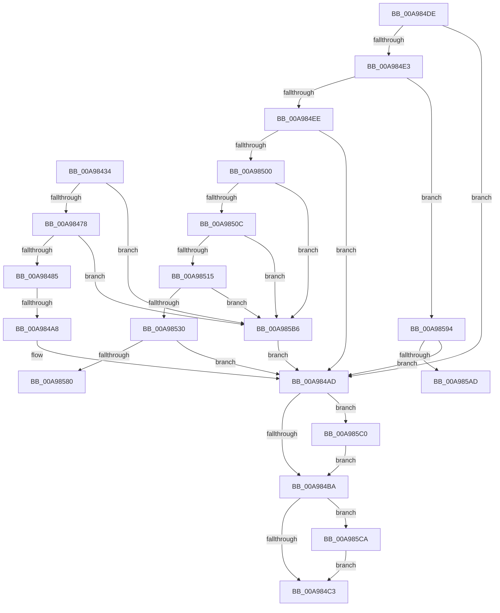

# _CmOpenDevicePanelRegKeyWorker

- RVA: `0x00A98434`–`0x00A985D9` (길이 `421` bytes)
- VA: `0x0000000140A98434`
- 실행 섹션: `PAGE`
- PDB 이름 있음: `예`; PDB Function 태그: `예`
- unwind 정보 RVA: `0x000BA00C`
- 디코드: `114`개 명령, `421/421` bytes 표시
- 미해석 바이트: `0` (있으면 어셈블리에 `.byte`로 보존)

> 이 문서는 커널 이미지의 기계어와 PDB 기호를 분석해 생성했습니다. 4번과 5번은 함수 원형과 자료형을 바이너리 사용 방식에서 추정한 C 해석이며 원본 소스 복구 결과는 아닙니다.

## 1. Dependencies

- 직접 호출 지점: **8**; 고유 호출 대상: **7**
- 직접 호출자로 확인된 함수: **1**
- RIP 상대 이미지 참조: **2**

### Outgoing calls
- `0x00A98497` → [ExAllocatePool2](../../poolcode/B8/ExAllocatePool2_function_00B820F0.md) (function, `0x00B820F0`)
- `0x00A984F5` → [RtlInitUnicodeStringEx](../../text/46/RtlInitUnicodeStringEx_function_00463960.md) (function, `0x00463960`)
- `0x00A98523` → [RtlPrefixUnicodeString](../8F/RtlPrefixUnicodeString_function_008F4F70.md) (function, `0x008F4F70`)
- `0x00A98556` → [RtlPrefixUnicodeString](../8F/RtlPrefixUnicodeString_function_008F4F70.md) (function, `0x008F4F70`)
- `0x00A98571` → [_PnpCtxGetCachedContextBaseKey](../8E/_PnpCtxGetCachedContextBaseKey_function_008EFB2C.md) (function, `0x008EFB2C`)
- `0x00A9859E` → [PnpCtxRegOpenCurrentUserKey](../AB/PnpCtxRegOpenCurrentUserKey_function_00AB5E40.md) (function, `0x00AB5E40`)
- `0x00A985C0` → [ZwClose](../../text/6A/ZwClose_function_006AD2B0.md) (function, `0x006AD2B0`)
- `0x00A985CF` → [ExFreePoolWithTag](../../poolcode/B8/ExFreePoolWithTag_function_00B82870.md) (function, `0x00B82870`)

### Direct callers
- [CmOpenDevicePanelRegKey](../82/CmOpenDevicePanelRegKey_function_0082F1C0.md) at `0x0082F28A`

### Static image references
- `0x00A9851C` → RVA `0x00001A08` (`.rdata`; read)
- `0x00A9854F` → RVA `0x00003A80` (`.rdata`; read)

## 2. Other-region calls and transfers

- 다른 실행 섹션으로 향하는 call: **4**
  - `0x00A98497` → [ExAllocatePool2](../../poolcode/B8/ExAllocatePool2_function_00B820F0.md) (`PAGE` → `POOLCODE`)
  - `0x00A984F5` → [RtlInitUnicodeStringEx](../../text/46/RtlInitUnicodeStringEx_function_00463960.md) (`PAGE` → `.text`)
  - `0x00A985C0` → [ZwClose](../../text/6A/ZwClose_function_006AD2B0.md) (`PAGE` → `.text`)
  - `0x00A985CF` → [ExFreePoolWithTag](../../poolcode/B8/ExFreePoolWithTag_function_00B82870.md) (`PAGE` → `POOLCODE`)
- call이 아닌 외부 분기/꼬리 이동: **3**
  - `0x00A984A2` → [sub_00B47E86](../B4/Unknown_function_00B47E86.md) (`tail-transfer`)
  - `0x00A9858F` → [sub_00B47E86 + 0x58](../B4/Unknown_function_00B47E86.md) (`tail-transfer`)
  - `0x00A985B1` → [sub_00B47E86 + 0x58](../B4/Unknown_function_00B47E86.md) (`tail-transfer`)

## 3. Assembly (complete function range)

```asm
00A98434  48 89 5C 24 08                  mov qword ptr [rsp + 8], rbx
00A98439  48 89 74 24 10                  mov qword ptr [rsp + 0x10], rsi
00A9843E  44 89 4C 24 20                  mov dword ptr [rsp + 0x20], r9d
00A98443  55                              push rbp
00A98444  57                              push rdi
00A98445  41 54                           push r12
00A98447  41 56                           push r14
00A98449  41 57                           push r15
00A9844B  48 8B EC                        mov rbp, rsp
00A9844E  48 83 EC 60                     sub rsp, 0x60
00A98452  33 FF                           xor edi, edi
00A98454  0F 57 C0                        xorps xmm0, xmm0
00A98457  21 7D 48                        and dword ptr [rbp + 0x48], edi
00A9845A  45 8B F0                        mov r14d, r8d
00A9845D  48 21 7D E8                     and qword ptr [rbp - 0x18], rdi
00A98461  4C 8B E2                        mov r12, rdx
00A98464  48 21 7D E0                     and qword ptr [rbp - 0x20], rdi
00A98468  4C 8B F9                        mov r15, rcx
00A9846B  0F 11 45 F0                     movups xmmword ptr [rbp - 0x10], xmm0
00A9846F  45 85 C0                        test r8d, r8d
00A98472  0F 84 3E 01 00 00               je 0x140a985b6
00A98478  41 F7 C0 9F FE FF FF            test r8d, 0xfffffe9f
00A9847F  0F 85 31 01 00 00               jne 0x140a985b6
00A98485  BE 3D 01 00 00                  mov esi, 0x13d
00A9848A  8B D6                           mov edx, esi
00A9848C  B9 00 01 00 00                  mov ecx, 0x100
00A98491  41 B8 50 4E 50 52               mov r8d, 0x52504e50
00A98497  E8 54 9C 0E 00                  call 0x140b820f0
00A9849C  48 8B F8                        mov rdi, rax
00A9849F  48 85 C0                        test rax, rax
00A984A2  0F 85 DE F9 0A 00               jne 0x140b47e86
00A984A8  BB 17 00 00 C0                  mov ebx, 0xc0000017
00A984AD  48 8B 4D E0                     mov rcx, qword ptr [rbp - 0x20]
00A984B1  48 85 C9                        test rcx, rcx
00A984B4  0F 85 06 01 00 00               jne 0x140a985c0
00A984BA  48 85 FF                        test rdi, rdi
00A984BD  0F 85 07 01 00 00               jne 0x140a985ca
00A984C3  4C 8D 5C 24 60                  lea r11, [rsp + 0x60]
00A984C8  8B C3                           mov eax, ebx
00A984CA  49 8B 5B 30                     mov rbx, qword ptr [r11 + 0x30]
00A984CE  49 8B 73 38                     mov rsi, qword ptr [r11 + 0x38]
00A984D2  49 8B E3                        mov rsp, r11
00A984D5  41 5F                           pop r15
00A984D7  41 5E                           pop r14
00A984D9  41 5C                           pop r12
00A984DB  5F                              pop rdi
00A984DC  5D                              pop rbp
00A984DD  C3                              ret
00A984DE  CC                              int3
00A984DF  85 C0                           test eax, eax
00A984E1  78 CA                           js 0x140a984ad
00A984E3  41 0F BA E6 08                  bt r14d, 8
00A984E8  0F 82 A6 00 00 00               jb 0x140a98594
00A984EE  48 8B D7                        mov rdx, rdi
00A984F1  48 8D 4D F0                     lea rcx, [rbp - 0x10]
00A984F5  E8 66 B4 9C FF                  call 0x140463960
00A984FA  8B D8                           mov ebx, eax
00A984FC  85 C0                           test eax, eax
00A984FE  78 AD                           js 0x140a984ad
00A98500  0F B7 5D F0                     movzx ebx, word ptr [rbp - 0x10]
00A98504  3B DE                           cmp ebx, esi
00A98506  0F 83 AA 00 00 00               jae 0x140a985b6
00A9850C  83 FB 32                        cmp ebx, 0x32
00A9850F  0F 86 A1 00 00 00               jbe 0x140a985b6
00A98515  41 B0 01                        mov r8b, 1
00A98518  48 8D 55 F0                     lea rdx, [rbp - 0x10]
00A9851C  48 8D 0D E5 94 56 FF            lea rcx, [rip - 0xa96b1b]
00A98523  E8 48 CA E5 FF                  call 0x1408f4f70
00A98528  84 C0                           test al, al
00A9852A  0F 84 86 00 00 00               je 0x140a985b6
00A98530  B8 CE FF 00 00                  mov eax, 0xffce
00A98535  4C 8D 77 32                     lea r14, [rdi + 0x32]
00A98539  66 01 45 F2                     add word ptr [rbp - 0xe], ax
00A9853D  48 8D 55 F0                     lea rdx, [rbp - 0x10]
00A98541  66 03 D8                        add bx, ax
00A98544  4C 89 75 F8                     mov qword ptr [rbp - 8], r14
00A98548  41 B0 01                        mov r8b, 1
00A9854B  66 89 5D F0                     mov word ptr [rbp - 0x10], bx
00A9854F  48 8D 0D 2A B5 56 FF            lea rcx, [rip - 0xa94ad6]
00A98556  E8 15 CA E5 FF                  call 0x1408f4f70
00A9855B  8A C8                           mov cl, al
00A9855D  4C 8D 45 E8                     lea r8, [rbp - 0x18]
00A98561  F6 D9                           neg cl
00A98563  44 8A E0                        mov r12b, al
00A98566  49 8B CF                        mov rcx, r15
00A98569  1B D2                           sbb edx, edx
00A9856B  83 E2 07                        and edx, 7
00A9856E  83 C2 04                        add edx, 4
00A98571  E8 B6 75 E5 FF                  call 0x1408efb2c
00A98576  8B D8                           mov ebx, eax
00A98578  85 C0                           test eax, eax
00A9857A  0F 88 2D FF FF FF               js 0x140a984ad
00A98580  48 8B 55 E8                     mov rdx, qword ptr [rbp - 0x18]
00A98584  49 8D 76 2A                     lea rsi, [r14 + 0x2a]
00A98588  45 84 E4                        test r12b, r12b
00A9858B  49 0F 44 F6                     cmove rsi, r14
00A9858F  E9 4A F9 0A 00                  jmp 0x140b47ede
00A98594  4C 8D 4D E0                     lea r9, [rbp - 0x20]
00A98598  49 8B CF                        mov rcx, r15
00A9859B  48 8B F7                        mov rsi, rdi
00A9859E  E8 9D D8 01 00                  call 0x140ab5e40
00A985A3  8B D8                           mov ebx, eax
00A985A5  85 C0                           test eax, eax
00A985A7  0F 88 00 FF FF FF               js 0x140a984ad
00A985AD  48 8B 55 E0                     mov rdx, qword ptr [rbp - 0x20]
00A985B1  E9 28 F9 0A 00                  jmp 0x140b47ede
00A985B6  BB 0D 00 00 C0                  mov ebx, 0xc000000d
00A985BB  E9 ED FE FF FF                  jmp 0x140a984ad
00A985C0  E8 EB 4C C1 FF                  call 0x1406ad2b0
00A985C5  E9 F0 FE FF FF                  jmp 0x140a984ba
00A985CA  33 D2                           xor edx, edx
00A985CC  48 8B CF                        mov rcx, rdi
00A985CF  E8 9C A2 0E 00                  call 0x140b82870
00A985D4  E9 EA FE FF FF                  jmp 0x140a984c3
```

## 4. C-style interpretation (structured pseudocode)

```c
__int64 __fastcall _CmOpenDevicePanelRegKeyWorker(__int64 a1, __int64 a2, int a3, int a4)
{
    __int64 result;
    __int64 v_rdi;
    __int64 v_rsp;
    unsigned __int64 v_stack_m28;
    unsigned __int64 v_stack_m30;
    unsigned __int16 v_stack_m36;
    unsigned __int64 v_stack_m38;
    unsigned __int64 v_stack_m40;
    unsigned __int64 v_stack_m48;
    unsigned __int64 v_stack_p10;
    unsigned int v_stack_p20;
    unsigned __int64 v_stack_p8;

    v_stack_p8 = v_rbx;
    v_stack_p10 = v_rsi;
    v_stack_p20 = a4;
    v_rsp = (v_rsp) - (96);
    v_rdi = 0;
    v_stack_m38 = v_xmm0;
    if (a3 == 0) goto loc_00A985B6;
    if (((a3) & (0xFFFFFE9FULL)) != 0) goto loc_00A985B6;
    result = ExAllocatePool2(256, 317, (unsigned int)(0x52504E50ULL), a4);
loc_00A984AD:
    if (v_stack_m48 != 0) goto loc_00A985C0;
loc_00A984BA:
    if (result != 0) goto loc_00A985CA;
loc_00A984C3:
    return (unsigned int)((unsigned int)((unsigned int)(0xC0000017ULL)));
loc_00A985B6:
    goto loc_00A984AD;
loc_00A985C0:
    result = ZwClose(v_stack_m48, 317, (unsigned int)(0x52504E50ULL), a4);
    goto loc_00A984BA;
loc_00A985CA:
    a2 = 0;
    result = ExFreePoolWithTag(result, a2, (unsigned int)(0x52504E50ULL), a4);
    goto loc_00A984C3;
}
```

## 5. (Beta) C Style

```c
int64_t _CmOpenDevicePanelRegKeyWorker(int64_t Arg1, int64_t Arg2, int32_t Arg3, int32_t Arg4)
{
    int64_t result;
    int64_t local_rdi;
    int64_t local_rsp;
    uint64_t v_stack_m28;
    uint64_t v_stack_m30;
    uint16_t v_stack_m36;
    uint64_t v_stack_m38;
    uint64_t v_stack_m40;
    uint64_t v_stack_m48;
    uint64_t v_stack_p10;
    uint32_t v_stack_p20;
    uint64_t v_stack_p8;

    v_stack_p8 = local_rbx;
    v_stack_p10 = local_rsi;
    v_stack_p20 = Arg4;
    local_rsp = (local_rsp) - (96);
    local_rdi = 0;
    v_stack_m38 = v_xmm0;
    if (Arg3 == 0) goto loc_00A985B6;
    if (((Arg3) & (0xFFFFFE9FULL)) != 0) goto loc_00A985B6;
    result = ExAllocatePool2(256, 317, (uint32_t)(0x52504E50ULL), Arg4);
loc_00A984AD:
    if (v_stack_m48 != 0) goto loc_00A985C0;
loc_00A984BA:
    if (result != 0) goto loc_00A985CA;
loc_00A984C3:
    return (uint32_t)((uint32_t)((uint32_t)(0xC0000017ULL)));
loc_00A985B6:
    goto loc_00A984AD;
loc_00A985C0:
    result = ZwClose(v_stack_m48, 317, (uint32_t)(0x52504E50ULL), Arg4);
    goto loc_00A984BA;
loc_00A985CA:
    Arg2 = 0;
    result = ExFreePoolWithTag(result, Arg2, (uint32_t)(0x52504E50ULL), Arg4);
    goto loc_00A984C3;
}
```

## 6. Execution-region graph

[열기: 2D/3D 그래프와 함수 탐색 컨트롤 패널](../../../control-panel.html?section=page&rva=0x00A98434&view=graph)

- 2D 그래프는 위에서 아래로 흐르고, 3D 그래프는 빈 공간을 드래그해 회전합니다. Shift+드래그는 이동, 휠은 확대·축소, 함수 노드 선택은 대상 보고서 이동입니다.

### Static fallback


