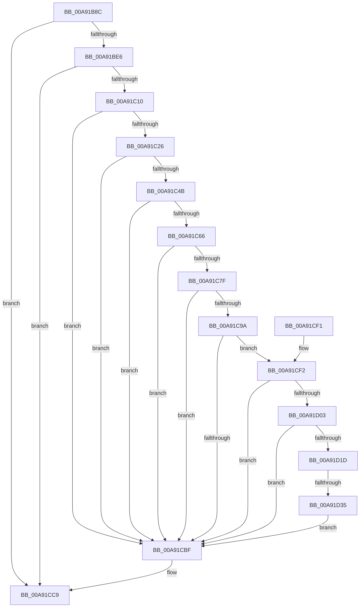

# _PnpGetPropertiesSecurityDescriptor

- RVA: `0x00A91B8C`–`0x00A91D3A` (길이 `430` bytes)
- VA: `0x0000000140A91B8C`
- 실행 섹션: `PAGE`
- PDB 이름 있음: `예`; PDB Function 태그: `예`
- unwind 정보 RVA: `0x000B9264`
- 디코드: `114`개 명령, `430/430` bytes 표시
- 미해석 바이트: `0` (있으면 어셈블리에 `.byte`로 보존)

> 이 문서는 커널 이미지의 기계어와 PDB 기호를 분석해 생성했습니다. 4번과 5번은 함수 원형과 자료형을 바이너리 사용 방식에서 추정한 C 해석이며 원본 소스 복구 결과는 아닙니다.

## 1. Dependencies

- 직접 호출 지점: **12**; 고유 호출 대상: **11**
- 직접 호출자로 확인된 함수: **1**
- RIP 상대 이미지 참조: **1**

### Outgoing calls
- `0x00A91BCA` → [RtlSubAuthoritySid](../../text/45/RtlSubAuthoritySid_function_00456D10.md) (function, `0x00456D10`)
- `0x00A91BD9` → [RtlValidSid](../92/RtlValidSid_function_00929710.md) (function, `0x00929710`)
- `0x00A91BEA` → [RtlLengthSid](../../text/45/RtlLengthSid_function_0045D270.md) (function, `0x0045D270`)
- `0x00A91BFF` → [ExAllocatePool2](../../poolcode/B8/ExAllocatePool2_function_00B820F0.md) (function, `0x00B820F0`)
- `0x00A91C19` → [RtlCreateAcl](../91/RtlCreateAcl_function_00916F00.md) (function, `0x00916F00`)
- `0x00A91C42` → [RtlpAddKnownAce](../92/RtlpAddKnownAce_function_00929A20.md) (function, `0x00929A20`)
- `0x00A91CB6` → [RtlValidSecurityDescriptor](../8B/RtlValidSecurityDescriptor_function_008BD3F0.md) (function, `0x008BD3F0`)
- `0x00A91CC4` → [ExFreePoolWithTag](../../poolcode/B8/ExFreePoolWithTag_function_00B82870.md) (function, `0x00B82870`)
- `0x00A91CD3` → [_security_check_cookie](../../text/6A/_security_check_cookie_function_006AC640.md) (function, `0x006AC640`)
- `0x00A91CF6` → [RtlLengthSecurityDescriptor](../8B/RtlLengthSecurityDescriptor_function_008BC870.md) (function, `0x008BC870`)
- `0x00A91D10` → [ExAllocatePool2](../../poolcode/B8/ExAllocatePool2_function_00B820F0.md) (function, `0x00B820F0`)
- `0x00A91D28` → [RtlAbsoluteToSelfRelativeSD](../A1/RtlAbsoluteToSelfRelativeSD_function_00A119B0.md) (function, `0x00A119B0`)

### Direct callers
- [_PnpOpenPropertiesKey](../99/_PnpOpenPropertiesKey_function_009938A0.md) at `0x00993AE3`

### Static image references
- `0x00A91BA6` → RVA `0x00E0A740` (`.data`; read)

## 2. Other-region calls and transfers

- 다른 실행 섹션으로 향하는 call: **6**
  - `0x00A91BCA` → [RtlSubAuthoritySid](../../text/45/RtlSubAuthoritySid_function_00456D10.md) (`PAGE` → `.text`)
  - `0x00A91BEA` → [RtlLengthSid](../../text/45/RtlLengthSid_function_0045D270.md) (`PAGE` → `.text`)
  - `0x00A91BFF` → [ExAllocatePool2](../../poolcode/B8/ExAllocatePool2_function_00B820F0.md) (`PAGE` → `POOLCODE`)
  - `0x00A91CC4` → [ExFreePoolWithTag](../../poolcode/B8/ExFreePoolWithTag_function_00B82870.md) (`PAGE` → `POOLCODE`)
  - `0x00A91CD3` → [_security_check_cookie](../../text/6A/_security_check_cookie_function_006AC640.md) (`PAGE` → `.text`)
  - `0x00A91D10` → [ExAllocatePool2](../../poolcode/B8/ExAllocatePool2_function_00B820F0.md) (`PAGE` → `POOLCODE`)
- call이 아닌 외부 분기/꼬리 이동: **1**
  - `0x00A91D2F` → [sub_00B46ECE](../B4/Unknown_function_00B46ECE.md) (`tail-transfer`)

## 3. Assembly (complete function range)

```asm
00A91B8C  48 89 5C 24 08                  mov qword ptr [rsp + 8], rbx
00A91B91  48 89 74 24 10                  mov qword ptr [rsp + 0x10], rsi
00A91B96  48 89 7C 24 18                  mov qword ptr [rsp + 0x18], rdi
00A91B9B  55                              push rbp
00A91B9C  48 8B EC                        mov rbp, rsp
00A91B9F  48 81 EC 80 00 00 00            sub rsp, 0x80
00A91BA6  48 8B 05 93 8B 37 00            mov rax, qword ptr [rip + 0x378b93]
00A91BAD  48 33 C4                        xor rax, rsp
00A91BB0  48 89 45 F0                     mov qword ptr [rbp - 0x10], rax
00A91BB4  33 D2                           xor edx, edx
00A91BB6  C7 45 E0 01 01 00 00            mov dword ptr [rbp - 0x20], 0x101
00A91BBD  48 8D 4D E0                     lea rcx, [rbp - 0x20]
00A91BC1  C7 45 E4 00 00 00 05            mov dword ptr [rbp - 0x1c], 0x5000000
00A91BC8  33 DB                           xor ebx, ebx
00A91BCA  E8 41 51 9C FF                  call 0x140456d10
00A91BCF  48 8D 4D E0                     lea rcx, [rbp - 0x20]
00A91BD3  C7 00 12 00 00 00               mov dword ptr [rax], 0x12
00A91BD9  E8 32 7B E9 FF                  call 0x140929710
00A91BDE  84 C0                           test al, al
00A91BE0  0F 84 E3 00 00 00               je 0x140a91cc9
00A91BE6  48 8D 4D E0                     lea rcx, [rbp - 0x20]
00A91BEA  E8 81 B6 9C FF                  call 0x14045d270
00A91BEF  B9 00 01 00 00                  mov ecx, 0x100
00A91BF4  41 B8 50 4E 50 52               mov r8d, 0x52504e50
00A91BFA  8D 78 10                        lea edi, [rax + 0x10]
00A91BFD  8B D7                           mov edx, edi
00A91BFF  E8 EC 04 0F 00                  call 0x140b820f0
00A91C04  48 8B F0                        mov rsi, rax
00A91C07  48 85 C0                        test rax, rax
00A91C0A  0F 84 B9 00 00 00               je 0x140a91cc9
00A91C10  44 8D 43 02                     lea r8d, [rbx + 2]
00A91C14  8B D7                           mov edx, edi
00A91C16  48 8B C8                        mov rcx, rax
00A91C19  E8 E2 52 E8 FF                  call 0x140916f00
00A91C1E  85 C0                           test eax, eax
00A91C20  0F 88 99 00 00 00               js 0x140a91cbf
00A91C26  8D 53 02                        lea edx, [rbx + 2]
00A91C29  88 5C 24 28                     mov byte ptr [rsp + 0x28], bl
00A91C2D  48 8D 45 E0                     lea rax, [rbp - 0x20]
00A91C31  44 8B C2                        mov r8d, edx
00A91C34  41 B9 3F 00 0F 00               mov r9d, 0xf003f
00A91C3A  48 89 44 24 20                  mov qword ptr [rsp + 0x20], rax
00A91C3F  48 8B CE                        mov rcx, rsi
00A91C42  E8 D9 7D E9 FF                  call 0x140929a20
00A91C47  85 C0                           test eax, eax
00A91C49  78 74                           js 0x140a91cbf
00A91C4B  89 5D B9                        mov dword ptr [rbp - 0x47], ebx
00A91C4E  0F B7 4D BA                     movzx ecx, word ptr [rbp - 0x46]
00A91C52  66 89 5D BD                     mov word ptr [rbp - 0x43], bx
00A91C56  88 5D BF                        mov byte ptr [rbp - 0x41], bl
00A91C59  48 89 5D D0                     mov qword ptr [rbp - 0x30], rbx
00A91C5D  C6 45 B8 01                     mov byte ptr [rbp - 0x48], 1
00A91C61  66 85 C9                        test cx, cx
00A91C64  78 59                           js 0x140a91cbf
00A91C66  66 83 C9 04                     or cx, 4
00A91C6A  48 89 75 D8                     mov qword ptr [rbp - 0x28], rsi
00A91C6E  0F B7 C1                        movzx eax, cx
00A91C71  BA F7 FF 00 00                  mov edx, 0xfff7
00A91C76  66 23 C2                        and ax, dx
00A91C79  66 89 45 BA                     mov word ptr [rbp - 0x46], ax
00A91C7D  7C 40                           jl 0x140a91cbf
00A91C7F  48 8D 45 E0                     lea rax, [rbp - 0x20]
00A91C83  48 89 45 C0                     mov qword ptr [rbp - 0x40], rax
00A91C87  8D 42 FF                        lea eax, [rdx - 1]
00A91C8A  66 23 C8                        and cx, ax
00A91C8D  0F B7 C1                        movzx eax, cx
00A91C90  66 83 C8 01                     or ax, 1
00A91C94  66 89 45 BA                     mov word ptr [rbp - 0x46], ax
00A91C98  7C 25                           jl 0x140a91cbf
00A91C9A  48 8D 45 E0                     lea rax, [rbp - 0x20]
00A91C9E  66 83 C9 03                     or cx, 3
00A91CA2  48 89 45 C8                     mov qword ptr [rbp - 0x38], rax
00A91CA6  B8 00 14 00 00                  mov eax, 0x1400
00A91CAB  66 0B C8                        or cx, ax
00A91CAE  66 89 4D BA                     mov word ptr [rbp - 0x46], cx
00A91CB2  48 8D 4D B8                     lea rcx, [rbp - 0x48]
00A91CB6  E8 35 B7 E2 FF                  call 0x1408bd3f0
00A91CBB  84 C0                           test al, al
00A91CBD  75 33                           jne 0x140a91cf2
00A91CBF  33 D2                           xor edx, edx
00A91CC1  48 8B CE                        mov rcx, rsi
00A91CC4  E8 A7 0B 0F 00                  call 0x140b82870
00A91CC9  48 8B C3                        mov rax, rbx
00A91CCC  48 8B 4D F0                     mov rcx, qword ptr [rbp - 0x10]
00A91CD0  48 33 CC                        xor rcx, rsp
00A91CD3  E8 68 A9 C1 FF                  call 0x1406ac640
00A91CD8  4C 8D 9C 24 80 00 00 00         lea r11, [rsp + 0x80]
00A91CE0  49 8B 5B 10                     mov rbx, qword ptr [r11 + 0x10]
00A91CE4  49 8B 73 18                     mov rsi, qword ptr [r11 + 0x18]
00A91CE8  49 8B 7B 20                     mov rdi, qword ptr [r11 + 0x20]
00A91CEC  49 8B E3                        mov rsp, r11
00A91CEF  5D                              pop rbp
00A91CF0  C3                              ret
00A91CF1  CC                              int3
00A91CF2  48 8D 4D B8                     lea rcx, [rbp - 0x48]
00A91CF6  E8 75 AB E2 FF                  call 0x1408bc870
00A91CFB  89 45 B0                        mov dword ptr [rbp - 0x50], eax
00A91CFE  83 F8 28                        cmp eax, 0x28
00A91D01  72 BC                           jb 0x140a91cbf
00A91D03  8B D0                           mov edx, eax
00A91D05  B9 00 01 00 00                  mov ecx, 0x100
00A91D0A  41 B8 50 4E 50 52               mov r8d, 0x52504e50
00A91D10  E8 DB 03 0F 00                  call 0x140b820f0
00A91D15  48 8B F8                        mov rdi, rax
00A91D18  48 85 C0                        test rax, rax
00A91D1B  74 A2                           je 0x140a91cbf
00A91D1D  4C 8D 45 B0                     lea r8, [rbp - 0x50]
00A91D21  48 8B D0                        mov rdx, rax
00A91D24  48 8D 4D B8                     lea rcx, [rbp - 0x48]
00A91D28  E8 83 FC F7 FF                  call 0x140a119b0
00A91D2D  85 C0                           test eax, eax
00A91D2F  0F 88 99 51 0B 00               js 0x140b46ece
00A91D35  48 8B DF                        mov rbx, rdi
00A91D38  EB 85                           jmp 0x140a91cbf
```

## 4. C-style interpretation (structured pseudocode)

```c
__int64 __fastcall _PnpGetPropertiesSecurityDescriptor(__int64 a1, int a2)
{
    __int64 result;
    __int64 v_rbx;
    __int64 v_rsp;
    unsigned __int64 v_stack_m18;
    unsigned int v_stack_m24;
    unsigned int v_stack_m28;
    unsigned __int64 v_stack_m30;
    unsigned __int64 v_stack_m38;
    unsigned __int64 v_stack_m40;
    unsigned __int64 v_stack_m48;
    unsigned __int8 v_stack_m49;
    unsigned __int16 v_stack_m4B;
    unsigned __int16 v_stack_m4E;
    unsigned int v_stack_m4F;
    unsigned __int8 v_stack_m50;
    unsigned int v_stack_m58;
    unsigned __int8 v_stack_m60;
    unsigned __int64 v_stack_m68;
    unsigned __int64 v_stack_m8;
    unsigned __int64 v_stack_p10;
    unsigned __int64 v_stack_p18;
    unsigned __int64 v_stack_p8;

    v_stack_p8 = v_rbx;
    v_stack_p10 = v_rsi;
    v_stack_p18 = v_rdi;
    v_rsp = (v_rsp) - (128);
    result = (*(unsigned __int64 *)(v_rip + 3640211)) ^ (v_rsp);
    v_stack_m18 = result;
    a2 = 0;
    v_stack_m28 = 257;
    v_stack_m24 = 0x5000000ULL;
    v_rbx = 0;
    result = RtlSubAuthoritySid(v_stack_m28, a2, a3, a4);
    *(unsigned int *)(result) = 18;
    result = RtlValidSid(v_stack_m28, a2, a3, a4);
    if ((unsigned __int8)(result) == 0) goto loc_00A91CC9;
    result = RtlLengthSid(v_stack_m28, a2, a3, a4);
    result = ExAllocatePool2(256, (unsigned int)((unsigned int)(result + 16)), (unsigned int)(0x52504E50ULL), a4);
    if (result == 0) goto loc_00A91CC9;
    result = RtlCreateAcl(result, (unsigned int)((unsigned int)(result + 16)), v_rbx + 2, a4);
    if (sign_flag) goto loc_00A91CBF;
    v_stack_m60 = 0;
    v_stack_m68 = v_stack_m28;
    result = RtlpAddKnownAce(result, v_rbx + 2, (unsigned int)((unsigned int)(v_rbx + 2)), (unsigned int)(0xF003FULL));
    if (sign_flag) goto loc_00A91CBF;
    v_stack_m4F = 0;
    v_stack_m4B = 0;
    v_stack_m49 = 0;
    v_stack_m38 = 0;
    v_stack_m50 = 1;
    if (sign_flag) goto loc_00A91CBF;
    a1 = (unsigned __int16)((v_stack_m4E) | (4));
    v_stack_m30 = result;
    result = (unsigned __int16)(((unsigned __int16)(a1)) & ((unsigned __int16)((unsigned int)(0xFFF7ULL))));
    v_stack_m4E = (unsigned __int16)(result);
    if (condition_is_less) goto loc_00A91CBF;
    v_stack_m48 = v_stack_m28;
    a1 = (unsigned __int16)((a1) & ((unsigned __int16)((unsigned int)(0xFFF7ULL) - 1)));
    result = (unsigned __int16)(((unsigned __int16)(a1)) | (1));
    v_stack_m4E = (unsigned __int16)(result);
    if (condition_is_less) goto loc_00A91CBF;
    a1 = (unsigned __int16)((a1) | (3));
    v_stack_m40 = v_stack_m28;
    a1 = (unsigned __int16)((a1) | ((unsigned __int16)((unsigned int)(0x1400ULL))));
    v_stack_m4E = (unsigned __int16)(a1);
    result = RtlValidSecurityDescriptor(v_stack_m50, (unsigned int)(0xFFF7ULL), (unsigned int)((unsigned int)(v_rbx + 2)), (unsigned int)(0xF003FULL));
    if ((unsigned __int8)(result) != 0) goto loc_00A91CF2;
loc_00A91CBF:
    a2 = 0;
    result = ExFreePoolWithTag(result, a2, (unsigned int)((unsigned int)(v_rbx + 2)), (unsigned int)(0xF003FULL));
loc_00A91CC9:
    a1 = (v_stack_m18) ^ (v_rsp);
    result = _security_check_cookie(a1, a2, (unsigned int)((unsigned int)(v_rbx + 2)), (unsigned int)(0xF003FULL));
    return result;
loc_00A91CF2:
    result = RtlLengthSecurityDescriptor(v_stack_m50, a2, (unsigned int)((unsigned int)(v_rbx + 2)), (unsigned int)(0xF003FULL));
    v_stack_m58 = (unsigned int)(result);
    if (((unsigned int)(result)) < 40) goto loc_00A91CBF;
    result = ExAllocatePool2(256, (unsigned int)((unsigned int)(result)), (unsigned int)(0x52504E50ULL), (unsigned int)(0xF003FULL));
    if (result == 0) goto loc_00A91CBF;
    result = RtlAbsoluteToSelfRelativeSD(v_stack_m50, result, v_stack_m58, (unsigned int)(0xF003FULL));
    goto loc_00A91CBF;
}
```

## 5. (Beta) C Style

```c
int64_t _PnpGetPropertiesSecurityDescriptor(int64_t Arg1, int32_t Arg2)
{
    int64_t result;
    int64_t local_rbx;
    int64_t local_rsp;
    uint64_t v_stack_m18;
    uint32_t v_stack_m24;
    uint32_t v_stack_m28;
    uint64_t v_stack_m30;
    uint64_t v_stack_m38;
    uint64_t v_stack_m40;
    uint64_t v_stack_m48;
    uint8_t v_stack_m49;
    uint16_t v_stack_m4B;
    uint16_t v_stack_m4E;
    uint32_t v_stack_m4F;
    uint8_t v_stack_m50;
    uint32_t v_stack_m58;
    uint8_t v_stack_m60;
    uint64_t v_stack_m68;
    uint64_t v_stack_m8;
    uint64_t v_stack_p10;
    uint64_t v_stack_p18;
    uint64_t v_stack_p8;

    v_stack_p8 = local_rbx;
    v_stack_p10 = local_rsi;
    v_stack_p18 = local_rdi;
    local_rsp = (local_rsp) - (128);
    result = (*(uint64_t *)(v_rip + 0x378B93)) ^ (local_rsp);
    v_stack_m18 = result;
    Arg2 = 0;
    v_stack_m28 = 257;
    v_stack_m24 = 0x5000000ULL;
    local_rbx = 0;
    result = RtlSubAuthoritySid(v_stack_m28, Arg2, a3, a4);
    *(uint32_t *)(result) = 18;
    result = RtlValidSid(v_stack_m28, Arg2, a3, a4);
    if ((uint8_t)(result) == 0) goto loc_00A91CC9;
    result = RtlLengthSid(v_stack_m28, Arg2, a3, a4);
    result = ExAllocatePool2(256, (uint32_t)((uint32_t)(result + 16)), (uint32_t)(0x52504E50ULL), a4);
    if (result == 0) goto loc_00A91CC9;
    result = RtlCreateAcl(result, (uint32_t)((uint32_t)(result + 16)), local_rbx + 2, a4);
    if (sign_flag) goto loc_00A91CBF;
    v_stack_m60 = 0;
    v_stack_m68 = v_stack_m28;
    result = RtlpAddKnownAce(result, local_rbx + 2, (uint32_t)((uint32_t)(local_rbx + 2)), (uint32_t)(0xF003FULL));
    if (sign_flag) goto loc_00A91CBF;
    v_stack_m4F = 0;
    v_stack_m4B = 0;
    v_stack_m49 = 0;
    v_stack_m38 = 0;
    v_stack_m50 = 1;
    if (sign_flag) goto loc_00A91CBF;
    Arg1 = (uint16_t)((v_stack_m4E) | (4));
    v_stack_m30 = result;
    result = (uint16_t)(((uint16_t)(Arg1)) & ((uint16_t)((uint32_t)(0xFFF7ULL))));
    v_stack_m4E = (uint16_t)(result);
    if (condition_is_less) goto loc_00A91CBF;
    v_stack_m48 = v_stack_m28;
    Arg1 = (uint16_t)((Arg1) & ((uint16_t)((uint32_t)(0xFFF7ULL) - 1)));
    result = (uint16_t)(((uint16_t)(Arg1)) | (1));
    v_stack_m4E = (uint16_t)(result);
    if (condition_is_less) goto loc_00A91CBF;
    Arg1 = (uint16_t)((Arg1) | (3));
    v_stack_m40 = v_stack_m28;
    Arg1 = (uint16_t)((Arg1) | ((uint16_t)((uint32_t)(0x1400ULL))));
    v_stack_m4E = (uint16_t)(Arg1);
    result = RtlValidSecurityDescriptor(v_stack_m50, (uint32_t)(0xFFF7ULL), (uint32_t)((uint32_t)(local_rbx + 2)), (uint32_t)(0xF003FULL));
    if ((uint8_t)(result) != 0) goto loc_00A91CF2;
loc_00A91CBF:
    Arg2 = 0;
    result = ExFreePoolWithTag(result, Arg2, (uint32_t)((uint32_t)(local_rbx + 2)), (uint32_t)(0xF003FULL));
loc_00A91CC9:
    Arg1 = (v_stack_m18) ^ (local_rsp);
    result = _security_check_cookie(Arg1, Arg2, (uint32_t)((uint32_t)(local_rbx + 2)), (uint32_t)(0xF003FULL));
    return result;
loc_00A91CF2:
    result = RtlLengthSecurityDescriptor(v_stack_m50, Arg2, (uint32_t)((uint32_t)(local_rbx + 2)), (uint32_t)(0xF003FULL));
    v_stack_m58 = (uint32_t)(result);
    if (((uint32_t)(result)) < 40) goto loc_00A91CBF;
    result = ExAllocatePool2(256, (uint32_t)((uint32_t)(result)), (uint32_t)(0x52504E50ULL), (uint32_t)(0xF003FULL));
    if (result == 0) goto loc_00A91CBF;
    result = RtlAbsoluteToSelfRelativeSD(v_stack_m50, result, v_stack_m58, (uint32_t)(0xF003FULL));
    goto loc_00A91CBF;
}
```

## 6. Execution-region graph

[열기: 2D/3D 그래프와 함수 탐색 컨트롤 패널](../../../control-panel.html?section=page&rva=0x00A91B8C&view=graph)

- 2D 그래프는 위에서 아래로 흐르고, 3D 그래프는 빈 공간을 드래그해 회전합니다. Shift+드래그는 이동, 휠은 확대·축소, 함수 노드 선택은 대상 보고서 이동입니다.

### Static fallback


