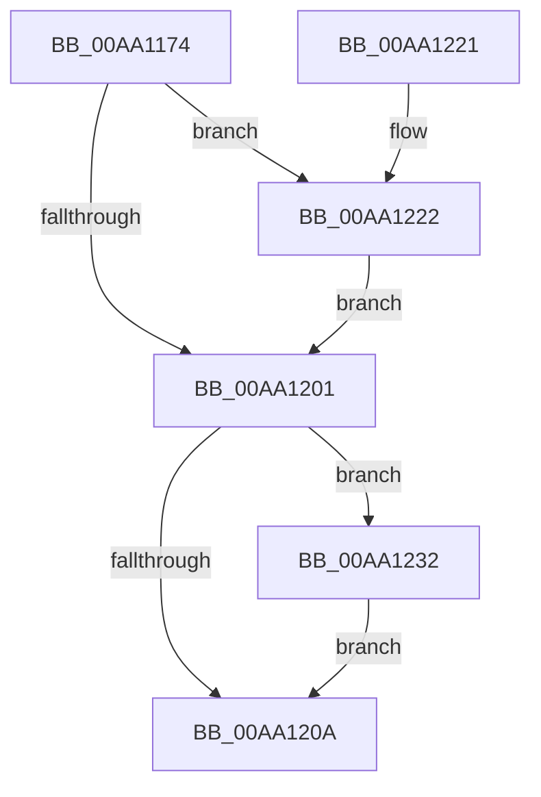

# BiGetDriveLayoutInformation

- RVA: `0x00AA1174`–`0x00AA1239` (길이 `197` bytes)
- VA: `0x0000000140AA1174`
- 실행 섹션: `PAGE`
- PDB 이름 있음: `예`; PDB Function 태그: `아니요`
- unwind 정보 RVA: `0x000BAC28`
- 디코드: `52`개 명령, `197/197` bytes 표시
- 미해석 바이트: `0` (있으면 어셈블리에 `.byte`로 보존)

> 이 문서는 커널 이미지의 기계어와 PDB 기호를 분석해 생성했습니다. 4번과 5번은 함수 원형과 자료형을 바이너리 사용 방식에서 추정한 C 해석이며 원본 소스 복구 결과는 아닙니다.

## 1. Dependencies

- 직접 호출 지점: **4**; 고유 호출 대상: **4**
- 직접 호출자로 확인된 함수: **2**
- RIP 상대 이미지 참조: **0**

### Outgoing calls
- `0x00AA11A9` → [RtlInitUnicodeString](../../text/42/RtlInitUnicodeString_function_0042A780.md) (function, `0x0042A780`)
- `0x00AA11F6` → [ZwOpenFile](../../text/6A/ZwOpenFile_function_006AD730.md) (function, `0x006AD730`)
- `0x00AA1229` → [BiIssueGetDriveLayoutIoctl](BiIssueGetDriveLayoutIoctl_function_00AA1240.md) (function, `0x00AA1240`)
- `0x00AA1232` → [ZwClose](../../text/6A/ZwClose_function_006AD2B0.md) (function, `0x006AD2B0`)

### Direct callers
- [BiCreatePartitionDevice](../82/BiCreatePartitionDevice_function_00824D10.md) at `0x00824DDA`
- [BiCreatePartitionDevice](../82/BiCreatePartitionDevice_function_00824D10.md) at `0x00824E07`
- [BiGetDriveLayoutBlock](../82/BiGetDriveLayoutBlock_function_0082538C.md) at `0x008253C4`
- [BiGetDriveLayoutBlock](../82/BiGetDriveLayoutBlock_function_0082538C.md) at `0x008253EA`

### Static image references
- 디코드된 RIP-relative 메모리 참조가 없습니다.

## 2. Other-region calls and transfers

- 다른 실행 섹션으로 향하는 call: **3**
  - `0x00AA11A9` → [RtlInitUnicodeString](../../text/42/RtlInitUnicodeString_function_0042A780.md) (`PAGE` → `.text`)
  - `0x00AA11F6` → [ZwOpenFile](../../text/6A/ZwOpenFile_function_006AD730.md) (`PAGE` → `.text`)
  - `0x00AA1232` → [ZwClose](../../text/6A/ZwClose_function_006AD2B0.md) (`PAGE` → `.text`)
- 별도 외부 분기/꼬리 이동을 확인하지 못했습니다.

## 3. Assembly (complete function range)

```asm
00AA1174  48 89 5C 24 08                  mov qword ptr [rsp + 8], rbx
00AA1179  48 89 7C 24 10                  mov qword ptr [rsp + 0x10], rdi
00AA117E  55                              push rbp
00AA117F  48 8B EC                        mov rbp, rsp
00AA1182  48 81 EC 80 00 00 00            sub rsp, 0x80
00AA1189  33 C0                           xor eax, eax
00AA118B  48 8B FA                        mov rdi, rdx
00AA118E  21 45 EC                        and dword ptr [rbp - 0x14], eax
00AA1191  48 8B D1                        mov rdx, rcx
00AA1194  48 21 45 20                     and qword ptr [rbp + 0x20], rax
00AA1198  48 8D 4D B0                     lea rcx, [rbp - 0x50]
00AA119C  0F 57 C0                        xorps xmm0, xmm0
00AA119F  89 45 D4                        mov dword ptr [rbp - 0x2c], eax
00AA11A2  21 45 D4                        and dword ptr [rbp - 0x2c], eax
00AA11A5  0F 11 45 B0                     movups xmmword ptr [rbp - 0x50], xmm0
00AA11A9  E8 D2 95 98 FF                  call 0x14042a780
00AA11AE  48 83 65 D8 00                  and qword ptr [rbp - 0x28], 0
00AA11B3  48 8D 45 B0                     lea rax, [rbp - 0x50]
00AA11B7  0F 57 C0                        xorps xmm0, xmm0
00AA11BA  C7 44 24 28 20 00 00 00         mov dword ptr [rsp + 0x28], 0x20
00AA11C2  4C 8D 4D C0                     lea r9, [rbp - 0x40]
00AA11C6  48 89 45 E0                     mov qword ptr [rbp - 0x20], rax
00AA11CA  4C 8D 45 D0                     lea r8, [rbp - 0x30]
00AA11CE  C7 45 D0 30 00 00 00            mov dword ptr [rbp - 0x30], 0x30
00AA11D5  BA 00 00 10 80                  mov edx, 0x80100000
00AA11DA  C7 45 E8 40 02 00 00            mov dword ptr [rbp - 0x18], 0x240
00AA11E1  48 8D 4D 20                     lea rcx, [rbp + 0x20]
00AA11E5  C7 44 24 20 03 00 00 00         mov dword ptr [rsp + 0x20], 3
00AA11ED  F3 0F 7F 45 F0                  movdqu xmmword ptr [rbp - 0x10], xmm0
00AA11F2  0F 11 45 C0                     movups xmmword ptr [rbp - 0x40], xmm0
00AA11F6  E8 35 C5 C0 FF                  call 0x1406ad730
00AA11FB  8B D8                           mov ebx, eax
00AA11FD  85 C0                           test eax, eax
00AA11FF  79 21                           jns 0x140aa1222
00AA1201  48 8B 4D 20                     mov rcx, qword ptr [rbp + 0x20]
00AA1205  48 85 C9                        test rcx, rcx
00AA1208  75 28                           jne 0x140aa1232
00AA120A  4C 8D 9C 24 80 00 00 00         lea r11, [rsp + 0x80]
00AA1212  8B C3                           mov eax, ebx
00AA1214  49 8B 5B 10                     mov rbx, qword ptr [r11 + 0x10]
00AA1218  49 8B 7B 18                     mov rdi, qword ptr [r11 + 0x18]
00AA121C  49 8B E3                        mov rsp, r11
00AA121F  5D                              pop rbp
00AA1220  C3                              ret
00AA1221  CC                              int3
00AA1222  48 8B 4D 20                     mov rcx, qword ptr [rbp + 0x20]
00AA1226  48 8B D7                        mov rdx, rdi
00AA1229  E8 12 00 00 00                  call 0x140aa1240
00AA122E  8B D8                           mov ebx, eax
00AA1230  EB CF                           jmp 0x140aa1201
00AA1232  E8 79 C0 C0 FF                  call 0x1406ad2b0
00AA1237  EB D1                           jmp 0x140aa120a
```

## 4. C-style interpretation (structured pseudocode)

```c
__int64 __fastcall BiGetDriveLayoutInformation(__int64 a1, __int64 a2)
{
    __int64 result;
    __int64 v_rsp;
    unsigned __int64 v_stack_m18;
    unsigned int v_stack_m1C;
    unsigned int v_stack_m20;
    unsigned __int64 v_stack_m28;
    unsigned __int64 v_stack_m30;
    unsigned int v_stack_m34;
    unsigned __int64 v_stack_m38;
    unsigned __int64 v_stack_m48;
    unsigned __int64 v_stack_m58;
    unsigned int v_stack_m60;
    unsigned int v_stack_m68;
    unsigned __int64 v_stack_m8;
    unsigned __int64 v_stack_p10;
    unsigned __int64 v_stack_p18;
    unsigned __int64 v_stack_p8;

    v_stack_p8 = v_rbx;
    v_stack_p10 = v_rdi;
    v_rsp = (v_rsp) - (128);
    result = 0;
    v_stack_m34 = 0;
    v_stack_m58 = v_xmm0;
    result = RtlInitUnicodeString(v_stack_m58, a1, a3, a4);
    v_stack_m60 = 32;
    v_stack_m28 = v_stack_m58;
    v_stack_m38 = 48;
    v_stack_m20 = 576;
    v_stack_m68 = 3;
    v_stack_m18 = v_xmm0;
    v_stack_m48 = v_xmm0;
    result = ZwOpenFile(v_stack_p18, (unsigned int)(0x80100000ULL), v_stack_m38, v_stack_m48);
    if (!sign_flag) goto loc_00AA1222;
loc_00AA1201:
    if (v_stack_p18 != 0) goto loc_00AA1232;
loc_00AA120A:
    return (unsigned int)((unsigned int)((unsigned int)((unsigned int)(result))));
loc_00AA1222:
    result = BiIssueGetDriveLayoutIoctl(v_stack_p18, *(unsigned __int64 *)(v_stack_m8 + 24), v_stack_m38, v_stack_m48);
    goto loc_00AA1201;
loc_00AA1232:
    result = ZwClose(v_stack_p18, *(unsigned __int64 *)(v_stack_m8 + 24), v_stack_m38, v_stack_m48);
    goto loc_00AA120A;
}
```

## 5. (Beta) C Style

```c
int64_t BiGetDriveLayoutInformation(int64_t Arg1, int64_t Arg2)
{
    int64_t result;
    int64_t local_rsp;
    uint64_t v_stack_m18;
    uint32_t v_stack_m1C;
    uint32_t v_stack_m20;
    uint64_t v_stack_m28;
    uint64_t v_stack_m30;
    uint32_t v_stack_m34;
    uint64_t v_stack_m38;
    uint64_t v_stack_m48;
    uint64_t v_stack_m58;
    uint32_t v_stack_m60;
    uint32_t v_stack_m68;
    uint64_t v_stack_m8;
    uint64_t v_stack_p10;
    uint64_t v_stack_p18;
    uint64_t v_stack_p8;

    v_stack_p8 = local_rbx;
    v_stack_p10 = local_rdi;
    local_rsp = (local_rsp) - (128);
    result = 0;
    v_stack_m34 = 0;
    v_stack_m58 = v_xmm0;
    result = RtlInitUnicodeString(v_stack_m58, Arg1, a3, a4);
    v_stack_m60 = 32;
    v_stack_m28 = v_stack_m58;
    v_stack_m38 = 48;
    v_stack_m20 = 576;
    v_stack_m68 = 3;
    v_stack_m18 = v_xmm0;
    v_stack_m48 = v_xmm0;
    result = ZwOpenFile(v_stack_p18, (uint32_t)(0x80100000ULL), v_stack_m38, v_stack_m48);
    if (!sign_flag) goto loc_00AA1222;
loc_00AA1201:
    if (v_stack_p18 != 0) goto loc_00AA1232;
loc_00AA120A:
    return (uint32_t)((uint32_t)((uint32_t)((uint32_t)(result))));
loc_00AA1222:
    result = BiIssueGetDriveLayoutIoctl(v_stack_p18, *(uint64_t *)(v_stack_m8 + 0x18), v_stack_m38, v_stack_m48);
    goto loc_00AA1201;
loc_00AA1232:
    result = ZwClose(v_stack_p18, *(uint64_t *)(v_stack_m8 + 0x18), v_stack_m38, v_stack_m48);
    goto loc_00AA120A;
}
```

## 6. Execution-region graph

[열기: 2D/3D 그래프와 함수 탐색 컨트롤 패널](../../../control-panel.html?section=page&rva=0x00AA1174&view=graph)

- 2D 그래프는 위에서 아래로 흐르고, 3D 그래프는 빈 공간을 드래그해 회전합니다. Shift+드래그는 이동, 휠은 확대·축소, 함수 노드 선택은 대상 보고서 이동입니다.

### Static fallback


