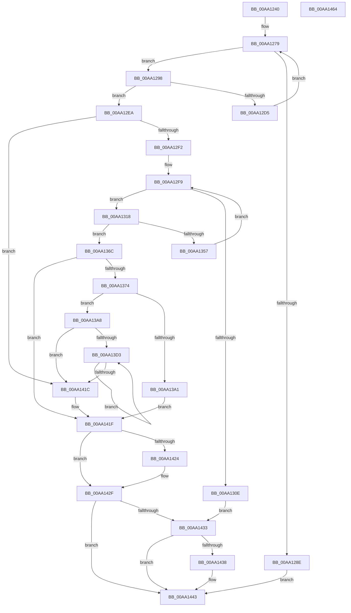

# BiIssueGetDriveLayoutIoctl

- RVA: `0x00AA1240`–`0x00AA1465` (길이 `549` bytes)
- VA: `0x0000000140AA1240`
- 실행 섹션: `PAGE`
- PDB 이름 있음: `예`; PDB Function 태그: `아니요`
- unwind 정보 RVA: `0x000BAC3C`
- 디코드: `158`개 명령, `549/549` bytes 표시
- 미해석 바이트: `0` (있으면 어셈블리에 `.byte`로 보존)

> 이 문서는 커널 이미지의 기계어와 PDB 기호를 분석해 생성했습니다. 4번과 5번은 함수 원형과 자료형을 바이너리 사용 방식에서 추정한 C 해석이며 원본 소스 복구 결과는 아닙니다.

## 1. Dependencies

- 직접 호출 지점: **11**; 고유 호출 대상: **4**
- 직접 호출자로 확인된 함수: **1**
- RIP 상대 이미지 참조: **0**

### Outgoing calls
- `0x00AA1281` → [ExAllocatePool2](../../poolcode/B8/ExAllocatePool2_function_00B820F0.md) (function, `0x00B820F0`)
- `0x00AA12C7` → [ZwDeviceIoControlFile](../../text/6A/ZwDeviceIoControlFile_function_006AD1B0.md) (function, `0x006AD1B0`)
- `0x00AA12DB` → [ExFreePoolWithTag](../../poolcode/B8/ExFreePoolWithTag_function_00B82870.md) (function, `0x00B82870`)
- `0x00AA1301` → [ExAllocatePool2](../../poolcode/B8/ExAllocatePool2_function_00B820F0.md) (function, `0x00B820F0`)
- `0x00AA1349` → [ZwDeviceIoControlFile](../../text/6A/ZwDeviceIoControlFile_function_006AD1B0.md) (function, `0x006AD1B0`)
- `0x00AA135D` → [ExFreePoolWithTag](../../poolcode/B8/ExFreePoolWithTag_function_00B82870.md) (function, `0x00B82870`)
- `0x00AA137A` → [ExFreePoolWithTag](../../poolcode/B8/ExFreePoolWithTag_function_00B82870.md) (function, `0x00B82870`)
- `0x00AA1394` → [ExAllocatePool2](../../poolcode/B8/ExAllocatePool2_function_00B820F0.md) (function, `0x00B820F0`)
- `0x00AA13B0` → [memset](../../text/6C/memset_function_006C6C40.md) (function, `0x006C6C40`)
- `0x00AA142A` → [ExFreePoolWithTag](../../poolcode/B8/ExFreePoolWithTag_function_00B82870.md) (function, `0x00B82870`)
- `0x00AA143E` → [ExFreePoolWithTag](../../poolcode/B8/ExFreePoolWithTag_function_00B82870.md) (function, `0x00B82870`)

### Direct callers
- [BiGetDriveLayoutInformation](BiGetDriveLayoutInformation_function_00AA1174.md) at `0x00AA1229`

### Static image references
- 디코드된 RIP-relative 메모리 참조가 없습니다.

## 2. Other-region calls and transfers

- 다른 실행 섹션으로 향하는 call: **11**
  - `0x00AA1281` → [ExAllocatePool2](../../poolcode/B8/ExAllocatePool2_function_00B820F0.md) (`PAGE` → `POOLCODE`)
  - `0x00AA12C7` → [ZwDeviceIoControlFile](../../text/6A/ZwDeviceIoControlFile_function_006AD1B0.md) (`PAGE` → `.text`)
  - `0x00AA12DB` → [ExFreePoolWithTag](../../poolcode/B8/ExFreePoolWithTag_function_00B82870.md) (`PAGE` → `POOLCODE`)
  - `0x00AA1301` → [ExAllocatePool2](../../poolcode/B8/ExAllocatePool2_function_00B820F0.md) (`PAGE` → `POOLCODE`)
  - `0x00AA1349` → [ZwDeviceIoControlFile](../../text/6A/ZwDeviceIoControlFile_function_006AD1B0.md) (`PAGE` → `.text`)
  - `0x00AA135D` → [ExFreePoolWithTag](../../poolcode/B8/ExFreePoolWithTag_function_00B82870.md) (`PAGE` → `POOLCODE`)
  - `0x00AA137A` → [ExFreePoolWithTag](../../poolcode/B8/ExFreePoolWithTag_function_00B82870.md) (`PAGE` → `POOLCODE`)
  - `0x00AA1394` → [ExAllocatePool2](../../poolcode/B8/ExAllocatePool2_function_00B820F0.md) (`PAGE` → `POOLCODE`)
  - `0x00AA13B0` → [memset](../../text/6C/memset_function_006C6C40.md) (`PAGE` → `.text`)
  - `0x00AA142A` → [ExFreePoolWithTag](../../poolcode/B8/ExFreePoolWithTag_function_00B82870.md) (`PAGE` → `POOLCODE`)
  - `0x00AA143E` → [ExFreePoolWithTag](../../poolcode/B8/ExFreePoolWithTag_function_00B82870.md) (`PAGE` → `POOLCODE`)
- 별도 외부 분기/꼬리 이동을 확인하지 못했습니다.

## 3. Assembly (complete function range)

```asm
00AA1240  48 8B C4                        mov rax, rsp
00AA1243  48 89 58 08                     mov qword ptr [rax + 8], rbx
00AA1247  48 89 68 10                     mov qword ptr [rax + 0x10], rbp
00AA124B  48 89 70 18                     mov qword ptr [rax + 0x18], rsi
00AA124F  48 89 78 20                     mov qword ptr [rax + 0x20], rdi
00AA1253  41 55                           push r13
00AA1255  41 56                           push r14
00AA1257  41 57                           push r15
00AA1259  48 83 EC 60                     sub rsp, 0x60
00AA125D  0F 57 C0                        xorps xmm0, xmm0
00AA1260  BD 30 48 00 00                  mov ebp, 0x4830
00AA1265  4C 8B FA                        mov r15, rdx
00AA1268  4C 8B F1                        mov r14, rcx
00AA126B  0F 11 40 D8                     movups xmmword ptr [rax - 0x28], xmm0
00AA126F  8B D5                           mov edx, ebp
00AA1271  33 F6                           xor esi, esi
00AA1273  41 BD 42 43 44 4B               mov r13d, 0x4b444342
00AA1279  45 8B C5                        mov r8d, r13d
00AA127C  B9 02 01 00 00                  mov ecx, 0x102
00AA1281  E8 6A 0E 0E 00                  call 0x140b820f0
00AA1286  48 8B F8                        mov rdi, rax
00AA1289  48 85 C0                        test rax, rax
00AA128C  75 0A                           jne 0x140aa1298
00AA128E  BB 9A 00 00 C0                  mov ebx, 0xc000009a
00AA1293  E9 AB 01 00 00                  jmp 0x140aa1443
00AA1298  89 6C 24 48                     mov dword ptr [rsp + 0x48], ebp
00AA129C  48 8D 44 24 50                  lea rax, [rsp + 0x50]
00AA12A1  48 89 7C 24 40                  mov qword ptr [rsp + 0x40], rdi
00AA12A6  45 33 C9                        xor r9d, r9d
00AA12A9  21 74 24 38                     and dword ptr [rsp + 0x38], esi
00AA12AD  45 33 C0                        xor r8d, r8d
00AA12B0  48 21 74 24 30                  and qword ptr [rsp + 0x30], rsi
00AA12B5  33 D2                           xor edx, edx
00AA12B7  C7 44 24 28 50 00 07 00         mov dword ptr [rsp + 0x28], 0x70050
00AA12BF  49 8B CE                        mov rcx, r14
00AA12C2  48 89 44 24 20                  mov qword ptr [rsp + 0x20], rax
00AA12C7  E8 E4 BE C0 FF                  call 0x1406ad1b0
00AA12CC  8B D8                           mov ebx, eax
00AA12CE  3D 23 00 00 C0                  cmp eax, 0xc0000023
00AA12D3  75 15                           jne 0x140aa12ea
00AA12D5  41 8B D5                        mov edx, r13d
00AA12D8  48 8B CF                        mov rcx, rdi
00AA12DB  E8 90 15 0E 00                  call 0x140b82870
00AA12E0  81 C5 00 24 00 00               add ebp, 0x2400
00AA12E6  8B D5                           mov edx, ebp
00AA12E8  EB 8F                           jmp 0x140aa1279
00AA12EA  85 C0                           test eax, eax
00AA12EC  0F 89 2A 01 00 00               jns 0x140aa141c
00AA12F2  BD 08 08 00 00                  mov ebp, 0x808
00AA12F7  8B D5                           mov edx, ebp
00AA12F9  45 8B C5                        mov r8d, r13d
00AA12FC  B9 02 01 00 00                  mov ecx, 0x102
00AA1301  E8 EA 0D 0E 00                  call 0x140b820f0
00AA1306  48 8B F0                        mov rsi, rax
00AA1309  48 85 C0                        test rax, rax
00AA130C  75 0A                           jne 0x140aa1318
00AA130E  BB 9A 00 00 C0                  mov ebx, 0xc000009a
00AA1313  E9 1B 01 00 00                  jmp 0x140aa1433
00AA1318  89 6C 24 48                     mov dword ptr [rsp + 0x48], ebp
00AA131C  48 8D 44 24 50                  lea rax, [rsp + 0x50]
00AA1321  48 89 74 24 40                  mov qword ptr [rsp + 0x40], rsi
00AA1326  45 33 C9                        xor r9d, r9d
00AA1329  83 64 24 38 00                  and dword ptr [rsp + 0x38], 0
00AA132E  45 33 C0                        xor r8d, r8d
00AA1331  48 83 64 24 30 00               and qword ptr [rsp + 0x30], 0
00AA1337  33 D2                           xor edx, edx
00AA1339  C7 44 24 28 0C 40 07 00         mov dword ptr [rsp + 0x28], 0x7400c
00AA1341  49 8B CE                        mov rcx, r14
00AA1344  48 89 44 24 20                  mov qword ptr [rsp + 0x20], rax
00AA1349  E8 62 BE C0 FF                  call 0x1406ad1b0
00AA134E  8B D8                           mov ebx, eax
00AA1350  3D 23 00 00 C0                  cmp eax, 0xc0000023
00AA1355  75 15                           jne 0x140aa136c
00AA1357  41 8B D5                        mov edx, r13d
00AA135A  48 8B CE                        mov rcx, rsi
00AA135D  E8 0E 15 0E 00                  call 0x140b82870
00AA1362  81 C5 00 08 00 00               add ebp, 0x800
00AA1368  8B D5                           mov edx, ebp
00AA136A  EB 8D                           jmp 0x140aa12f9
00AA136C  85 C0                           test eax, eax
00AA136E  0F 88 AB 00 00 00               js 0x140aa141f
00AA1374  41 8B D5                        mov edx, r13d
00AA1377  48 8B CF                        mov rcx, rdi
00AA137A  E8 F1 14 0E 00                  call 0x140b82870
00AA137F  8B 06                           mov eax, dword ptr [rsi]
00AA1381  45 8B C5                        mov r8d, r13d
00AA1384  B9 02 01 00 00                  mov ecx, 0x102
00AA1389  8D 14 C0                        lea edx, [rax + rax*8]
00AA138C  C1 E2 04                        shl edx, 4
00AA138F  83 C2 30                        add edx, 0x30
00AA1392  8B EA                           mov ebp, edx
00AA1394  E8 57 0D 0E 00                  call 0x140b820f0
00AA1399  48 8B F8                        mov rdi, rax
00AA139C  48 85 C0                        test rax, rax
00AA139F  75 07                           jne 0x140aa13a8
00AA13A1  BB 9A 00 00 C0                  mov ebx, 0xc000009a
00AA13A6  EB 77                           jmp 0x140aa141f
00AA13A8  4C 8B C5                        mov r8, rbp
00AA13AB  33 D2                           xor edx, edx
00AA13AD  48 8B CF                        mov rcx, rdi
00AA13B0  E8 8B 58 C2 FF                  call 0x1406c6c40
00AA13B5  83 27 00                        and dword ptr [rdi], 0
00AA13B8  48 8D 56 08                     lea rdx, [rsi + 8]
00AA13BC  8B 06                           mov eax, dword ptr [rsi]
00AA13BE  48 8D 4F 30                     lea rcx, [rdi + 0x30]
00AA13C2  89 47 04                        mov dword ptr [rdi + 4], eax
00AA13C5  45 33 C0                        xor r8d, r8d
00AA13C8  8B 46 04                        mov eax, dword ptr [rsi + 4]
00AA13CB  89 47 08                        mov dword ptr [rdi + 8], eax
00AA13CE  44 39 06                        cmp dword ptr [rsi], r8d
00AA13D1  76 49                           jbe 0x140aa141c
00AA13D3  83 21 00                        and dword ptr [rcx], 0
00AA13D6  41 FF C0                        inc r8d
00AA13D9  48 8B 02                        mov rax, qword ptr [rdx]
00AA13DC  48 8D 52 20                     lea rdx, [rdx + 0x20]
00AA13E0  48 89 41 08                     mov qword ptr [rcx + 8], rax
00AA13E4  48 8D 89 90 00 00 00            lea rcx, [rcx + 0x90]
00AA13EB  48 8B 42 E8                     mov rax, qword ptr [rdx - 0x18]
00AA13EF  48 89 41 80                     mov qword ptr [rcx - 0x80], rax
00AA13F3  8B 42 F4                        mov eax, dword ptr [rdx - 0xc]
00AA13F6  89 41 88                        mov dword ptr [rcx - 0x78], eax
00AA13F9  8A 42 FB                        mov al, byte ptr [rdx - 5]
00AA13FC  88 41 8C                        mov byte ptr [rcx - 0x74], al
00AA13FF  8A 42 F8                        mov al, byte ptr [rdx - 8]
00AA1402  88 41 90                        mov byte ptr [rcx - 0x70], al
00AA1405  8A 42 F9                        mov al, byte ptr [rdx - 7]
00AA1408  88 41 91                        mov byte ptr [rcx - 0x6f], al
00AA140B  8A 42 FA                        mov al, byte ptr [rdx - 6]
00AA140E  88 41 92                        mov byte ptr [rcx - 0x6e], al
00AA1411  8B 42 F0                        mov eax, dword ptr [rdx - 0x10]
00AA1414  89 41 94                        mov dword ptr [rcx - 0x6c], eax
00AA1417  44 3B 06                        cmp r8d, dword ptr [rsi]
00AA141A  72 B7                           jb 0x140aa13d3
00AA141C  49 89 3F                        mov qword ptr [r15], rdi
00AA141F  48 85 F6                        test rsi, rsi
00AA1422  74 0B                           je 0x140aa142f
00AA1424  41 8B D5                        mov edx, r13d
00AA1427  48 8B CE                        mov rcx, rsi
00AA142A  E8 41 14 0E 00                  call 0x140b82870
00AA142F  85 DB                           test ebx, ebx
00AA1431  79 10                           jns 0x140aa1443
00AA1433  48 85 FF                        test rdi, rdi
00AA1436  74 0B                           je 0x140aa1443
00AA1438  41 8B D5                        mov edx, r13d
00AA143B  48 8B CF                        mov rcx, rdi
00AA143E  E8 2D 14 0E 00                  call 0x140b82870
00AA1443  4C 8D 5C 24 60                  lea r11, [rsp + 0x60]
00AA1448  8B C3                           mov eax, ebx
00AA144A  49 8B 5B 20                     mov rbx, qword ptr [r11 + 0x20]
00AA144E  49 8B 6B 28                     mov rbp, qword ptr [r11 + 0x28]
00AA1452  49 8B 73 30                     mov rsi, qword ptr [r11 + 0x30]
00AA1456  49 8B 7B 38                     mov rdi, qword ptr [r11 + 0x38]
00AA145A  49 8B E3                        mov rsp, r11
00AA145D  41 5F                           pop r15
00AA145F  41 5E                           pop r14
00AA1461  41 5D                           pop r13
00AA1463  C3                              ret
00AA1464  CC                              int3
```

## 4. C-style interpretation (structured pseudocode)

```c
__int64 __fastcall BiIssueGetDriveLayoutIoctl(__int64 a1, __int64 a2, __int64 a3, int a4)
{
    __int64 result;
    __int64 v_rbp;
    __int64 v_rsi;
    __int64 v_rsp;
    unsigned __int64 v_stack_m18;
    unsigned __int64 v_stack_m28;
    unsigned int v_stack_m30;
    unsigned __int64 v_stack_m38;
    unsigned int v_stack_m40;
    unsigned __int64 v_stack_m48;
    unsigned int v_stack_m50;
    unsigned __int64 v_stack_m58;

    *(unsigned __int64 *)(v_rsp + 8) = v_rbx;
    *(unsigned __int64 *)(v_rsp + 16) = v_rbp;
    *(unsigned __int64 *)(v_rsp + 24) = v_rsi;
    *(unsigned __int64 *)(v_rsp + 32) = v_rdi;
    v_rsp = (v_rsp) - (96);
    *(unsigned __int64 *)(v_rsp - 40) = v_xmm0;
    v_rsi = 0;
loc_00AA1279:
    result = ExAllocatePool2(258, (unsigned int)((unsigned int)((unsigned int)(0x4830ULL))), (unsigned int)((unsigned int)((unsigned int)(0x4B444342ULL))), a4);
    if (result != 0) goto loc_00AA1298;
    goto loc_00AA1443;
loc_00AA1298:
    v_stack_m30 = (unsigned int)((unsigned int)(0x4830ULL));
    v_stack_m38 = result;
    a4 = 0;
    a3 = 0;
    a2 = 0;
    v_stack_m50 = 0x70050ULL;
    v_stack_m58 = v_stack_m28;
    result = ZwDeviceIoControlFile(a1, a2, a3, a4);
    if (((unsigned int)(result)) != 0xC0000023ULL) goto loc_00AA12EA;
    result = ExFreePoolWithTag(result, (unsigned int)((unsigned int)((unsigned int)(0x4B444342ULL))), a3, a4);
    v_rbp = (unsigned int)(((unsigned int)(0x4830ULL)) + (0x2400ULL));
    goto loc_00AA1279;
loc_00AA12EA:
    if (!sign_flag) goto loc_00AA141C;
loc_00AA12F9:
    result = ExAllocatePool2(258, (unsigned int)((unsigned int)((unsigned int)(0x808ULL))), (unsigned int)((unsigned int)((unsigned int)(0x4B444342ULL))), a4);
    if (result != 0) goto loc_00AA1318;
    goto loc_00AA1433;
loc_00AA1318:
    v_stack_m30 = (unsigned int)((unsigned int)(0x808ULL));
    v_stack_m38 = result;
    a4 = 0;
    a3 = 0;
    a2 = 0;
    v_stack_m50 = 0x7400CULL;
    v_stack_m58 = v_stack_m28;
    result = ZwDeviceIoControlFile(a1, a2, a3, a4);
    if (((unsigned int)(result)) != 0xC0000023ULL) goto loc_00AA136C;
    result = ExFreePoolWithTag(result, (unsigned int)((unsigned int)((unsigned int)(0x4B444342ULL))), a3, a4);
    v_rbp = (unsigned int)(((unsigned int)(0x808ULL)) + (0x800ULL));
    goto loc_00AA12F9;
loc_00AA136C:
    if (sign_flag) goto loc_00AA141F;
    result = ExFreePoolWithTag(result, (unsigned int)((unsigned int)((unsigned int)(0x4B444342ULL))), a3, a4);
    a2 = (unsigned int)(((unsigned int)(*(unsigned int *)(result)) + (unsigned int)(*(unsigned int *)(result)) * 8) << (4));
    a2 = (unsigned int)((a2) + (48));
    result = ExAllocatePool2(258, a2, (unsigned int)((unsigned int)((unsigned int)(0x4B444342ULL))), a4);
    if (result != 0) goto loc_00AA13A8;
    goto loc_00AA141F;
loc_00AA13A8:
    a2 = 0;
    result = memset(result, a2, (unsigned int)((unsigned int)(a2)), a4);
    *(unsigned int *)(result + 4) = (unsigned int)((unsigned int)(*(unsigned int *)(result)));
    a3 = 0;
    *(unsigned int *)(result + 8) = (unsigned int)((unsigned int)(*(unsigned int *)(result + 4)));
    if ((*(unsigned int *)(result)) <= 0) goto loc_00AA141C;
loc_00AA13D3:
    a3 = (unsigned int)((a3) + 1);
    *(unsigned __int64 *)(result + 48 + 8) = *(unsigned __int64 *)(result + 8);
    *(unsigned __int64 *)(result + 48 + 144 - 128) = *(unsigned __int64 *)(result + 8 + 32 - 24);
    *(unsigned int *)(result + 48 + 144 - 120) = (unsigned int)((unsigned int)(*(unsigned int *)(result + 8 + 32 - 12)));
    *(unsigned __int8 *)(result + 48 + 144 - 116) = (unsigned __int8)(*(unsigned __int8 *)(result + 8 + 32 - 5));
    *(unsigned __int8 *)(result + 48 + 144 - 112) = (unsigned __int8)(*(unsigned __int8 *)(result + 8 + 32 - 8));
    *(unsigned __int8 *)(result + 48 + 144 - 111) = (unsigned __int8)(*(unsigned __int8 *)(result + 8 + 32 - 7));
    *(unsigned __int8 *)(result + 48 + 144 - 110) = (unsigned __int8)(*(unsigned __int8 *)(result + 8 + 32 - 6));
    *(unsigned int *)(result + 48 + 144 - 108) = (unsigned int)((unsigned int)(*(unsigned int *)(result + 8 + 32 - 16)));
    if (((unsigned int)(a3)) < (*(unsigned int *)(result))) goto loc_00AA13D3;
loc_00AA141C:
    *(unsigned __int64 *)(a2) = result;
loc_00AA141F:
    result = (unsigned int)(*(unsigned int *)(result + 8 + 32 - 16));
    if (result != 0) {
        a2 = (unsigned int)((unsigned int)(0x4B444342ULL));
        a1 = result;
        result = ExFreePoolWithTag(a1, a2, a3, a4);
    }
    if (!sign_flag) goto loc_00AA1443;
loc_00AA1433:
    if (result != 0) {
        a2 = (unsigned int)((unsigned int)(0x4B444342ULL));
        a1 = result;
        result = ExFreePoolWithTag(a1, a2, a3, a4);
    }
    return (unsigned int)((unsigned int)((unsigned int)(0xC000009AULL)));
}
```

## 5. (Beta) C Style

```c
int64_t BiIssueGetDriveLayoutIoctl(int64_t Arg1, void *Arg2, int64_t Arg3, int32_t Arg4)
{
    uint8_t *arg2 = (uint8_t *)Arg2;

    int64_t result;
    int64_t local_rbp;
    int64_t local_rsi;
    int64_t local_rsp;
    uint64_t v_stack_m18;
    uint64_t v_stack_m28;
    uint32_t v_stack_m30;
    uint64_t v_stack_m38;
    uint32_t v_stack_m40;
    uint64_t v_stack_m48;
    uint32_t v_stack_m50;
    uint64_t v_stack_m58;

    *(uint64_t *)(local_rsp + 0x8) = local_rbx;
    *(uint64_t *)(local_rsp + 0x10) = local_rbp;
    *(uint64_t *)(local_rsp + 0x18) = local_rsi;
    *(uint64_t *)(local_rsp + 0x20) = local_rdi;
    local_rsp = (local_rsp) - (96);
    *(uint64_t *)(local_rsp - 0x28) = v_xmm0;
    local_rsi = 0;
loc_00AA1279:
    result = ExAllocatePool2(258, (uint32_t)((uint32_t)((uint32_t)(0x4830ULL))), (uint32_t)((uint32_t)((uint32_t)(0x4B444342ULL))), Arg4);
    if (result != 0) goto loc_00AA1298;
    goto loc_00AA1443;
loc_00AA1298:
    v_stack_m30 = (uint32_t)((uint32_t)(0x4830ULL));
    v_stack_m38 = result;
    Arg4 = 0;
    Arg3 = 0;
    Arg2 = 0;
    v_stack_m50 = 0x70050ULL;
    v_stack_m58 = v_stack_m28;
    result = ZwDeviceIoControlFile(Arg1, Arg2, Arg3, Arg4);
    if (((uint32_t)(result)) != 0xC0000023ULL) goto loc_00AA12EA;
    result = ExFreePoolWithTag(result, (uint32_t)((uint32_t)((uint32_t)(0x4B444342ULL))), Arg3, Arg4);
    local_rbp = (uint32_t)(((uint32_t)(0x4830ULL)) + (0x2400ULL));
    goto loc_00AA1279;
loc_00AA12EA:
    if (!sign_flag) goto loc_00AA141C;
loc_00AA12F9:
    result = ExAllocatePool2(258, (uint32_t)((uint32_t)((uint32_t)(0x808ULL))), (uint32_t)((uint32_t)((uint32_t)(0x4B444342ULL))), Arg4);
    if (result != 0) goto loc_00AA1318;
    goto loc_00AA1433;
loc_00AA1318:
    v_stack_m30 = (uint32_t)((uint32_t)(0x808ULL));
    v_stack_m38 = result;
    Arg4 = 0;
    Arg3 = 0;
    Arg2 = 0;
    v_stack_m50 = 0x7400CULL;
    v_stack_m58 = v_stack_m28;
    result = ZwDeviceIoControlFile(Arg1, Arg2, Arg3, Arg4);
    if (((uint32_t)(result)) != 0xC0000023ULL) goto loc_00AA136C;
    result = ExFreePoolWithTag(result, (uint32_t)((uint32_t)((uint32_t)(0x4B444342ULL))), Arg3, Arg4);
    local_rbp = (uint32_t)(((uint32_t)(0x808ULL)) + (0x800ULL));
    goto loc_00AA12F9;
loc_00AA136C:
    if (sign_flag) goto loc_00AA141F;
    result = ExFreePoolWithTag(result, (uint32_t)((uint32_t)((uint32_t)(0x4B444342ULL))), Arg3, Arg4);
    Arg2 = (uint32_t)(((uint32_t)(*(uint32_t *)(result)) + (uint32_t)(*(uint32_t *)(result)) * 8) << (4));
    Arg2 = (uint32_t)((Arg2) + (48));
    result = ExAllocatePool2(258, Arg2, (uint32_t)((uint32_t)((uint32_t)(0x4B444342ULL))), Arg4);
    if (result != 0) goto loc_00AA13A8;
    goto loc_00AA141F;
loc_00AA13A8:
    Arg2 = 0;
    result = memset(result, Arg2, (uint32_t)((uint32_t)(Arg2)), Arg4);
    *(uint32_t *)(result + 0x4) = (uint32_t)((uint32_t)(*(uint32_t *)(result)));
    Arg3 = 0;
    *(uint32_t *)(result + 0x8) = (uint32_t)((uint32_t)(*(uint32_t *)(result + 0x4)));
    if ((*(uint32_t *)(result)) <= 0) goto loc_00AA141C;
loc_00AA13D3:
    Arg3 = (uint32_t)((Arg3) + 1);
    *(uint64_t *)(result + 0x30 + 0x8) = *(uint64_t *)(result + 0x8);
    *(uint64_t *)(result + 0x30 + 0x90 - 0x80) = *(uint64_t *)(result + 0x8 + 0x20 - 0x18);
    *(uint32_t *)(result + 0x30 + 0x90 - 0x78) = (uint32_t)((uint32_t)(*(uint32_t *)(result + 0x8 + 0x20 - 0xC)));
    *(uint8_t *)(result + 0x30 + 0x90 - 0x74) = (uint8_t)(*(uint8_t *)(result + 0x8 + 0x20 - 0x5));
    *(uint8_t *)(result + 0x30 + 0x90 - 0x70) = (uint8_t)(*(uint8_t *)(result + 0x8 + 0x20 - 0x8));
    *(uint8_t *)(result + 0x30 + 0x90 - 0x6F) = (uint8_t)(*(uint8_t *)(result + 0x8 + 0x20 - 0x7));
    *(uint8_t *)(result + 0x30 + 0x90 - 0x6E) = (uint8_t)(*(uint8_t *)(result + 0x8 + 0x20 - 0x6));
    *(uint32_t *)(result + 0x30 + 0x90 - 0x6C) = (uint32_t)((uint32_t)(*(uint32_t *)(result + 0x8 + 0x20 - 0x10)));
    if (((uint32_t)(Arg3)) < (*(uint32_t *)(result))) goto loc_00AA13D3;
loc_00AA141C:
    *(uint64_t *)(arg2) = result;
loc_00AA141F:
    result = (uint32_t)(*(uint32_t *)(result + 0x8 + 0x20 - 0x10));
    if (result != 0) {
        Arg2 = (uint32_t)((uint32_t)(0x4B444342ULL));
        Arg1 = result;
        result = ExFreePoolWithTag(Arg1, Arg2, Arg3, Arg4);
    }
    if (!sign_flag) goto loc_00AA1443;
loc_00AA1433:
    if (result != 0) {
        Arg2 = (uint32_t)((uint32_t)(0x4B444342ULL));
        Arg1 = result;
        result = ExFreePoolWithTag(Arg1, Arg2, Arg3, Arg4);
    }
    return (uint32_t)((uint32_t)((uint32_t)(0xC000009AULL)));
}
```

### 관측된 메모리 오프셋

구조체 형식이 확인되지 않은 접근은 인자 기준의 오프셋으로만 기록했습니다.

| 기준 인자 | 오프셋 표현 | 폭 (bit) | 접근 |
|---|---:|---:|---|
| `Arg2` | `+ 0x0` | `64` | `W` |

## 6. Execution-region graph

[열기: 2D/3D 그래프와 함수 탐색 컨트롤 패널](../../../control-panel.html?section=page&rva=0x00AA1240&view=graph)

- 2D 그래프는 위에서 아래로 흐르고, 3D 그래프는 빈 공간을 드래그해 회전합니다. Shift+드래그는 이동, 휠은 확대·축소, 함수 노드 선택은 대상 보고서 이동입니다.

### Static fallback


