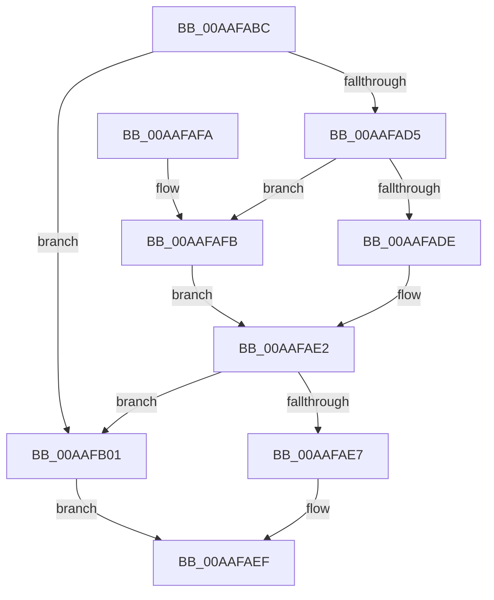

# CcGetDeviceGuid

- RVA: `0x00AAFABC`–`0x00AAFB08` (길이 `76` bytes)
- VA: `0x0000000140AAFABC`
- 실행 섹션: `PAGE`
- PDB 이름 있음: `예`; PDB Function 태그: `아니요`
- unwind 정보 RVA: `0x00076818`
- 디코드: `25`개 명령, `76/76` bytes 표시
- 미해석 바이트: `0` (있으면 어셈블리에 `.byte`로 보존)

> 이 문서는 커널 이미지의 기계어와 PDB 기호를 분석해 생성했습니다. 4번과 5번은 함수 원형과 자료형을 바이너리 사용 방식에서 추정한 C 해석이며 원본 소스 복구 결과는 아닙니다.

## 1. Dependencies

- 직접 호출 지점: **2**; 고유 호출 대상: **2**
- 직접 호출자로 확인된 함수: **2**
- RIP 상대 이미지 참조: **0**

### Outgoing calls
- `0x00AAFACC` → [KeAreAllApcsDisabled](../../text/2F/KeAreAllApcsDisabled_function_002F7AC0.md) (function, `0x002F7AC0`)
- `0x00AAFAEA` → [IoVolumeDeviceToGuid](../95/IoVolumeDeviceToGuid_function_00952A90.md) (function, `0x00952A90`)

### Direct callers
- [CcGetDeviceGuidAsync](../../text/57/CcGetDeviceGuidAsync_function_0057ED70.md) at `0x0057EDA2`
- [sub_006E5110](../../text/6E/Unknown_function_006E5110.md) at `0x006E5182`

### Static image references
- 디코드된 RIP-relative 메모리 참조가 없습니다.

## 2. Other-region calls and transfers

- 다른 실행 섹션으로 향하는 call: **1**
  - `0x00AAFACC` → [KeAreAllApcsDisabled](../../text/2F/KeAreAllApcsDisabled_function_002F7AC0.md) (`PAGE` → `.text`)
- 별도 외부 분기/꼬리 이동을 확인하지 못했습니다.

## 3. Assembly (complete function range)

```asm
00AAFABC  48 89 5C 24 08                  mov qword ptr [rsp + 8], rbx
00AAFAC1  57                              push rdi
00AAFAC2  48 83 EC 20                     sub rsp, 0x20
00AAFAC6  48 8B FA                        mov rdi, rdx
00AAFAC9  48 8B D9                        mov rbx, rcx
00AAFACC  E8 EF 7F 84 FF                  call 0x1402f7ac0
00AAFAD1  84 C0                           test al, al
00AAFAD3  75 2C                           jne 0x140aafb01
00AAFAD5  48 8B 4B 10                     mov rcx, qword ptr [rbx + 0x10]
00AAFAD9  48 85 C9                        test rcx, rcx
00AAFADC  74 1D                           je 0x140aafafb
00AAFADE  48 8B 49 10                     mov rcx, qword ptr [rcx + 0x10]
00AAFAE2  48 85 C9                        test rcx, rcx
00AAFAE5  74 1A                           je 0x140aafb01
00AAFAE7  48 8B D7                        mov rdx, rdi
00AAFAEA  E8 A1 2F EA FF                  call 0x140952a90
00AAFAEF  48 8B 5C 24 30                  mov rbx, qword ptr [rsp + 0x30]
00AAFAF4  48 83 C4 20                     add rsp, 0x20
00AAFAF8  5F                              pop rdi
00AAFAF9  C3                              ret
00AAFAFA  CC                              int3
00AAFAFB  48 8B 4B 08                     mov rcx, qword ptr [rbx + 8]
00AAFAFF  EB E1                           jmp 0x140aafae2
00AAFB01  B8 01 00 00 C0                  mov eax, 0xc0000001
00AAFB06  EB E7                           jmp 0x140aafaef
```

## 4. C-style interpretation (structured pseudocode)

```c
__int64 __fastcall CcGetDeviceGuid(__int64 a1, __int64 a2)
{
    __int64 result;
    __int64 v_rsp;
    unsigned __int64 v_stack_p8;

    v_stack_p8 = v_rbx;
    v_rsp = (v_rsp) - (32);
    result = KeAreAllApcsDisabled(a1, a2, a3, a4);
    if ((unsigned __int8)(result) != 0) goto loc_00AAFB01;
    if (*(unsigned __int64 *)(a1 + 16) == 0) goto loc_00AAFAFB;
loc_00AAFAE2:
    if (*(unsigned __int64 *)(*(unsigned __int64 *)(a1 + 16) + 16) == 0) goto loc_00AAFB01;
    result = IoVolumeDeviceToGuid(*(unsigned __int64 *)(*(unsigned __int64 *)(a1 + 16) + 16), a2, a3, a4);
loc_00AAFAEF:
    v_rsp = (v_rsp) + (32);
    return result;
loc_00AAFAFB:
    goto loc_00AAFAE2;
loc_00AAFB01:
    goto loc_00AAFAEF;
}
```

## 5. (Beta) C Style

```c
int64_t CcGetDeviceGuid(void *Arg1, int64_t Arg2)
{
    uint8_t *arg1 = (uint8_t *)Arg1;

    int64_t result;
    int64_t local_rsp;
    uint64_t v_stack_p8;

    v_stack_p8 = local_rbx;
    local_rsp = (local_rsp) - (32);
    result = KeAreAllApcsDisabled(Arg1, Arg2, a3, a4);
    if ((uint8_t)(result) != 0) goto loc_00AAFB01;
    if (*(uint64_t *)(arg1 + 0x10) == 0) goto loc_00AAFAFB;
loc_00AAFAE2:
    if (*(uint64_t *)(*(uint64_t *)(arg1 + 0x10) + 0x10) == 0) goto loc_00AAFB01;
    result = IoVolumeDeviceToGuid(*(uint64_t *)(*(uint64_t *)(arg1 + 0x10) + 0x10), Arg2, a3, a4);
loc_00AAFAEF:
    local_rsp = (local_rsp) + (32);
    return result;
loc_00AAFAFB:
    goto loc_00AAFAE2;
loc_00AAFB01:
    goto loc_00AAFAEF;
}
```

### 관측된 메모리 오프셋

구조체 형식이 확인되지 않은 접근은 인자 기준의 오프셋으로만 기록했습니다.

| 기준 인자 | 오프셋 표현 | 폭 (bit) | 접근 |
|---|---:|---:|---|
| `Arg1` | `+ 0x8` | `64` | `R` |
| `Arg1` | `+ 0x10` | `64` | `R` |

## 6. Execution-region graph

[열기: 2D/3D 그래프와 함수 탐색 컨트롤 패널](../../../control-panel.html?section=page&rva=0x00AAFABC&view=graph)

- 2D 그래프는 위에서 아래로 흐르고, 3D 그래프는 빈 공간을 드래그해 회전합니다. Shift+드래그는 이동, 휠은 확대·축소, 함수 노드 선택은 대상 보고서 이동입니다.

### Static fallback


