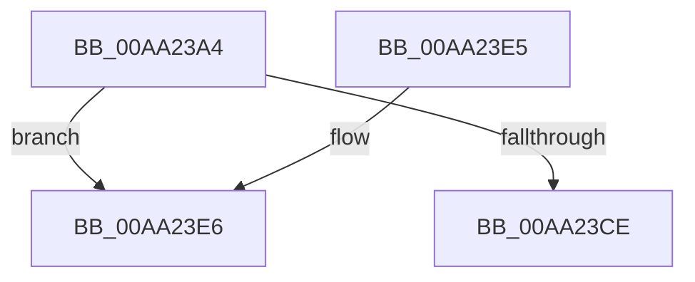

# CmGetKeyFlags

- RVA: `0x00AA23A4`–`0x00AA23F2` (길이 `78` bytes)
- VA: `0x0000000140AA23A4`
- 실행 섹션: `PAGE`
- PDB 이름 있음: `예`; PDB Function 태그: `예`
- unwind 정보 RVA: `0x000BB140`
- 디코드: `22`개 명령, `78/78` bytes 표시
- 미해석 바이트: `0` (있으면 어셈블리에 `.byte`로 보존)

> 이 문서는 커널 이미지의 기계어와 PDB 기호를 분석해 생성했습니다. 4번과 5번은 함수 원형과 자료형을 바이너리 사용 방식에서 추정한 C 해석이며 원본 소스 복구 결과는 아닙니다.

## 1. Dependencies

- 직접 호출 지점: **0**; 고유 호출 대상: **0**
- 직접 호출자로 확인된 함수: **2**
- RIP 상대 이미지 참조: **0**

### Outgoing calls
- 직접 디코드된 call 명령이 없습니다.

### Direct callers
- [CmQueryLayeredKey](../../text/46/CmQueryLayeredKey_function_0046A930.md) at `0x0046ABF4`
- [CmQueryKey](../85/CmQueryKey_function_00858240.md) at `0x008587A5`

### Static image references
- 디코드된 RIP-relative 메모리 참조가 없습니다.

## 2. Other-region calls and transfers

- 다른 실행 섹션으로 향하는 call: **0**
- call이 아닌 외부 분기/꼬리 이동: **1**
  - `0x00AA23ED` → [sub_00B49904](../B4/Unknown_function_00B49904.md) (`tail-transfer`)

## 3. Assembly (complete function range)

```asm
00AA23A4  48 8B C4                        mov rax, rsp
00AA23A7  48 89 58 10                     mov qword ptr [rax + 0x10], rbx
00AA23AB  48 89 68 18                     mov qword ptr [rax + 0x18], rbp
00AA23AF  48 89 70 20                     mov qword ptr [rax + 0x20], rsi
00AA23B3  57                              push rdi
00AA23B4  48 83 EC 20                     sub rsp, 0x20
00AA23B8  8B 99 B8 00 00 00               mov ebx, dword ptr [rcx + 0xb8]
00AA23BE  48 8B F2                        mov rsi, rdx
00AA23C1  48 83 60 08 00                  and qword ptr [rax + 8], 0
00AA23C6  83 E3 0F                        and ebx, 0xf
00AA23C9  48 85 D2                        test rdx, rdx
00AA23CC  75 18                           jne 0x140aa23e6
00AA23CE  48 8B 6C 24 40                  mov rbp, qword ptr [rsp + 0x40]
00AA23D3  8B C3                           mov eax, ebx
00AA23D5  48 8B 5C 24 38                  mov rbx, qword ptr [rsp + 0x38]
00AA23DA  48 8B 74 24 48                  mov rsi, qword ptr [rsp + 0x48]
00AA23DF  48 83 C4 20                     add rsp, 0x20
00AA23E3  5F                              pop rdi
00AA23E4  C3                              ret
00AA23E5  CC                              int3
00AA23E6  48 8D A9 D0 00 00 00            lea rbp, [rcx + 0xd0]
00AA23ED  E9 12 75 0A 00                  jmp 0x140b49904
```

## 4. C-style interpretation (structured pseudocode)

```c
__int64 __fastcall CmGetKeyFlags(__int64 a1, __int64 a2)
{
    __int64 v_rbx;
    __int64 v_rsp;
    unsigned __int64 v_stack_p10;
    unsigned __int64 v_stack_p18;
    unsigned __int64 v_stack_p20;

    *(unsigned __int64 *)(v_rsp + 16) = v_rbx;
    *(unsigned __int64 *)(v_rsp + 24) = v_rbp;
    *(unsigned __int64 *)(v_rsp + 32) = v_rsi;
    v_rsp = (v_rsp) - (32);
    v_rbx = (unsigned int)(((unsigned int)(*(unsigned int *)(a1 + 184))) & (15));
    if (a2 != 0) goto loc_00AA23E6;
    v_rsp = (v_rsp) + (32);
    return (unsigned int)((unsigned int)(v_rbx));
loc_00AA23E6:
}
```

## 5. (Beta) C Style

```c
int64_t CmGetKeyFlags(void *Arg1, int64_t Arg2)
{
    uint8_t *arg1 = (uint8_t *)Arg1;

    int64_t local_rbx;
    int64_t local_rsp;
    uint64_t v_stack_p10;
    uint64_t v_stack_p18;
    uint64_t v_stack_p20;

    *(uint64_t *)(local_rsp + 0x10) = local_rbx;
    *(uint64_t *)(local_rsp + 0x18) = local_rbp;
    *(uint64_t *)(local_rsp + 0x20) = local_rsi;
    local_rsp = (local_rsp) - (32);
    local_rbx = (uint32_t)(((uint32_t)(*(uint32_t *)(arg1 + 0xB8))) & (15));
    if (Arg2 != 0) goto loc_00AA23E6;
    local_rsp = (local_rsp) + (32);
    return (uint32_t)((uint32_t)(local_rbx));
loc_00AA23E6:
}
```

### 관측된 메모리 오프셋

구조체 형식이 확인되지 않은 접근은 인자 기준의 오프셋으로만 기록했습니다.

| 기준 인자 | 오프셋 표현 | 폭 (bit) | 접근 |
|---|---:|---:|---|
| `Arg1` | `+ 0xB8` | `32` | `R` |
| `Arg1` | `+ 0xD0` | `64` | `R` |

## 6. Execution-region graph

[열기: 2D/3D 그래프와 함수 탐색 컨트롤 패널](../../../control-panel.html?section=page&rva=0x00AA23A4&view=graph)

- 2D 그래프는 위에서 아래로 흐르고, 3D 그래프는 빈 공간을 드래그해 회전합니다. Shift+드래그는 이동, 휠은 확대·축소, 함수 노드 선택은 대상 보고서 이동입니다.

### Static fallback


