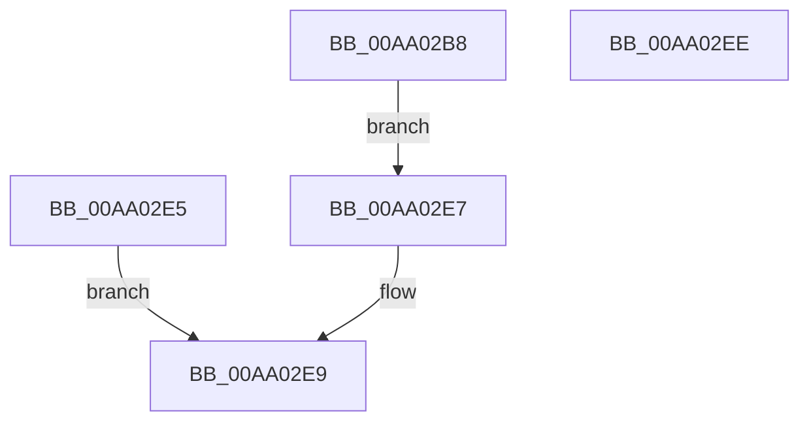

# CmQueryRegistryQuotaInformation

- RVA: `0x00AA02B8`–`0x00AA02EF` (길이 `55` bytes)
- VA: `0x0000000140AA02B8`
- 실행 섹션: `PAGE`
- PDB 이름 있음: `예`; PDB Function 태그: `아니요`
- unwind 정보 RVA: `0x000BAB20`
- 디코드: `16`개 명령, `55/55` bytes 표시
- 미해석 바이트: `0` (있으면 어셈블리에 `.byte`로 보존)

> 이 문서는 커널 이미지의 기계어와 PDB 기호를 분석해 생성했습니다. 4번과 5번은 함수 원형과 자료형을 바이너리 사용 방식에서 추정한 C 해석이며 원본 소스 복구 결과는 아닙니다.

## 1. Dependencies

- 직접 호출 지점: **1**; 고유 호출 대상: **1**
- 직접 호출자로 확인된 함수: **1**
- RIP 상대 이미지 참조: **3**

### Outgoing calls
- `0x00AA02BF` → [CmpUpdateGlobalQuotaAllowed](../84/CmpUpdateGlobalQuotaAllowed_function_0084DE00.md) (function, `0x0084DE00`)

### Direct callers
- [ExpQuerySystemInformation](../A5/ExpQuerySystemInformation_function_00A57858.md) at `0x00A58796`

### Static image references
- `0x00AA02C5` → RVA `0x00FD8060` (`PAGEDATA`; read)
- `0x00AA02CE` → RVA `0x00FD9C80` (`PAGEDATA`; read)
- `0x00AA02D8` → RVA `0x00FD9C78` (`PAGEDATA`; read)

## 2. Other-region calls and transfers

- 다른 실행 섹션으로 향하는 call: **0**
- 별도 외부 분기/꼬리 이동을 확인하지 못했습니다.

## 3. Assembly (complete function range)

```asm
00AA02B8  48 83 EC 28                     sub rsp, 0x28
00AA02BC  4C 8B C1                        mov r8, rcx
00AA02BF  E8 3C DB DA FF                  call 0x14084de00
00AA02C4  90                              nop
00AA02C5  8B 05 95 7D 53 00               mov eax, dword ptr [rip + 0x537d95]
00AA02CB  41 89 00                        mov dword ptr [r8], eax
00AA02CE  8B 05 AC 99 53 00               mov eax, dword ptr [rip + 0x5399ac]
00AA02D4  41 89 40 04                     mov dword ptr [r8 + 4], eax
00AA02D8  48 8B 05 99 99 53 00            mov rax, qword ptr [rip + 0x539999]
00AA02DF  49 89 40 08                     mov qword ptr [r8 + 8], rax
00AA02E3  EB 02                           jmp 0x140aa02e7
00AA02E5  EB 02                           jmp 0x140aa02e9
00AA02E7  33 C0                           xor eax, eax
00AA02E9  48 83 C4 28                     add rsp, 0x28
00AA02ED  C3                              ret
00AA02EE  CC                              int3
```

## 4. C-style interpretation (structured pseudocode)

```c
__int64 __fastcall CmQueryRegistryQuotaInformation(__int64 a1)
{
    __int64 result;
    __int64 v_rsp;

    v_rsp = (v_rsp) - (40);
    result = CmpUpdateGlobalQuotaAllowed(a1, a2, a1, a4);
    *(unsigned int *)(a1) = (unsigned int)((unsigned int)(*(unsigned int *)(v_rip + 5471637)));
    *(unsigned int *)(a1 + 4) = (unsigned int)((unsigned int)(*(unsigned int *)(v_rip + 5478828)));
    *(unsigned __int64 *)(a1 + 8) = *(unsigned __int64 *)(v_rip + 5478809);
    goto loc_00AA02E7;
loc_00AA02E7:
    result = 0;
loc_00AA02E9:
    v_rsp = (v_rsp) + (40);
    return result;
}
```

## 5. (Beta) C Style

```c
int64_t CmQueryRegistryQuotaInformation(int64_t Arg1)
{
    int64_t result;
    int64_t local_rsp;

    local_rsp = (local_rsp) - (40);
    result = CmpUpdateGlobalQuotaAllowed(Arg1, a2, Arg1, a4);
    *(uint32_t *)(Arg1) = (uint32_t)((uint32_t)(*(uint32_t *)(v_rip + 0x537D95)));
    *(uint32_t *)(Arg1 + 0x4) = (uint32_t)((uint32_t)(*(uint32_t *)(v_rip + 0x5399AC)));
    *(uint64_t *)(Arg1 + 0x8) = *(uint64_t *)(v_rip + 0x539999);
    goto loc_00AA02E7;
loc_00AA02E7:
    result = 0;
loc_00AA02E9:
    local_rsp = (local_rsp) + (40);
    return result;
}
```

## 6. Execution-region graph

[열기: 2D/3D 그래프와 함수 탐색 컨트롤 패널](../../../control-panel.html?section=page&rva=0x00AA02B8&view=graph)

- 2D 그래프는 위에서 아래로 흐르고, 3D 그래프는 빈 공간을 드래그해 회전합니다. Shift+드래그는 이동, 휠은 확대·축소, 함수 노드 선택은 대상 보고서 이동입니다.

### Static fallback


