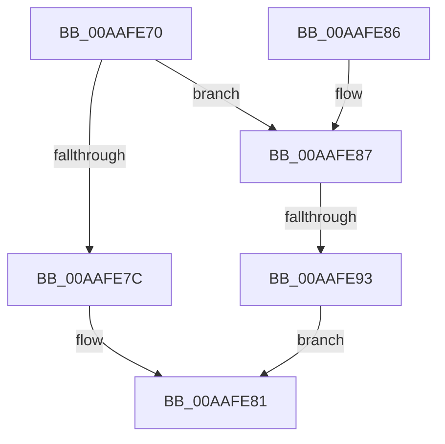

# CmRegisterCallbackEx

- RVA: `0x00AAFE70`–`0x00AAFE9A` (길이 `42` bytes)
- VA: `0x0000000140AAFE70`
- 실행 섹션: `PAGE`
- PDB 이름 있음: `예`; PDB Function 태그: `예`
- unwind 정보 RVA: `0x000BC478`
- 디코드: `12`개 명령, `42/42` bytes 표시
- 미해석 바이트: `0` (있으면 어셈블리에 `.byte`로 보존)

> 이 문서는 커널 이미지의 기계어와 PDB 기호를 분석해 생성했습니다. 4번과 5번은 함수 원형과 자료형을 바이너리 사용 방식에서 추정한 C 해석이며 원본 소스 복구 결과는 아닙니다.

## 1. Dependencies

- 직접 호출 지점: **0**; 고유 호출 대상: **0**
- 직접 호출자로 확인된 함수: **1**
- RIP 상대 이미지 참조: **0**

### Outgoing calls
- 직접 디코드된 call 명령이 없습니다.

### Direct callers
- [DifCmRegisterCallbackExWrapper](../../text/61/DifCmRegisterCallbackExWrapper_function_0061C780.md) at `0x0061C897`

### Static image references
- 디코드된 RIP-relative 메모리 참조가 없습니다.

## 2. Other-region calls and transfers

- 다른 실행 섹션으로 향하는 call: **0**
- call이 아닌 외부 분기/꼬리 이동: **1**
  - `0x00AAFE8D` → [sub_00B4A8AE](../B4/Unknown_function_00B4A8AE.md) (`tail-transfer`)

## 3. Assembly (complete function range)

```asm
00AAFE70  48 83 EC 38                     sub rsp, 0x38
00AAFE74  4D 8B D1                        mov r10, r9
00AAFE77  4D 85 C0                        test r8, r8
00AAFE7A  75 0B                           jne 0x140aafe87
00AAFE7C  B8 F1 00 00 C0                  mov eax, 0xc00000f1
00AAFE81  48 83 C4 38                     add rsp, 0x38
00AAFE85  C3                              ret
00AAFE86  CC                              int3
00AAFE87  48 83 7C 24 68 00               cmp qword ptr [rsp + 0x68], 0
00AAFE8D  0F 84 1B AA 09 00               je 0x140b4a8ae
00AAFE93  B8 F4 00 00 C0                  mov eax, 0xc00000f4
00AAFE98  EB E7                           jmp 0x140aafe81
```

## 4. C-style interpretation (structured pseudocode)

```c
__int64 __fastcall CmRegisterCallbackEx(__int64 a1, __int64 a2, __int64 a3, __int64 a4, __int64 a5, __int64 a6)
{
    __int64 v_rsp;

    v_rsp = (v_rsp) - (56);
    if (a3 != 0) goto loc_00AAFE87;
loc_00AAFE81:
    v_rsp = (v_rsp) + (56);
    return (unsigned int)(0xC00000F1ULL);
loc_00AAFE87:
    goto loc_00AAFE81;
}
```

## 5. (Beta) C Style

```c
int64_t CmRegisterCallbackEx(int64_t Arg1, int64_t Arg2, int64_t Arg3, int64_t Arg4, uint64_t Arg5, int64_t Arg6)
{
    int64_t local_rsp;

    local_rsp = (local_rsp) - (56);
    if (Arg3 != 0) goto loc_00AAFE87;
loc_00AAFE81:
    local_rsp = (local_rsp) + (56);
    return (uint32_t)(0xC00000F1ULL);
loc_00AAFE87:
    goto loc_00AAFE81;
}
```

## 6. Execution-region graph

[열기: 2D/3D 그래프와 함수 탐색 컨트롤 패널](../../../control-panel.html?section=page&rva=0x00AAFE70&view=graph)

- 2D 그래프는 위에서 아래로 흐르고, 3D 그래프는 빈 공간을 드래그해 회전합니다. Shift+드래그는 이동, 휠은 확대·축소, 함수 노드 선택은 대상 보고서 이동입니다.

### Static fallback


