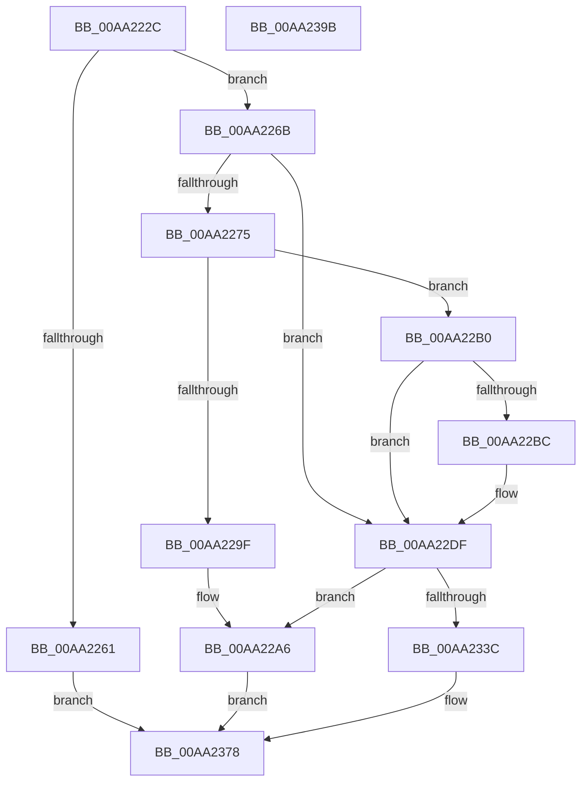

# CmpAddStringToMapping

- RVA: `0x00AA222C`–`0x00AA239C` (길이 `368` bytes)
- VA: `0x0000000140AA222C`
- 실행 섹션: `PAGE`
- PDB 이름 있음: `예`; PDB Function 태그: `아니요`
- unwind 정보 RVA: `0x0005C954`
- 디코드: `84`개 명령, `368/368` bytes 표시
- 미해석 바이트: `0` (있으면 어셈블리에 `.byte`로 보존)

> 이 문서는 커널 이미지의 기계어와 PDB 기호를 분석해 생성했습니다. 4번과 5번은 함수 원형과 자료형을 바이너리 사용 방식에서 추정한 C 해석이며 원본 소스 복구 결과는 아닙니다.

## 1. Dependencies

- 직접 호출 지점: **8**; 고유 호출 대상: **6**
- 직접 호출자로 확인된 함수: **1**
- RIP 상대 이미지 참조: **7**

### Outgoing calls
- `0x00AA224F` → [ExAcquireFastMutex](../../text/20/ExAcquireFastMutex_function_0020E5A0.md) (function, `0x0020E5A0`)
- `0x00AA228E` → [ExAllocatePool2](../../poolcode/B8/ExAllocatePool2_function_00B820F0.md) (function, `0x00B820F0`)
- `0x00AA22CD` → [memcpy](../../text/6C/memcpy_function_006C6840.md) (function, `0x006C6840`)
- `0x00AA22DA` → [ExFreePoolWithTag](../../poolcode/B8/ExFreePoolWithTag_function_00B82870.md) (function, `0x00B82870`)
- `0x00AA2315` → [ExAllocatePool2](../../poolcode/B8/ExAllocatePool2_function_00B820F0.md) (function, `0x00B820F0`)
- `0x00AA2347` → [memcpy](../../text/6C/memcpy_function_006C6840.md) (function, `0x006C6840`)
- `0x00AA234F` → [CmpHashUnicodeComponent](../84/CmpHashUnicodeComponent_function_0084AC24.md) (function, `0x0084AC24`)
- `0x00AA237F` → [ExReleaseFastMutex](../../text/25/ExReleaseFastMutex_function_002519C0.md) (function, `0x002519C0`)

### Direct callers
- [CmpVEAddHiveToSIDMappingTable](CmpVEAddHiveToSIDMappingTable_function_00AA2190.md) at `0x00AA2206`

### Static image references
- `0x00AA2246` → RVA `0x00EF5900` (`.data`; read)
- `0x00AA2254` → RVA `0x00EEFC08` (`.data`; read)
- `0x00AA226B` → RVA `0x00EEFC18` (`.data`; read)
- `0x00AA2275` → RVA `0x00EEFC10` (`.data`; read)
- `0x00AA2293` → RVA `0x00EEFC10` (`.data`; write)
- `0x00AA22B0` → RVA `0x00EEFC18` (`.data`; read/write)
- `0x00AA236C` → RVA `0x00EEFC08` (`.data`; write)

## 2. Other-region calls and transfers

- 다른 실행 섹션으로 향하는 call: **7**
  - `0x00AA224F` → [ExAcquireFastMutex](../../text/20/ExAcquireFastMutex_function_0020E5A0.md) (`PAGE` → `.text`)
  - `0x00AA228E` → [ExAllocatePool2](../../poolcode/B8/ExAllocatePool2_function_00B820F0.md) (`PAGE` → `POOLCODE`)
  - `0x00AA22CD` → [memcpy](../../text/6C/memcpy_function_006C6840.md) (`PAGE` → `.text`)
  - `0x00AA22DA` → [ExFreePoolWithTag](../../poolcode/B8/ExFreePoolWithTag_function_00B82870.md) (`PAGE` → `POOLCODE`)
  - `0x00AA2315` → [ExAllocatePool2](../../poolcode/B8/ExAllocatePool2_function_00B820F0.md) (`PAGE` → `POOLCODE`)
  - `0x00AA2347` → [memcpy](../../text/6C/memcpy_function_006C6840.md) (`PAGE` → `.text`)
  - `0x00AA237F` → [ExReleaseFastMutex](../../text/25/ExReleaseFastMutex_function_002519C0.md) (`PAGE` → `.text`)
- 별도 외부 분기/꼬리 이동을 확인하지 못했습니다.

## 3. Assembly (complete function range)

```asm
00AA222C  48 89 5C 24 08                  mov qword ptr [rsp + 8], rbx
00AA2231  48 89 6C 24 10                  mov qword ptr [rsp + 0x10], rbp
00AA2236  48 89 74 24 18                  mov qword ptr [rsp + 0x18], rsi
00AA223B  57                              push rdi
00AA223C  48 83 EC 20                     sub rsp, 0x20
00AA2240  48 8B F1                        mov rsi, rcx
00AA2243  48 8B EA                        mov rbp, rdx
00AA2246  48 8D 0D B3 36 45 00            lea rcx, [rip + 0x4536b3]
00AA224D  33 DB                           xor ebx, ebx
00AA224F  E8 4C C3 76 FF                  call 0x14020e5a0
00AA2254  8B 05 AE D9 44 00               mov eax, dword ptr [rip + 0x44d9ae]
00AA225A  FF C0                           inc eax
00AA225C  83 F8 01                        cmp eax, 1
00AA225F  73 0A                           jae 0x140aa226b
00AA2261  BB 95 00 00 C0                  mov ebx, 0xc0000095
00AA2266  E9 0D 01 00 00                  jmp 0x140aa2378
00AA226B  8B 0D A7 D9 44 00               mov ecx, dword ptr [rip + 0x44d9a7]
00AA2271  3B C1                           cmp eax, ecx
00AA2273  72 6A                           jb 0x140aa22df
00AA2275  48 8B 3D 94 D9 44 00            mov rdi, qword ptr [rip + 0x44d994]
00AA227C  8D 51 04                        lea edx, [rcx + 4]
00AA227F  48 C1 E2 05                     shl rdx, 5
00AA2283  B9 00 01 00 00                  mov ecx, 0x100
00AA2288  41 B8 43 4D 56 65               mov r8d, 0x65564d43
00AA228E  E8 5D FE 0D 00                  call 0x140b820f0
00AA2293  48 89 05 76 D9 44 00            mov qword ptr [rip + 0x44d976], rax
00AA229A  48 85 C0                        test rax, rax
00AA229D  75 11                           jne 0x140aa22b0
00AA229F  48 89 3D 6A D9 44 00            mov qword ptr [rip + 0x44d96a], rdi
00AA22A6  BB 9A 00 00 C0                  mov ebx, 0xc000009a
00AA22AB  E9 C8 00 00 00                  jmp 0x140aa2378
00AA22B0  83 05 61 D9 44 00 04            add dword ptr [rip + 0x44d961], 4
00AA22B7  48 85 FF                        test rdi, rdi
00AA22BA  74 23                           je 0x140aa22df
00AA22BC  44 8B 05 45 D9 44 00            mov r8d, dword ptr [rip + 0x44d945]
00AA22C3  48 8B D7                        mov rdx, rdi
00AA22C6  49 C1 E0 05                     shl r8, 5
00AA22CA  48 8B C8                        mov rcx, rax
00AA22CD  E8 6E 45 C2 FF                  call 0x1406c6840
00AA22D2  BA 43 4D 56 65                  mov edx, 0x65564d43
00AA22D7  48 8B CF                        mov rcx, rdi
00AA22DA  E8 91 05 0E 00                  call 0x140b82870
00AA22DF  48 8B 15 2A D9 44 00            mov rdx, qword ptr [rip + 0x44d92a]
00AA22E6  B9 00 01 00 00                  mov ecx, 0x100
00AA22EB  44 8B 0D 16 D9 44 00            mov r9d, dword ptr [rip + 0x44d916]
00AA22F2  41 B8 43 4D 56 65               mov r8d, 0x65564d43
00AA22F8  49 C1 E1 05                     shl r9, 5
00AA22FC  49 89 6C 11 18                  mov qword ptr [r9 + rdx + 0x18], rbp
00AA2301  0F B7 06                        movzx eax, word ptr [rsi]
00AA2304  66 41 89 04 11                  mov word ptr [r9 + rdx], ax
00AA2309  0F B7 06                        movzx eax, word ptr [rsi]
00AA230C  66 41 89 44 11 02               mov word ptr [r9 + rdx + 2], ax
00AA2312  0F B7 16                        movzx edx, word ptr [rsi]
00AA2315  E8 D6 FD 0D 00                  call 0x140b820f0
00AA231A  8B 0D E8 D8 44 00               mov ecx, dword ptr [rip + 0x44d8e8]
00AA2320  4C 8B C8                        mov r9, rax
00AA2323  48 8B 05 E6 D8 44 00            mov rax, qword ptr [rip + 0x44d8e6]
00AA232A  48 C1 E1 05                     shl rcx, 5
00AA232E  4C 89 4C 01 08                  mov qword ptr [rcx + rax + 8], r9
00AA2333  4D 85 C9                        test r9, r9
00AA2336  0F 84 6A FF FF FF               je 0x140aa22a6
00AA233C  44 0F B7 06                     movzx r8d, word ptr [rsi]
00AA2340  49 8B C9                        mov rcx, r9
00AA2343  48 8B 56 08                     mov rdx, qword ptr [rsi + 8]
00AA2347  E8 F4 44 C2 FF                  call 0x1406c6840
00AA234C  48 8B CE                        mov rcx, rsi
00AA234F  E8 D0 88 DA FF                  call 0x14084ac24
00AA2354  44 8B 0D AD D8 44 00            mov r9d, dword ptr [rip + 0x44d8ad]
00AA235B  48 8B 15 AE D8 44 00            mov rdx, qword ptr [rip + 0x44d8ae]
00AA2362  45 8B C1                        mov r8d, r9d
00AA2365  49 C1 E0 05                     shl r8, 5
00AA2369  41 FF C1                        inc r9d
00AA236C  44 89 0D 95 D8 44 00            mov dword ptr [rip + 0x44d895], r9d
00AA2373  41 89 44 10 10                  mov dword ptr [r8 + rdx + 0x10], eax
00AA2378  48 8D 0D 81 35 45 00            lea rcx, [rip + 0x453581]
00AA237F  E8 3C F6 7A FF                  call 0x1402519c0
00AA2384  48 8B 6C 24 38                  mov rbp, qword ptr [rsp + 0x38]
00AA2389  8B C3                           mov eax, ebx
00AA238B  48 8B 5C 24 30                  mov rbx, qword ptr [rsp + 0x30]
00AA2390  48 8B 74 24 40                  mov rsi, qword ptr [rsp + 0x40]
00AA2395  48 83 C4 20                     add rsp, 0x20
00AA2399  5F                              pop rdi
00AA239A  C3                              ret
00AA239B  CC                              int3
```

## 4. C-style interpretation (structured pseudocode)

```c
__int64 __fastcall CmpAddStringToMapping(__int64 a1, __int64 a2)
{
    __int64 result;
    __int64 v_rbx;
    __int64 v_rsp;
    unsigned __int64 v_stack_p10;
    unsigned __int64 v_stack_p18;
    unsigned __int64 v_stack_p8;

    v_stack_p8 = v_rbx;
    v_stack_p10 = v_rbp;
    v_stack_p18 = v_rsi;
    v_rsp = (v_rsp) - (32);
    v_rbx = 0;
    result = ExAcquireFastMutex(v_rip + 4535987, a2, a3, a4);
    result = (unsigned int)(((unsigned int)(*(unsigned int *)(v_rip + 4512174))) + 1);
    if (((unsigned int)(result)) >= 1) goto loc_00AA226B;
    goto loc_00AA2378;
loc_00AA226B:
    if (((unsigned int)(result)) < ((unsigned int)((unsigned int)(*(unsigned int *)(v_rip + 4512167))))) goto loc_00AA22DF;
    a2 = ((unsigned int)(*(unsigned int *)(v_rip + 4512167)) + 4) << (5);
    result = ExAllocatePool2(256, a2, (unsigned int)(0x65564D43ULL), a4);
    *(unsigned __int64 *)(v_rip + 4512118) = result;
    if (result != 0) goto loc_00AA22B0;
    *(unsigned __int64 *)(v_rip + 4512106) = *(unsigned __int64 *)(v_rip + 4512148);
loc_00AA22A6:
    goto loc_00AA2378;
loc_00AA22B0:
    if (*(unsigned __int64 *)(v_rip + 4512148) != 0) {
        a3 = *(unsigned int *)(v_rip + 4512069);
        a2 = *(unsigned __int64 *)(v_rip + 4512148);
        a3 = (a3) << (5);
        a1 = result;
        result = memcpy(a1, a2, a3, a4);
        a2 = 0x65564D43ULL;
        a1 = *(unsigned __int64 *)(v_rip + 4512148);
        result = ExFreePoolWithTag(a1, a2, a3, a4);
    }
    a4 = ((unsigned int)(*(unsigned int *)(v_rip + 4512022))) << (5);
    *(unsigned __int64 *)(a4 + *(unsigned __int64 *)(v_rip + 4512042) * 1 + 24) = a2;
    *(unsigned __int16 *)(a4 + *(unsigned __int64 *)(v_rip + 4512042) * 1) = (unsigned __int16)(*(unsigned __int16 *)(a1));
    *(unsigned __int16 *)(a4 + *(unsigned __int64 *)(v_rip + 4512042) * 1 + 2) = (unsigned __int16)(*(unsigned __int16 *)(a1));
    result = ExAllocatePool2(256, *(unsigned __int16 *)(a1), (unsigned int)(0x65564D43ULL), a4);
    a1 = ((unsigned int)(*(unsigned int *)(v_rip + 4511976))) << (5);
    *(unsigned __int64 *)(a1 + *(unsigned __int64 *)(v_rip + 4511974) * 1 + 8) = result;
    if (result == 0) goto loc_00AA22A6;
    result = memcpy(result, *(unsigned __int64 *)(a1 + 8), *(unsigned __int16 *)(a1), result);
    result = CmpHashUnicodeComponent(a1, *(unsigned __int64 *)(a1 + 8), *(unsigned __int16 *)(a1), result);
    a3 = ((unsigned int)((unsigned int)((unsigned int)(*(unsigned int *)(v_rip + 4511917))))) << (5);
    a4 = (unsigned int)(((unsigned int)(*(unsigned int *)(v_rip + 4511917))) + 1);
    *(unsigned int *)(v_rip + 4511893) = (unsigned int)(a4);
    *(unsigned int *)(a3 + *(unsigned __int64 *)(v_rip + 4511918) * 1 + 16) = (unsigned int)(result);
loc_00AA2378:
    result = ExReleaseFastMutex(v_rip + 4535681, *(unsigned __int64 *)(v_rip + 4511918), a3, a4);
    v_rsp = (v_rsp) + (32);
    return (unsigned int)((unsigned int)((unsigned int)(0xC000009AULL)));
}
```

## 5. (Beta) C Style

```c
int64_t CmpAddStringToMapping(void *Arg1, int64_t Arg2)
{
    uint8_t *arg1 = (uint8_t *)Arg1;

    int64_t result;
    int64_t local_rbx;
    int64_t local_rsp;
    uint64_t v_stack_p10;
    uint64_t v_stack_p18;
    uint64_t v_stack_p8;

    v_stack_p8 = local_rbx;
    v_stack_p10 = local_rbp;
    v_stack_p18 = local_rsi;
    local_rsp = (local_rsp) - (32);
    local_rbx = 0;
    result = ExAcquireFastMutex(v_rip + 4535987, Arg2, a3, a4);
    result = (uint32_t)(((uint32_t)(*(uint32_t *)(v_rip + 0x44D9AE))) + 1);
    if (((uint32_t)(result)) >= 1) goto loc_00AA226B;
    goto loc_00AA2378;
loc_00AA226B:
    if (((uint32_t)(result)) < ((uint32_t)((uint32_t)(*(uint32_t *)(v_rip + 0x44D9A7))))) goto loc_00AA22DF;
    Arg2 = ((uint32_t)(*(uint32_t *)(v_rip + 0x44D9A7)) + 4) << (5);
    result = ExAllocatePool2(256, Arg2, (uint32_t)(0x65564D43ULL), a4);
    *(uint64_t *)(v_rip + 0x44D976) = result;
    if (result != 0) goto loc_00AA22B0;
    *(uint64_t *)(v_rip + 0x44D96A) = *(uint64_t *)(v_rip + 0x44D994);
loc_00AA22A6:
    goto loc_00AA2378;
loc_00AA22B0:
    if (*(uint64_t *)(v_rip + 0x44D994) != 0) {
        a3 = *(uint32_t *)(v_rip + 0x44D945);
        Arg2 = *(uint64_t *)(v_rip + 0x44D994);
        a3 = (a3) << (5);
        Arg1 = result;
        result = memcpy(Arg1, Arg2, a3, a4);
        Arg2 = 0x65564D43ULL;
        Arg1 = *(uint64_t *)(v_rip + 0x44D994);
        result = ExFreePoolWithTag(Arg1, Arg2, a3, a4);
    }
    a4 = ((uint32_t)(*(uint32_t *)(v_rip + 0x44D916))) << (5);
    *(uint64_t *)(a4 + *(uint64_t *)(v_rip + 0x44D92A) * 1 + 0x18) = Arg2;
    *(uint16_t *)(a4 + *(uint64_t *)(v_rip + 0x44D92A) * 1) = (uint16_t)(*(uint16_t *)(arg1));
    *(uint16_t *)(a4 + *(uint64_t *)(v_rip + 0x44D92A) * 1 + 0x2) = (uint16_t)(*(uint16_t *)(arg1));
    result = ExAllocatePool2(256, *(uint16_t *)(arg1), (uint32_t)(0x65564D43ULL), a4);
    Arg1 = ((uint32_t)(*(uint32_t *)(v_rip + 0x44D8E8))) << (5);
    *(uint64_t *)(arg1 + *(uint64_t *)(v_rip + 0x44D8E6) * 1 + 0x8) = result;
    if (result == 0) goto loc_00AA22A6;
    result = memcpy(result, *(uint64_t *)(arg1 + 0x8), *(uint16_t *)(arg1), result);
    result = CmpHashUnicodeComponent(Arg1, *(uint64_t *)(arg1 + 0x8), *(uint16_t *)(arg1), result);
    a3 = ((uint32_t)((uint32_t)((uint32_t)(*(uint32_t *)(v_rip + 0x44D8AD))))) << (5);
    a4 = (uint32_t)(((uint32_t)(*(uint32_t *)(v_rip + 0x44D8AD))) + 1);
    *(uint32_t *)(v_rip + 0x44D895) = (uint32_t)(a4);
    *(uint32_t *)(a3 + *(uint64_t *)(v_rip + 0x44D8AE) * 1 + 0x10) = (uint32_t)(result);
loc_00AA2378:
    result = ExReleaseFastMutex(v_rip + 4535681, *(uint64_t *)(v_rip + 0x44D8AE), a3, a4);
    local_rsp = (local_rsp) + (32);
    return (uint32_t)((uint32_t)((uint32_t)(0xC000009AULL)));
}
```

### 관측된 메모리 오프셋

구조체 형식이 확인되지 않은 접근은 인자 기준의 오프셋으로만 기록했습니다.

| 기준 인자 | 오프셋 표현 | 폭 (bit) | 접근 |
|---|---:|---:|---|
| `Arg1` | `+ 0x0` | `16` | `R` |
| `Arg1` | `+ 0x8` | `64` | `R` |

## 6. Execution-region graph

[열기: 2D/3D 그래프와 함수 탐색 컨트롤 패널](../../../control-panel.html?section=page&rva=0x00AA222C&view=graph)

- 2D 그래프는 위에서 아래로 흐르고, 3D 그래프는 빈 공간을 드래그해 회전합니다. Shift+드래그는 이동, 휠은 확대·축소, 함수 노드 선택은 대상 보고서 이동입니다.

### Static fallback


