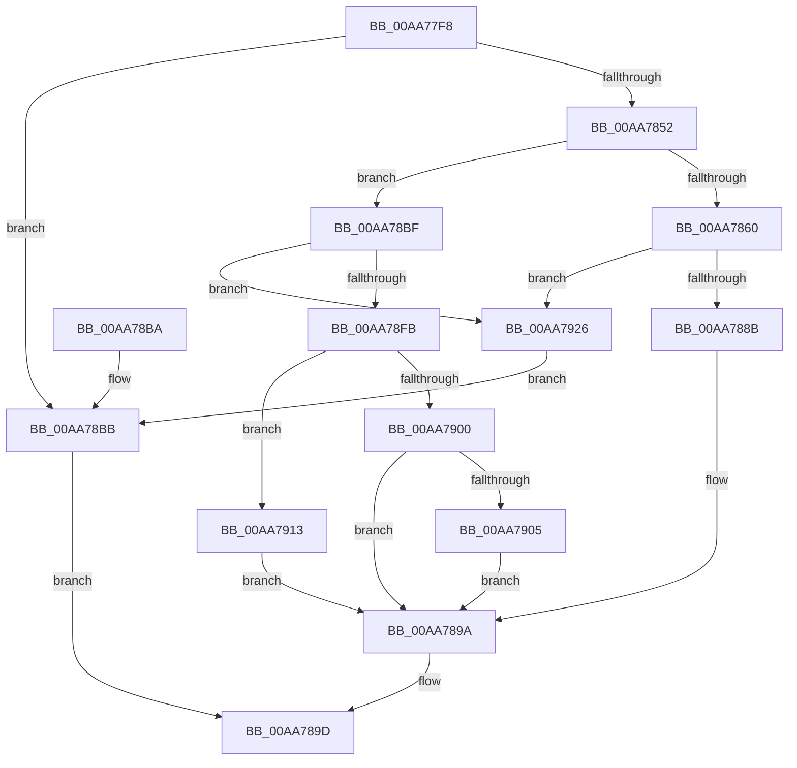

# CmpAllocatePostBlock

- RVA: `0x00AA77F8`–`0x00AA7932` (길이 `314` bytes)
- VA: `0x0000000140AA77F8`
- 실행 섹션: `PAGE`
- PDB 이름 있음: `예`; PDB Function 태그: `아니요`
- unwind 정보 RVA: `0x000BBAB4`
- 디코드: `91`개 명령, `314/314` bytes 표시
- 미해석 바이트: `0` (있으면 어셈블리에 `.byte`로 보존)

> 이 문서는 커널 이미지의 기계어와 PDB 기호를 분석해 생성했습니다. 4번과 5번은 함수 원형과 자료형을 바이너리 사용 방식에서 추정한 C 해석이며 원본 소스 복구 결과는 아닙니다.

## 1. Dependencies

- 직접 호출 지점: **5**; 고유 호출 대상: **3**
- 직접 호출자로 확인된 함수: **1**
- RIP 상대 이미지 참조: **0**

### Outgoing calls
- `0x00AA7845` → [ExAllocatePool2](../../poolcode/B8/ExAllocatePool2_function_00B820F0.md) (function, `0x00B820F0`)
- `0x00AA7879` → [ExAllocatePool2](../../poolcode/B8/ExAllocatePool2_function_00B820F0.md) (function, `0x00B820F0`)
- `0x00AA78ED` → [ExAllocatePool2](../../poolcode/B8/ExAllocatePool2_function_00B820F0.md) (function, `0x00B820F0`)
- `0x00AA791C` → [KeInitializeEvent](../../text/40/KeInitializeEvent_function_0040DD10.md) (function, `0x0040DD10`)
- `0x00AA792B` → [ExFreePoolWithTag](../../poolcode/B8/ExFreePoolWithTag_function_00B82870.md) (function, `0x00B82870`)

### Direct callers
- [NtNotifyChangeMultipleKeys](../9D/NtNotifyChangeMultipleKeys_function_009DC6B0.md) at `0x009DC9EB`
- [NtNotifyChangeMultipleKeys](../9D/NtNotifyChangeMultipleKeys_function_009DC6B0.md) at `0x009DCA27`

### Static image references
- 디코드된 RIP-relative 메모리 참조가 없습니다.

## 2. Other-region calls and transfers

- 다른 실행 섹션으로 향하는 call: **5**
  - `0x00AA7845` → [ExAllocatePool2](../../poolcode/B8/ExAllocatePool2_function_00B820F0.md) (`PAGE` → `POOLCODE`)
  - `0x00AA7879` → [ExAllocatePool2](../../poolcode/B8/ExAllocatePool2_function_00B820F0.md) (`PAGE` → `POOLCODE`)
  - `0x00AA78ED` → [ExAllocatePool2](../../poolcode/B8/ExAllocatePool2_function_00B820F0.md) (`PAGE` → `POOLCODE`)
  - `0x00AA791C` → [KeInitializeEvent](../../text/40/KeInitializeEvent_function_0040DD10.md) (`PAGE` → `.text`)
  - `0x00AA792B` → [ExFreePoolWithTag](../../poolcode/B8/ExFreePoolWithTag_function_00B82870.md) (`PAGE` → `POOLCODE`)
- 별도 외부 분기/꼬리 이동을 확인하지 못했습니다.

## 3. Assembly (complete function range)

```asm
00AA77F8  48 89 5C 24 08                  mov qword ptr [rsp + 8], rbx
00AA77FD  48 89 6C 24 10                  mov qword ptr [rsp + 0x10], rbp
00AA7802  48 89 74 24 18                  mov qword ptr [rsp + 0x18], rsi
00AA7807  57                              push rdi
00AA7808  41 54                           push r12
00AA780A  41 55                           push r13
00AA780C  41 56                           push r14
00AA780E  41 57                           push r15
00AA7810  48 83 EC 20                     sub rsp, 0x20
00AA7814  BD 00 00 00 00                  mov ebp, 0
00AA7819  8D 41 FE                        lea eax, [rcx - 2]
00AA781C  A9 FD FF FF FF                  test eax, 0xfffffffd
00AA7821  49 8B F0                        mov rsi, r8
00AA7824  44 8B E2                        mov r12d, edx
00AA7827  8B D9                           mov ebx, ecx
00AA7829  41 B8 43 4D 70 62               mov r8d, 0x62704d43
00AA782F  4D 8B F9                        mov r15, r9
00AA7832  44 8D 6D 01                     lea r13d, [rbp + 1]
00AA7836  41 0F 44 ED                     cmove ebp, r13d
00AA783A  41 8D 55 47                     lea edx, [r13 + 0x47]
00AA783E  48 8D 8D 00 01 00 00            lea rcx, [rbp + 0x100]
00AA7845  E8 A6 A8 0D 00                  call 0x140b820f0
00AA784A  48 8B F8                        mov rdi, rax
00AA784D  48 85 C0                        test rax, rax
00AA7850  74 69                           je 0x140aa78bb
00AA7852  8B C3                           mov eax, ebx
00AA7854  41 0B C4                        or eax, r12d
00AA7857  89 47 38                        mov dword ptr [rdi + 0x38], eax
00AA785A  0F BA E0 10                     bt eax, 0x10
00AA785E  72 5F                           jb 0x140aa78bf
00AA7860  49 8B 47 40                     mov rax, qword ptr [r15 + 0x40]
00AA7864  41 8D 55 17                     lea edx, [r13 + 0x17]
00AA7868  41 B8 43 4D 34 35               mov r8d, 0x35344d43
00AA786E  48 89 47 40                     mov qword ptr [rdi + 0x40], rax
00AA7872  48 8D 8D 00 01 00 00            lea rcx, [rbp + 0x100]
00AA7879  E8 72 A8 0D 00                  call 0x140b820f0
00AA787E  48 89 47 30                     mov qword ptr [rdi + 0x30], rax
00AA7882  48 85 C0                        test rax, rax
00AA7885  0F 84 9B 00 00 00               je 0x140aa7926
00AA788B  48 89 70 10                     mov qword ptr [rax + 0x10], rsi
00AA788F  48 8B 47 30                     mov rax, qword ptr [rdi + 0x30]
00AA7893  48 89 40 08                     mov qword ptr [rax + 8], rax
00AA7897  48 89 00                        mov qword ptr [rax], rax
00AA789A  48 8B C7                        mov rax, rdi
00AA789D  48 8B 5C 24 50                  mov rbx, qword ptr [rsp + 0x50]
00AA78A2  48 8B 6C 24 58                  mov rbp, qword ptr [rsp + 0x58]
00AA78A7  48 8B 74 24 60                  mov rsi, qword ptr [rsp + 0x60]
00AA78AC  48 83 C4 20                     add rsp, 0x20
00AA78B0  41 5F                           pop r15
00AA78B2  41 5E                           pop r14
00AA78B4  41 5D                           pop r13
00AA78B6  41 5C                           pop r12
00AA78B8  5F                              pop rdi
00AA78B9  C3                              ret
00AA78BA  CC                              int3
00AA78BB  33 C0                           xor eax, eax
00AA78BD  EB DE                           jmp 0x140aa789d
00AA78BF  48 83 67 30 00                  and qword ptr [rdi + 0x30], 0
00AA78C4  8D 43 FD                        lea eax, [rbx - 3]
00AA78C7  41 3B C5                        cmp eax, r13d
00AA78CA  B9 40 00 00 00                  mov ecx, 0x40
00AA78CF  BA 00 01 00 00                  mov edx, 0x100
00AA78D4  41 B8 43 4D 34 34               mov r8d, 0x34344d43
00AA78DA  0F 47 D1                        cmova edx, ecx
00AA78DD  8B CA                           mov ecx, edx
00AA78DF  49 0B CD                        or rcx, r13
00AA78E2  85 ED                           test ebp, ebp
00AA78E4  48 0F 44 CA                     cmove rcx, rdx
00AA78E8  BA 70 00 00 00                  mov edx, 0x70
00AA78ED  E8 FE A7 0D 00                  call 0x140b820f0
00AA78F2  48 89 47 40                     mov qword ptr [rdi + 0x40], rax
00AA78F6  48 85 C0                        test rax, rax
00AA78F9  74 2B                           je 0x140aa7926
00AA78FB  41 2B DD                        sub ebx, r13d
00AA78FE  74 13                           je 0x140aa7913
00AA7900  83 FB 02                        cmp ebx, 2
00AA7903  75 95                           jne 0x140aa789a
00AA7905  0F 57 C0                        xorps xmm0, xmm0
00AA7908  33 C9                           xor ecx, ecx
00AA790A  0F 11 00                        movups xmmword ptr [rax], xmm0
00AA790D  48 89 48 10                     mov qword ptr [rax + 0x10], rcx
00AA7911  EB 87                           jmp 0x140aa789a
00AA7913  45 33 C0                        xor r8d, r8d
00AA7916  41 8B D5                        mov edx, r13d
00AA7919  48 8B C8                        mov rcx, rax
00AA791C  E8 EF 63 96 FF                  call 0x14040dd10
00AA7921  E9 74 FF FF FF                  jmp 0x140aa789a
00AA7926  33 D2                           xor edx, edx
00AA7928  48 8B CF                        mov rcx, rdi
00AA792B  E8 40 AF 0D 00                  call 0x140b82870
00AA7930  EB 89                           jmp 0x140aa78bb
```

## 4. C-style interpretation (structured pseudocode)

```c
__int64 __fastcall CmpAllocatePostBlock(__int64 a1, int a2, __int64 a3, __int64 a4)
{
    __int64 result;
    __int64 v_rbp;
    __int64 v_rbx;
    __int64 v_rsp;
    unsigned __int64 v_stack_p10;
    unsigned __int64 v_stack_p18;
    unsigned __int64 v_stack_p8;

    v_stack_p8 = v_rbx;
    v_stack_p10 = v_rbp;
    v_stack_p18 = v_rsi;
    v_rsp = (v_rsp) - (32);
    v_rbp = 0;
    if ((((unsigned int)(a1 - 2)) & (0xFFFFFFFDULL)) == 0) { v_rbp = (unsigned int)(0 + 1); }
    result = ExAllocatePool2(v_rbp + 256, 0 + 1 + 71, (unsigned int)(0x62704D43ULL), a4);
    if (result == 0) goto loc_00AA78BB;
    result = (unsigned int)(((unsigned int)((unsigned int)((unsigned int)((unsigned int)(a1))))) | ((unsigned int)((unsigned int)(a2))));
    *(unsigned int *)(result + 56) = (unsigned int)(result);
    if (condition_is_below) goto loc_00AA78BF;
    *(unsigned __int64 *)(result + 64) = *(unsigned __int64 *)(a4 + 64);
    result = ExAllocatePool2(v_rbp + 256, 0 + 1 + 23, (unsigned int)(0x35344D43ULL), a4);
    *(unsigned __int64 *)(result + 48) = result;
    if (result == 0) goto loc_00AA7926;
    *(unsigned __int64 *)(result + 16) = a3;
    *(unsigned __int64 *)(*(unsigned __int64 *)(result + 48) + 8) = *(unsigned __int64 *)(result + 48);
    *(unsigned __int64 *)(*(unsigned __int64 *)(result + 48)) = *(unsigned __int64 *)(result + 48);
loc_00AA789A:
loc_00AA789D:
    v_rsp = (v_rsp) + (32);
    return result;
loc_00AA78BB:
    result = 0;
    goto loc_00AA789D;
loc_00AA78BF:
    a2 = 256;
    if (((unsigned int)(v_stack_p8 - 3)) > ((unsigned int)(0 + 1))) { a2 = 64; }
    a1 = ((unsigned int)(a2)) | (0 + 1);
    if ((unsigned int)(v_stack_p10) == 0) { a1 = a2; }
    result = ExAllocatePool2(a1, 112, (unsigned int)(0x34344D43ULL), a4);
    *(unsigned __int64 *)(result + 64) = result;
    if (result == 0) goto loc_00AA7926;
    v_rbx = (unsigned int)((v_stack_p8) - ((unsigned int)(0 + 1)));
    if (condition_is_equal) goto loc_00AA7913;
    if (((unsigned int)(v_rbx)) != 2) goto loc_00AA789A;
    a1 = 0;
    *(unsigned __int64 *)(result) = v_xmm0;
    *(unsigned __int64 *)(result + 16) = 0;
    goto loc_00AA789A;
loc_00AA7913:
    a3 = 0;
    result = KeInitializeEvent(result, (unsigned int)((unsigned int)(0 + 1)), a3, a4);
    goto loc_00AA789A;
loc_00AA7926:
    a2 = 0;
    result = ExFreePoolWithTag(result, a2, a3, a4);
    goto loc_00AA78BB;
}
```

## 5. (Beta) C Style

```c
int64_t CmpAllocatePostBlock(void *Arg1, int32_t Arg2, int64_t Arg3, void *Arg4)
{
    uint8_t *arg1 = (uint8_t *)Arg1;
    uint8_t *arg4 = (uint8_t *)Arg4;

    int64_t result;
    int64_t local_rbp;
    int64_t local_rbx;
    int64_t local_rsp;
    uint64_t v_stack_p10;
    uint64_t v_stack_p18;
    uint64_t v_stack_p8;

    v_stack_p8 = local_rbx;
    v_stack_p10 = local_rbp;
    v_stack_p18 = local_rsi;
    local_rsp = (local_rsp) - (32);
    local_rbp = 0;
    if ((((uint32_t)(Arg1 - 2)) & (0xFFFFFFFDULL)) == 0) { local_rbp = (uint32_t)(0 + 1); }
    result = ExAllocatePool2(local_rbp + 256, 0 + 1 + 71, (uint32_t)(0x62704D43ULL), Arg4);
    if (result == 0) goto loc_00AA78BB;
    result = (uint32_t)(((uint32_t)((uint32_t)((uint32_t)((uint32_t)(Arg1))))) | ((uint32_t)((uint32_t)(Arg2))));
    *(uint32_t *)(result + 0x38) = (uint32_t)(result);
    if (condition_is_below) goto loc_00AA78BF;
    *(uint64_t *)(result + 0x40) = *(uint64_t *)(arg4 + 0x40);
    result = ExAllocatePool2(local_rbp + 256, 0 + 1 + 23, (uint32_t)(0x35344D43ULL), Arg4);
    *(uint64_t *)(result + 0x30) = result;
    if (result == 0) goto loc_00AA7926;
    *(uint64_t *)(result + 0x10) = Arg3;
    *(uint64_t *)(*(uint64_t *)(result + 0x30) + 0x8) = *(uint64_t *)(result + 0x30);
    *(uint64_t *)(*(uint64_t *)(result + 0x30)) = *(uint64_t *)(result + 0x30);
loc_00AA789A:
loc_00AA789D:
    local_rsp = (local_rsp) + (32);
    return result;
loc_00AA78BB:
    result = 0;
    goto loc_00AA789D;
loc_00AA78BF:
    Arg2 = 256;
    if (((uint32_t)(v_stack_p8 - 3)) > ((uint32_t)(0 + 1))) { Arg2 = 64; }
    Arg1 = ((uint32_t)(Arg2)) | (0 + 1);
    if ((uint32_t)(v_stack_p10) == 0) { Arg1 = Arg2; }
    result = ExAllocatePool2(Arg1, 112, (uint32_t)(0x34344D43ULL), Arg4);
    *(uint64_t *)(result + 0x40) = result;
    if (result == 0) goto loc_00AA7926;
    local_rbx = (uint32_t)((v_stack_p8) - ((uint32_t)(0 + 1)));
    if (condition_is_equal) goto loc_00AA7913;
    if (((uint32_t)(local_rbx)) != 2) goto loc_00AA789A;
    Arg1 = 0;
    *(uint64_t *)(result) = v_xmm0;
    *(uint64_t *)(result + 0x10) = 0;
    goto loc_00AA789A;
loc_00AA7913:
    Arg3 = 0;
    result = KeInitializeEvent(result, (uint32_t)((uint32_t)(0 + 1)), Arg3, Arg4);
    goto loc_00AA789A;
loc_00AA7926:
    Arg2 = 0;
    result = ExFreePoolWithTag(result, Arg2, Arg3, Arg4);
    goto loc_00AA78BB;
}
```

### 관측된 메모리 오프셋

구조체 형식이 확인되지 않은 접근은 인자 기준의 오프셋으로만 기록했습니다.

| 기준 인자 | 오프셋 표현 | 폭 (bit) | 접근 |
|---|---:|---:|---|
| `Arg1` | `- 0x3` | `32` | `R` |
| `Arg1` | `- 0x2` | `32` | `R` |
| `Arg4` | `+ 0x40` | `64` | `R` |

## 6. Execution-region graph

[열기: 2D/3D 그래프와 함수 탐색 컨트롤 패널](../../../control-panel.html?section=page&rva=0x00AA77F8&view=graph)

- 2D 그래프는 위에서 아래로 흐르고, 3D 그래프는 빈 공간을 드래그해 회전합니다. Shift+드래그는 이동, 휠은 확대·축소, 함수 노드 선택은 대상 보고서 이동입니다.

### Static fallback


