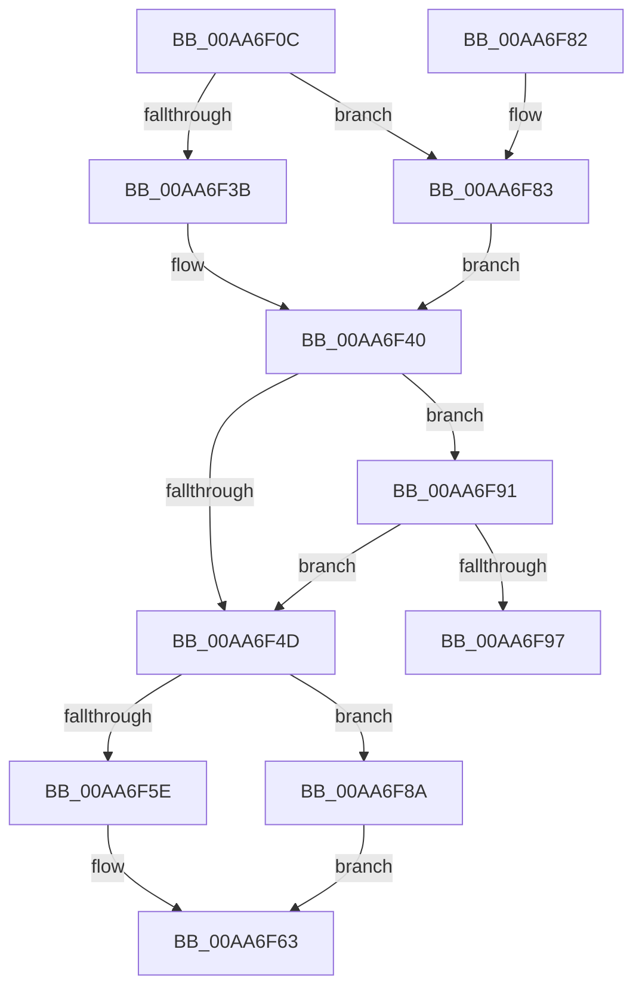

# CmpFreeIndexByCell

- RVA: `0x00AA6F0C`–`0x00AA6F9C` (길이 `144` bytes)
- VA: `0x0000000140AA6F0C`
- 실행 섹션: `PAGE`
- PDB 이름 있음: `예`; PDB Function 태그: `예`
- unwind 정보 RVA: `0x000BB9EC`
- 디코드: `41`개 명령, `144/144` bytes 표시
- 미해석 바이트: `0` (있으면 어셈블리에 `.byte`로 보존)

> 이 문서는 커널 이미지의 기계어와 PDB 기호를 분석해 생성했습니다. 4번과 5번은 함수 원형과 자료형을 바이너리 사용 방식에서 추정한 C 해석이며 원본 소스 복구 결과는 아닙니다.

## 1. Dependencies

- 직접 호출 지점: **5**; 고유 호출 대상: **5**
- 직접 호출자로 확인된 함수: **2**
- RIP 상대 이미지 참조: **0**

### Outgoing calls
- `0x00AA6F3B` → [HvpGetCellFlat](../85/HvpGetCellFlat_function_00854C60.md) (function, `0x00854C60`)
- `0x00AA6F5E` → [HvpReleaseCellPaged](../85/HvpReleaseCellPaged_function_00855F40.md) (function, `0x00855F40`)
- `0x00AA6F68` → [HvFreeCell](../85/HvFreeCell_function_0085A72C.md) (function, `0x0085A72C`)
- `0x00AA6F83` → [HvpGetCellPaged](../85/HvpGetCellPaged_function_00854CB0.md) (function, `0x00854CB0`)
- `0x00AA6F8A` → [HvpReleaseCellFlat](../85/HvpReleaseCellFlat_function_0085CC20.md) (function, `0x0085CC20`)

### Direct callers
- [CmRenameKey](../7E/CmRenameKey_function_007E8F48.md) at `0x007EA0F3`
- [CmRenameKey](../7E/CmRenameKey_function_007E8F48.md) at `0x007EA105`
- [CmpLightWeightCleanupModifyKeyDataUoW](../A5/CmpLightWeightCleanupModifyKeyDataUoW_function_00A54EE4.md) at `0x00A54F24`
- [CmpLightWeightCleanupModifyKeyDataUoW](../A5/CmpLightWeightCleanupModifyKeyDataUoW_function_00A54EE4.md) at `0x00A54F2E`

### Static image references
- 디코드된 RIP-relative 메모리 참조가 없습니다.

## 2. Other-region calls and transfers

- 다른 실행 섹션으로 향하는 call: **0**
- call이 아닌 외부 분기/꼬리 이동: **1**
  - `0x00AA6F97` → [sub_00B49EE8](../B4/Unknown_function_00B49EE8.md) (`tail-transfer`)

## 3. Assembly (complete function range)

```asm
00AA6F0C  48 8B C4                        mov rax, rsp
00AA6F0F  48 89 58 10                     mov qword ptr [rax + 0x10], rbx
00AA6F13  48 89 68 18                     mov qword ptr [rax + 0x18], rbp
00AA6F17  48 89 70 20                     mov qword ptr [rax + 0x20], rsi
00AA6F1B  57                              push rdi
00AA6F1C  48 83 EC 20                     sub rsp, 0x20
00AA6F20  83 48 08 FF                     or dword ptr [rax + 8], 0xffffffff
00AA6F24  4C 8D 40 08                     lea r8, [rax + 8]
00AA6F28  33 F6                           xor esi, esi
00AA6F2A  8B EA                           mov ebp, edx
00AA6F2C  F6 81 8C 00 00 00 01            test byte ptr [rcx + 0x8c], 1
00AA6F33  48 8B D9                        mov rbx, rcx
00AA6F36  89 70 0C                        mov dword ptr [rax + 0xc], esi
00AA6F39  74 48                           je 0x140aa6f83
00AA6F3B  E8 20 DD DA FF                  call 0x140854c60
00AA6F40  48 8B F8                        mov rdi, rax
00AA6F43  B8 72 69 00 00                  mov eax, 0x6972
00AA6F48  66 39 07                        cmp word ptr [rdi], ax
00AA6F4B  74 44                           je 0x140aa6f91
00AA6F4D  F6 83 8C 00 00 00 01            test byte ptr [rbx + 0x8c], 1
00AA6F54  48 8D 54 24 30                  lea rdx, [rsp + 0x30]
00AA6F59  48 8B CB                        mov rcx, rbx
00AA6F5C  75 2C                           jne 0x140aa6f8a
00AA6F5E  E8 DD EF DA FF                  call 0x140855f40
00AA6F63  8B D5                           mov edx, ebp
00AA6F65  48 8B CB                        mov rcx, rbx
00AA6F68  E8 BF 37 DB FF                  call 0x14085a72c
00AA6F6D  48 8B 5C 24 38                  mov rbx, qword ptr [rsp + 0x38]
00AA6F72  48 8B 6C 24 40                  mov rbp, qword ptr [rsp + 0x40]
00AA6F77  48 8B 74 24 48                  mov rsi, qword ptr [rsp + 0x48]
00AA6F7C  48 83 C4 20                     add rsp, 0x20
00AA6F80  5F                              pop rdi
00AA6F81  C3                              ret
00AA6F82  CC                              int3
00AA6F83  E8 28 DD DA FF                  call 0x140854cb0
00AA6F88  EB B6                           jmp 0x140aa6f40
00AA6F8A  E8 91 5C DB FF                  call 0x14085cc20
00AA6F8F  EB D2                           jmp 0x140aa6f63
00AA6F91  66 3B 77 02                     cmp si, word ptr [rdi + 2]
00AA6F95  73 B6                           jae 0x140aa6f4d
00AA6F97  E9 4C 2F 0A 00                  jmp 0x140b49ee8
```

## 4. C-style interpretation (structured pseudocode)

```c
__int64 __fastcall CmpFreeIndexByCell(__int64 a1, int a2)
{
    __int64 result;
    __int64 v_rsi;
    __int64 v_rsp;
    unsigned __int64 v_stack_p10;
    unsigned __int64 v_stack_p18;
    unsigned __int64 v_stack_p20;
    unsigned __int64 v_stack_p8;

    *(unsigned __int64 *)(v_rsp + 16) = v_rbx;
    *(unsigned __int64 *)(v_rsp + 24) = v_rbp;
    *(unsigned __int64 *)(v_rsp + 32) = v_rsi;
    v_rsp = (v_rsp) - (32);
    v_rsi = 0;
    *(unsigned int *)(v_rsp + 12) = 0;
    if (((*(unsigned __int8 *)(a1 + 140)) & (1)) == 0) goto loc_00AA6F83;
    result = HvpGetCellFlat(a1, a2, v_rsp + 8, a4);
loc_00AA6F40:
    if ((*(unsigned __int16 *)(result)) == ((unsigned __int16)((unsigned int)(0x6972ULL)))) goto loc_00AA6F91;
loc_00AA6F4D:
    if (((*(unsigned __int8 *)(a1 + 140)) & (1)) != 0) goto loc_00AA6F8A;
    result = HvpReleaseCellPaged(a1, v_stack_p8, v_rsp + 8, a4);
loc_00AA6F63:
    result = HvFreeCell(a1, (unsigned int)((unsigned int)((unsigned int)(a2))), v_rsp + 8, a4);
    v_rsp = (v_rsp) + (32);
    return result;
loc_00AA6F83:
    result = HvpGetCellPaged(a1, (unsigned int)((unsigned int)((unsigned int)(a2))), v_rsp + 8, a4);
    goto loc_00AA6F40;
loc_00AA6F8A:
    result = HvpReleaseCellFlat(a1, (unsigned int)((unsigned int)((unsigned int)(a2))), v_rsp + 8, a4);
    goto loc_00AA6F63;
loc_00AA6F91:
    if (((unsigned __int16)(v_stack_p20)) >= (*(unsigned __int16 *)(result + 2))) goto loc_00AA6F4D;
}
```

## 5. (Beta) C Style

```c
int64_t CmpFreeIndexByCell(void *Arg1, int32_t Arg2)
{
    uint8_t *arg1 = (uint8_t *)Arg1;

    int64_t result;
    int64_t local_rsi;
    int64_t local_rsp;
    uint64_t v_stack_p10;
    uint64_t v_stack_p18;
    uint64_t v_stack_p20;
    uint64_t v_stack_p8;

    *(uint64_t *)(local_rsp + 0x10) = local_rbx;
    *(uint64_t *)(local_rsp + 0x18) = local_rbp;
    *(uint64_t *)(local_rsp + 0x20) = local_rsi;
    local_rsp = (local_rsp) - (32);
    local_rsi = 0;
    *(uint32_t *)(local_rsp + 0xC) = 0;
    if (((*(uint8_t *)(arg1 + 0x8C)) & (1)) == 0) goto loc_00AA6F83;
    result = HvpGetCellFlat(Arg1, Arg2, local_rsp + 8, a4);
loc_00AA6F40:
    if ((*(uint16_t *)(result)) == ((uint16_t)((uint32_t)(0x6972ULL)))) goto loc_00AA6F91;
loc_00AA6F4D:
    if (((*(uint8_t *)(arg1 + 0x8C)) & (1)) != 0) goto loc_00AA6F8A;
    result = HvpReleaseCellPaged(Arg1, v_stack_p8, local_rsp + 8, a4);
loc_00AA6F63:
    result = HvFreeCell(Arg1, (uint32_t)((uint32_t)((uint32_t)(Arg2))), local_rsp + 8, a4);
    local_rsp = (local_rsp) + (32);
    return result;
loc_00AA6F83:
    result = HvpGetCellPaged(Arg1, (uint32_t)((uint32_t)((uint32_t)(Arg2))), local_rsp + 8, a4);
    goto loc_00AA6F40;
loc_00AA6F8A:
    result = HvpReleaseCellFlat(Arg1, (uint32_t)((uint32_t)((uint32_t)(Arg2))), local_rsp + 8, a4);
    goto loc_00AA6F63;
loc_00AA6F91:
    if (((uint16_t)(v_stack_p20)) >= (*(uint16_t *)(result + 0x2))) goto loc_00AA6F4D;
}
```

### 관측된 메모리 오프셋

구조체 형식이 확인되지 않은 접근은 인자 기준의 오프셋으로만 기록했습니다.

| 기준 인자 | 오프셋 표현 | 폭 (bit) | 접근 |
|---|---:|---:|---|
| `Arg1` | `+ 0x8C` | `8` | `R` |

## 6. Execution-region graph

[열기: 2D/3D 그래프와 함수 탐색 컨트롤 패널](../../../control-panel.html?section=page&rva=0x00AA6F0C&view=graph)

- 2D 그래프는 위에서 아래로 흐르고, 3D 그래프는 빈 공간을 드래그해 회전합니다. Shift+드래그는 이동, 휠은 확대·축소, 함수 노드 선택은 대상 보고서 이동입니다.

### Static fallback


