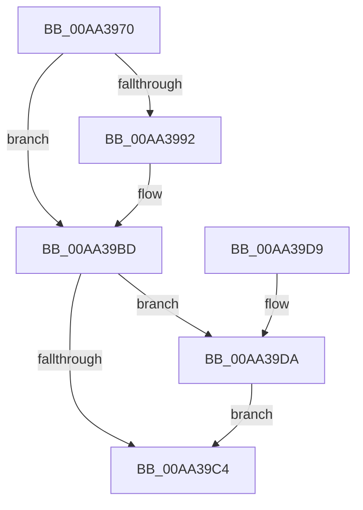

# CmpInvalidateSubtreeWorker

- RVA: `0x00AA3970`–`0x00AA39E7` (길이 `119` bytes)
- VA: `0x0000000140AA3970`
- 실행 섹션: `PAGE`
- PDB 이름 있음: `예`; PDB Function 태그: `아니요`
- unwind 정보 RVA: `0x00069B08`
- 디코드: `36`개 명령, `119/119` bytes 표시
- 미해석 바이트: `0` (있으면 어셈블리에 `.byte`로 보존)

> 이 문서는 커널 이미지의 기계어와 PDB 기호를 분석해 생성했습니다. 4번과 5번은 함수 원형과 자료형을 바이너리 사용 방식에서 추정한 C 해석이며 원본 소스 복구 결과는 아닙니다.

## 1. Dependencies

- 직접 호출 지점: **5**; 고유 호출 대상: **5**
- 직접 호출자로 확인된 함수: **0**
- RIP 상대 이미지 참조: **0**

### Outgoing calls
- `0x00AA399A` → [CmpFlushNotifiesOnKeyBodyList](../9B/CmpFlushNotifiesOnKeyBodyList_function_009B3594.md) (function, `0x009B3594`)
- `0x00AA39A5` → [CmpCleanUpSubKeyInfo](../84/CmpCleanUpSubKeyInfo_function_0084C6F4.md) (function, `0x0084C6F4`)
- `0x00AA39B0` → [CmpMarkKeyUnbacked](../9B/CmpMarkKeyUnbacked_function_009B3C4C.md) (function, `0x009B3C4C`)
- `0x00AA39B8` → [CmpDiscardKcb](../9B/CmpDiscardKcb_function_009B2F34.md) (function, `0x009B2F34`)
- `0x00AA39E0` → [CmpRemoveLayerLinkForDiscardedKcb](../9B/CmpRemoveLayerLinkForDiscardedKcb_function_009B3BE0.md) (function, `0x009B3BE0`)

### Direct callers
- 이 함수 시작 RVA로 연결되는 직접 call은 확인되지 않았습니다. 간접 호출은 완전히 역산할 수 없습니다.

### Static image references
- 디코드된 RIP-relative 메모리 참조가 없습니다.

## 2. Other-region calls and transfers

- 다른 실행 섹션으로 향하는 call: **0**
- 별도 외부 분기/꼬리 이동을 확인하지 못했습니다.

## 3. Assembly (complete function range)

```asm
00AA3970  48 89 5C 24 08                  mov qword ptr [rsp + 8], rbx
00AA3975  48 89 74 24 10                  mov qword ptr [rsp + 0x10], rsi
00AA397A  57                              push rdi
00AA397B  48 83 EC 20                     sub rsp, 0x20
00AA397F  F7 41 08 00 00 02 00            test dword ptr [rcx + 8], 0x20000
00AA3986  48 8B DA                        mov rbx, rdx
00AA3989  48 8B 72 10                     mov rsi, qword ptr [rdx + 0x10]
00AA398D  48 8B F9                        mov rdi, rcx
00AA3990  75 2B                           jne 0x140aa39bd
00AA3992  8B 12                           mov edx, dword ptr [rdx]
00AA3994  41 B1 01                        mov r9b, 1
00AA3997  4C 8B C6                        mov r8, rsi
00AA399A  E8 F5 FB F0 FF                  call 0x1409b3594
00AA399F  48 8B 4F 48                     mov rcx, qword ptr [rdi + 0x48]
00AA39A3  33 D2                           xor edx, edx
00AA39A5  E8 4A 8D DA FF                  call 0x14084c6f4
00AA39AA  48 8B D6                        mov rdx, rsi
00AA39AD  48 8B CF                        mov rcx, rdi
00AA39B0  E8 97 02 F1 FF                  call 0x1409b3c4c
00AA39B5  48 8B CF                        mov rcx, rdi
00AA39B8  E8 77 F5 F0 FF                  call 0x1409b2f34
00AA39BD  8B 43 08                        mov eax, dword ptr [rbx + 8]
00AA39C0  A8 01                           test al, 1
00AA39C2  75 16                           jne 0x140aa39da
00AA39C4  FF 43 04                        inc dword ptr [rbx + 4]
00AA39C7  48 8B 5C 24 30                  mov rbx, qword ptr [rsp + 0x30]
00AA39CC  33 C0                           xor eax, eax
00AA39CE  48 8B 74 24 38                  mov rsi, qword ptr [rsp + 0x38]
00AA39D3  48 83 C4 20                     add rsp, 0x20
00AA39D7  5F                              pop rdi
00AA39D8  C3                              ret
00AA39D9  CC                              int3
00AA39DA  48 8B D6                        mov rdx, rsi
00AA39DD  48 8B CF                        mov rcx, rdi
00AA39E0  E8 FB 01 F1 FF                  call 0x1409b3be0
00AA39E5  EB DD                           jmp 0x140aa39c4
```

## 4. C-style interpretation (structured pseudocode)

```c
__int64 __fastcall CmpInvalidateSubtreeWorker(__int64 a1, __int64 a2)
{
    __int64 result;
    __int64 v_rsp;
    unsigned __int64 v_stack_p10;
    unsigned __int64 v_stack_p8;

    v_stack_p8 = v_rbx;
    v_stack_p10 = v_rsi;
    v_rsp = (v_rsp) - (32);
    if (((*(unsigned int *)(a1 + 8)) & (0x20000ULL)) == 0) {
        a2 = *(unsigned int *)(a2);
        a4 = 1;
        a3 = *(unsigned __int64 *)(a2 + 16);
        result = CmpFlushNotifiesOnKeyBodyList(a1, a2, a3, a4);
        a1 = *(unsigned __int64 *)(a1 + 72);
        a2 = 0;
        result = CmpCleanUpSubKeyInfo(a1, a2, a3, a4);
        a2 = *(unsigned __int64 *)(a2 + 16);
        a1 = a1;
        result = CmpMarkKeyUnbacked(a1, a2, a3, a4);
        a1 = a1;
        result = CmpDiscardKcb(a1, a2, a3, a4);
    }
    if ((((unsigned __int8)((unsigned int)(*(unsigned int *)(a2 + 8)))) & (1)) != 0) goto loc_00AA39DA;
loc_00AA39C4:
    result = 0;
    v_rsp = (v_rsp) + (32);
    return result;
loc_00AA39DA:
    result = CmpRemoveLayerLinkForDiscardedKcb(a1, v_stack_p10, a3, a4);
    goto loc_00AA39C4;
}
```

## 5. (Beta) C Style

```c
int64_t CmpInvalidateSubtreeWorker(void *Arg1, void *Arg2)
{
    uint8_t *arg1 = (uint8_t *)Arg1;
    uint8_t *arg2 = (uint8_t *)Arg2;

    int64_t result;
    int64_t local_rsp;
    uint64_t v_stack_p10;
    uint64_t v_stack_p8;

    v_stack_p8 = local_rbx;
    v_stack_p10 = local_rsi;
    local_rsp = (local_rsp) - (32);
    if (((*(uint32_t *)(arg1 + 0x8)) & (0x20000ULL)) == 0) {
        Arg2 = *(uint32_t *)(arg2);
        a4 = 1;
        a3 = *(uint64_t *)(arg2 + 0x10);
        result = CmpFlushNotifiesOnKeyBodyList(Arg1, Arg2, a3, a4);
        Arg1 = *(uint64_t *)(arg1 + 0x48);
        Arg2 = 0;
        result = CmpCleanUpSubKeyInfo(Arg1, Arg2, a3, a4);
        Arg2 = *(uint64_t *)(arg2 + 0x10);
        Arg1 = Arg1;
        result = CmpMarkKeyUnbacked(Arg1, Arg2, a3, a4);
        Arg1 = Arg1;
        result = CmpDiscardKcb(Arg1, Arg2, a3, a4);
    }
    if ((((uint8_t)((uint32_t)(*(uint32_t *)(arg2 + 0x8)))) & (1)) != 0) goto loc_00AA39DA;
loc_00AA39C4:
    result = 0;
    local_rsp = (local_rsp) + (32);
    return result;
loc_00AA39DA:
    result = CmpRemoveLayerLinkForDiscardedKcb(Arg1, v_stack_p10, a3, a4);
    goto loc_00AA39C4;
}
```

### 관측된 메모리 오프셋

구조체 형식이 확인되지 않은 접근은 인자 기준의 오프셋으로만 기록했습니다.

| 기준 인자 | 오프셋 표현 | 폭 (bit) | 접근 |
|---|---:|---:|---|
| `Arg1` | `+ 0x8` | `32` | `R` |
| `Arg1` | `+ 0x48` | `64` | `R` |
| `Arg2` | `+ 0x0` | `32` | `R` |
| `Arg2` | `+ 0x4` | `32` | `R/W` |
| `Arg2` | `+ 0x8` | `32` | `R` |
| `Arg2` | `+ 0x10` | `64` | `R` |

## 6. Execution-region graph

[열기: 2D/3D 그래프와 함수 탐색 컨트롤 패널](../../../control-panel.html?section=page&rva=0x00AA3970&view=graph)

- 2D 그래프는 위에서 아래로 흐르고, 3D 그래프는 빈 공간을 드래그해 회전합니다. Shift+드래그는 이동, 휠은 확대·축소, 함수 노드 선택은 대상 보고서 이동입니다.

### Static fallback


