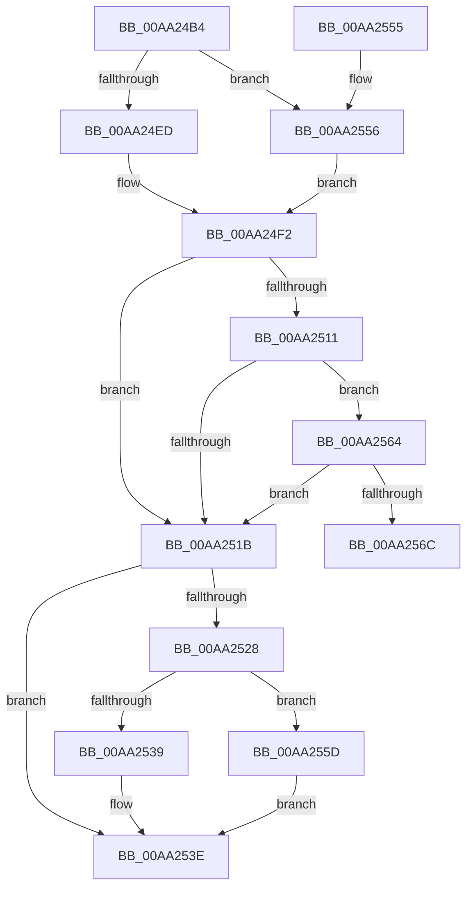

# CmpMarkEntireIndexDirty

- RVA: `0x00AA24B4`–`0x00AA2571` (길이 `189` bytes)
- VA: `0x0000000140AA24B4`
- 실행 섹션: `PAGE`
- PDB 이름 있음: `예`; PDB Function 태그: `예`
- unwind 정보 RVA: `0x000BB190`
- 디코드: `55`개 명령, `189/189` bytes 표시
- 미해석 바이트: `0` (있으면 어셈블리에 `.byte`로 보존)

> 이 문서는 커널 이미지의 기계어와 PDB 기호를 분석해 생성했습니다. 4번과 5번은 함수 원형과 자료형을 바이너리 사용 방식에서 추정한 C 해석이며 원본 소스 복구 결과는 아닙니다.

## 1. Dependencies

- 직접 호출 지점: **8**; 고유 호출 대상: **8**
- 직접 호출자로 확인된 함수: **2**
- RIP 상대 이미지 참조: **0**

### Outgoing calls
- `0x00AA24D7` → [HvpGetCellContextInitialize](../85/HvpGetCellContextInitialize_function_00855F10.md) (function, `0x00855F10`)
- `0x00AA24ED` → [HvpGetCellFlat](../85/HvpGetCellFlat_function_00854C60.md) (function, `0x00854C60`)
- `0x00AA24F8` → [HvLockHiveWriter](../85/HvLockHiveWriter_function_00859894.md) (function, `0x00859894`)
- `0x00AA2508` → [HvpMarkCellDirty](../85/HvpMarkCellDirty_function_00858080.md) (function, `0x00858080`)
- `0x00AA251E` → [HvUnlockHiveWriter](../85/HvUnlockHiveWriter_function_008598E4.md) (function, `0x008598E4`)
- `0x00AA2539` → [HvpReleaseCellPaged](../85/HvpReleaseCellPaged_function_00855F40.md) (function, `0x00855F40`)
- `0x00AA2556` → [HvpGetCellPaged](../85/HvpGetCellPaged_function_00854CB0.md) (function, `0x00854CB0`)
- `0x00AA255D` → [HvpReleaseCellFlat](../85/HvpReleaseCellFlat_function_0085CC20.md) (function, `0x0085CC20`)

### Direct callers
- [CmRenameKey](../7E/CmRenameKey_function_007E8F48.md) at `0x007E9977`
- [CmRenameKey](../7E/CmRenameKey_function_007E8F48.md) at `0x007E9997`
- [CmpLightWeightDuplicateParentLists](../A5/CmpLightWeightDuplicateParentLists_function_00A54BB4.md) at `0x00A54C1F`

### Static image references
- 디코드된 RIP-relative 메모리 참조가 없습니다.

## 2. Other-region calls and transfers

- 다른 실행 섹션으로 향하는 call: **0**
- call이 아닌 외부 분기/꼬리 이동: **1**
  - `0x00AA256C` → [sub_00B4993C](../B4/Unknown_function_00B4993C.md) (`tail-transfer`)

## 3. Assembly (complete function range)

```asm
00AA24B4  48 8B C4                        mov rax, rsp
00AA24B7  48 89 58 10                     mov qword ptr [rax + 0x10], rbx
00AA24BB  48 89 68 18                     mov qword ptr [rax + 0x18], rbp
00AA24BF  48 89 70 20                     mov qword ptr [rax + 0x20], rsi
00AA24C3  57                              push rdi
00AA24C4  48 83 EC 20                     sub rsp, 0x20
00AA24C8  48 8B D9                        mov rbx, rcx
00AA24CB  33 ED                           xor ebp, ebp
00AA24CD  48 8D 48 08                     lea rcx, [rax + 8]
00AA24D1  48 89 68 08                     mov qword ptr [rax + 8], rbp
00AA24D5  8B F2                           mov esi, edx
00AA24D7  E8 34 3A DB FF                  call 0x140855f10
00AA24DC  F6 83 8C 00 00 00 01            test byte ptr [rbx + 0x8c], 1
00AA24E3  4C 8D 44 24 30                  lea r8, [rsp + 0x30]
00AA24E8  48 8B CB                        mov rcx, rbx
00AA24EB  74 69                           je 0x140aa2556
00AA24ED  E8 6E 27 DB FF                  call 0x140854c60
00AA24F2  48 8B CB                        mov rcx, rbx
00AA24F5  48 8B F8                        mov rdi, rax
00AA24F8  E8 97 73 DB FF                  call 0x140859894
00AA24FD  45 33 C9                        xor r9d, r9d
00AA2500  41 B0 01                        mov r8b, 1
00AA2503  8B D6                           mov edx, esi
00AA2505  48 8B CB                        mov rcx, rbx
00AA2508  E8 73 5B DB FF                  call 0x140858080
00AA250D  85 C0                           test eax, eax
00AA250F  78 0A                           js 0x140aa251b
00AA2511  B8 72 69 00 00                  mov eax, 0x6972
00AA2516  66 39 07                        cmp word ptr [rdi], ax
00AA2519  74 49                           je 0x140aa2564
00AA251B  48 8B CB                        mov rcx, rbx
00AA251E  E8 C1 73 DB FF                  call 0x1408598e4
00AA2523  48 85 FF                        test rdi, rdi
00AA2526  74 16                           je 0x140aa253e
00AA2528  F6 83 8C 00 00 00 01            test byte ptr [rbx + 0x8c], 1
00AA252F  48 8D 54 24 30                  lea rdx, [rsp + 0x30]
00AA2534  48 8B CB                        mov rcx, rbx
00AA2537  75 24                           jne 0x140aa255d
00AA2539  E8 02 3A DB FF                  call 0x140855f40
00AA253E  48 8B 5C 24 38                  mov rbx, qword ptr [rsp + 0x38]
00AA2543  33 C0                           xor eax, eax
00AA2545  48 8B 6C 24 40                  mov rbp, qword ptr [rsp + 0x40]
00AA254A  48 8B 74 24 48                  mov rsi, qword ptr [rsp + 0x48]
00AA254F  48 83 C4 20                     add rsp, 0x20
00AA2553  5F                              pop rdi
00AA2554  C3                              ret
00AA2555  CC                              int3
00AA2556  E8 55 27 DB FF                  call 0x140854cb0
00AA255B  EB 95                           jmp 0x140aa24f2
00AA255D  E8 BE A6 DB FF                  call 0x14085cc20
00AA2562  EB DA                           jmp 0x140aa253e
00AA2564  8B F5                           mov esi, ebp
00AA2566  66 3B 6F 02                     cmp bp, word ptr [rdi + 2]
00AA256A  73 AF                           jae 0x140aa251b
00AA256C  E9 CB 73 0A 00                  jmp 0x140b4993c
```

## 4. C-style interpretation (structured pseudocode)

```c
__int64 __fastcall CmpMarkEntireIndexDirty(__int64 a1, int a2, __int64 a3, int a4)
{
    __int64 result;
    __int64 v_rbp;
    __int64 v_rsp;
    unsigned __int64 v_stack_p10;
    unsigned __int64 v_stack_p18;
    unsigned __int64 v_stack_p20;
    unsigned __int64 v_stack_p8;

    *(unsigned __int64 *)(v_rsp + 16) = v_rbx;
    *(unsigned __int64 *)(v_rsp + 24) = v_rbp;
    *(unsigned __int64 *)(v_rsp + 32) = v_rsi;
    v_rsp = (v_rsp) - (32);
    v_rbp = 0;
    *(unsigned __int64 *)(v_rsp + 8) = 0;
    result = HvpGetCellContextInitialize(v_rsp + 8, a2, a3, a4);
    if (((*(unsigned __int8 *)(a1 + 140)) & (1)) == 0) goto loc_00AA2556;
    result = HvpGetCellFlat(a1, a2, v_stack_p8, a4);
loc_00AA24F2:
    result = HvLockHiveWriter(a1, a2, v_stack_p8, a4);
    a4 = 0;
    result = HvpMarkCellDirty(a1, (unsigned int)((unsigned int)((unsigned int)(a2))), 1, a4);
    if (sign_flag) goto loc_00AA251B;
    if ((*(unsigned __int16 *)(result)) == ((unsigned __int16)((unsigned int)(0x6972ULL)))) goto loc_00AA2564;
loc_00AA251B:
    result = HvUnlockHiveWriter(a1, (unsigned int)((unsigned int)((unsigned int)(a2))), 1, a4);
    if (result == 0) goto loc_00AA253E;
    if (((*(unsigned __int8 *)(a1 + 140)) & (1)) != 0) goto loc_00AA255D;
    result = HvpReleaseCellPaged(a1, v_stack_p8, 1, a4);
loc_00AA253E:
    result = 0;
    v_rsp = (v_rsp) + (32);
    return result;
loc_00AA2556:
    result = HvpGetCellPaged(a1, v_stack_p8, 1, a4);
    goto loc_00AA24F2;
loc_00AA255D:
    result = HvpReleaseCellFlat(a1, v_stack_p8, 1, a4);
    goto loc_00AA253E;
loc_00AA2564:
    if (((unsigned __int16)(v_stack_p18)) >= (*(unsigned __int16 *)(result + 2))) goto loc_00AA251B;
}
```

## 5. (Beta) C Style

```c
int64_t CmpMarkEntireIndexDirty(void *Arg1, int32_t Arg2, int64_t Arg3, int32_t Arg4)
{
    uint8_t *arg1 = (uint8_t *)Arg1;

    int64_t result;
    int64_t local_rbp;
    int64_t local_rsp;
    uint64_t v_stack_p10;
    uint64_t v_stack_p18;
    uint64_t v_stack_p20;
    uint64_t v_stack_p8;

    *(uint64_t *)(local_rsp + 0x10) = local_rbx;
    *(uint64_t *)(local_rsp + 0x18) = local_rbp;
    *(uint64_t *)(local_rsp + 0x20) = local_rsi;
    local_rsp = (local_rsp) - (32);
    local_rbp = 0;
    *(uint64_t *)(local_rsp + 0x8) = 0;
    result = HvpGetCellContextInitialize(local_rsp + 8, Arg2, Arg3, Arg4);
    if (((*(uint8_t *)(arg1 + 0x8C)) & (1)) == 0) goto loc_00AA2556;
    result = HvpGetCellFlat(Arg1, Arg2, v_stack_p8, Arg4);
loc_00AA24F2:
    result = HvLockHiveWriter(Arg1, Arg2, v_stack_p8, Arg4);
    Arg4 = 0;
    result = HvpMarkCellDirty(Arg1, (uint32_t)((uint32_t)((uint32_t)(Arg2))), 1, Arg4);
    if (sign_flag) goto loc_00AA251B;
    if ((*(uint16_t *)(result)) == ((uint16_t)((uint32_t)(0x6972ULL)))) goto loc_00AA2564;
loc_00AA251B:
    result = HvUnlockHiveWriter(Arg1, (uint32_t)((uint32_t)((uint32_t)(Arg2))), 1, Arg4);
    if (result == 0) goto loc_00AA253E;
    if (((*(uint8_t *)(arg1 + 0x8C)) & (1)) != 0) goto loc_00AA255D;
    result = HvpReleaseCellPaged(Arg1, v_stack_p8, 1, Arg4);
loc_00AA253E:
    result = 0;
    local_rsp = (local_rsp) + (32);
    return result;
loc_00AA2556:
    result = HvpGetCellPaged(Arg1, v_stack_p8, 1, Arg4);
    goto loc_00AA24F2;
loc_00AA255D:
    result = HvpReleaseCellFlat(Arg1, v_stack_p8, 1, Arg4);
    goto loc_00AA253E;
loc_00AA2564:
    if (((uint16_t)(v_stack_p18)) >= (*(uint16_t *)(result + 0x2))) goto loc_00AA251B;
}
```

### 관측된 메모리 오프셋

구조체 형식이 확인되지 않은 접근은 인자 기준의 오프셋으로만 기록했습니다.

| 기준 인자 | 오프셋 표현 | 폭 (bit) | 접근 |
|---|---:|---:|---|
| `Arg1` | `+ 0x8C` | `8` | `R` |

## 6. Execution-region graph

[열기: 2D/3D 그래프와 함수 탐색 컨트롤 패널](../../../control-panel.html?section=page&rva=0x00AA24B4&view=graph)

- 2D 그래프는 위에서 아래로 흐르고, 3D 그래프는 빈 공간을 드래그해 회전합니다. Shift+드래그는 이동, 휠은 확대·축소, 함수 노드 선택은 대상 보고서 이동입니다.

### Static fallback


