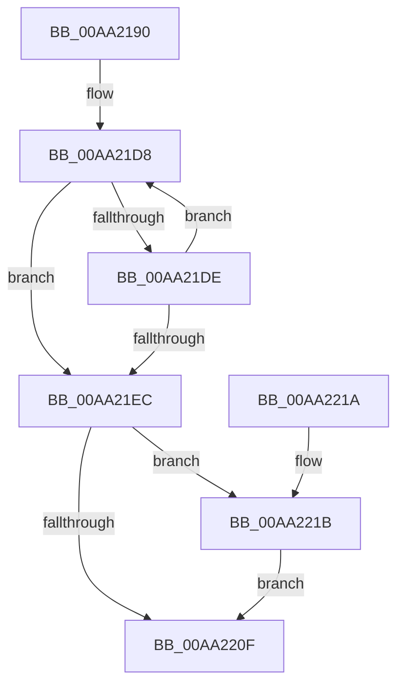

# CmpVEAddHiveToSIDMappingTable

- RVA: `0x00AA2190`–`0x00AA2225` (길이 `149` bytes)
- VA: `0x0000000140AA2190`
- 실행 섹션: `PAGE`
- PDB 이름 있음: `예`; PDB Function 태그: `아니요`
- unwind 정보 RVA: `0x000931F8`
- 디코드: `43`개 명령, `149/149` bytes 표시
- 미해석 바이트: `0` (있으면 어셈블리에 `.byte`로 보존)

> 이 문서는 커널 이미지의 기계어와 PDB 기호를 분석해 생성했습니다. 4번과 5번은 함수 원형과 자료형을 바이너리 사용 방식에서 추정한 C 해석이며 원본 소스 복구 결과는 아닙니다.

## 1. Dependencies

- 직접 호출 지점: **2**; 고유 호출 대상: **2**
- 직접 호출자로 확인된 함수: **1**
- RIP 상대 이미지 참조: **0**

### Outgoing calls
- `0x00AA21AF` → [RtlInitUnicodeString](../../text/42/RtlInitUnicodeString_function_0042A780.md) (function, `0x0042A780`)
- `0x00AA2206` → [CmpAddStringToMapping](CmpAddStringToMapping_function_00AA222C.md) (function, `0x00AA222C`)

### Direct callers
- [CmpLoadKeyCommon](../../text/46/CmpLoadKeyCommon_function_0046E9F8.md) at `0x0046ECB0`

### Static image references
- 디코드된 RIP-relative 메모리 참조가 없습니다.

## 2. Other-region calls and transfers

- 다른 실행 섹션으로 향하는 call: **1**
  - `0x00AA21AF` → [RtlInitUnicodeString](../../text/42/RtlInitUnicodeString_function_0042A780.md) (`PAGE` → `.text`)
- 별도 외부 분기/꼬리 이동을 확인하지 못했습니다.

## 3. Assembly (complete function range)

```asm
00AA2190  48 89 5C 24 08                  mov qword ptr [rsp + 8], rbx
00AA2195  57                              push rdi
00AA2196  48 83 EC 30                     sub rsp, 0x30
00AA219A  48 8B DA                        mov rbx, rdx
00AA219D  48 8B F9                        mov rdi, rcx
00AA21A0  0F 57 C0                        xorps xmm0, xmm0
00AA21A3  48 8D 4C 24 20                  lea rcx, [rsp + 0x20]
00AA21A8  33 D2                           xor edx, edx
00AA21AA  0F 11 44 24 20                  movups xmmword ptr [rsp + 0x20], xmm0
00AA21AF  E8 CC 85 98 FF                  call 0x14042a780
00AA21B4  48 8B 43 10                     mov rax, qword ptr [rbx + 0x10]
00AA21B8  BB 02 00 00 00                  mov ebx, 2
00AA21BD  0F B7 4C 24 22                  movzx ecx, word ptr [rsp + 0x22]
00AA21C2  0F B7 10                        movzx edx, word ptr [rax]
00AA21C5  4C 8B 40 08                     mov r8, qword ptr [rax + 8]
00AA21C9  48 2B D3                        sub rdx, rbx
00AA21CC  48 D1 EA                        shr rdx, 1
00AA21CF  49 8D 04 50                     lea rax, [r8 + rdx*2]
00AA21D3  0F B7 54 24 20                  movzx edx, word ptr [rsp + 0x20]
00AA21D8  66 83 38 5C                     cmp word ptr [rax], 0x5c
00AA21DC  74 0E                           je 0x140aa21ec
00AA21DE  48 2B C3                        sub rax, rbx
00AA21E1  66 03 D3                        add dx, bx
00AA21E4  66 03 CB                        add cx, bx
00AA21E7  49 3B C0                        cmp rax, r8
00AA21EA  73 EC                           jae 0x140aa21d8
00AA21EC  66 89 4C 24 22                  mov word ptr [rsp + 0x22], cx
00AA21F1  48 03 C3                        add rax, rbx
00AA21F4  66 89 54 24 20                  mov word ptr [rsp + 0x20], dx
00AA21F9  48 8D 4C 24 20                  lea rcx, [rsp + 0x20]
00AA21FE  48 8B D7                        mov rdx, rdi
00AA2201  48 89 44 24 28                  mov qword ptr [rsp + 0x28], rax
00AA2206  E8 21 00 00 00                  call 0x140aa222c
00AA220B  85 C0                           test eax, eax
00AA220D  79 0C                           jns 0x140aa221b
00AA220F  48 8B 5C 24 40                  mov rbx, qword ptr [rsp + 0x40]
00AA2214  48 83 C4 30                     add rsp, 0x30
00AA2218  5F                              pop rdi
00AA2219  C3                              ret
00AA221A  CC                              int3
00AA221B  09 9F 10 10 00 00               or dword ptr [rdi + 0x1010], ebx
00AA2221  33 C0                           xor eax, eax
00AA2223  EB EA                           jmp 0x140aa220f
```

## 4. C-style interpretation (structured pseudocode)

```c
__int64 __fastcall CmpVEAddHiveToSIDMappingTable(__int64 a1, __int64 a2)
{
    __int64 result;
    __int64 v_rsp;
    unsigned __int64 v_stack_m10;
    unsigned __int16 v_stack_m16;
    unsigned __int64 v_stack_m18;
    unsigned __int64 v_stack_p8;

    v_stack_p8 = v_rbx;
    v_rsp = (v_rsp) - (48);
    a2 = 0;
    v_stack_m18 = v_xmm0;
    result = RtlInitUnicodeString(v_stack_m18, a2, a3, a4);
    a2 = (*(unsigned __int16 *)(*(unsigned __int64 *)(a2 + 16))) - (2);
    a2 = (a2) >> (1);
loc_00AA21D8:
    if ((*(unsigned __int16 *)(*(unsigned __int64 *)(*(unsigned __int64 *)(a2 + 16) + 8) + a2 * 2)) == 92) goto loc_00AA21EC;
    result = (*(unsigned __int64 *)(*(unsigned __int64 *)(a2 + 16) + 8) + a2 * 2) - (2);
    a2 = (unsigned __int16)((v_stack_m18) + (2));
    a1 = (unsigned __int16)((v_stack_m16) + (2));
    if (result >= (*(unsigned __int64 *)(*(unsigned __int64 *)(a2 + 16) + 8))) goto loc_00AA21D8;
loc_00AA21EC:
    v_stack_m16 = (unsigned __int16)(a1);
    result = (result) + (2);
    v_stack_m18 = (unsigned __int16)(a2);
    v_stack_m10 = result;
    result = CmpAddStringToMapping(v_stack_m18, a1, *(unsigned __int64 *)(*(unsigned __int64 *)(a2 + 16) + 8), a4);
    if (!sign_flag) goto loc_00AA221B;
loc_00AA220F:
    v_rsp = (v_rsp) + (48);
    return result;
loc_00AA221B:
    result = 0;
    goto loc_00AA220F;
}
```

## 5. (Beta) C Style

```c
int64_t CmpVEAddHiveToSIDMappingTable(void *Arg1, void *Arg2)
{
    uint8_t *arg1 = (uint8_t *)Arg1;
    uint8_t *arg2 = (uint8_t *)Arg2;

    int64_t result;
    int64_t local_rsp;
    uint64_t v_stack_m10;
    uint16_t v_stack_m16;
    uint64_t v_stack_m18;
    uint64_t v_stack_p8;

    v_stack_p8 = local_rbx;
    local_rsp = (local_rsp) - (48);
    Arg2 = 0;
    v_stack_m18 = v_xmm0;
    result = RtlInitUnicodeString(v_stack_m18, Arg2, a3, a4);
    Arg2 = (*(uint16_t *)(*(uint64_t *)(arg2 + 0x10))) - (2);
    Arg2 = (Arg2) >> (1);
loc_00AA21D8:
    if ((*(uint16_t *)(*(uint64_t *)(*(uint64_t *)(arg2 + 0x10) + 0x8) + arg2 * 2)) == 92) goto loc_00AA21EC;
    result = (*(uint64_t *)(*(uint64_t *)(arg2 + 0x10) + 0x8) + Arg2 * 2) - (2);
    Arg2 = (uint16_t)((v_stack_m18) + (2));
    Arg1 = (uint16_t)((v_stack_m16) + (2));
    if (result >= (*(uint64_t *)(*(uint64_t *)(arg2 + 0x10) + 0x8))) goto loc_00AA21D8;
loc_00AA21EC:
    v_stack_m16 = (uint16_t)(Arg1);
    result = (result) + (2);
    v_stack_m18 = (uint16_t)(Arg2);
    v_stack_m10 = result;
    result = CmpAddStringToMapping(v_stack_m18, Arg1, *(uint64_t *)(*(uint64_t *)(arg2 + 0x10) + 0x8), a4);
    if (!sign_flag) goto loc_00AA221B;
loc_00AA220F:
    local_rsp = (local_rsp) + (48);
    return result;
loc_00AA221B:
    result = 0;
    goto loc_00AA220F;
}
```

### 관측된 메모리 오프셋

구조체 형식이 확인되지 않은 접근은 인자 기준의 오프셋으로만 기록했습니다.

| 기준 인자 | 오프셋 표현 | 폭 (bit) | 접근 |
|---|---:|---:|---|
| `Arg1` | `+ 0x1010` | `32` | `R/W` |
| `Arg2` | `+ 0x10` | `64` | `R` |

## 6. Execution-region graph

[열기: 2D/3D 그래프와 함수 탐색 컨트롤 패널](../../../control-panel.html?section=page&rva=0x00AA2190&view=graph)

- 2D 그래프는 위에서 아래로 흐르고, 3D 그래프는 빈 공간을 드래그해 회전합니다. Shift+드래그는 이동, 휠은 확대·축소, 함수 노드 선택은 대상 보고서 이동입니다.

### Static fallback


