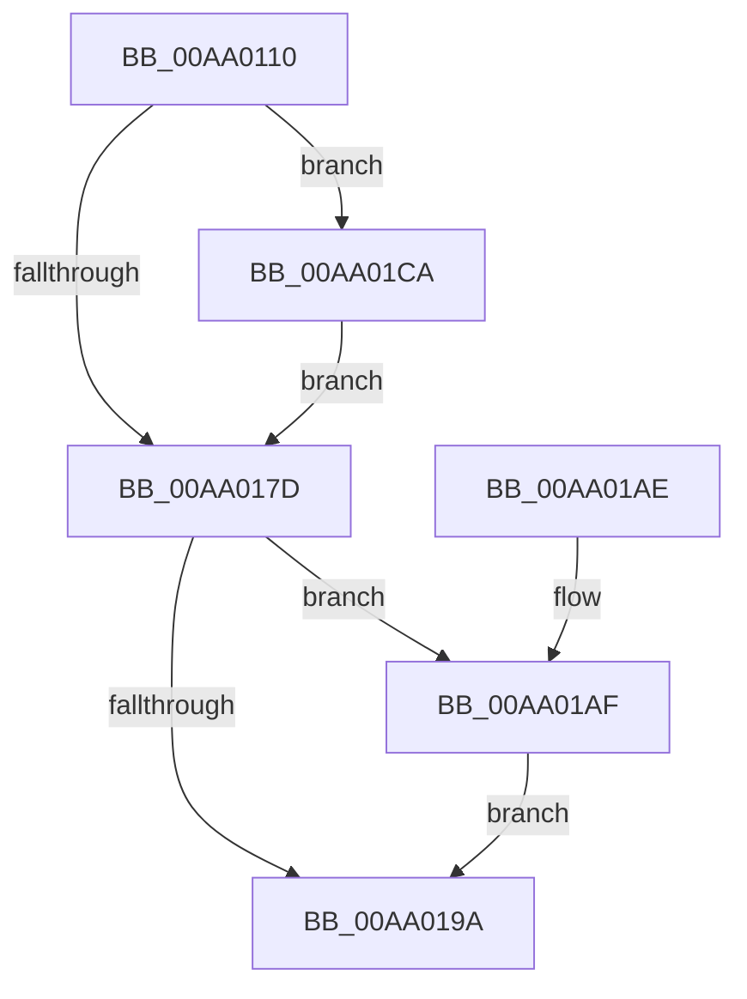

# CmpWaitOnHiveWriteQueue

- RVA: `0x00AA0110`–`0x00AA01D4` (길이 `196` bytes)
- VA: `0x0000000140AA0110`
- 실행 섹션: `PAGE`
- PDB 이름 있음: `예`; PDB Function 태그: `아니요`
- unwind 정보 RVA: `0x000BAAE0`
- 디코드: `55`개 명령, `196/196` bytes 표시
- 미해석 바이트: `0` (있으면 어셈블리에 `.byte`로 보존)

> 이 문서는 커널 이미지의 기계어와 PDB 기호를 분석해 생성했습니다. 4번과 5번은 함수 원형과 자료형을 바이너리 사용 방식에서 추정한 C 해석이며 원본 소스 복구 결과는 아닙니다.

## 1. Dependencies

- 직접 호출 지점: **10**; 고유 호출 대상: **9**
- 직접 호출자로 확인된 함수: **3**
- RIP 상대 이미지 참조: **0**

### Outgoing calls
- `0x00AA013F` → [KeInitializeEvent](../../text/40/KeInitializeEvent_function_0040DD10.md) (function, `0x0040DD10`)
- `0x00AA0159` → [HvUnlockHiveFlusherExclusive](../../pagecmrc/BC/HvUnlockHiveFlusherExclusive_function_00BC9C34.md) (function, `0x00BC9C34`)
- `0x00AA015E` → [CmpUnlockRegistry](../../pagecmrc/BC/CmpUnlockRegistry_function_00BC9A84.md) (function, `0x00BC9A84`)
- `0x00AA0163` → [CmpTraceHiveFlushStartWaitForActive](CmpTraceHiveFlushStartWaitForActive_function_00AA01DC.md) (function, `0x00AA01DC`)
- `0x00AA0170` → [KeAbPreAcquire](../../text/21/KeAbPreAcquire_function_00210230.md) (function, `0x00210230`)
- `0x00AA0190` → [KeWaitForSingleObject](../../text/20/KeWaitForSingleObject_function_0020E6B0.md) (function, `0x0020E6B0`)
- `0x00AA019A` → [CmpTraceHiveFlushFinishWaitForActive](CmpTraceHiveFlushFinishWaitForActive_function_00AA0248.md) (function, `0x00AA0248`)
- `0x00AA01B8` → [KeAbPreAcquire](../../text/21/KeAbPreAcquire_function_00210230.md) (function, `0x00210230`)
- `0x00AA01C3` → [KeAbPostReleaseEx](../../text/26/KeAbPostReleaseEx_function_00262210.md) (function, `0x00262210`)
- `0x00AA01CD` → [KeAbPreWait](../../text/20/KeAbPreWait_function_0020E560.md) (function, `0x0020E560`)

### Direct callers
- [NtCompressKey](../7D/NtCompressKey_function_007DF9D0.md) at `0x007DFAF8`
- [CmpBecomeActiveFlusherAndReconciler](../7E/CmpBecomeActiveFlusherAndReconciler_function_007E7E20.md) at `0x007E7E61`
- [CmpFlushHive](../9B/CmpFlushHive_function_009B3DC0.md) at `0x009B4508`
- [CmpFlushHive](../9B/CmpFlushHive_function_009B3DC0.md) at `0x009B482B`

### Static image references
- 디코드된 RIP-relative 메모리 참조가 없습니다.

## 2. Other-region calls and transfers

- 다른 실행 섹션으로 향하는 call: **8**
  - `0x00AA013F` → [KeInitializeEvent](../../text/40/KeInitializeEvent_function_0040DD10.md) (`PAGE` → `.text`)
  - `0x00AA0159` → [HvUnlockHiveFlusherExclusive](../../pagecmrc/BC/HvUnlockHiveFlusherExclusive_function_00BC9C34.md) (`PAGE` → `PAGECMRC`)
  - `0x00AA015E` → [CmpUnlockRegistry](../../pagecmrc/BC/CmpUnlockRegistry_function_00BC9A84.md) (`PAGE` → `PAGECMRC`)
  - `0x00AA0170` → [KeAbPreAcquire](../../text/21/KeAbPreAcquire_function_00210230.md) (`PAGE` → `.text`)
  - `0x00AA0190` → [KeWaitForSingleObject](../../text/20/KeWaitForSingleObject_function_0020E6B0.md) (`PAGE` → `.text`)
  - `0x00AA01B8` → [KeAbPreAcquire](../../text/21/KeAbPreAcquire_function_00210230.md) (`PAGE` → `.text`)
  - `0x00AA01C3` → [KeAbPostReleaseEx](../../text/26/KeAbPostReleaseEx_function_00262210.md) (`PAGE` → `.text`)
  - `0x00AA01CD` → [KeAbPreWait](../../text/20/KeAbPreWait_function_0020E560.md) (`PAGE` → `.text`)
- 별도 외부 분기/꼬리 이동을 확인하지 못했습니다.

## 3. Assembly (complete function range)

```asm
00AA0110  48 8B C4                        mov rax, rsp
00AA0113  48 89 58 08                     mov qword ptr [rax + 8], rbx
00AA0117  57                              push rdi
00AA0118  48 83 EC 60                     sub rsp, 0x60
00AA011C  48 83 60 C8 00                  and qword ptr [rax - 0x38], 0
00AA0121  45 33 C0                        xor r8d, r8d
00AA0124  48 83 60 E0 00                  and qword ptr [rax - 0x20], 0
00AA0129  48 8B FA                        mov rdi, rdx
00AA012C  48 8B D9                        mov rbx, rcx
00AA012F  0F 57 C0                        xorps xmm0, xmm0
00AA0132  48 8D 48 C8                     lea rcx, [rax - 0x38]
00AA0136  41 8D 50 01                     lea edx, [r8 + 1]
00AA013A  F3 0F 7F 40 D0                  movdqu xmmword ptr [rax - 0x30], xmm0
00AA013F  E8 CC DB 96 FF                  call 0x14040dd10
00AA0144  48 8B 47 08                     mov rax, qword ptr [rdi + 8]
00AA0148  48 8B CB                        mov rcx, rbx
00AA014B  48 89 44 24 50                  mov qword ptr [rsp + 0x50], rax
00AA0150  48 8D 44 24 30                  lea rax, [rsp + 0x30]
00AA0155  48 89 47 08                     mov qword ptr [rdi + 8], rax
00AA0159  E8 D6 9A 12 00                  call 0x140bc9c34
00AA015E  E8 21 99 12 00                  call 0x140bc9a84
00AA0163  E8 74 00 00 00                  call 0x140aa01dc
00AA0168  45 33 C0                        xor r8d, r8d
00AA016B  33 D2                           xor edx, edx
00AA016D  48 8B CF                        mov rcx, rdi
00AA0170  E8 BB 00 77 FF                  call 0x140210230
00AA0175  48 8B D8                        mov rbx, rax
00AA0178  48 85 C0                        test rax, rax
00AA017B  75 4D                           jne 0x140aa01ca
00AA017D  48 83 64 24 20 00               and qword ptr [rsp + 0x20], 0
00AA0183  48 8D 4C 24 30                  lea rcx, [rsp + 0x30]
00AA0188  45 33 C9                        xor r9d, r9d
00AA018B  45 33 C0                        xor r8d, r8d
00AA018E  33 D2                           xor edx, edx
00AA0190  E8 1B E5 76 FF                  call 0x14020e6b0
00AA0195  48 85 DB                        test rbx, rbx
00AA0198  75 15                           jne 0x140aa01af
00AA019A  E8 A9 00 00 00                  call 0x140aa0248
00AA019F  8B 44 24 48                     mov eax, dword ptr [rsp + 0x48]
00AA01A3  48 8B 5C 24 70                  mov rbx, qword ptr [rsp + 0x70]
00AA01A8  48 83 C4 60                     add rsp, 0x60
00AA01AC  5F                              pop rdi
00AA01AD  C3                              ret
00AA01AE  CC                              int3
00AA01AF  45 33 C0                        xor r8d, r8d
00AA01B2  48 8B D3                        mov rdx, rbx
00AA01B5  48 8B CF                        mov rcx, rdi
00AA01B8  E8 73 00 77 FF                  call 0x140210230
00AA01BD  48 8B D0                        mov rdx, rax
00AA01C0  48 8B CF                        mov rcx, rdi
00AA01C3  E8 48 20 7C FF                  call 0x140262210
00AA01C8  EB D0                           jmp 0x140aa019a
00AA01CA  48 8B CB                        mov rcx, rbx
00AA01CD  E8 8E E3 76 FF                  call 0x14020e560
00AA01D2  EB A9                           jmp 0x140aa017d
```

## 4. C-style interpretation (structured pseudocode)

```c
__int64 __fastcall CmpWaitOnHiveWriteQueue(__int64 a1, __int64 a2, int a3, int a4)
{
    __int64 result;
    __int64 v_rsp;
    unsigned __int64 v_stack_m18;
    unsigned int v_stack_m20;
    unsigned __int64 v_stack_m38;
    unsigned __int64 v_stack_m48;
    unsigned __int64 v_stack_p8;

    *(unsigned __int64 *)(v_rsp + 8) = v_rbx;
    v_rsp = (v_rsp) - (96);
    a3 = 0;
    *(unsigned __int64 *)(v_rsp - 48) = v_xmm0;
    result = KeInitializeEvent(v_rsp - 56, a3 + 1, a3, a4);
    v_stack_m18 = *(unsigned __int64 *)(a2 + 8);
    *(unsigned __int64 *)(a2 + 8) = v_stack_m38;
    result = HvUnlockHiveFlusherExclusive(a1, a3 + 1, a3, a4);
    result = CmpUnlockRegistry(a1, a3 + 1, a3, a4);
    result = CmpTraceHiveFlushStartWaitForActive(a1, a3 + 1, a3, a4);
    a3 = 0;
    a2 = 0;
    result = KeAbPreAcquire(0, a2, a3, a4);
    if (result != 0) goto loc_00AA01CA;
loc_00AA017D:
    a4 = 0;
    a3 = 0;
    a2 = 0;
    result = KeWaitForSingleObject(v_stack_m38, a2, a3, a4);
    if (result != 0) goto loc_00AA01AF;
loc_00AA019A:
    result = CmpTraceHiveFlushFinishWaitForActive(v_stack_m38, a2, a3, a4);
    v_rsp = (v_rsp) + (96);
    return (unsigned int)(v_stack_m20);
loc_00AA01AF:
    a3 = 0;
    result = KeAbPreAcquire(0, v_stack_p8, a3, a4);
    result = KeAbPostReleaseEx(0, result, a3, a4);
    goto loc_00AA019A;
loc_00AA01CA:
    result = KeAbPreWait(v_stack_p8, result, a3, a4);
    goto loc_00AA017D;
}
```

## 5. (Beta) C Style

```c
int64_t CmpWaitOnHiveWriteQueue(int64_t Arg1, void *Arg2, int32_t Arg3, int32_t Arg4)
{
    uint8_t *arg2 = (uint8_t *)Arg2;

    int64_t result;
    int64_t local_rsp;
    uint64_t v_stack_m18;
    uint32_t v_stack_m20;
    uint64_t v_stack_m38;
    uint64_t v_stack_m48;
    uint64_t v_stack_p8;

    *(uint64_t *)(local_rsp + 0x8) = local_rbx;
    local_rsp = (local_rsp) - (96);
    Arg3 = 0;
    *(uint64_t *)(local_rsp - 0x30) = v_xmm0;
    result = KeInitializeEvent(local_rsp - 56, Arg3 + 1, Arg3, Arg4);
    v_stack_m18 = *(uint64_t *)(arg2 + 0x8);
    *(uint64_t *)(arg2 + 0x8) = v_stack_m38;
    result = HvUnlockHiveFlusherExclusive(Arg1, Arg3 + 1, Arg3, Arg4);
    result = CmpUnlockRegistry(Arg1, Arg3 + 1, Arg3, Arg4);
    result = CmpTraceHiveFlushStartWaitForActive(Arg1, Arg3 + 1, Arg3, Arg4);
    Arg3 = 0;
    Arg2 = 0;
    result = KeAbPreAcquire(0, Arg2, Arg3, Arg4);
    if (result != 0) goto loc_00AA01CA;
loc_00AA017D:
    Arg4 = 0;
    Arg3 = 0;
    Arg2 = 0;
    result = KeWaitForSingleObject(v_stack_m38, Arg2, Arg3, Arg4);
    if (result != 0) goto loc_00AA01AF;
loc_00AA019A:
    result = CmpTraceHiveFlushFinishWaitForActive(v_stack_m38, Arg2, Arg3, Arg4);
    local_rsp = (local_rsp) + (96);
    return (uint32_t)(v_stack_m20);
loc_00AA01AF:
    Arg3 = 0;
    result = KeAbPreAcquire(0, v_stack_p8, Arg3, Arg4);
    result = KeAbPostReleaseEx(0, result, Arg3, Arg4);
    goto loc_00AA019A;
loc_00AA01CA:
    result = KeAbPreWait(v_stack_p8, result, Arg3, Arg4);
    goto loc_00AA017D;
}
```

### 관측된 메모리 오프셋

구조체 형식이 확인되지 않은 접근은 인자 기준의 오프셋으로만 기록했습니다.

| 기준 인자 | 오프셋 표현 | 폭 (bit) | 접근 |
|---|---:|---:|---|
| `Arg2` | `+ 0x8` | `64` | `R` |
| `Arg2` | `+ 0x8` | `64` | `W` |

## 6. Execution-region graph

[열기: 2D/3D 그래프와 함수 탐색 컨트롤 패널](../../../control-panel.html?section=page&rva=0x00AA0110&view=graph)

- 2D 그래프는 위에서 아래로 흐르고, 3D 그래프는 빈 공간을 드래그해 회전합니다. Shift+드래그는 이동, 휠은 확대·축소, 함수 노드 선택은 대상 보고서 이동입니다.

### Static fallback


