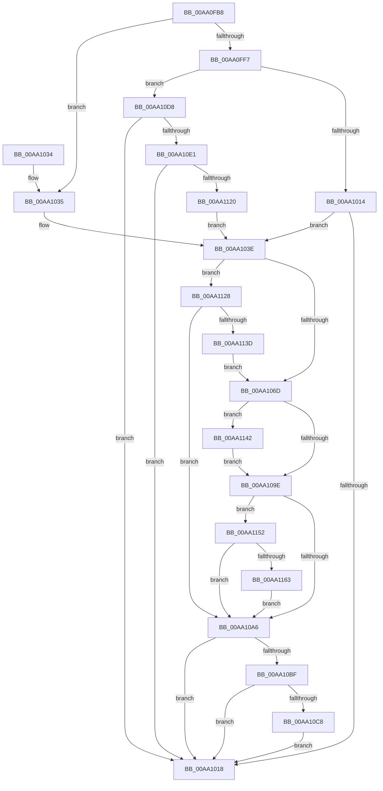

# DrvDbOpenDriverDatabaseRegKey

- RVA: `0x00AA0FB8`–`0x00AA116E` (길이 `438` bytes)
- VA: `0x0000000140AA0FB8`
- 실행 섹션: `PAGE`
- PDB 이름 있음: `예`; PDB Function 태그: `아니요`
- unwind 정보 RVA: `0x000BAC0C`
- 디코드: `110`개 명령, `438/438` bytes 표시
- 미해석 바이트: `0` (있으면 어셈블리에 `.byte`로 보존)

> 이 문서는 커널 이미지의 기계어와 PDB 기호를 분석해 생성했습니다. 4번과 5번은 함수 원형과 자료형을 바이너리 사용 방식에서 추정한 C 해석이며 원본 소스 복구 결과는 아닙니다.

## 1. Dependencies

- 직접 호출 지점: **10**; 고유 호출 대상: **10**
- 직접 호출자로 확인된 함수: **4**
- RIP 상대 이미지 참조: **1**

### Outgoing calls
- `0x00AA0FEE` → [wcsicmp](../../text/50/wcsicmp_function_00500080.md) (function, `0x00500080`)
- `0x00AA1002` → [DrvDbFindDatabaseNode](../93/DrvDbFindDatabaseNode_function_00932628.md) (function, `0x00932628`)
- `0x00AA105D` → [ExAcquireResourceExclusiveLite](../../text/21/ExAcquireResourceExclusiveLite_function_00214E20.md) (function, `0x00214E20`)
- `0x00AA108C` → [PnpCtxRegOpenKey](../8E/PnpCtxRegOpenKey_function_008EF7B8.md) (function, `0x008EF7B8`)
- `0x00AA10AD` → [ExReleaseResourceLite](../../text/25/ExReleaseResourceLite_function_0025FA10.md) (function, `0x0025FA10`)
- `0x00AA10B2` → [KeLeaveCriticalRegion](../../text/25/KeLeaveCriticalRegion_function_0025D8B0.md) (function, `0x0025D8B0`)
- `0x00AA10CE` → [DrvDbDestroyDatabaseNode](../83/DrvDbDestroyDatabaseNode_function_00835674.md) (function, `0x00835674`)
- `0x00AA1111` → [DrvDbCreateDatabaseNode](../83/DrvDbCreateDatabaseNode_function_0083533C.md) (function, `0x0083533C`)
- `0x00AA112E` → [DrvDbLoadDatabaseNode](../93/DrvDbLoadDatabaseNode_function_00931668.md) (function, `0x00931668`)
- `0x00AA1148` → [DrvDbUnloadDatabaseNode](../93/DrvDbUnloadDatabaseNode_function_0093183C.md) (function, `0x0093183C`)

### Direct callers
- [DrvDbGetDriverDatabaseMappedPropertyKeys](../83/DrvDbGetDriverDatabaseMappedPropertyKeys_function_0083355C.md) at `0x008335C2`
- [DrvDbSetDriverDatabaseMappedProperty](../83/DrvDbSetDriverDatabaseMappedProperty_function_00834014.md) at `0x0083449F`
- [DrvDbDispatchDriverDatabase](../8E/DrvDbDispatchDriverDatabase_function_008E6EC0.md) at `0x008E6FF6`
- [DrvDbDispatchDriverDatabase](../8E/DrvDbDispatchDriverDatabase_function_008E6EC0.md) at `0x008E7039`
- [sub_00B233E6](../B2/Unknown_function_00B233E6.md) at `0x00B23756`

### Static image references
- `0x00AA0FDB` → RVA `0x00AFD260` (` ?? ::NNGAKEGL::`string'`; read)

## 2. Other-region calls and transfers

- 다른 실행 섹션으로 향하는 call: **4**
  - `0x00AA0FEE` → [wcsicmp](../../text/50/wcsicmp_function_00500080.md) (`PAGE` → `.text`)
  - `0x00AA105D` → [ExAcquireResourceExclusiveLite](../../text/21/ExAcquireResourceExclusiveLite_function_00214E20.md) (`PAGE` → `.text`)
  - `0x00AA10AD` → [ExReleaseResourceLite](../../text/25/ExReleaseResourceLite_function_0025FA10.md) (`PAGE` → `.text`)
  - `0x00AA10B2` → [KeLeaveCriticalRegion](../../text/25/KeLeaveCriticalRegion_function_0025D8B0.md) (`PAGE` → `.text`)
- 별도 외부 분기/꼬리 이동을 확인하지 못했습니다.

## 3. Assembly (complete function range)

```asm
00AA0FB8  48 8B C4                        mov rax, rsp
00AA0FBB  48 89 58 08                     mov qword ptr [rax + 8], rbx
00AA0FBF  48 89 68 10                     mov qword ptr [rax + 0x10], rbp
00AA0FC3  48 89 70 18                     mov qword ptr [rax + 0x18], rsi
00AA0FC7  57                              push rdi
00AA0FC8  41 56                           push r14
00AA0FCA  41 57                           push r15
00AA0FCC  48 83 EC 60                     sub rsp, 0x60
00AA0FD0  48 83 60 D8 00                  and qword ptr [rax - 0x28], 0
00AA0FD5  48 8B FA                        mov rdi, rdx
00AA0FD8  48 8B F1                        mov rsi, rcx
00AA0FDB  48 8D 15 7E C2 05 00            lea rdx, [rip + 0x5c27e]
00AA0FE2  48 8B CF                        mov rcx, rdi
00AA0FE5  45 8A F1                        mov r14b, r9b
00AA0FE8  45 8B F8                        mov r15d, r8d
00AA0FEB  40 32 ED                        xor bpl, bpl
00AA0FEE  E8 8D F0 A5 FF                  call 0x140500080
00AA0FF3  85 C0                           test eax, eax
00AA0FF5  74 3E                           je 0x140aa1035
00AA0FF7  4C 8D 44 24 50                  lea r8, [rsp + 0x50]
00AA0FFC  48 8B D7                        mov rdx, rdi
00AA0FFF  48 8B CE                        mov rcx, rsi
00AA1002  E8 21 16 E9 FF                  call 0x140932628
00AA1007  8B D8                           mov ebx, eax
00AA1009  3D 34 00 00 C0                  cmp eax, 0xc0000034
00AA100E  0F 84 C4 00 00 00               je 0x140aa10d8
00AA1014  85 C0                           test eax, eax
00AA1016  79 26                           jns 0x140aa103e
00AA1018  4C 8D 5C 24 60                  lea r11, [rsp + 0x60]
00AA101D  8B C3                           mov eax, ebx
00AA101F  49 8B 5B 20                     mov rbx, qword ptr [r11 + 0x20]
00AA1023  49 8B 6B 28                     mov rbp, qword ptr [r11 + 0x28]
00AA1027  49 8B 73 30                     mov rsi, qword ptr [r11 + 0x30]
00AA102B  49 8B E3                        mov rsp, r11
00AA102E  41 5F                           pop r15
00AA1030  41 5E                           pop r14
00AA1032  5F                              pop rdi
00AA1033  C3                              ret
00AA1034  CC                              int3
00AA1035  48 8B 46 20                     mov rax, qword ptr [rsi + 0x20]
00AA1039  48 89 44 24 50                  mov qword ptr [rsp + 0x50], rax
00AA103E  65 48 8B 04 25 88 01 00 00      mov rax, qword ptr gs:[0x188]
00AA1047  B2 01                           mov dl, 1
00AA1049  48 8B 7C 24 50                  mov rdi, qword ptr [rsp + 0x50]
00AA104E  66 FF 88 E4 01 00 00            dec word ptr [rax + 0x1e4]
00AA1055  90                              nop
00AA1056  48 8B 8F 98 00 00 00            mov rcx, qword ptr [rdi + 0x98]
00AA105D  E8 BE 3D 77 FF                  call 0x140214e20
00AA1062  8B 47 40                        mov eax, dword ptr [rdi + 0x40]
00AA1065  A8 01                           test al, 1
00AA1067  0F 84 BB 00 00 00               je 0x140aa1128
00AA106D  48 8B 84 24 A0 00 00 00         mov rax, qword ptr [rsp + 0xa0]
00AA1075  45 33 C9                        xor r9d, r9d
00AA1078  48 8B 57 60                     mov rdx, qword ptr [rdi + 0x60]
00AA107C  45 33 C0                        xor r8d, r8d
00AA107F  48 8B 0E                        mov rcx, qword ptr [rsi]
00AA1082  48 89 44 24 28                  mov qword ptr [rsp + 0x28], rax
00AA1087  44 89 7C 24 20                  mov dword ptr [rsp + 0x20], r15d
00AA108C  E8 27 E7 E4 FF                  call 0x1408ef7b8
00AA1091  8B D8                           mov ebx, eax
00AA1093  8B 47 40                        mov eax, dword ptr [rdi + 0x40]
00AA1096  A8 01                           test al, 1
00AA1098  0F 84 A4 00 00 00               je 0x140aa1142
00AA109E  85 DB                           test ebx, ebx
00AA10A0  0F 89 AC 00 00 00               jns 0x140aa1152
00AA10A6  48 8B 8F 98 00 00 00            mov rcx, qword ptr [rdi + 0x98]
00AA10AD  E8 5E E9 7B FF                  call 0x14025fa10
00AA10B2  E8 F9 C7 7B FF                  call 0x14025d8b0
00AA10B7  85 DB                           test ebx, ebx
00AA10B9  0F 89 59 FF FF FF               jns 0x140aa1018
00AA10BF  40 84 ED                        test bpl, bpl
00AA10C2  0F 84 50 FF FF FF               je 0x140aa1018
00AA10C8  48 8B D7                        mov rdx, rdi
00AA10CB  48 8B CE                        mov rcx, rsi
00AA10CE  E8 A1 45 D9 FF                  call 0x140835674
00AA10D3  E9 40 FF FF FF                  jmp 0x140aa1018
00AA10D8  45 84 F6                        test r14b, r14b
00AA10DB  0F 84 37 FF FF FF               je 0x140aa1018
00AA10E1  48 8D 44 24 50                  lea rax, [rsp + 0x50]
00AA10E6  45 33 C9                        xor r9d, r9d
00AA10E9  48 89 44 24 40                  mov qword ptr [rsp + 0x40], rax
00AA10EE  45 33 C0                        xor r8d, r8d
00AA10F1  48 83 64 24 38 00               and qword ptr [rsp + 0x38], 0
00AA10F7  48 8B D7                        mov rdx, rdi
00AA10FA  48 83 64 24 30 00               and qword ptr [rsp + 0x30], 0
00AA1100  48 8B CE                        mov rcx, rsi
00AA1103  C7 44 24 28 10 00 00 00         mov dword ptr [rsp + 0x28], 0x10
00AA110B  48 83 64 24 20 00               and qword ptr [rsp + 0x20], 0
00AA1111  E8 26 42 D9 FF                  call 0x14083533c
00AA1116  8B D8                           mov ebx, eax
00AA1118  85 C0                           test eax, eax
00AA111A  0F 88 F8 FE FF FF               js 0x140aa1018
00AA1120  40 B5 01                        mov bpl, 1
00AA1123  E9 16 FF FF FF                  jmp 0x140aa103e
00AA1128  48 8B D7                        mov rdx, rdi
00AA112B  48 8B CE                        mov rcx, rsi
00AA112E  E8 35 05 E9 FF                  call 0x140931668
00AA1133  8B D8                           mov ebx, eax
00AA1135  85 C0                           test eax, eax
00AA1137  0F 88 69 FF FF FF               js 0x140aa10a6
00AA113D  E9 2B FF FF FF                  jmp 0x140aa106d
00AA1142  48 8B D7                        mov rdx, rdi
00AA1145  48 8B CE                        mov rcx, rsi
00AA1148  E8 EF 06 E9 FF                  call 0x14093183c
00AA114D  E9 4C FF FF FF                  jmp 0x140aa109e
00AA1152  48 8B 84 24 A8 00 00 00         mov rax, qword ptr [rsp + 0xa8]
00AA115A  48 85 C0                        test rax, rax
00AA115D  0F 84 43 FF FF FF               je 0x140aa10a6
00AA1163  C7 00 02 00 00 00               mov dword ptr [rax], 2
00AA1169  E9 38 FF FF FF                  jmp 0x140aa10a6
```

## 4. C-style interpretation (structured pseudocode)

```c
__int64 __fastcall DrvDbOpenDriverDatabaseRegKey(__int64 a1, __int64 a2, int a3, int a4, __int64 a5, __int64 a6)
{
    __int64 result;
    __int64 v_rbp;
    __int64 v_rsp;
    unsigned __int64 v_stack_m10;
    unsigned __int64 v_stack_m18;
    unsigned __int64 v_stack_m20;
    unsigned __int64 v_stack_m28;
    unsigned __int64 v_stack_m30;
    unsigned __int64 v_stack_m38;
    unsigned int v_stack_m40;

    *(unsigned __int64 *)(v_rsp + 8) = v_rbx;
    *(unsigned __int64 *)(v_rsp + 16) = v_rbp;
    *(unsigned __int64 *)(v_rsp + 24) = v_rsi;
    v_rsp = (v_rsp) - (96);
    v_rbp = 0;
    result = wcsicmp(a2, v_rip + 377470, a3, a4);
    if ((unsigned int)(result) == 0) goto loc_00AA1035;
    result = DrvDbFindDatabaseNode(a1, a2, v_stack_m28, a4);
    if (((unsigned int)(result)) == 0xC0000034ULL) goto loc_00AA10D8;
    if (!sign_flag) goto loc_00AA103E;
loc_00AA1018:
    return (unsigned int)((unsigned int)((unsigned int)((unsigned int)(result))));
loc_00AA1035:
    v_stack_m10 = *(unsigned __int64 *)(*(unsigned __int64 *)(v_stack_m18 + 48) + 32);
loc_00AA103E:
    result = ExAcquireResourceExclusiveLite(*(unsigned __int64 *)(v_stack_m10 + 152), 1, v_stack_m28, a4);
    if ((((unsigned __int8)((unsigned int)(*(unsigned int *)(v_stack_m10 + 64)))) & (1)) == 0) goto loc_00AA1128;
loc_00AA106D:
    a4 = 0;
    a3 = 0;
    v_stack_m38 = a5;
    v_stack_m40 = (unsigned int)((unsigned int)(a3));
    result = PnpCtxRegOpenKey(*(unsigned __int64 *)(*(unsigned __int64 *)(v_stack_m18 + 48)), *(unsigned __int64 *)(v_stack_m10 + 96), a3, a4);
    if ((((unsigned __int8)((unsigned int)(*(unsigned int *)(v_stack_m10 + 64)))) & (1)) == 0) goto loc_00AA1142;
loc_00AA109E:
    if (!sign_flag) goto loc_00AA1152;
loc_00AA10A6:
    result = ExReleaseResourceLite(*(unsigned __int64 *)(v_stack_m10 + 152), *(unsigned __int64 *)(v_stack_m10 + 96), a3, a4);
    result = KeLeaveCriticalRegion(*(unsigned __int64 *)(v_stack_m10 + 152), *(unsigned __int64 *)(v_stack_m10 + 96), a3, a4);
    if (!sign_flag) goto loc_00AA1018;
    if ((unsigned __int8)(*(unsigned __int64 *)(v_stack_m18 + 40)) == 0) goto loc_00AA1018;
    result = DrvDbDestroyDatabaseNode(*(unsigned __int64 *)(v_stack_m18 + 48), v_stack_m10, a3, a4);
    goto loc_00AA1018;
loc_00AA10D8:
    if ((unsigned __int8)((unsigned __int8)(a4)) == 0) goto loc_00AA1018;
    a4 = 0;
    v_stack_m20 = v_stack_m10;
    a3 = 0;
    v_stack_m38 = 16;
    result = DrvDbCreateDatabaseNode(*(unsigned __int64 *)(v_stack_m18 + 48), v_stack_m10, a3, a4);
    if (sign_flag) goto loc_00AA1018;
    goto loc_00AA103E;
loc_00AA1128:
    result = DrvDbLoadDatabaseNode(*(unsigned __int64 *)(v_stack_m18 + 48), v_stack_m10, a3, a4);
    if (sign_flag) goto loc_00AA10A6;
    goto loc_00AA106D;
loc_00AA1142:
    result = DrvDbUnloadDatabaseNode(*(unsigned __int64 *)(v_stack_m18 + 48), v_stack_m10, a3, a4);
    goto loc_00AA109E;
loc_00AA1152:
    if (a6 == 0) goto loc_00AA10A6;
    *(unsigned int *)(a6) = 2;
    goto loc_00AA10A6;
}
```

## 5. (Beta) C Style

```c
int64_t DrvDbOpenDriverDatabaseRegKey(void *Arg1, int64_t Arg2, int32_t Arg3, int32_t Arg4, int64_t Arg5, int64_t Arg6)
{
    uint8_t *arg1 = (uint8_t *)Arg1;

    int64_t result;
    int64_t local_rbp;
    int64_t local_rsp;
    uint64_t v_stack_m10;
    uint64_t v_stack_m18;
    uint64_t v_stack_m20;
    uint64_t v_stack_m28;
    uint64_t v_stack_m30;
    uint64_t v_stack_m38;
    uint32_t v_stack_m40;

    *(uint64_t *)(local_rsp + 0x8) = local_rbx;
    *(uint64_t *)(local_rsp + 0x10) = local_rbp;
    *(uint64_t *)(local_rsp + 0x18) = local_rsi;
    local_rsp = (local_rsp) - (96);
    local_rbp = 0;
    result = wcsicmp(Arg2, v_rip + 377470, Arg3, Arg4);
    if ((uint32_t)(result) == 0) goto loc_00AA1035;
    result = DrvDbFindDatabaseNode(Arg1, Arg2, v_stack_m28, Arg4);
    if (((uint32_t)(result)) == 0xC0000034ULL) goto loc_00AA10D8;
    if (!sign_flag) goto loc_00AA103E;
loc_00AA1018:
    return (uint32_t)((uint32_t)((uint32_t)((uint32_t)(result))));
loc_00AA1035:
    v_stack_m10 = *(uint64_t *)(*(uint64_t *)(v_stack_m18 + 0x30) + 0x20);
loc_00AA103E:
    result = ExAcquireResourceExclusiveLite(*(uint64_t *)(v_stack_m10 + 0x98), 1, v_stack_m28, Arg4);
    if ((((uint8_t)((uint32_t)(*(uint32_t *)(v_stack_m10 + 0x40)))) & (1)) == 0) goto loc_00AA1128;
loc_00AA106D:
    Arg4 = 0;
    Arg3 = 0;
    v_stack_m38 = Arg5;
    v_stack_m40 = (uint32_t)((uint32_t)(Arg3));
    result = PnpCtxRegOpenKey(*(uint64_t *)(*(uint64_t *)(v_stack_m18 + 0x30)), *(uint64_t *)(v_stack_m10 + 0x60), Arg3, Arg4);
    if ((((uint8_t)((uint32_t)(*(uint32_t *)(v_stack_m10 + 0x40)))) & (1)) == 0) goto loc_00AA1142;
loc_00AA109E:
    if (!sign_flag) goto loc_00AA1152;
loc_00AA10A6:
    result = ExReleaseResourceLite(*(uint64_t *)(v_stack_m10 + 0x98), *(uint64_t *)(v_stack_m10 + 0x60), Arg3, Arg4);
    result = KeLeaveCriticalRegion(*(uint64_t *)(v_stack_m10 + 0x98), *(uint64_t *)(v_stack_m10 + 0x60), Arg3, Arg4);
    if (!sign_flag) goto loc_00AA1018;
    if ((uint8_t)(*(uint64_t *)(v_stack_m18 + 0x28)) == 0) goto loc_00AA1018;
    result = DrvDbDestroyDatabaseNode(*(uint64_t *)(v_stack_m18 + 0x30), v_stack_m10, Arg3, Arg4);
    goto loc_00AA1018;
loc_00AA10D8:
    if ((uint8_t)((uint8_t)(Arg4)) == 0) goto loc_00AA1018;
    Arg4 = 0;
    v_stack_m20 = v_stack_m10;
    Arg3 = 0;
    v_stack_m38 = 16;
    result = DrvDbCreateDatabaseNode(*(uint64_t *)(v_stack_m18 + 0x30), v_stack_m10, Arg3, Arg4);
    if (sign_flag) goto loc_00AA1018;
    goto loc_00AA103E;
loc_00AA1128:
    result = DrvDbLoadDatabaseNode(*(uint64_t *)(v_stack_m18 + 0x30), v_stack_m10, Arg3, Arg4);
    if (sign_flag) goto loc_00AA10A6;
    goto loc_00AA106D;
loc_00AA1142:
    result = DrvDbUnloadDatabaseNode(*(uint64_t *)(v_stack_m18 + 0x30), v_stack_m10, Arg3, Arg4);
    goto loc_00AA109E;
loc_00AA1152:
    if (Arg6 == 0) goto loc_00AA10A6;
    *(uint32_t *)(Arg6) = 2;
    goto loc_00AA10A6;
}
```

### 관측된 메모리 오프셋

구조체 형식이 확인되지 않은 접근은 인자 기준의 오프셋으로만 기록했습니다.

| 기준 인자 | 오프셋 표현 | 폭 (bit) | 접근 |
|---|---:|---:|---|
| `Arg1` | `+ 0x0` | `64` | `R` |
| `Arg1` | `+ 0x20` | `64` | `R` |

## 6. Execution-region graph

[열기: 2D/3D 그래프와 함수 탐색 컨트롤 패널](../../../control-panel.html?section=page&rva=0x00AA0FB8&view=graph)

- 2D 그래프는 위에서 아래로 흐르고, 3D 그래프는 빈 공간을 드래그해 회전합니다. Shift+드래그는 이동, 휠은 확대·축소, 함수 노드 선택은 대상 보고서 이동입니다.

### Static fallback


