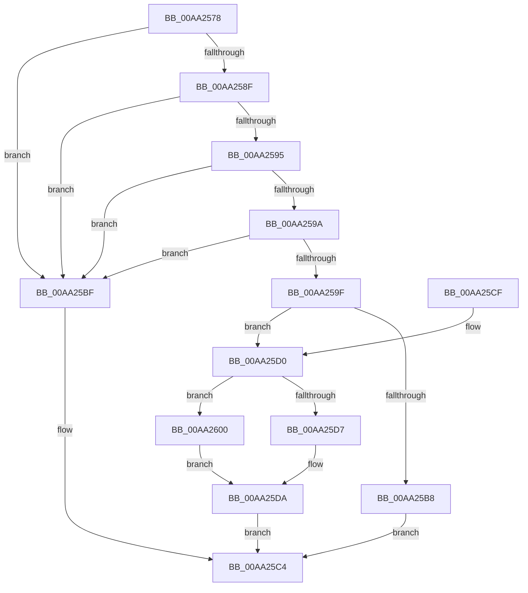

# EtwQueryTraceHandleByLoggerName

- RVA: `0x00AA2578`–`0x00AA2607` (길이 `143` bytes)
- VA: `0x0000000140AA2578`
- 실행 섹션: `PAGE`
- PDB 이름 있음: `예`; PDB Function 태그: `아니요`
- unwind 정보 RVA: `0x00062E24`
- 디코드: `43`개 명령, `143/143` bytes 표시
- 미해석 바이트: `0` (있으면 어셈블리에 `.byte`로 보존)

> 이 문서는 커널 이미지의 기계어와 PDB 기호를 분석해 생성했습니다. 4번과 5번은 함수 원형과 자료형을 바이너리 사용 방식에서 추정한 C 해석이며 원본 소스 복구 결과는 아닙니다.

## 1. Dependencies

- 직접 호출 지점: **3**; 고유 호출 대상: **3**
- 직접 호출자로 확인된 함수: **2**
- RIP 상대 이미지 참조: **0**

### Outgoing calls
- `0x00AA259F` → [PsGetCurrentServerSiloGlobals](../../text/2F/PsGetCurrentServerSiloGlobals_function_002FE1F0.md) (function, `0x002FE1F0`)
- `0x00AA25AE` → [EtwpAcquireLoggerContextByLoggerName](../93/EtwpAcquireLoggerContextByLoggerName_function_0093283C.md) (function, `0x0093283C`)
- `0x00AA25F7` → [ExReleaseRundownProtectionCacheAwareEx](../../text/25/ExReleaseRundownProtectionCacheAwareEx_function_0025F050.md) (function, `0x0025F050`)

### Direct callers
- [WmiQueryTraceInformation](../7B/WmiQueryTraceInformation_function_007B9370.md) at `0x007B9752`
- [IopErrorLogConnectSession](../A5/IopErrorLogConnectSession_function_00A5E3E0.md) at `0x00A5E41A`

### Static image references
- 디코드된 RIP-relative 메모리 참조가 없습니다.

## 2. Other-region calls and transfers

- 다른 실행 섹션으로 향하는 call: **2**
  - `0x00AA259F` → [PsGetCurrentServerSiloGlobals](../../text/2F/PsGetCurrentServerSiloGlobals_function_002FE1F0.md) (`PAGE` → `.text`)
  - `0x00AA25F7` → [ExReleaseRundownProtectionCacheAwareEx](../../text/25/ExReleaseRundownProtectionCacheAwareEx_function_0025F050.md) (`PAGE` → `.text`)
- 별도 외부 분기/꼬리 이동을 확인하지 못했습니다.

## 3. Assembly (complete function range)

```asm
00AA2578  48 89 5C 24 08                  mov qword ptr [rsp + 8], rbx
00AA257D  57                              push rdi
00AA257E  48 83 EC 20                     sub rsp, 0x20
00AA2582  33 FF                           xor edi, edi
00AA2584  48 8B DA                        mov rbx, rdx
00AA2587  48 8B D1                        mov rdx, rcx
00AA258A  48 85 C9                        test rcx, rcx
00AA258D  74 30                           je 0x140aa25bf
00AA258F  48 39 79 08                     cmp qword ptr [rcx + 8], rdi
00AA2593  74 2A                           je 0x140aa25bf
00AA2595  66 39 39                        cmp word ptr [rcx], di
00AA2598  74 25                           je 0x140aa25bf
00AA259A  48 85 DB                        test rbx, rbx
00AA259D  74 20                           je 0x140aa25bf
00AA259F  E8 4C BC 85 FF                  call 0x1402fe1f0
00AA25A4  45 33 C0                        xor r8d, r8d
00AA25A7  48 8B 88 40 03 00 00            mov rcx, qword ptr [rax + 0x340]
00AA25AE  E8 89 02 E9 FF                  call 0x14093283c
00AA25B3  48 85 C0                        test rax, rax
00AA25B6  75 18                           jne 0x140aa25d0
00AA25B8  B8 96 02 00 C0                  mov eax, 0xc0000296
00AA25BD  EB 05                           jmp 0x140aa25c4
00AA25BF  B8 0D 00 00 C0                  mov eax, 0xc000000d
00AA25C4  48 8B 5C 24 30                  mov rbx, qword ptr [rsp + 0x30]
00AA25C9  48 83 C4 20                     add rsp, 0x20
00AA25CD  5F                              pop rdi
00AA25CE  C3                              ret
00AA25CF  CC                              int3
00AA25D0  48 89 3B                        mov qword ptr [rbx], rdi
00AA25D3  39 38                           cmp dword ptr [rax], edi
00AA25D5  74 29                           je 0x140aa2600
00AA25D7  0F B7 08                        movzx ecx, word ptr [rax]
00AA25DA  66 89 0B                        mov word ptr [rbx], cx
00AA25DD  BA 01 00 00 00                  mov edx, 1
00AA25E2  44 8B 00                        mov r8d, dword ptr [rax]
00AA25E5  48 8B 80 50 05 00 00            mov rax, qword ptr [rax + 0x550]
00AA25EC  48 8B 88 C0 02 00 00            mov rcx, qword ptr [rax + 0x2c0]
00AA25F3  4A 8B 0C C1                     mov rcx, qword ptr [rcx + r8*8]
00AA25F7  E8 54 CA 7B FF                  call 0x14025f050
00AA25FC  33 C0                           xor eax, eax
00AA25FE  EB C4                           jmp 0x140aa25c4
00AA2600  B9 FF FF 00 00                  mov ecx, 0xffff
00AA2605  EB D3                           jmp 0x140aa25da
```

## 4. C-style interpretation (structured pseudocode)

```c
__int64 __fastcall EtwQueryTraceHandleByLoggerName(__int64 a1, __int64 a2, int a3)
{
    __int64 result;
    __int64 v_rdi;
    __int64 v_rsp;
    unsigned __int64 v_stack_p8;

    v_stack_p8 = v_rbx;
    v_rsp = (v_rsp) - (32);
    v_rdi = 0;
    if (a1 == 0) goto loc_00AA25BF;
    if ((*(unsigned __int64 *)(a1 + 8)) == 0) goto loc_00AA25BF;
    if ((*(unsigned __int16 *)(a1)) == 0) goto loc_00AA25BF;
    if (a2 == 0) goto loc_00AA25BF;
    result = PsGetCurrentServerSiloGlobals(a1, a1, a3, a4);
    a3 = 0;
    result = EtwpAcquireLoggerContextByLoggerName(*(unsigned __int64 *)(result + 832), a1, a3, a4);
    if (result != 0) goto loc_00AA25D0;
    goto loc_00AA25C4;
loc_00AA25BF:
loc_00AA25C4:
    v_rsp = (v_rsp) + (32);
    return (unsigned int)(0xC000000DULL);
loc_00AA25D0:
    *(unsigned __int64 *)(v_stack_p8) = 0;
    if ((*(unsigned int *)((unsigned int)(0xC000000DULL))) == 0) goto loc_00AA2600;
loc_00AA25DA:
    *(unsigned __int16 *)(v_stack_p8) = (unsigned __int16)(*(unsigned __int16 *)((unsigned int)(0xC000000DULL)));
    result = ExReleaseRundownProtectionCacheAwareEx(*(unsigned __int64 *)(*(unsigned __int64 *)(*(unsigned __int64 *)((unsigned int)(0xC000000DULL) + 1360) + 704) + (unsigned int)(*(unsigned int *)((unsigned int)(0xC000000DULL))) * 8), 1, (unsigned int)(*(unsigned int *)((unsigned int)(0xC000000DULL))), a4);
    result = 0;
    goto loc_00AA25C4;
loc_00AA2600:
    goto loc_00AA25DA;
}
```

## 5. (Beta) C Style

```c
int64_t EtwQueryTraceHandleByLoggerName(int64_t Arg1, int64_t Arg2, int32_t Arg3)
{
    int64_t result;
    int64_t local_rdi;
    int64_t local_rsp;
    uint64_t v_stack_p8;

    v_stack_p8 = local_rbx;
    local_rsp = (local_rsp) - (32);
    local_rdi = 0;
    if (Arg1 == 0) goto loc_00AA25BF;
    if ((*(uint64_t *)(Arg1 + 0x8)) == 0) goto loc_00AA25BF;
    if ((*(uint16_t *)(Arg1)) == 0) goto loc_00AA25BF;
    if (Arg2 == 0) goto loc_00AA25BF;
    result = PsGetCurrentServerSiloGlobals(Arg1, Arg1, Arg3, a4);
    Arg3 = 0;
    result = EtwpAcquireLoggerContextByLoggerName(*(uint64_t *)(result + 0x340), Arg1, Arg3, a4);
    if (result != 0) goto loc_00AA25D0;
    goto loc_00AA25C4;
loc_00AA25BF:
loc_00AA25C4:
    local_rsp = (local_rsp) + (32);
    return (uint32_t)(0xC000000DULL);
loc_00AA25D0:
    *(uint64_t *)(v_stack_p8) = 0;
    if ((*(uint32_t *)((uint32_t)(0xC000000DULL))) == 0) goto loc_00AA2600;
loc_00AA25DA:
    *(uint16_t *)(v_stack_p8) = (uint16_t)(*(uint16_t *)((uint32_t)(0xC000000DULL)));
    result = ExReleaseRundownProtectionCacheAwareEx(*(uint64_t *)(*(uint64_t *)(*(uint64_t *)((uint32_t)(0xC000000DULL) + 0x550) + 0x2C0) + (uint32_t)(*(uint32_t *)((uint32_t)(0xC000000DULL))) * 8), 1, (uint32_t)(*(uint32_t *)((uint32_t)(0xC000000DULL))), a4);
    result = 0;
    goto loc_00AA25C4;
loc_00AA2600:
    goto loc_00AA25DA;
}
```

## 6. Execution-region graph

[열기: 2D/3D 그래프와 함수 탐색 컨트롤 패널](../../../control-panel.html?section=page&rva=0x00AA2578&view=graph)

- 2D 그래프는 위에서 아래로 흐르고, 3D 그래프는 빈 공간을 드래그해 회전합니다. Shift+드래그는 이동, 휠은 확대·축소, 함수 노드 선택은 대상 보고서 이동입니다.

### Static fallback


