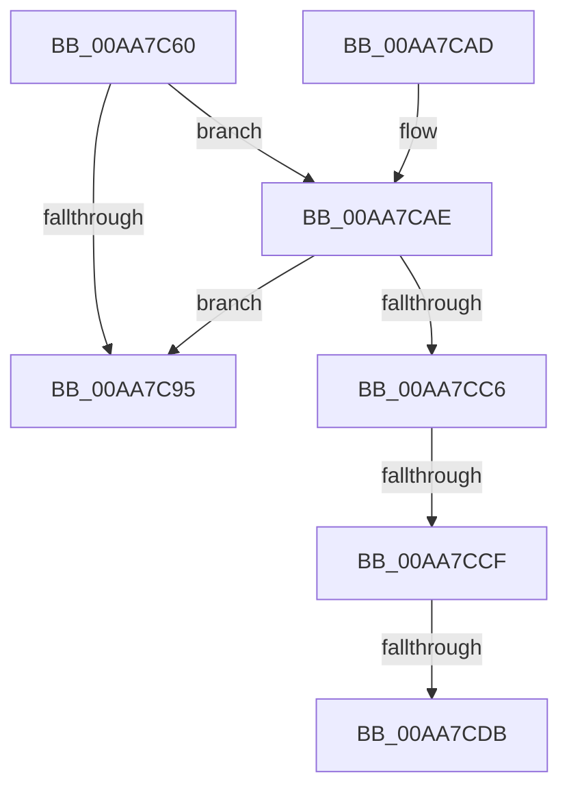

# EtwTiLogDriverObjectUnLoad

- RVA: `0x00AA7C60`–`0x00AA7CE9` (길이 `137` bytes)
- VA: `0x0000000140AA7C60`
- 실행 섹션: `PAGE`
- PDB 이름 있음: `예`; PDB Function 태그: `예`
- unwind 정보 RVA: `0x000BBAFC`
- 디코드: `36`개 명령, `137/137` bytes 표시
- 미해석 바이트: `0` (있으면 어셈블리에 `.byte`로 보존)

> 이 문서는 커널 이미지의 기계어와 PDB 기호를 분석해 생성했습니다. 4번과 5번은 함수 원형과 자료형을 바이너리 사용 방식에서 추정한 C 해석이며 원본 소스 복구 결과는 아닙니다.

## 1. Dependencies

- 직접 호출 지점: **3**; 고유 호출 대상: **3**
- 직접 호출자로 확인된 함수: **2**
- RIP 상대 이미지 참조: **3**

### Outgoing calls
- `0x00AA7C8A` → [EtwEventEnabled](../../text/39/EtwEventEnabled_function_00392450.md) (function, `0x00392450`)
- `0x00AA7C9D` → [_security_check_cookie](../../text/6A/_security_check_cookie_function_006AC640.md) (function, `0x006AC640`)
- `0x00AA7CBD` → [EtwProviderEnabled](../../text/3B/EtwProviderEnabled_function_003BA250.md) (function, `0x003BA250`)

### Direct callers
- [IoDeleteDriver](../71/IoDeleteDriver_function_0071D400.md) at `0x0071D40D`
- [IopUnloadDriver](../AB/IopUnloadDriver_function_00ABF868.md) at `0x00ABFC52`

### Static image references
- `0x00AA7C6A` → RVA `0x00E0A740` (`.data`; read)
- `0x00AA7C7C` → RVA `0x0001E070` (`.rdata`; read)
- `0x00AA7C83` → RVA `0x00EFFA30` (`.data`; read)

## 2. Other-region calls and transfers

- 다른 실행 섹션으로 향하는 call: **3**
  - `0x00AA7C8A` → [EtwEventEnabled](../../text/39/EtwEventEnabled_function_00392450.md) (`PAGE` → `.text`)
  - `0x00AA7C9D` → [_security_check_cookie](../../text/6A/_security_check_cookie_function_006AC640.md) (`PAGE` → `.text`)
  - `0x00AA7CBD` → [EtwProviderEnabled](../../text/3B/EtwProviderEnabled_function_003BA250.md) (`PAGE` → `.text`)
- call이 아닌 외부 분기/꼬리 이동: **3**
  - `0x00AA7CC9` → [sub_00B4A23E](../B4/Unknown_function_00B4A23E.md) (`tail-transfer`)
  - `0x00AA7CD5` → [sub_00B4A23E](../B4/Unknown_function_00B4A23E.md) (`tail-transfer`)
  - `0x00AA7CE4` → [sub_00B4A23E + 0xF](../B4/Unknown_function_00B4A23E.md) (`tail-transfer`)

## 3. Assembly (complete function range)

```asm
00AA7C60  48 89 5C 24 08                  mov qword ptr [rsp + 8], rbx
00AA7C65  57                              push rdi
00AA7C66  48 83 EC 60                     sub rsp, 0x60
00AA7C6A  48 8B 05 CF 2A 36 00            mov rax, qword ptr [rip + 0x362acf]
00AA7C71  48 33 C4                        xor rax, rsp
00AA7C74  48 89 44 24 58                  mov qword ptr [rsp + 0x58], rax
00AA7C79  48 8B D9                        mov rbx, rcx
00AA7C7C  48 8D 15 ED 63 57 FF            lea rdx, [rip - 0xa89c13]
00AA7C83  48 8B 0D A6 7D 45 00            mov rcx, qword ptr [rip + 0x457da6]
00AA7C8A  E8 C1 A7 8E FF                  call 0x140392450
00AA7C8F  33 FF                           xor edi, edi
00AA7C91  84 C0                           test al, al
00AA7C93  75 19                           jne 0x140aa7cae
00AA7C95  48 8B 4C 24 58                  mov rcx, qword ptr [rsp + 0x58]
00AA7C9A  48 33 CC                        xor rcx, rsp
00AA7C9D  E8 9E 49 C0 FF                  call 0x1406ac640
00AA7CA2  48 8B 5C 24 70                  mov rbx, qword ptr [rsp + 0x70]
00AA7CA7  48 83 C4 60                     add rsp, 0x60
00AA7CAB  5F                              pop rdi
00AA7CAC  C3                              ret
00AA7CAD  CC                              int3
00AA7CAE  48 8B 0D 7B 7D 45 00            mov rcx, qword ptr [rip + 0x457d7b]
00AA7CB5  33 D2                           xor edx, edx
00AA7CB7  41 B8 00 00 00 40               mov r8d, 0x40000000
00AA7CBD  E8 8E 25 91 FF                  call 0x1403ba250
00AA7CC2  84 C0                           test al, al
00AA7CC4  74 CF                           je 0x140aa7c95
00AA7CC6  48 85 DB                        test rbx, rbx
00AA7CC9  0F 84 6F 25 0A 00               je 0x140b4a23e
00AA7CCF  0F B7 03                        movzx eax, word ptr [rbx]
00AA7CD2  66 85 C0                        test ax, ax
00AA7CD5  0F 84 63 25 0A 00               je 0x140b4a23e
00AA7CDB  48 8B 53 08                     mov rdx, qword ptr [rbx + 8]
00AA7CDF  8B C8                           mov ecx, eax
00AA7CE1  66 D1 E8                        shr ax, 1
00AA7CE4  E9 64 25 0A 00                  jmp 0x140b4a24d
```

## 4. C-style interpretation (structured pseudocode)

```c
__int64 __fastcall EtwTiLogDriverObjectUnLoad(__int64 a1)
{
    __int64 result;
    __int64 v_rdi;
    __int64 v_rsp;
    unsigned __int64 v_stack_m10;
    unsigned __int64 v_stack_p8;

    v_stack_p8 = v_rbx;
    v_rsp = (v_rsp) - (96);
    result = (*(unsigned __int64 *)(v_rip + 3549903)) ^ (v_rsp);
    v_stack_m10 = result;
    result = EtwEventEnabled(*(unsigned __int64 *)(v_rip + 4554150), v_rip - 11050003, a3, a4);
    v_rdi = 0;
    if ((unsigned __int8)(result) != 0) goto loc_00AA7CAE;
loc_00AA7C95:
    a1 = (v_stack_m10) ^ (v_rsp);
    result = _security_check_cookie(a1, v_rip - 11050003, a3, a4);
    v_rsp = (v_rsp) + (96);
    return result;
loc_00AA7CAE:
    a2 = 0;
    result = EtwProviderEnabled(*(unsigned __int64 *)(v_rip + 4554107), a2, (unsigned int)(0x40000000ULL), a4);
    if ((unsigned __int8)(result) == 0) goto loc_00AA7C95;
    result = (unsigned __int16)((*(unsigned __int16 *)(v_stack_p8)) >> (1));
}
```

## 5. (Beta) C Style

```c
int64_t EtwTiLogDriverObjectUnLoad(int64_t Arg1)
{
    int64_t result;
    int64_t local_rdi;
    int64_t local_rsp;
    uint64_t v_stack_m10;
    uint64_t v_stack_p8;

    v_stack_p8 = local_rbx;
    local_rsp = (local_rsp) - (96);
    result = (*(uint64_t *)(v_rip + 0x362ACF)) ^ (local_rsp);
    v_stack_m10 = result;
    result = EtwEventEnabled(*(uint64_t *)(v_rip + 0x457DA6), v_rip - 11050003, a3, a4);
    local_rdi = 0;
    if ((uint8_t)(result) != 0) goto loc_00AA7CAE;
loc_00AA7C95:
    Arg1 = (v_stack_m10) ^ (local_rsp);
    result = _security_check_cookie(Arg1, v_rip - 11050003, a3, a4);
    local_rsp = (local_rsp) + (96);
    return result;
loc_00AA7CAE:
    a2 = 0;
    result = EtwProviderEnabled(*(uint64_t *)(v_rip + 0x457D7B), a2, (uint32_t)(0x40000000ULL), a4);
    if ((uint8_t)(result) == 0) goto loc_00AA7C95;
    result = (uint16_t)((*(uint16_t *)(v_stack_p8)) >> (1));
}
```

## 6. Execution-region graph

[열기: 2D/3D 그래프와 함수 탐색 컨트롤 패널](../../../control-panel.html?section=page&rva=0x00AA7C60&view=graph)

- 2D 그래프는 위에서 아래로 흐르고, 3D 그래프는 빈 공간을 드래그해 회전합니다. Shift+드래그는 이동, 휠은 확대·축소, 함수 노드 선택은 대상 보고서 이동입니다.

### Static fallback


