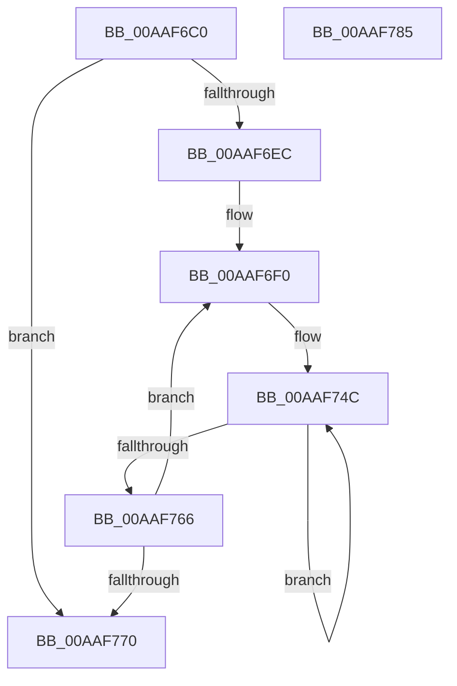

# EtwpCovSampCaptureFlushStats

- RVA: `0x00AAF6C0`–`0x00AAF786` (길이 `198` bytes)
- VA: `0x0000000140AAF6C0`
- 실행 섹션: `PAGE`
- PDB 이름 있음: `예`; PDB Function 태그: `아니요`
- unwind 정보 RVA: `0x0006C8E8`
- 디코드: `51`개 명령, `198/198` bytes 표시
- 미해석 바이트: `0` (있으면 어셈블리에 `.byte`로 보존)

> 이 문서는 커널 이미지의 기계어와 PDB 기호를 분석해 생성했습니다. 4번과 5번은 함수 원형과 자료형을 바이너리 사용 방식에서 추정한 C 해석이며 원본 소스 복구 결과는 아닙니다.

## 1. Dependencies

- 직접 호출 지점: **1**; 고유 호출 대상: **1**
- 직접 호출자로 확인된 함수: **1**
- RIP 상대 이미지 참조: **1**

### Outgoing calls
- `0x00AAF6DF` → [KeQueryMaximumProcessorCountEx](../../text/26/KeQueryMaximumProcessorCountEx_function_00264D60.md) (function, `0x00264D60`)

### Direct callers
- [EtwpCoverageSamplerQuery](../95/EtwpCoverageSamplerQuery_function_0095C4A0.md) at `0x0095CFD2`

### Static image references
- `0x00AAF6FA` → RVA `0x00EFA278` (`.data`; read)

## 2. Other-region calls and transfers

- 다른 실행 섹션으로 향하는 call: **1**
  - `0x00AAF6DF` → [KeQueryMaximumProcessorCountEx](../../text/26/KeQueryMaximumProcessorCountEx_function_00264D60.md) (`PAGE` → `.text`)
- 별도 외부 분기/꼬리 이동을 확인하지 못했습니다.

## 3. Assembly (complete function range)

```asm
00AAF6C0  48 89 5C 24 10                  mov qword ptr [rsp + 0x10], rbx
00AAF6C5  48 89 6C 24 18                  mov qword ptr [rsp + 0x18], rbp
00AAF6CA  48 89 74 24 20                  mov qword ptr [rsp + 0x20], rsi
00AAF6CF  57                              push rdi
00AAF6D0  48 83 EC 20                     sub rsp, 0x20
00AAF6D4  48 8B E9                        mov rbp, rcx
00AAF6D7  48 8B F2                        mov rsi, rdx
00AAF6DA  B9 FF FF 00 00                  mov ecx, 0xffff
00AAF6DF  E8 7C 56 7B FF                  call 0x140264d60
00AAF6E4  85 C0                           test eax, eax
00AAF6E6  0F 84 84 00 00 00               je 0x140aaf770
00AAF6EC  33 DB                           xor ebx, ebx
00AAF6EE  8B F8                           mov edi, eax
00AAF6F0  48 8B 45 08                     mov rax, qword ptr [rbp + 8]
00AAF6F4  41 B9 01 00 00 00               mov r9d, 1
00AAF6FA  48 8B 15 77 AB 44 00            mov rdx, qword ptr [rip + 0x44ab77]
00AAF701  44 8B D8                        mov r11d, eax
00AAF704  41 C1 EB 0D                     shr r11d, 0xd
00AAF708  41 81 E3 FF FF 03 00            and r11d, 0x3ffff
00AAF70F  48 C1 E8 04                     shr rax, 4
00AAF713  41 0F BD CB                     bsr ecx, r11d
00AAF717  4C 8B 04 13                     mov r8, qword ptr [rbx + rdx]
00AAF71B  25 FF 01 00 00                  and eax, 0x1ff
00AAF720  41 D3 E1                        shl r9d, cl
00AAF723  4D 33 CB                        xor r9, r11
00AAF726  89 4C 24 30                     mov dword ptr [rsp + 0x30], ecx
00AAF72A  44 8D 51 FE                     lea r10d, [rcx - 2]
00AAF72E  4B 8B 0C D0                     mov rcx, qword ptr [r8 + r10*8]
00AAF732  4C 8D 04 C5 0F 00 00 00         lea r8, [rax*8 + 0xf]
00AAF73A  4E 03 44 C9 08                  add r8, qword ptr [rcx + r9*8 + 8]
00AAF73F  48 8B CE                        mov rcx, rsi
00AAF742  49 83 E0 F0                     and r8, 0xfffffffffffffff0
00AAF746  33 D2                           xor edx, edx
00AAF748  44 8D 4A 08                     lea r9d, [rdx + 8]
00AAF74C  33 C0                           xor eax, eax
00AAF74E  42 87 84 02 30 01 00 00         xchg dword ptr [rdx + r8 + 0x130], eax
00AAF756  01 01                           add dword ptr [rcx], eax
00AAF758  48 8D 52 04                     lea rdx, [rdx + 4]
00AAF75C  48 8D 49 04                     lea rcx, [rcx + 4]
00AAF760  49 83 E9 01                     sub r9, 1
00AAF764  75 E6                           jne 0x140aaf74c
00AAF766  48 83 C3 08                     add rbx, 8
00AAF76A  48 83 EF 01                     sub rdi, 1
00AAF76E  75 80                           jne 0x140aaf6f0
00AAF770  48 8B 5C 24 38                  mov rbx, qword ptr [rsp + 0x38]
00AAF775  48 8B 6C 24 40                  mov rbp, qword ptr [rsp + 0x40]
00AAF77A  48 8B 74 24 48                  mov rsi, qword ptr [rsp + 0x48]
00AAF77F  48 83 C4 20                     add rsp, 0x20
00AAF783  5F                              pop rdi
00AAF784  C3                              ret
00AAF785  CC                              int3
```

## 4. C-style interpretation (structured pseudocode)

```c
__int64 __fastcall EtwpCovSampCaptureFlushStats(__int64 a1, __int64 a2)
{
    __int64 result;
    __int64 v_r11;
    __int64 v_rbx;
    __int64 v_rdi;
    __int64 v_rsp;
    unsigned __int64 v_stack_p10;
    unsigned __int64 v_stack_p18;
    unsigned __int64 v_stack_p20;
    unsigned int v_stack_p8;

    v_stack_p10 = v_rbx;
    v_stack_p18 = v_rbp;
    v_stack_p20 = v_rsi;
    v_rsp = (v_rsp) - (32);
    result = KeQueryMaximumProcessorCountEx((unsigned int)(0xFFFFULL), a2, a3, a4);
    if ((unsigned int)(result) == 0) goto loc_00AAF770;
    v_rbx = 0;
loc_00AAF6F0:
    v_r11 = (unsigned int)(((unsigned int)((unsigned int)(*(unsigned __int64 *)(a1 + 8)))) >> (13));
    v_r11 = (unsigned int)((v_r11) & (0x3FFFFULL));
    result = (*(unsigned __int64 *)(a1 + 8)) >> (4);
    result = (unsigned int)((result) & (511));
    a4 = (unsigned int)((1) << ((unsigned __int8)((unsigned int)(0xFFFFULL))));
    a4 = (a4) ^ (v_r11);
    v_stack_p8 = (unsigned int)((unsigned int)(0xFFFFULL));
    a3 = (result * 8 + 15) + (*(unsigned __int64 *)(*(unsigned __int64 *)(*(unsigned __int64 *)(v_rbx + *(unsigned __int64 *)(v_rip + 4500343) * 1) + (unsigned int)(0xFFFFULL) - 2 * 8) + a4 * 8 + 8));
    a3 = (a3) & (-16);
    a2 = 0;
loc_00AAF74C:
    result = 0;
    a4 = (a2 + 8) - (1);
    if (condition_is_not_equal) goto loc_00AAF74C;
    v_rbx = (v_rbx) + (8);
    v_rdi = ((unsigned int)((unsigned int)(result))) - (1);
    if (condition_is_not_equal) goto loc_00AAF6F0;
loc_00AAF770:
    v_rsp = (v_rsp) + (32);
    return result;
}
```

## 5. (Beta) C Style

```c
int64_t EtwpCovSampCaptureFlushStats(void *Arg1, void *Arg2)
{
    uint8_t *arg1 = (uint8_t *)Arg1;
    uint8_t *arg2 = (uint8_t *)Arg2;

    int64_t result;
    int64_t local_r11;
    int64_t local_rbx;
    int64_t local_rdi;
    int64_t local_rsp;
    uint64_t v_stack_p10;
    uint64_t v_stack_p18;
    uint64_t v_stack_p20;
    uint32_t v_stack_p8;

    v_stack_p10 = local_rbx;
    v_stack_p18 = local_rbp;
    v_stack_p20 = local_rsi;
    local_rsp = (local_rsp) - (32);
    result = KeQueryMaximumProcessorCountEx((uint32_t)(0xFFFFULL), Arg2, a3, a4);
    if ((uint32_t)(result) == 0) goto loc_00AAF770;
    local_rbx = 0;
loc_00AAF6F0:
    local_r11 = (uint32_t)(((uint32_t)((uint32_t)(*(uint64_t *)(arg1 + 0x8)))) >> (13));
    local_r11 = (uint32_t)((local_r11) & (0x3FFFFULL));
    result = (*(uint64_t *)(arg1 + 0x8)) >> (4);
    result = (uint32_t)((result) & (511));
    a4 = (uint32_t)((1) << ((uint8_t)((uint32_t)(0xFFFFULL))));
    a4 = (a4) ^ (local_r11);
    v_stack_p8 = (uint32_t)((uint32_t)(0xFFFFULL));
    a3 = (result * 8 + 15) + (*(uint64_t *)(*(uint64_t *)(*(uint64_t *)(local_rbx + *(uint64_t *)(v_rip + 0x44AB77) * 1) + (uint32_t)(0xFFFFULL) - 0x2 * 8) + a4 * 8 + 0x8));
    a3 = (a3) & (-16);
    Arg2 = 0;
loc_00AAF74C:
    result = 0;
    a4 = (Arg2 + 8) - (1);
    if (condition_is_not_equal) goto loc_00AAF74C;
    local_rbx = (local_rbx) + (8);
    local_rdi = ((uint32_t)((uint32_t)(result))) - (1);
    if (condition_is_not_equal) goto loc_00AAF6F0;
loc_00AAF770:
    local_rsp = (local_rsp) + (32);
    return result;
}
```

### 관측된 메모리 오프셋

구조체 형식이 확인되지 않은 접근은 인자 기준의 오프셋으로만 기록했습니다.

| 기준 인자 | 오프셋 표현 | 폭 (bit) | 접근 |
|---|---:|---:|---|
| `Arg1` | `+ 0x8` | `64` | `R` |
| `Arg2` | `+ 0x0` | `32` | `R/W` |
| `Arg2` | `+ 0x4` | `64` | `R` |

## 6. Execution-region graph

[열기: 2D/3D 그래프와 함수 탐색 컨트롤 패널](../../../control-panel.html?section=page&rva=0x00AAF6C0&view=graph)

- 2D 그래프는 위에서 아래로 흐르고, 3D 그래프는 빈 공간을 드래그해 회전합니다. Shift+드래그는 이동, 휠은 확대·축소, 함수 노드 선택은 대상 보고서 이동입니다.

### Static fallback


