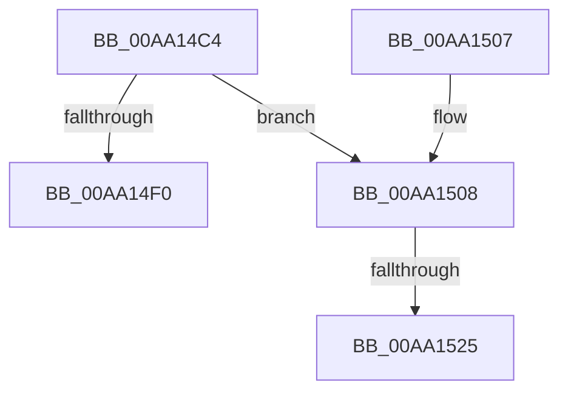

# EtwpCovSampStackHashCheck

- RVA: `0x00AA14C4`–`0x00AA1531` (길이 `109` bytes)
- VA: `0x0000000140AA14C4`
- 실행 섹션: `PAGE`
- PDB 이름 있음: `예`; PDB Function 태그: `예`
- unwind 정보 RVA: `0x000BAC5C`
- 디코드: `34`개 명령, `109/109` bytes 표시
- 미해석 바이트: `0` (있으면 어셈블리에 `.byte`로 보존)

> 이 문서는 커널 이미지의 기계어와 PDB 기호를 분석해 생성했습니다. 4번과 5번은 함수 원형과 자료형을 바이너리 사용 방식에서 추정한 C 해석이며 원본 소스 복구 결과는 아닙니다.

## 1. Dependencies

- 직접 호출 지점: **0**; 고유 호출 대상: **0**
- 직접 호출자로 확인된 함수: **1**
- RIP 상대 이미지 참조: **0**

### Outgoing calls
- 직접 디코드된 call 명령이 없습니다.

### Direct callers
- [EtwpCovSampSampleBufferProcess](../8D/EtwpCovSampSampleBufferProcess_function_008D96EC.md) at `0x008D9795`

### Static image references
- 디코드된 RIP-relative 메모리 참조가 없습니다.

## 2. Other-region calls and transfers

- 다른 실행 섹션으로 향하는 call: **0**
- call이 아닌 외부 분기/꼬리 이동: **2**
  - `0x00AA151F` → [sub_00B49312](../B4/Unknown_function_00B49312.md) (`tail-transfer`)
  - `0x00AA152C` → [sub_00B49312](../B4/Unknown_function_00B49312.md) (`tail-transfer`)

## 3. Assembly (complete function range)

```asm
00AA14C4  48 89 5C 24 18                  mov qword ptr [rsp + 0x18], rbx
00AA14C9  48 89 54 24 10                  mov qword ptr [rsp + 0x10], rdx
00AA14CE  55                              push rbp
00AA14CF  56                              push rsi
00AA14D0  57                              push rdi
00AA14D1  41 54                           push r12
00AA14D3  41 55                           push r13
00AA14D5  41 56                           push r14
00AA14D7  41 57                           push r15
00AA14D9  48 83 EC 20                     sub rsp, 0x20
00AA14DD  48 83 64 24 68 00               and qword ptr [rsp + 0x68], 0
00AA14E3  4C 8B F1                        mov r14, rcx
00AA14E6  48 83 B9 20 05 00 00 00         cmp qword ptr [rcx + 0x520], 0
00AA14EE  75 18                           jne 0x140aa1508
00AA14F0  33 C0                           xor eax, eax
00AA14F2  48 8B 5C 24 70                  mov rbx, qword ptr [rsp + 0x70]
00AA14F7  48 83 C4 20                     add rsp, 0x20
00AA14FB  41 5F                           pop r15
00AA14FD  41 5E                           pop r14
00AA14FF  41 5D                           pop r13
00AA1501  41 5C                           pop r12
00AA1503  5F                              pop rdi
00AA1504  5E                              pop rsi
00AA1505  5D                              pop rbp
00AA1506  C3                              ret
00AA1507  CC                              int3
00AA1508  48 8B A9 20 05 00 00            mov rbp, qword ptr [rcx + 0x520]
00AA150F  45 33 E4                        xor r12d, r12d
00AA1512  48 8B B1 28 05 00 00            mov rsi, qword ptr [rcx + 0x528]
00AA1519  45 33 ED                        xor r13d, r13d
00AA151C  48 3B EE                        cmp rbp, rsi
00AA151F  0F 85 ED 7D 0A 00               jne 0x140b49312
00AA1525  48 8B B1 30 05 00 00            mov rsi, qword ptr [rcx + 0x530]
00AA152C  E9 E1 7D 0A 00                  jmp 0x140b49312
```

## 4. C-style interpretation (structured pseudocode)

```c
__int64 __fastcall EtwpCovSampStackHashCheck(__int64 a1, __int64 a2)
{
    __int64 result;
    __int64 v_r12;
    __int64 v_r13;
    __int64 v_rsp;
    unsigned __int64 v_stack_p10;
    unsigned __int64 v_stack_p18;

    v_stack_p18 = v_rbx;
    v_stack_p10 = a2;
    v_rsp = (v_rsp) - (32);
    if ((*(unsigned __int64 *)(a1 + 1312)) != 0) goto loc_00AA1508;
    result = 0;
    v_rsp = (v_rsp) + (32);
    return result;
loc_00AA1508:
    v_r12 = 0;
    v_r13 = 0;
}
```

## 5. (Beta) C Style

```c
int64_t EtwpCovSampStackHashCheck(void *Arg1, int64_t Arg2)
{
    uint8_t *arg1 = (uint8_t *)Arg1;

    int64_t result;
    int64_t local_r12;
    int64_t local_r13;
    int64_t local_rsp;
    uint64_t v_stack_p10;
    uint64_t v_stack_p18;

    v_stack_p18 = local_rbx;
    v_stack_p10 = Arg2;
    local_rsp = (local_rsp) - (32);
    if ((*(uint64_t *)(arg1 + 0x520)) != 0) goto loc_00AA1508;
    result = 0;
    local_rsp = (local_rsp) + (32);
    return result;
loc_00AA1508:
    local_r12 = 0;
    local_r13 = 0;
}
```

### 관측된 메모리 오프셋

구조체 형식이 확인되지 않은 접근은 인자 기준의 오프셋으로만 기록했습니다.

| 기준 인자 | 오프셋 표현 | 폭 (bit) | 접근 |
|---|---:|---:|---|
| `Arg1` | `+ 0x520` | `64` | `R` |
| `Arg1` | `+ 0x528` | `64` | `R` |
| `Arg1` | `+ 0x530` | `64` | `R` |

## 6. Execution-region graph

[열기: 2D/3D 그래프와 함수 탐색 컨트롤 패널](../../../control-panel.html?section=page&rva=0x00AA14C4&view=graph)

- 2D 그래프는 위에서 아래로 흐르고, 3D 그래프는 빈 공간을 드래그해 회전합니다. Shift+드래그는 이동, 휠은 확대·축소, 함수 노드 선택은 대상 보고서 이동입니다.

### Static fallback


