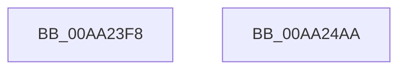

# EtwpEventWriteCaptureState

- RVA: `0x00AA23F8`–`0x00AA24AB` (길이 `179` bytes)
- VA: `0x0000000140AA23F8`
- 실행 섹션: `PAGE`
- PDB 이름 있음: `예`; PDB Function 태그: `아니요`
- unwind 정보 RVA: `0x0009EA9C`
- 디코드: `37`개 명령, `179/179` bytes 표시
- 미해석 바이트: `0` (있으면 어셈블리에 `.byte`로 보존)

> 이 문서는 커널 이미지의 기계어와 PDB 기호를 분석해 생성했습니다. 4번과 5번은 함수 원형과 자료형을 바이너리 사용 방식에서 추정한 C 해석이며 원본 소스 복구 결과는 아닙니다.

## 1. Dependencies

- 직접 호출 지점: **2**; 고유 호출 대상: **2**
- 직접 호출자로 확인된 함수: **1**
- RIP 상대 이미지 참조: **3**

### Outgoing calls
- `0x00AA2490` → [EtwWrite](../../text/41/EtwWrite_function_0041C720.md) (function, `0x0041C720`)
- `0x00AA249C` → [_security_check_cookie](../../text/6A/_security_check_cookie_function_006AC640.md) (function, `0x006AC640`)

### Direct callers
- [EtwpEnableGuid](../A5/EtwpEnableGuid_function_00A5CD28.md) at `0x00A5CE38`

### Static image references
- `0x00AA2406` → RVA `0x00E0A740` (`.data`; read)
- `0x00AA2414` → RVA `0x00EFF840` (`.data`; read)
- `0x00AA2458` → RVA `0x0001C7E0` (`.rdata`; read)

## 2. Other-region calls and transfers

- 다른 실행 섹션으로 향하는 call: **2**
  - `0x00AA2490` → [EtwWrite](../../text/41/EtwWrite_function_0041C720.md) (`PAGE` → `.text`)
  - `0x00AA249C` → [_security_check_cookie](../../text/6A/_security_check_cookie_function_006AC640.md) (`PAGE` → `.text`)
- 별도 외부 분기/꼬리 이동을 확인하지 못했습니다.

## 3. Assembly (complete function range)

```asm
00AA23F8  40 55                           push rbp
00AA23FA  48 8D 6C 24 A9                  lea rbp, [rsp - 0x57]
00AA23FF  48 81 EC A0 00 00 00            sub rsp, 0xa0
00AA2406  48 8B 05 33 83 36 00            mov rax, qword ptr [rip + 0x368333]
00AA240D  48 33 C4                        xor rax, rsp
00AA2410  48 89 45 47                     mov qword ptr [rbp + 0x47], rax
00AA2414  48 8B 0D 25 D4 45 00            mov rcx, qword ptr [rip + 0x45d425]
00AA241B  48 8D 42 06                     lea rax, [rdx + 6]
00AA241F  48 89 45 F7                     mov qword ptr [rbp - 9], rax
00AA2423  41 B9 06 00 00 00               mov r9d, 6
00AA2429  48 8D 42 10                     lea rax, [rdx + 0x10]
00AA242D  4C 89 45 E7                     mov qword ptr [rbp - 0x19], r8
00AA2431  48 89 45 07                     mov qword ptr [rbp + 7], rax
00AA2435  45 33 C0                        xor r8d, r8d
00AA2438  48 8D 42 18                     lea rax, [rdx + 0x18]
00AA243C  48 C7 45 EF 10 00 00 00         mov qword ptr [rbp - 0x11], 0x10
00AA2444  48 89 45 17                     mov qword ptr [rbp + 0x17], rax
00AA2448  48 8D 42 04                     lea rax, [rdx + 4]
00AA244C  48 89 45 27                     mov qword ptr [rbp + 0x27], rax
00AA2450  48 8D 42 08                     lea rax, [rdx + 8]
00AA2454  48 89 45 37                     mov qword ptr [rbp + 0x37], rax
00AA2458  48 8D 15 81 A3 57 FF            lea rdx, [rip - 0xa85c7f]
00AA245F  48 8D 45 E7                     lea rax, [rbp - 0x19]
00AA2463  48 C7 45 FF 02 00 00 00         mov qword ptr [rbp - 1], 2
00AA246B  48 89 44 24 20                  mov qword ptr [rsp + 0x20], rax
00AA2470  48 C7 45 0F 08 00 00 00         mov qword ptr [rbp + 0xf], 8
00AA2478  48 C7 45 1F 08 00 00 00         mov qword ptr [rbp + 0x1f], 8
00AA2480  48 C7 45 2F 01 00 00 00         mov qword ptr [rbp + 0x2f], 1
00AA2488  48 C7 45 3F 04 00 00 00         mov qword ptr [rbp + 0x3f], 4
00AA2490  E8 8B A2 97 FF                  call 0x14041c720
00AA2495  48 8B 4D 47                     mov rcx, qword ptr [rbp + 0x47]
00AA2499  48 33 CC                        xor rcx, rsp
00AA249C  E8 9F A1 C0 FF                  call 0x1406ac640
00AA24A1  48 81 C4 A0 00 00 00            add rsp, 0xa0
00AA24A8  5D                              pop rbp
00AA24A9  C3                              ret
00AA24AA  CC                              int3
```

## 4. C-style interpretation (structured pseudocode)

```c
__int64 __fastcall EtwpEventWriteCaptureState(__int64 a1, __int64 a2, __int64 a3)
{
    __int64 result;
    __int64 v_rsp;
    unsigned __int64 v_stack_m18;
    unsigned __int64 v_stack_m20;
    unsigned __int64 v_stack_m28;
    unsigned __int64 v_stack_m30;
    unsigned __int64 v_stack_m38;
    unsigned __int64 v_stack_m40;
    unsigned __int64 v_stack_m48;
    unsigned __int64 v_stack_m50;
    unsigned __int64 v_stack_m58;
    unsigned __int64 v_stack_m5F;
    unsigned __int64 v_stack_m60;
    unsigned __int64 v_stack_m68;
    unsigned __int64 v_stack_m70;
    unsigned __int64 v_stack_m78;
    unsigned __int64 v_stack_m88;

    v_rsp = (v_rsp) - (160);
    result = (*(unsigned __int64 *)(v_rip + 3572531)) ^ (v_rsp);
    v_stack_m18 = result;
    v_stack_m68 = a2 + 6;
    v_stack_m78 = a3;
    v_stack_m58 = a2 + 16;
    a3 = 0;
    v_stack_m70 = 16;
    v_stack_m48 = a2 + 24;
    v_stack_m38 = a2 + 4;
    v_stack_m28 = a2 + 8;
    v_stack_m60 = 2;
    v_stack_m88 = v_stack_m78;
    v_stack_m50 = 8;
    v_stack_m40 = 8;
    v_stack_m30 = 1;
    v_stack_m20 = 4;
    result = EtwWrite(*(unsigned __int64 *)(v_rip + 4576293), v_rip - 11033727, a3, 6);
    a1 = (v_stack_m18) ^ (v_rsp);
    result = _security_check_cookie(a1, v_rip - 11033727, a3, 6);
    v_rsp = (v_rsp) + (160);
    return result;
}
```

## 5. (Beta) C Style

```c
int64_t EtwpEventWriteCaptureState(int64_t Arg1, void *Arg2, int64_t Arg3)
{
    uint8_t *arg2 = (uint8_t *)Arg2;

    int64_t result;
    int64_t local_rsp;
    uint64_t v_stack_m18;
    uint64_t v_stack_m20;
    uint64_t v_stack_m28;
    uint64_t v_stack_m30;
    uint64_t v_stack_m38;
    uint64_t v_stack_m40;
    uint64_t v_stack_m48;
    uint64_t v_stack_m50;
    uint64_t v_stack_m58;
    uint64_t v_stack_m5F;
    uint64_t v_stack_m60;
    uint64_t v_stack_m68;
    uint64_t v_stack_m70;
    uint64_t v_stack_m78;
    uint64_t v_stack_m88;

    local_rsp = (local_rsp) - (160);
    result = (*(uint64_t *)(v_rip + 0x368333)) ^ (local_rsp);
    v_stack_m18 = result;
    v_stack_m68 = Arg2 + 6;
    v_stack_m78 = Arg3;
    v_stack_m58 = Arg2 + 16;
    Arg3 = 0;
    v_stack_m70 = 16;
    v_stack_m48 = Arg2 + 24;
    v_stack_m38 = Arg2 + 4;
    v_stack_m28 = Arg2 + 8;
    v_stack_m60 = 2;
    v_stack_m88 = v_stack_m78;
    v_stack_m50 = 8;
    v_stack_m40 = 8;
    v_stack_m30 = 1;
    v_stack_m20 = 4;
    result = EtwWrite(*(uint64_t *)(v_rip + 0x45D425), v_rip - 11033727, Arg3, 6);
    Arg1 = (v_stack_m18) ^ (local_rsp);
    result = _security_check_cookie(Arg1, v_rip - 11033727, Arg3, 6);
    local_rsp = (local_rsp) + (160);
    return result;
}
```

### 관측된 메모리 오프셋

구조체 형식이 확인되지 않은 접근은 인자 기준의 오프셋으로만 기록했습니다.

| 기준 인자 | 오프셋 표현 | 폭 (bit) | 접근 |
|---|---:|---:|---|
| `Arg2` | `+ 0x4` | `64` | `R` |
| `Arg2` | `+ 0x6` | `64` | `R` |
| `Arg2` | `+ 0x8` | `64` | `R` |
| `Arg2` | `+ 0x10` | `64` | `R` |
| `Arg2` | `+ 0x18` | `64` | `R` |

## 6. Execution-region graph

[열기: 2D/3D 그래프와 함수 탐색 컨트롤 패널](../../../control-panel.html?section=page&rva=0x00AA23F8&view=graph)

- 2D 그래프는 위에서 아래로 흐르고, 3D 그래프는 빈 공간을 드래그해 회전합니다. Shift+드래그는 이동, 휠은 확대·축소, 함수 노드 선택은 대상 보고서 이동입니다.

### Static fallback


