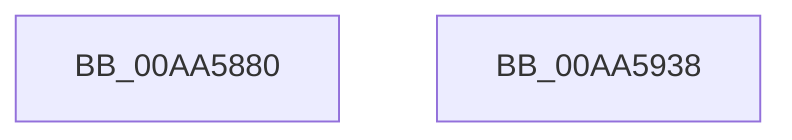

# EtwpEventWriteTemplateAdmin

- RVA: `0x00AA5880`–`0x00AA5939` (길이 `185` bytes)
- VA: `0x0000000140AA5880`
- 실행 섹션: `PAGE`
- PDB 이름 있음: `예`; PDB Function 태그: `아니요`
- unwind 정보 RVA: `0x0009EA9C`
- 디코드: `42`개 명령, `185/185` bytes 표시
- 미해석 바이트: `0` (있으면 어셈블리에 `.byte`로 보존)

> 이 문서는 커널 이미지의 기계어와 PDB 기호를 분석해 생성했습니다. 4번과 5번은 함수 원형과 자료형을 바이너리 사용 방식에서 추정한 C 해석이며 원본 소스 복구 결과는 아닙니다.

## 1. Dependencies

- 직접 호출 지점: **2**; 고유 호출 대상: **2**
- 직접 호출자로 확인된 함수: **6**
- RIP 상대 이미지 참조: **3**

### Outgoing calls
- `0x00AA591E` → [EtwWrite](../../text/41/EtwWrite_function_0041C720.md) (function, `0x0041C720`)
- `0x00AA592A` → [_security_check_cookie](../../text/6A/_security_check_cookie_function_006AC640.md) (function, `0x006AC640`)

### Direct callers
- [EtwpUpdateSelectedGroupMasks](../../text/49/EtwpUpdateSelectedGroupMasks_function_0049B114.md) at `0x0049B4A1`
- [EtwpFlushBufferToLogfile](../9B/EtwpFlushBufferToLogfile_function_009BFC08.md) at `0x009BFE16`
- [EtwpRealtimeSaveBuffer](../9B/EtwpRealtimeSaveBuffer_function_009BFF48.md) at `0x009C00D2`
- [EtwpCreateLogFile](../9C/EtwpCreateLogFile_function_009C035C.md) at `0x009C0631`
- [EtwpStartLogger](../A9/EtwpStartLogger_function_00A99D80.md) at `0x00A9A070`
- [sub_00B2E9EA](../B2/Unknown_function_00B2E9EA.md) at `0x00B2EA31`

### Static image references
- `0x00AA588E` → RVA `0x00E0A740` (`.data`; read)
- `0x00AA58B2` → RVA `0x000105E0` (`.rdata`; read)
- `0x00AA58C7` → RVA `0x00EFF840` (`.data`; read)

## 2. Other-region calls and transfers

- 다른 실행 섹션으로 향하는 call: **2**
  - `0x00AA591E` → [EtwWrite](../../text/41/EtwWrite_function_0041C720.md) (`PAGE` → `.text`)
  - `0x00AA592A` → [_security_check_cookie](../../text/6A/_security_check_cookie_function_006AC640.md) (`PAGE` → `.text`)
- 별도 외부 분기/꼬리 이동을 확인하지 못했습니다.

## 3. Assembly (complete function range)

```asm
00AA5880  40 55                           push rbp
00AA5882  48 8D 6C 24 C1                  lea rbp, [rsp - 0x3f]
00AA5887  48 81 EC A0 00 00 00            sub rsp, 0xa0
00AA588E  48 8B 05 AB 4E 36 00            mov rax, qword ptr [rip + 0x364eab]
00AA5895  48 33 C4                        xor rax, rsp
00AA5898  48 89 45 2F                     mov qword ptr [rbp + 0x2f], rax
00AA589C  49 8B 41 08                     mov rax, qword ptr [r9 + 8]
00AA58A0  45 33 D2                        xor r10d, r10d
00AA58A3  48 8B 4D 6F                     mov rcx, qword ptr [rbp + 0x6f]
00AA58A7  45 33 C0                        xor r8d, r8d
00AA58AA  48 89 45 CF                     mov qword ptr [rbp - 0x31], rax
00AA58AE  41 0F B7 01                     movzx eax, word ptr [r9]
00AA58B2  4C 8D 0D 27 AD 56 FF            lea r9, [rip - 0xa952d9]
00AA58B9  89 45 D7                        mov dword ptr [rbp - 0x29], eax
00AA58BC  48 8B 41 08                     mov rax, qword ptr [rcx + 8]
00AA58C0  48 89 45 EF                     mov qword ptr [rbp - 0x11], rax
00AA58C4  0F B7 01                        movzx eax, word ptr [rcx]
00AA58C7  48 8B 0D 72 9F 45 00            mov rcx, qword ptr [rip + 0x459f72]
00AA58CE  89 45 F7                        mov dword ptr [rbp - 9], eax
00AA58D1  48 8D 45 77                     lea rax, [rbp + 0x77]
00AA58D5  48 89 45 0F                     mov qword ptr [rbp + 0xf], rax
00AA58D9  48 8D 45 7F                     lea rax, [rbp + 0x7f]
00AA58DD  48 89 45 1F                     mov qword ptr [rbp + 0x1f], rax
00AA58E1  48 8D 45 CF                     lea rax, [rbp - 0x31]
00AA58E5  4C 89 4D DF                     mov qword ptr [rbp - 0x21], r9
00AA58E9  4C 89 4D FF                     mov qword ptr [rbp - 1], r9
00AA58ED  45 8D 4A 06                     lea r9d, [r10 + 6]
00AA58F1  48 89 44 24 20                  mov qword ptr [rsp + 0x20], rax
00AA58F6  44 89 55 DB                     mov dword ptr [rbp - 0x25], r10d
00AA58FA  48 C7 45 E7 02 00 00 00         mov qword ptr [rbp - 0x19], 2
00AA5902  44 89 55 FB                     mov dword ptr [rbp - 5], r10d
00AA5906  48 C7 45 07 02 00 00 00         mov qword ptr [rbp + 7], 2
00AA590E  48 C7 45 17 04 00 00 00         mov qword ptr [rbp + 0x17], 4
00AA5916  48 C7 45 27 04 00 00 00         mov qword ptr [rbp + 0x27], 4
00AA591E  E8 FD 6D 97 FF                  call 0x14041c720
00AA5923  48 8B 4D 2F                     mov rcx, qword ptr [rbp + 0x2f]
00AA5927  48 33 CC                        xor rcx, rsp
00AA592A  E8 11 6D C0 FF                  call 0x1406ac640
00AA592F  48 81 C4 A0 00 00 00            add rsp, 0xa0
00AA5936  5D                              pop rbp
00AA5937  C3                              ret
00AA5938  CC                              int3
```

## 4. C-style interpretation (structured pseudocode)

```c
__int64 __fastcall EtwpEventWriteTemplateAdmin(__int64 a1, __int64 a2, int a3, __int64 a4, __int64 a5, __int64 a6, __int64 a7)
{
    __int64 result;
    __int64 v_r10;
    __int64 v_rsp;
    unsigned __int64 v_stack_m18;
    unsigned __int64 v_stack_m20;
    unsigned __int64 v_stack_m28;
    unsigned __int64 v_stack_m30;
    unsigned __int64 v_stack_m38;
    unsigned __int64 v_stack_m40;
    unsigned __int64 v_stack_m47;
    unsigned __int64 v_stack_m48;
    unsigned int v_stack_m4C;
    unsigned int v_stack_m50;
    unsigned __int64 v_stack_m58;
    unsigned __int64 v_stack_m60;
    unsigned __int64 v_stack_m68;
    unsigned int v_stack_m6C;
    unsigned int v_stack_m70;
    unsigned __int64 v_stack_m78;
    unsigned __int64 v_stack_m88;

    v_rsp = (v_rsp) - (160);
    result = (*(unsigned __int64 *)(v_rip + 3559083)) ^ (v_rsp);
    v_stack_m18 = result;
    v_r10 = 0;
    a3 = 0;
    v_stack_m78 = *(unsigned __int64 *)(a4 + 8);
    v_stack_m70 = (unsigned int)(*(unsigned __int16 *)(a4));
    v_stack_m58 = *(unsigned __int64 *)(a5 + 8);
    v_stack_m50 = (unsigned int)(*(unsigned __int16 *)(a5));
    v_stack_m38 = a6;
    v_stack_m28 = a7;
    v_stack_m68 = v_rip - 11096793;
    v_stack_m48 = v_rip - 11096793;
    v_stack_m88 = v_stack_m78;
    v_stack_m6C = 0;
    v_stack_m60 = 2;
    v_stack_m4C = 0;
    v_stack_m40 = 2;
    v_stack_m30 = 4;
    v_stack_m20 = 4;
    result = EtwWrite(*(unsigned __int64 *)(v_rip + 4562802), a2, a3, v_r10 + 6);
    a1 = (v_stack_m18) ^ (v_rsp);
    result = _security_check_cookie(a1, a2, a3, v_r10 + 6);
    v_rsp = (v_rsp) + (160);
    return result;
}
```

## 5. (Beta) C Style

```c
int64_t EtwpEventWriteTemplateAdmin(int64_t Arg1, int64_t Arg2, int32_t Arg3, void *Arg4, void *Arg5, int64_t Arg6, int64_t Arg7)
{
    uint8_t *arg4 = (uint8_t *)Arg4;
    uint8_t *arg5 = (uint8_t *)Arg5;

    int64_t result;
    int64_t local_r10;
    int64_t local_rsp;
    uint64_t v_stack_m18;
    uint64_t v_stack_m20;
    uint64_t v_stack_m28;
    uint64_t v_stack_m30;
    uint64_t v_stack_m38;
    uint64_t v_stack_m40;
    uint64_t v_stack_m47;
    uint64_t v_stack_m48;
    uint32_t v_stack_m4C;
    uint32_t v_stack_m50;
    uint64_t v_stack_m58;
    uint64_t v_stack_m60;
    uint64_t v_stack_m68;
    uint32_t v_stack_m6C;
    uint32_t v_stack_m70;
    uint64_t v_stack_m78;
    uint64_t v_stack_m88;

    local_rsp = (local_rsp) - (160);
    result = (*(uint64_t *)(v_rip + 0x364EAB)) ^ (local_rsp);
    v_stack_m18 = result;
    local_r10 = 0;
    Arg3 = 0;
    v_stack_m78 = *(uint64_t *)(arg4 + 0x8);
    v_stack_m70 = (uint32_t)(*(uint16_t *)(arg4));
    v_stack_m58 = *(uint64_t *)(arg5 + 0x8);
    v_stack_m50 = (uint32_t)(*(uint16_t *)(arg5));
    v_stack_m38 = Arg6;
    v_stack_m28 = Arg7;
    v_stack_m68 = v_rip - 11096793;
    v_stack_m48 = v_rip - 11096793;
    v_stack_m88 = v_stack_m78;
    v_stack_m6C = 0;
    v_stack_m60 = 2;
    v_stack_m4C = 0;
    v_stack_m40 = 2;
    v_stack_m30 = 4;
    v_stack_m20 = 4;
    result = EtwWrite(*(uint64_t *)(v_rip + 0x459F72), Arg2, Arg3, local_r10 + 6);
    Arg1 = (v_stack_m18) ^ (local_rsp);
    result = _security_check_cookie(Arg1, Arg2, Arg3, local_r10 + 6);
    local_rsp = (local_rsp) + (160);
    return result;
}
```

### 관측된 메모리 오프셋

구조체 형식이 확인되지 않은 접근은 인자 기준의 오프셋으로만 기록했습니다.

| 기준 인자 | 오프셋 표현 | 폭 (bit) | 접근 |
|---|---:|---:|---|
| `Arg4` | `+ 0x0` | `16` | `R` |
| `Arg4` | `+ 0x8` | `64` | `R` |
| `Arg5` | `+ 0x0` | `16` | `R` |
| `Arg5` | `+ 0x8` | `64` | `R` |

## 6. Execution-region graph

[열기: 2D/3D 그래프와 함수 탐색 컨트롤 패널](../../../control-panel.html?section=page&rva=0x00AA5880&view=graph)

- 2D 그래프는 위에서 아래로 흐르고, 3D 그래프는 빈 공간을 드래그해 회전합니다. Shift+드래그는 이동, 휠은 확대·축소, 함수 노드 선택은 대상 보고서 이동입니다.

### Static fallback


